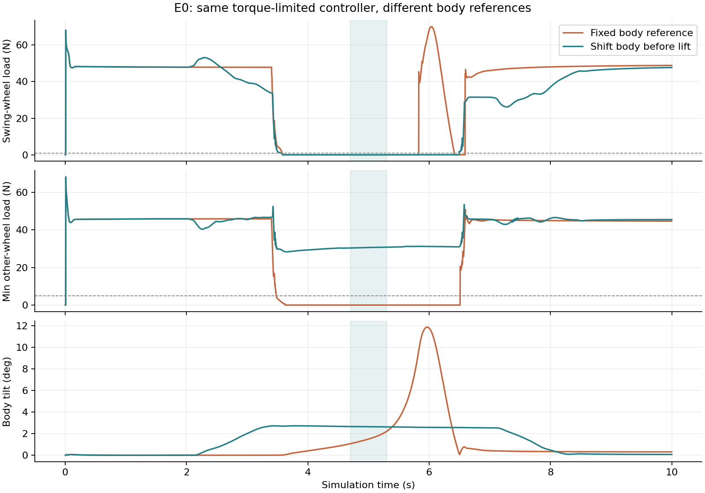
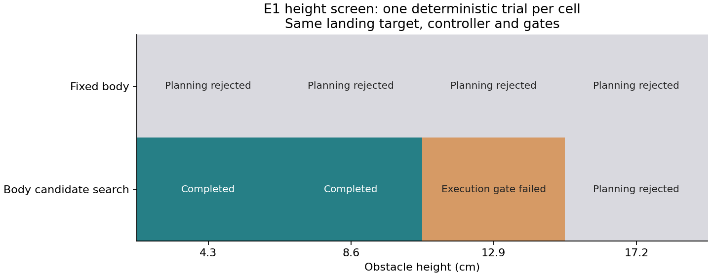
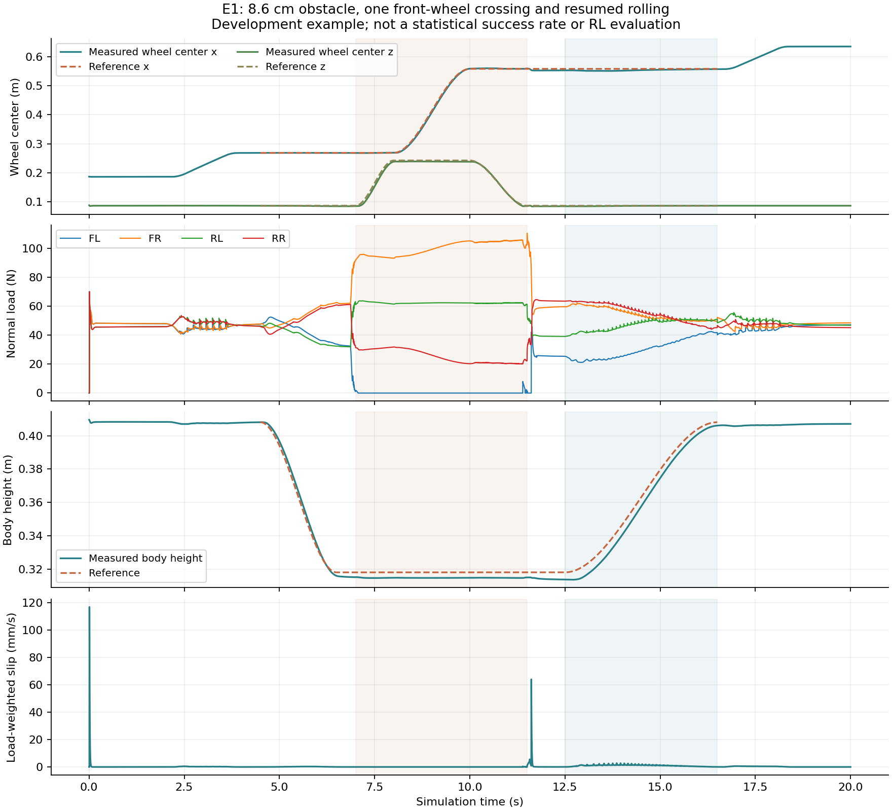
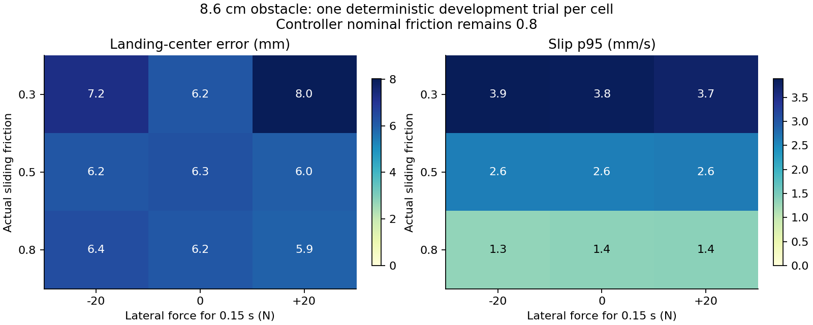
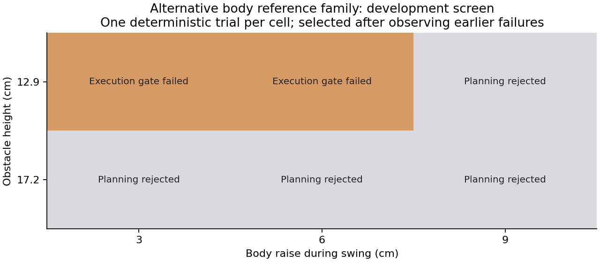
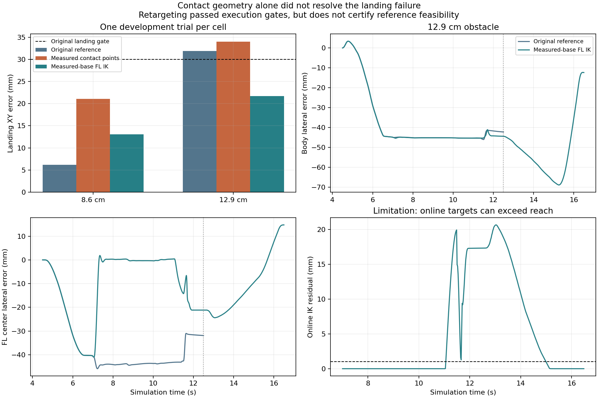

# Go2W E0 / E1 本机实验记录

开始日期：2026-10-21；本次推进与整理：2026-10-22（Asia/Shanghai）。本目录接续研究分支的 [E0–E7 实验流程](../../rolling_stepping_experiment_protocol.md)。

**整套实验完成状态、最新搜索失败原因及接续操作见 [PROGRESS.md](../../PROGRESS.md)。本目录中的局部结果不表示 E0–E7 已完成。**

**已经从简化点足检查推进到完整 Go2W 模型的执行器驱动物理仿真。当前可审阅的结果是低速、停车后单前轮跨障的诊断原型；E0 只完成了一部分，尚未训练 RL。**

## 当前结果与证据

| 检查 | 实际结果 | 边界 |
|---|---|---|
| E0 静止承载、正反滚动、升降 ±3 cm、俯仰 8° | 已通过电机力矩驱动和物理积分执行，保存状态、接触力与驱动量 | 使用公开模型参数；未标定真实硬件的转矩—转速曲线 |
| E0 单腿抬落 | 相同控制器下，提前移动机身后摆动轮完全卸载，其余三轮在保持段持续承载；实际抬高约 5.3 cm。保持原机身参考时丢失一个支撑轮 | 一种低速单腿动作，不是完整步态 |
| E0 固定四轮中心的机身姿态扫描 | 1,197 个候选中 891 个通过关节限制、IK 和本模型碰撞筛选 | 采样运动学可行域，不是稳定工作空间，也不证明搜索完备 |
| E0 差速转向尝试 | 0.3 rad/s 命令最终只转约 4.3°，未达到预设转向门槛 | 仍需要轮足转向/腿姿态协调；不能宣布 E0 全部通过 |
| E1 4.3 cm / 8.6 cm 障碍 | 候选机身偏移 + IK 参考 + 接触反馈控制完成接近、跨越、恢复承载、其他轮追上和恢复滚动。落地平面轮心误差分别约 6.24 / 6.15 mm | 每个高度仅一个确定性开发案例；障碍仅影响左前轮通行带 |
| E1 固定机身参考 | 四个高度均被 IK / 关节限制检查拒绝，样本保留 | 只说明该固定参考和动作集合失败；不等于所有固定机身方案不可行 |
| E1 原控制器的 12.9 cm / 17.2 cm | 前者落地误差约 31.9 mm，超过事先采用的 30 mm 门槛；后者规划拒绝 | 不放宽门槛，也不删除失败样本 |
| E1 步长敏感性 | 4.3 cm 案例从 2 ms 改为 1 ms 后仍通过，落地误差约 6.11 mm | 只是代表性步长检查 |
| E1 摩擦/横推筛查 | 8.6 cm 障碍的 9 个开发案例均通过原执行门槛：实际摩擦 0.3/0.5/0.8 × 横向力 −20/0/+20 N，持续 0.15 s；落地误差约 5.9–8.0 mm | 控制器仍按名义摩擦 0.8 分配力；每格一次，不作为泛化成功率 |
| E1 实测机身姿态下更新摆动腿 IK | 12.9 cm 名义案例、1 ms 步长和两组低摩擦横推均通过原执行门槛，落地误差 21.7–24.8 mm；全部通过独立碰撞检查 | 改变了控制器；在线目标仍有不可达残差，不能据此宣称联合规划全部可行 |

[逐案例完整摘要](published/trial_summaries.json)、[便于筛选的表格](published/trial_table.csv)、[模型/依赖/代码校验值](published/provenance.json)。






[8.6 cm 实际积分状态的视频](published/e1_h086/searched_shift.mp4)及[关键帧](published/e1_h086/searched_shift_montage.png)。视频由保存的物理状态回放渲染；执行实验只在初始化时设置仿真状态，随后通过电机力矩和 `mj_step` 推进。

## 采用了什么测试对象

- Unitree 官方 [unitree_mujoco](https://github.com/unitreerobotics/unitree_mujoco)，固定提交 `1eb6642e3f3fdfb7fb13a9794fd6a2dd93ea0e7d`，模型 `unitree_robots/go2w/go2w.xml`。
- 模型总质量约 19.1264 kg、轮半径约 0.086 m、12 个腿电机和 4 个轮电机。腿关节限制和力矩上限沿用 MJCF。硬件传动、热限制和转矩—转速曲线没有额外验证。
- 原模型每轮有两份重叠的可碰撞网格。本目录保留原模型的配对试跑结果；后续实验将第一份设为仅显示，第二份保留原六维摩擦接触。这是显式模型变体，不代表官方参数已经完成硬件标定。
- 本机 MuJoCo 3.8.0、Python 3.10.20、NumPy 1.26.4、SciPy 1.15.2。物理积分使用 CPU；视频使用本机 EGL 渲染。已有 Isaac Sim 5.1 的简化几何复验见仓库 `local_validation_20261021/`。
- 控制器是关节 PD、近静态接触力分配、机身反馈和轮心纵向反馈的诊断实现。它不是已经训练完成的 DTC，也不是完整的约束 MPC/WBC。力分配后的摩擦投影存在剩余动力学误差。

## 沿失败原因做了哪些改变

1. 简单 PD 下，规划抬腿并不代表实际离地；加入重力补偿和支撑力分配后，才形成真实单腿承载转换。
2. 固定机身及最初的预设偏移被关节限制拒绝；随后在 48 个机身候选中筛选，保持相同障碍与落地目标。4.3 / 8.6 cm 最后选择机身侧移 −7 cm、降低 9 cm 的候选。
3. 只有力分配时，落地横向误差约 4 cm；增加机身反馈后降到约 1.1 cm，但追上阶段前轮向后滑回障碍边缘。加入支撑轮世界位置反馈后完成接续，并将落地误差降低到约 6 mm。
4. 对 12.9 cm 失败，分别测试更高机身增益、较低摆腿余隙和摆腿期间抬高机身。增益提高到 100 时出现失稳，其余方案仍未通过原门槛。所有 5 个控制/余隙筛查案例与 6 个机身参考筛查案例均保留，固定通过标准。



## 继续实验：区分接触几何与参考跟踪

新增 [误差分解](published/landing_diagnosis.json) 对已保存状态做离线正运动学检查：先替换机身实际位姿，再替换实际关节角，形成可精确相加的误差分解。这是运动学分解，不是动力学因果证明。12.9 cm 失败案例在 12.5 s 的左前轮横向误差约 −31.90 mm，其中机身位姿项约 −34.08 mm、关节项约 +2.18 mm；机身本身横向偏离参考约 −42.21 mm。

两组对照据此进行，使用同一落地区域与原执行门槛：

- **真实接触位置参与力分配：** 用仿真接触力加权接触位置替代“轮心减去轮半径”的近似。这使用仿真真值接触信息。8.6 cm 落地误差从 6.15 增到 21.05 mm；12.9 cm 从 31.91 增到 34.02 mm，仍失败。接触点替换本身没有解决问题。
- **根据实测机身姿态更新摆动腿 IK：** 每 20 ms 重算左前腿参考，其他腿保留原控制；卸载摆动时跟踪三维轮心，重新承载与追上阶段保持当前轮心高度、修正平面位置。12.9 cm 名义案例误差降到 21.68 mm，完成后续滚动；1 ms 步长为 22.16 mm，摩擦 0.3、±20 N 横推两例分别为 24.80 / 23.84 mm。[四例验证记录](published/retarget_validation.json)包含状态完整性与独立 SAT 结果，最小分离下界约 7.46 mm。

该在线 IK 方法仍有明确缺陷：名义例约 41.5% 的更新残差超过 1 mm，峰值 20.64 mm；低摩擦例峰值约 25.9 mm。求解器只输出关节限制内的近似目标，物理执行通过并不等于每个在线目标都可达。名义例机身最大倾斜约 5.02°，95 分位滑移约 4.37 mm/s；低摩擦两例滑移约 15.8–16.0 mm/s。8.6 cm 的落地误差也从原来的 6.15 mm 增到 13.05 mm，因此没有将此版本当作所有高度的默认替代。



[12.9 cm 新控制器的完整轨迹](published/e1_h129_retarget/)与[视频](published/e1_h129_retarget/searched_shift.mp4)均保留；原失败案例也继续保留。此处比较了不同控制器，不能作为“相同低层下规划算法优越性”的结论。

进一步尝试在下降阶段把机身侧移从 −13 cm 收回至 −7 cm，原控制与在线 IK 两种设置均被**规划碰撞检查拒绝**。其参考 IK 最大误差仅约 0.00018 mm，但左前小腿在约 11.14 s 开始进入障碍，最深约 13.64 mm。因此，单独收回侧移会换来小腿碰撞，不能因为轮心轨迹可达就执行。[被拒绝的参考与完整记录](published/e1_h129_lateral_return_rejected/)已保存；这两例只执行了共同接近阶段，其实际轨迹通过几何检查不代表被拒绝参考安全。

## 独立检查与通过标准

执行中记录实际离地、重新承载和恢复滚动事件。恢复前检查摆动轮已离地、四轮重新承载、机身倾斜和落地平面误差；同时保留规划拒绝、碰撞、失稳和门槛失败。开发门槛包括：落地轮心误差 ≤3 cm，摆腿检查段另外三轮各承载 >5 N 的占比 >95%，摆动轮卸载占比 >95%，随后稳定滚动速度 >0.04 m/s，无 >1 N 禁止接触，关节越界 <0.005 rad，驱动饱和占比 <1%。这些是当前低速原型的开发条件。

`validate_geometry.py` 对 MuJoCo 距离查询的早期检查发现：个别查询返回零距离，但返回的两个见证点明显分离，因此该检查不被用来认证安全。后续使用独立的 `validate_geometry_sat.py`：直接读取所有已积分姿态，用分离轴检查盒体与轮网格的凸包；圆柱采用外包 24 边棱柱，球体使用解析距离。

4.3 cm 案例的 10,000 个物理状态均通过，机器人到障碍的分离距离下界至少约 17.8 mm；8.6 cm 案例至少约 5.53 mm。1 ms 案例的 20,000 个状态也通过。此处的数值是保守的投影分离下界，不是精确欧氏净空；它只覆盖模型已有的碰撞形状及保存的物理时刻，不提供步间连续碰撞保证。碰撞几何没有覆盖到的视觉细节也不在此结论内。

9 个摩擦/横推案例也逐一完成独立 SAT 检查，每个检查 10,000 个物理状态，均无潜在重叠；最小分离下界约 5.526 mm。[逐案例几何结果](published/robustness_geometry_summary.json)保留了最接近的部件和时刻。

`test_geometry_sat.py` 用解析可核对的分离、接触、重叠、旋转盒体和球体检查几何实现；`check_recorded_trials.py` 检查完整状态尺寸、时间步、四元数、力矩上限及注入冲量。

## 复现

从本目录运行。先使用 Python 3.10 环境安装依赖，再获取固定模型版本：

```bash
python -m pip install -r requirements.txt
bash bootstrap_model.sh
```

模型默认放到仓库根的 `.deps/`。也可设置 `GO2W_MODEL_XML` 指向同一固定版本的 `go2w.xml`。保存的场景 XML 含原始路径；渲染与验证入口会通过 `load_recorded_model` 重定位到本地模型资产，不依赖原机器目录。

```bash
export OPENBLAS_NUM_THREADS=1
export MPLCONFIGDIR=/tmp/go2-mpl-cache
export XDG_CACHE_HOME=/tmp/go2-cache

# E0 运动学与物理诊断
python workspace_scan.py
python run_e0.py --controller gravity --trials stand roll_0.1 roll_0.2 roll_0.4 roll_-0.2 height_0.03 height_-0.03 pitch_8 lift_naive lift_shift turn_0.3 --out formal_gravity
python run_e0.py --controller gravity --dt 0.001 --trials stand roll_0.2 lift_shift --out sensitivity_dt001

# E1 高度、控制、替代参考和扰动筛查
python sweep_e1.py
python screen_failure.py
python sweep_body_reference.py
python sweep_robustness.py
python e1_local.py --methods searched_shift --feedback --wheel-feedback --dt 0.001 --out e1_dt001
python diagnose_landing.py
python sweep_contact_points.py
python sweep_retarget.py
python validate_retarget.py
python sweep_landing_reference.py
python plot_retarget.py

# 独立验证
python test_geometry_sat.py
python check_recorded_trials.py
python validate_geometry_sat.py published/e1_h086
python validate_robustness.py
```

本机已安装的 `/home/jiang/miniconda3/envs/nero/bin/python` 可直接运行，无需修改既有环境。开发原始 CSV、NPZ、场景和日志保留在各输出目录；GitHub 交付 `published/` 中的完整逐案例摘要、代表性成功/失败的每步状态、压缩遥测、图和视频。摘要不能替代原始状态，主要案例两者均提供。

## 下一步推进依据

最新已尝试在下降阶段联合枚举机身前移/侧移/升高与支撑轮前移：144 个候选及扩大支撑运动范围后的 192 个候选均被筛查拒绝。两组只有接近阶段的物理轨迹，没有新增成功跨障。[当前代码的精确重放检查](published/coupled_reproduction_checks.json)通过，完整原因与复现命令见根目录进度文件。

1. 继续修正落地阶段参考可达性：实测机身 IK 改善实际落点，但下降后仍有不可达目标；提前收回侧移又引入小腿碰撞。同步调整机身与支撑轮的有限候选搜索也未找到解。下一项应允许更早的支撑准备、分阶段移动、机身俯仰或不同阶段时长，并同时筛选整条腿扫掠。
2. 增加接触前瞻或预备换足动作，检查 17.2 cm 失败是否来自现有动作集合缺失；不能把一次候选搜索失败解释为物理不可行。
3. 在同一模型、控制器和预算下补齐固定步序、工作空间启发式、停车换足的强对照，再加入顶棚与腿部侧障碍。当前固定机身对照较弱，不据此主张算法优越性。
4. 在局部动作及日志接口稳定后，建立参考条件化 RL 训练接口。E2–E7 的完整对照、重建地图、在线截止期和恢复能力仍未验证。

模型及衍生场景遵守 [Unitree BSD 3-Clause 许可](published/UNITREE_LICENSE.txt)。
