# FSGP-BGK CPU 方法复现结果

本报告由实际运行生成。使用论文 arXiv v2 公式 (1)–(11) 的 CPU 参考实现。
官方 hill/quick 点云已固定版本；flat/ramp/steps 为本地生成的诊断地形。
**这些 MAE 与耗时不能当作论文 Table I–III 的复现指标。** 官方未发布原始 2500 场景、
完整标签生成公式及批量评测程序；本实验也没有使用论文的 RTX 4060。

## 本次实测

| 场景 | M | 方法 | cost MAE ↓ | cost RMSE ↓ | 中位耗时 ms | 当前覆盖率 | 含历史覆盖率 |
|---|---:|---|---:|---:|---:|---:|---:|
| flat | 50 | SGP-XY | 0.035428 | 0.041219 | 9.73 | 97.7% | 97.7% |
| flat | 50 | FSGP | 0.030679 | 0.036629 | 10.51 | 98.2% | 98.2% |
| flat | 50 | FSGP-BGK | 0.031555 | 0.035249 | 12.49 | 98.2% | 99.8% |
| flat | 125 | SGP-XY | 0.048018 | 0.052780 | 13.05 | 100.0% | 100.0% |
| flat | 125 | FSGP | 0.046695 | 0.050239 | 14.10 | 100.0% | 100.0% |
| flat | 125 | FSGP-BGK | 0.047313 | 0.049665 | 16.15 | 100.0% | 100.0% |
| flat | 500 | SGP-XY | 0.026431 | 0.027431 | 63.83 | 100.0% | 100.0% |
| flat | 500 | FSGP | 0.025999 | 0.027126 | 63.10 | 100.0% | 100.0% |
| flat | 500 | FSGP-BGK | 0.025950 | 0.026585 | 65.22 | 100.0% | 100.0% |
| ramp | 50 | SGP-XY | 0.022600 | 0.031406 | 9.71 | 98.5% | 98.5% |
| ramp | 50 | FSGP | 0.023816 | 0.031481 | 9.92 | 98.1% | 98.1% |
| ramp | 50 | FSGP-BGK | 0.018655 | 0.025928 | 11.91 | 98.1% | 99.4% |
| ramp | 125 | SGP-XY | 0.021953 | 0.028988 | 13.17 | 100.0% | 100.0% |
| ramp | 125 | FSGP | 0.021498 | 0.028274 | 13.61 | 100.0% | 100.0% |
| ramp | 125 | FSGP-BGK | 0.022802 | 0.030300 | 15.63 | 100.0% | 100.0% |
| ramp | 500 | SGP-XY | 0.010488 | 0.013240 | 61.55 | 100.0% | 100.0% |
| ramp | 500 | FSGP | 0.010151 | 0.012604 | 60.76 | 100.0% | 100.0% |
| ramp | 500 | FSGP-BGK | 0.009921 | 0.012374 | 62.83 | 100.0% | 100.0% |
| steps | 50 | SGP-XY | 0.080568 | 0.110719 | 9.53 | 99.3% | 99.3% |
| steps | 50 | FSGP | 0.078119 | 0.105392 | 10.28 | 98.9% | 98.9% |
| steps | 50 | FSGP-BGK | 0.069886 | 0.086206 | 12.25 | 98.9% | 99.6% |
| steps | 125 | SGP-XY | 0.131120 | 0.188853 | 13.16 | 100.0% | 100.0% |
| steps | 125 | FSGP | 0.098362 | 0.146546 | 14.16 | 100.0% | 100.0% |
| steps | 125 | FSGP-BGK | 0.076778 | 0.101091 | 16.34 | 100.0% | 100.0% |
| steps | 500 | SGP-XY | 0.075423 | 0.116377 | 61.97 | 100.0% | 100.0% |
| steps | 500 | FSGP | 0.071769 | 0.111614 | 61.82 | 100.0% | 100.0% |
| steps | 500 | FSGP-BGK | 0.070696 | 0.109374 | 63.98 | 100.0% | 100.0% |
| hill | 50 | SGP-XY | 0.046714 | 0.069451 | 9.83 | 98.1% | 98.1% |
| hill | 50 | FSGP | 0.044115 | 0.069410 | 10.04 | 98.2% | 98.2% |
| hill | 50 | FSGP-BGK | 0.039203 | 0.058329 | 12.02 | 98.2% | 99.5% |
| hill | 125 | SGP-XY | 0.052932 | 0.074894 | 13.01 | 100.0% | 100.0% |
| hill | 125 | FSGP | 0.043500 | 0.065694 | 13.34 | 100.0% | 100.0% |
| hill | 125 | FSGP-BGK | 0.047636 | 0.066424 | 15.40 | 100.0% | 100.0% |
| hill | 500 | SGP-XY | 0.020812 | 0.028379 | 57.59 | 100.0% | 100.0% |
| hill | 500 | FSGP | 0.022683 | 0.030952 | 59.88 | 100.0% | 100.0% |
| hill | 500 | FSGP-BGK | 0.021640 | 0.028957 | 62.07 | 100.0% | 100.0% |
| quick | 50 | SGP-XY | 0.020753 | 0.028028 | 5.76 | 98.9% | 98.9% |
| quick | 50 | FSGP | 0.019479 | 0.026641 | 5.92 | 99.2% | 99.2% |
| quick | 50 | FSGP-BGK | 0.015696 | 0.021709 | 7.92 | 99.2% | 100.0% |
| quick | 125 | SGP-XY | 0.022417 | 0.029399 | 9.06 | 100.0% | 100.0% |
| quick | 125 | FSGP | 0.019239 | 0.025352 | 9.37 | 100.0% | 100.0% |
| quick | 125 | FSGP-BGK | 0.019905 | 0.025645 | 11.38 | 100.0% | 100.0% |
| quick | 500 | SGP-XY | 0.009095 | 0.011679 | 52.89 | 100.0% | 100.0% |
| quick | 500 | FSGP | 0.010132 | 0.013121 | 54.71 | 100.0% | 100.0% |
| quick | 500 | FSGP-BGK | 0.010755 | 0.014348 | 56.79 | 100.0% | 100.0% |

BGK 在 15 个场景/诱导点配置中有 9 个配置降低了相对 FSGP 的 MAE。
未强制调参以得到论文宣称的优势；不改善的结果同样保留。

## 图与证据

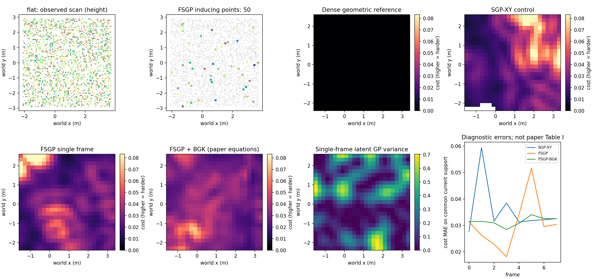
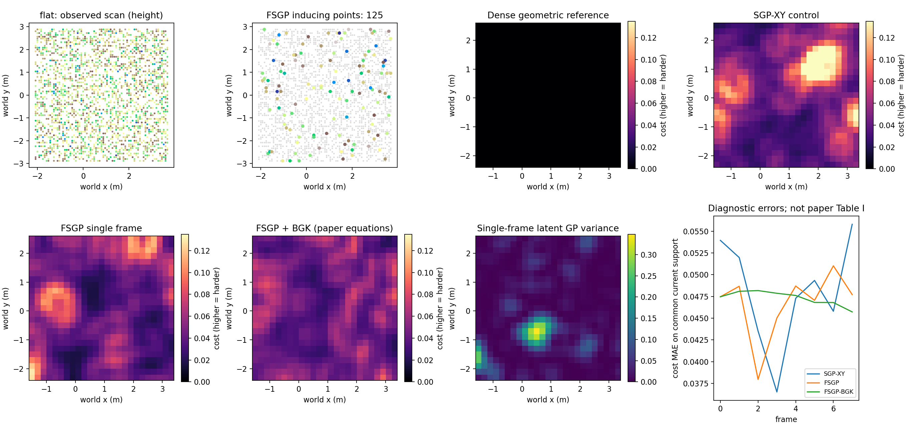
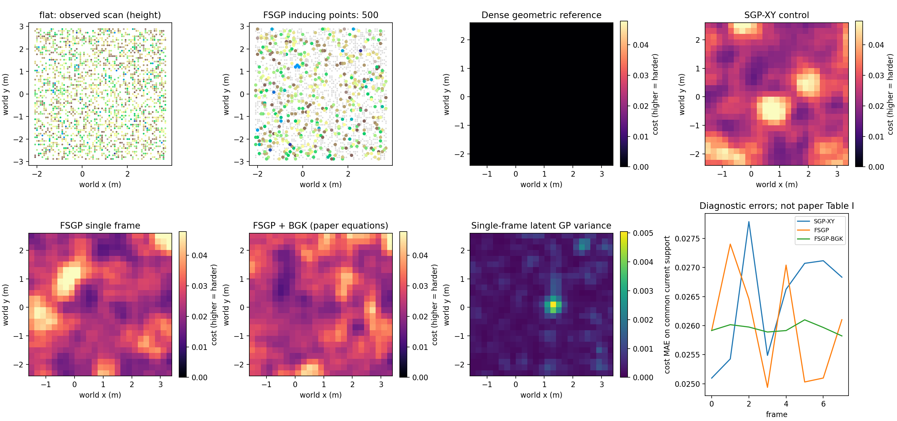
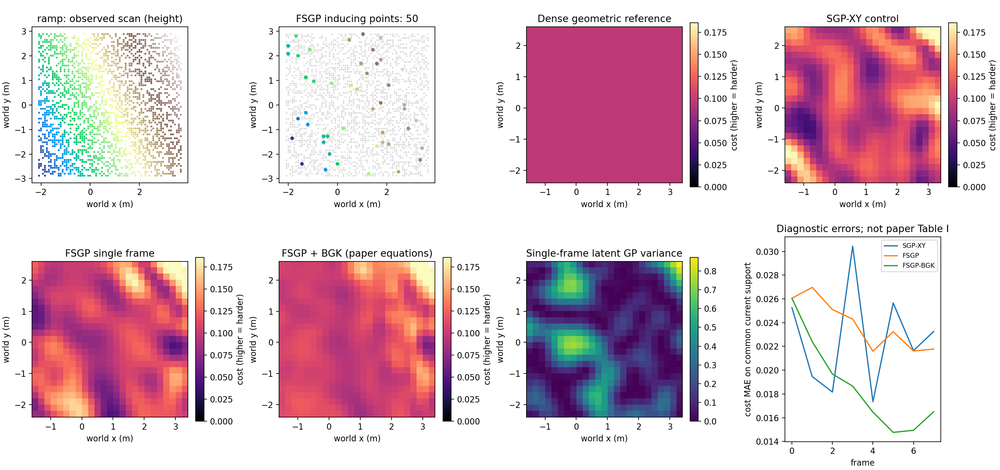
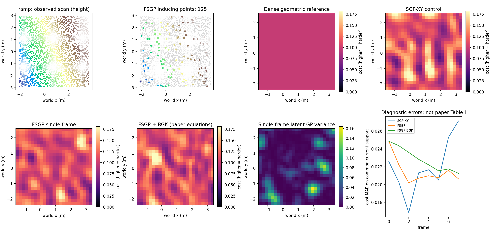
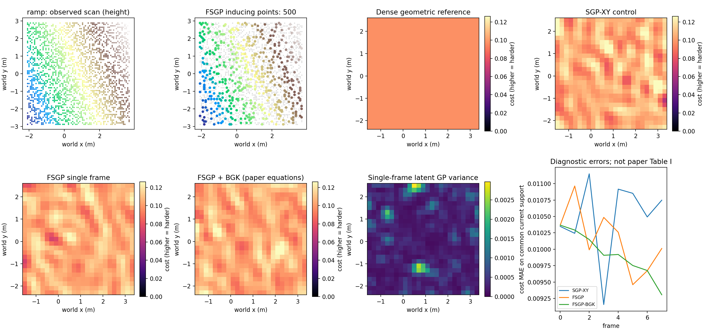
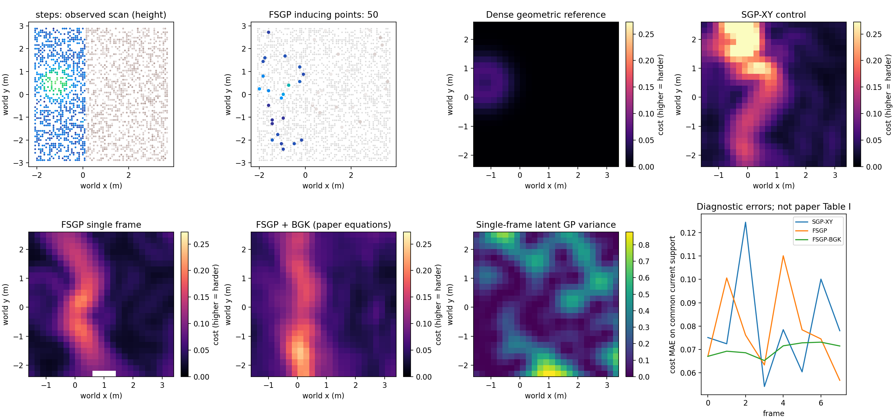
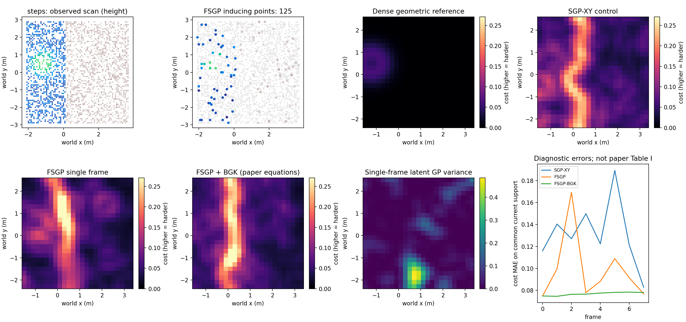
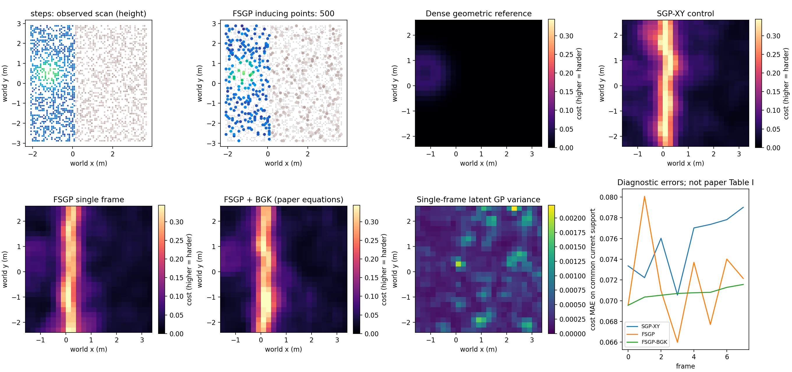
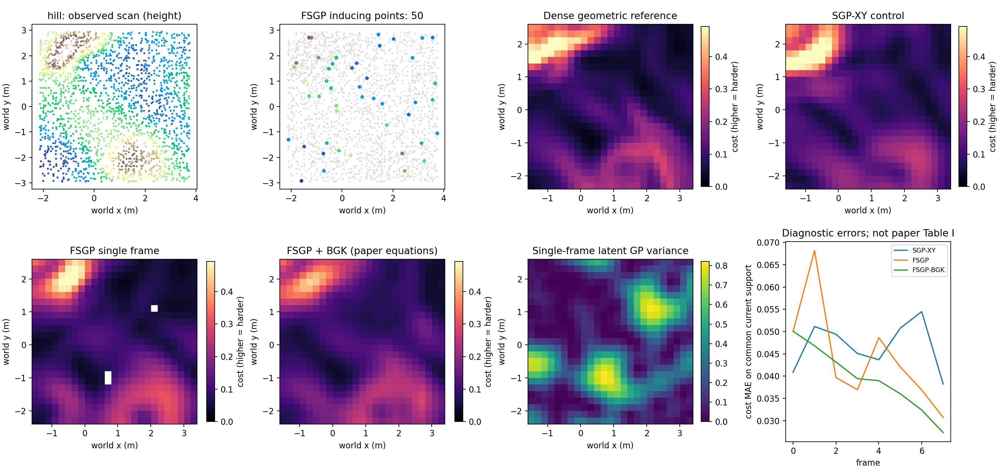
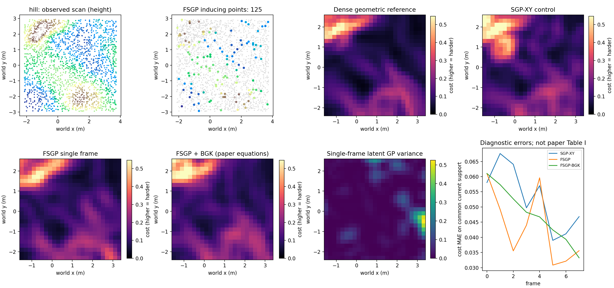
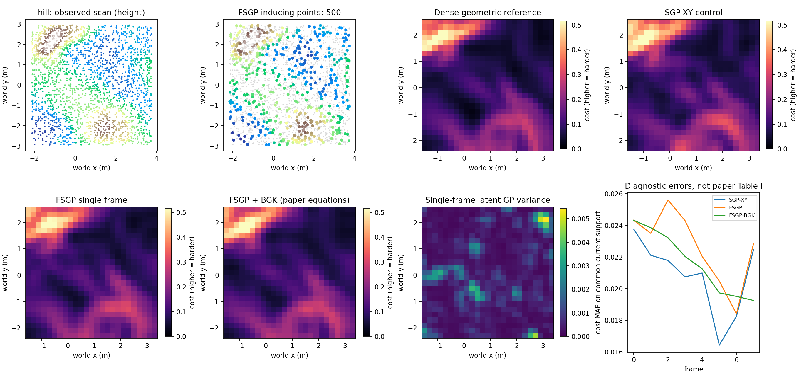
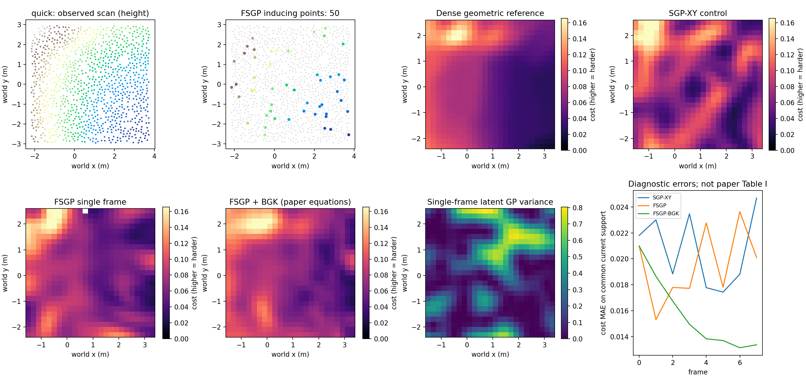
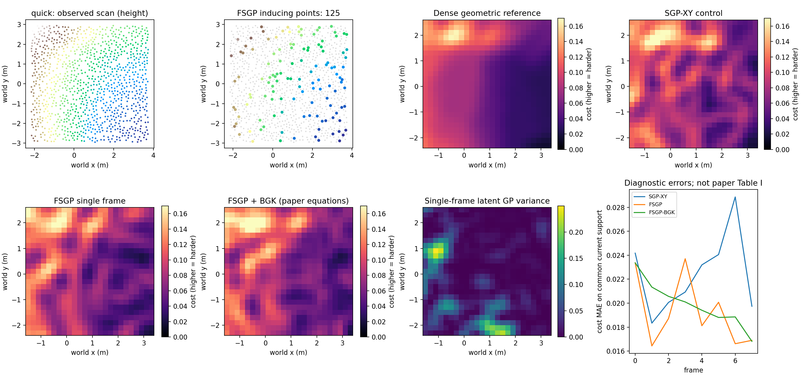
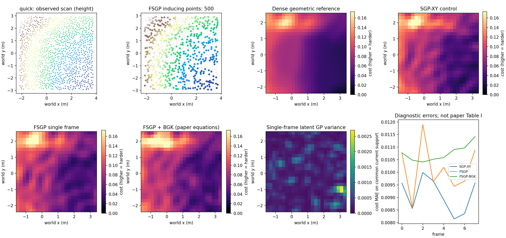

## 评测解释

- 参考 cost：完整无噪声点云的 KNN 曲率、平均绝对高差及局部 PCA 法向坡度；
  平面和斜坡使用解析坡度。该参考不使用 GP。官方点云没有 cost 标签，故它是诊断参考。
- 每帧相同扫描输入 SGP-XY 与 FSGP；BGK 直接融合同一份 FSGP 输出。不同 M 使用同一组扫描。
- SGP-XY 是去除 GP 特征输入及特征采样的本地对照，评分仍使用相同曲率/高差；不等同于论文引用基线的官方实现。
- 相同当前可观测格子参与各方法误差评测，未知格子不当作零代价。历史覆盖率单独报告。
- cost 按式 (8) 使用原始属性，越高越难通行；论文未明确给出所有量纲归一化细节。
- BGK 严格使用式 (9),(10)，仅旧方差进入式 (9) 的置信度。很小的旧方差可能令地图更新缓慢。
- 所有方法使用相同的二维高斯平滑。BGK 方差是论文启发式融合量，不是严格校准的 cost 后验。
- 延迟包括特征提取、GP、评分和平滑，BGK 包括额外融合；不含文件读取、参考计算及绘图。
- CPU 单线程 BLAS；代码没有实现 GPU 加速，不能据此声称达到论文实时性能。

## 运行环境与参数

```json
{
  "scope": "paper-equation CPU reproduction and diagnostic benchmark; not author benchmark",
  "config": {
    "resolution": 0.2,
    "length": 5.0,
    "neighbors": 20,
    "interpolation_neighbors": 5,
    "voxel_size": 0.1,
    "curvature_threshold": 0.03,
    "gradient_threshold": 0.03,
    "inducing_points": 125,
    "pca": true,
    "lengthscale": 0.6,
    "alpha": 10.0,
    "signal_variance": 1.0,
    "noise_variance": 0.0004,
    "jitter": 1e-08,
    "weights": [
      0.3333333333333333,
      0.3333333333333333,
      0.3333333333333333
    ],
    "support_radius": 0.45,
    "max_variance": 0.8,
    "decay_rate": 1.0,
    "history_ttl": 60.0,
    "smoothing_sigma": 0.8,
    "seed": 7
  },
  "scenes": [
    "flat",
    "ramp",
    "steps",
    "hill",
    "quick"
  ],
  "inducing_counts": [
    50,
    125,
    500
  ],
  "frames": 8,
  "frame_interval_seconds": 0.1,
  "noise_z_std_m": 0.015,
  "random_point_dropout": 0.15,
  "sensor_points_before_dropout_cap": 2500,
  "reference_voxel_m": 0.06,
  "evaluation_mask": "intersection of SGP-XY and FSGP current support and finite reference",
  "timing": "cold-start-inclusive algorithm time; excludes reference generation, loading and plotting; no GPU",
  "environment": {
    "python": "3.10.12 (main, Mar  3 2026, 11:56:32) [GCC 11.4.0]",
    "executable": "/usr/bin/python3",
    "numpy": "1.21.5",
    "scipy": "1.8.0",
    "platform": "Linux-6.8.0-124-generic-x86_64-with-glibc2.35",
    "processor": "AMD Ryzen 9 7945HX with Radeon Graphics",
    "thread_environment": {
      "OPENBLAS_NUM_THREADS": "1",
      "OMP_NUM_THREADS": "1",
      "MKL_NUM_THREADS": "1"
    },
    "backend": "CPU / NumPy + SciPy",
    "cuda_used": false
  },
  "wall_seconds": 18.11784164100027,
  "implementation_sha256": {
    "core.py": "c176374d9d8bad4faa4841738a6798e24b3cb8bfe466e0cbe71b4974313009bb",
    "experiment.py": "f07a7354a236d37589dad32feac65750ac32d8b88e23aaf2748b994ab131a254",
    "io.py": "421ebfaf3dfca06090e80c49a0926abe2cfc472644e2fc6d9b5203f022d56da1",
    "__main__.py": "24cde963564b16cf4efcbbf6a9080a471cea169497d592bc6bdffe5ad46f35c8"
  },
  "source_lock_sha256": "542e37304586d8ea5c3251b25db2136fb6000be7688c19f09310124b58b336df"
}
```

原始逐帧指标见 `per_frame.csv`，汇总见 `summary.csv`，末帧各层见 `*_sgp/fsgp/bgk.npz`。
每幅图的扫描及参考 cost 保存在 `*_evidence.npz`，可独立重算图示末帧误差。
