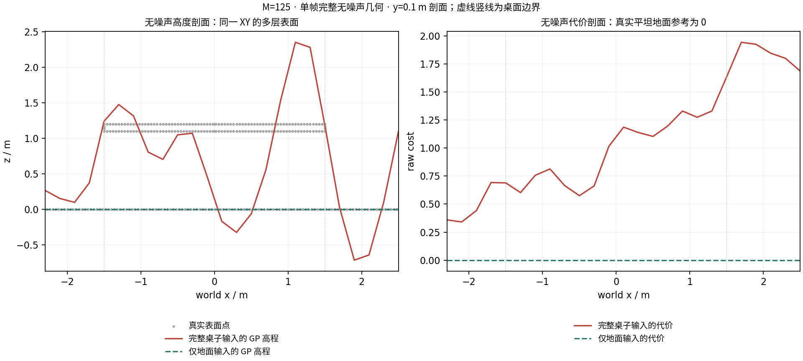
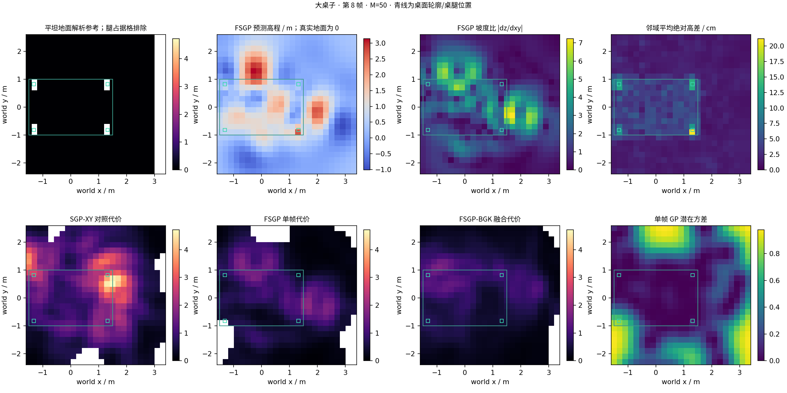
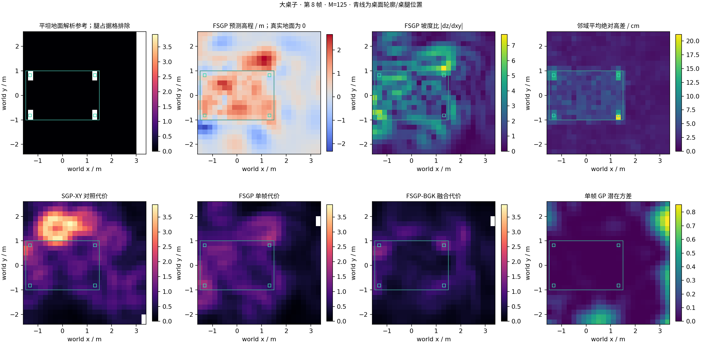
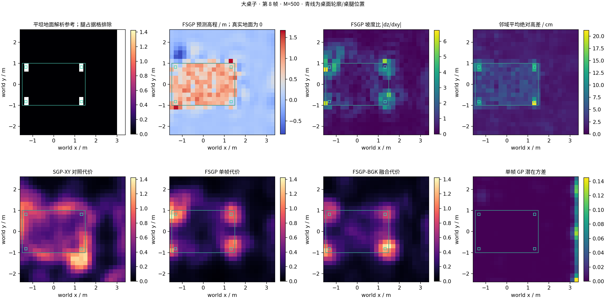

# 大桌子场景：FSGP-BGK 实测

按论文 v2 公式 (1)–(11) 的现有 CPU 参考实现运行，没有修改核心算法或为桌子调参。
这不是作者 GPU 实现、论文 2500 场景基准或导航成功率复现。

## 输入和参考

- 桌面 3×2 m，总高 1.2 m，桌下净高 1.1 m，四条腿截面 0.12×0.12 m；地面 z=0。
- 主实验保留桌面、桌底、桌腿和地面的全部高度层；不做地面分割、不删除悬空桌面。
- 每帧局部点云先随机取最多 2500 点，再随机丢弃 15%，添加 0.015 m 高程标准差噪声。
  这是点随机丢失模型，没有模拟真实 LiDAR 射线遮挡；同一帧各方法和各 M 输入完全一致。
- 5×5 m 局部窗口、0.2 m 栅格、8 帧、帧间隔 0.1 s，窗口中心 x 从 -0.8 到 0.8 m。
- 独立参考为平坦地面：理想曲率、高差、坡度都为 0，故式 (8) 的参考代价为 0。
  凡栅格与桌腿相交或超出完整地面范围，参考值设为 NaN，不参与代价偏差计算。
- MAE/RMSE 是有效平坦地面上的代价偏差，未归一化，不能当成论文精度或碰撞分类准确率。
- 桌下内部区域定义为 |x|≤1 m、|y|≤0.5 m，避开桌腿和桌面边缘。

## 连续八帧汇总

| M | 方法 | 地面代价 MAE | 地面代价 RMSE | 中位耗时 ms | 桌下预测高程中位数 m | 桌下坡度均值 | 桌下代价均值 |
|---:|---|---:|---:|---:|---:|---:|---:|
| 50 | SGP-XY | 0.79546 | 1.08803 | 11.01 | 0.787 | 3.548 | 1.20955 |
| 50 | FSGP | 0.53342 | 0.67430 | 11.37 | 0.853 | 1.977 | 0.69302 |
| 50 | FSGP-BGK | 0.57184 | 0.70067 | 13.19 | 0.853 | 1.977 | 0.84243 |
| 125 | SGP-XY | 1.06678 | 1.29734 | 13.24 | 0.771 | 3.071 | 1.05955 |
| 125 | FSGP | 0.52915 | 0.65781 | 13.86 | 0.881 | 1.492 | 0.53485 |
| 125 | FSGP-BGK | 0.44908 | 0.51894 | 15.82 | 0.881 | 1.492 | 0.45986 |
| 500 | SGP-XY | 0.36928 | 0.45925 | 60.99 | 0.762 | 1.597 | 0.56226 |
| 500 | FSGP | 0.22071 | 0.30151 | 60.85 | 0.845 | 0.672 | 0.26087 |
| 500 | FSGP-BGK | 0.22886 | 0.31313 | 62.95 | 0.845 | 0.672 | 0.28649 |

高程和坡度属于当前帧 GP，FSGP 与 FSGP-BGK 共用；BGK 只融合同一二维单元的代价/方差。
耗时包含特征、GP、评分/平滑，BGK 额外包含融合；排除扫描抽样、文件读写、绘图和 ROS。

## 无噪声对照（M=125，单帧）

| 输入 | 裁剪后点数 | 桌下高程中位数 m | 桌下高程绝对误差均值 m | 桌下坡度均值 | 桌下代价均值 |
|---|---:|---:|---:|---:|---:|
| complete_clean | 31491 | 0.8757 | 0.9179 | 3.3480 | 1.11393 |
| floor_only_clean | 21567 | 0.0000 | 0.0000 | 0.0000 | 0.00000 |

## 结果解释

M=125 时，桌下内部的真实地面高程为 0，而预测高程中位数为 0.881 m；坡度比均值为 1.492。
同一区域的 FSGP/BGK 代价均值分别为 0.53485/0.45986。
这些值说明当前实现对多层输入的响应；单个高程/代价栅格没有输出桌底高度或净空。
不能只凭代价高低宣称机器人能穿桌或必然碰撞，也没有以调阈值方式制造成功率。
移除桌面和腿的 floor_only_clean 是单独标明的诊断对照，不是对主实验输入进行预处理。

在 (x,y)=(0,0) 处，地面/桌底/桌面三个点的 κ、g 都为 0，GP 输入 (x,y,κ,g) 相同，
目标高程却分别为 0、1.1、1.2 m；详见 `multilayer_ambiguity.json`。
这说明这一输入表示本身存在多值目标，不能从单个栅格高程直接恢复三层表面。

## 图和复核

`per_frame.csv` / `summary.csv` 保存原始指标；`scans/` 保存每一帧实际输入；
`frames/` 保存各 M、各方法的每一帧地图，根目录 `table_m*_*.npz` 为第八帧。
`protocol.json` 固定算法、场景、参数与环境哈希；`audit.json` 为独立重算复核。

方法来源：https://arxiv.org/html/2503.04134v2
