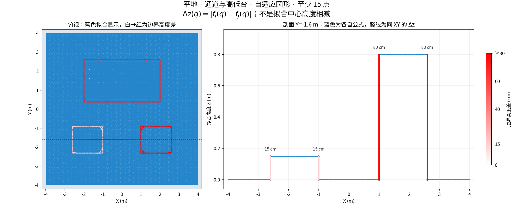
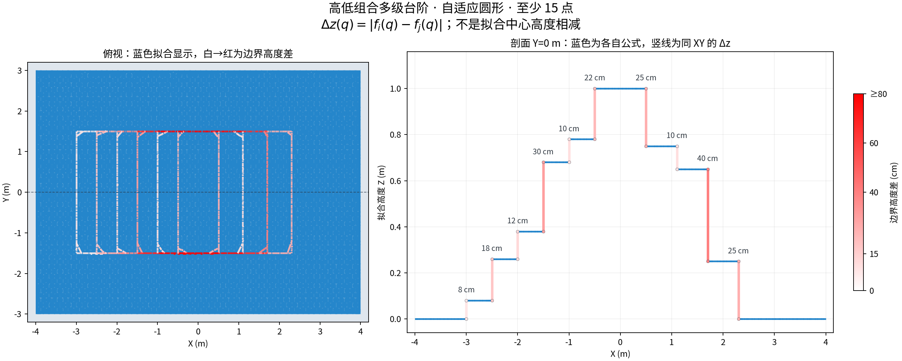

# 邻层曲面：边界高度差图

日期：2026-11-22。端口仍为 http://127.0.0.1:42482/ 。

[三维：高低台与地面](http://127.0.0.1:42482/?scene=flat-corridor-platforms&profile=qcircle-adaptive&coverage=1&boundary=1) · [三维：多级台阶](http://127.0.0.1:42482/?scene=steps&profile=qcircle-adaptive&coverage=1&boundary=1)

## 看什么

蓝色保留各自二次函数的拟合曲面。白到红色线只表示两侧函数在同一个边界 XY 的高度差，0–80 cm 固定色标，超过 80 cm 同为红色但保留原数值。上方六项指标读数保持原定义，边界平均／最大值单独显示在图下。勾选“边界高度差”，可旋转、俯视、侧视；点击色线显示两侧函数编号和高差。竖向短线是两层高度的标尺，不是新拟合面。色线为诊断叠加，允许透过蓝色面显示。

默认合成高低台中，算法从拟合域识别出地面、矮台、高台、通道顶板下表面和上表面等区域，没有预设层数。矮台／地面的边界差约 15 cm，高台／地面约 80 cm，通道下／上表面边缘到地面约 60／72 cm。这些层间差不能全部解释成可行走台阶或机器人抬腿阈值。

俯视蓝色与当前页面一致，含已经启用的小缝显示补全；剖面蓝线只画原凸包内的解析函数。边界计算始终使用原始拟合域，没有把补缝当成新增观测。

## 如何计算

1. 仅使用保存的有效二次函数、原拟合点 XY 凸包；没有使用场景部件标签、人工台阶边线或已知高度来构造图，也没有重新拟合。
2. 以函数为节点：凸包 XY 间距≤2.5 cm，且在两中心 XY 与中点三个共同查询位置的函数预测差都≤2 cm，才连接为同一局部一致区域。按连通分量得到区域，少于三个函数的分量不画边界；不预设三层或固定高度分层。
3. 对每个区域的凸包并集提取外边界及 ≥9 cm² 的孔洞边界，每隔最多 2 cm 采样。沿外法向取 2 cm 探针，只选择向外侧延伸的其他区域，XY 边界间距≤10 cm；搜索 32 个最近拟合中心。同样近（5 mm 内）的候选中选择高度最接近的一层，避免一次把全部上下层都连起来。
4. 原拟合域可能有间隙，通常没有严格共同边线。边界查询 q 取源边界和相邻拟合域最近点的 XY 中点，是由观测拟合域估计的边界；并非使用已知物体真实边界。源凸包上无法找到支持函数的点不画。
5. 在完全相同的 q 代入两个原函数：Δz(q)=|f_i(q)−f_j(q)|。它能区分连续坡面与真正预测跳变。颜色按 Δz，图中仅显示≥2 cm 的差值；未显示不代表已证明无跳变，缺乏支持时不把未知记成零。
6. 色线沿两函数的预测高度分别画出，并稀疏增加竖向标尺。不生成组合曲面、不跨层补面。局部函数在间隙处是有限外推，单侧中点外推距离最多约 5 cm；高度一致的连通分量也不保证整个区域由单一公式表示。

白到红指标色面和边界高差色线是两种量；勾选蓝色拟合覆盖后观察边界最清楚。边界均值是所保留诊断样本的算术平均，既不是面积加权均值，也不是全场景平均台阶高度。

## 逐设置结果

| 场景 | 设置 | 邻层区域对 | 边界样本 | 平均 Δz | 最大 Δz |
| --- | --- | ---: | ---: | ---: | ---: |
| 平地 · 通道与高低台 | 15×15 cm · 至少 15 点 | 32 | 3,031 | 54.44 cm | 78.71 cm |
| 高低组合多级台阶 | 15×15 cm · 至少 15 点 | 58 | 1,962 | 29.90 cm | 97.71 cm |
| 平地 · 通道与高低台 | 20×20 cm · 至少 30 点 | 5 | 2,297 | 52.49 cm | 78.75 cm |
| 高低组合多级台阶 | 20×20 cm · 至少 30 点 | 17 | 2,312 | 27.71 cm | 97.75 cm |
| 平地 · 通道与高低台 | 自适应圆形 · 至少 15 点 | 4 | 2,332 | 59.65 cm | 80.00 cm |
| 高低组合多级台阶 | 自适应圆形 · 至少 15 点 | 17 | 2,445 | 30.56 cm | 100.00 cm |
| 平地 · 通道与高低台 | 圆形 R=7 cm · 至少 15 点 | 5 | 5,990 | 40.80 cm | 80.00 cm |
| 高低组合多级台阶 | 圆形 R=7 cm · 至少 15 点 | 17 | 2,801 | 29.12 cm | 100.00 cm |

默认多级台阶的最大 100 cm 来自最高台面侧边与外侧地面的落差，不是中央相邻台阶的最大一级高度。方窗在边缘混点会使原曲面倾斜、碎裂或偏移，因此边界高差也受原拟合误差影响；例如高台最大值约 78.7 cm，不能自动修正成已知的 80 cm。

## 验证与复现

逐样本独立重算同 XY 高差、检查函数有效性和边界 XY 距离；导出线顶点符合两侧解析函数，颜色值符合高差；全部原文件哈希不变。连续陡坡测试无跳变，叠加 15 cm 台阶后仍恢复 15 cm，两个平行面恢复 80 cm。默认拟合的实景构造数据另按几何位置核对两平台已知高度及中央十级台阶；这些已知值仅用于事后核查，不参与区域或边界计算，也不是独立观测精度。

[机器核查](audit.json) · [浏览器核查](browser-audit.json)；逐样本 CSV 位于 `<profile>/<scene>/samples.csv`，含两侧函数、区域、边界 XY、两侧 Z 和 Δz。

运行：系统 Python 依次执行 `python -m fsgp_bgk_repro.boundary_heights --profiles qcircle-adaptive qcircle-r07 q15-n15 q20-n30`、`python -m fsgp_bgk_repro.boundary_height_report`、`python -m fsgp_bgk_repro.publish_metric_viewer`。默认只计算本次请求的高低台通道场景及多级台阶，不改变其余场景的六指标和小缝补偿。
