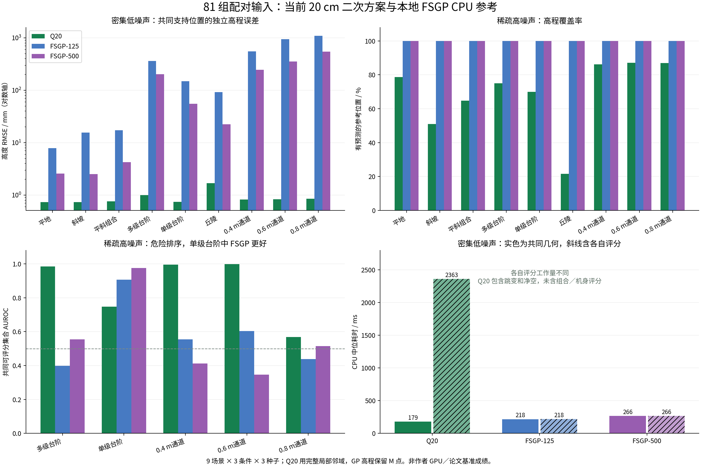

# 当前 20 cm 二次曲面方案与 FSGP：配对效果测评

日期：2026-11-17。交互页面：http://127.0.0.1:42482/fsgp-q20/ 。这里的 FSGP 是本地 **CPU 公式参考实现**；未执行作者 GPyTorch/CuPy GPU 程序，未复现论文 Table I–III，不能将下列数值称作超过论文成绩。

本次结果：密集输入上，Q20 的局部高程更准确；稀疏输入时覆盖明显下降，并会误关联上层曲面。FSGP 在覆盖、稀疏单级台阶排序和 BGK 静态历史融合上有优势。Q20 共同几何预测稍快，但现有跳变／净空评分整体更慢，不能将“二次函数求解快”当成完整评估实时。



[下载总览 PDF](comparison.pdf)。图中各场景的几何参考、共同集合和限制见下文。

## 1. 测评边界与设计

论文利用特征稀疏 GP 建地形模型，并用 BGK 融合历史代价；论文方法说明见 [原文](https://arxiv.org/html/2503.04134v2)，官方批量评测程序仍在[仓库](https://github.com/ZJU-FAST-Lab/FSGP_BGK)的待发布列表。本次保持本地两种方法核心代码和参数不变，测一个可检查输入与参考值的小基准。

- 使用已有的平地、斜坡、平地与斜坡、多级台阶、原单级台阶、官方丘陵、0.4/0.6/0.8 m 通道，共 9 场景。
- 3 条件：保留 85%、Z 噪声 3 mm；保留 85%、Z 噪声 15 mm；保留 45%、Z 噪声 15 mm。XY 噪声均为 1 mm 标准差。随机丢点不等同真实 LiDAR 射线遮挡。
- 每个条件 3 个传感器随机种子：1101/1102/1103，共 81 组配对输入。三种主方法在每组收到逐字节一致的 XYZ。
- 输入裁剪到中心附近 ±2.95 m，输出沿用原 FSGP 的 5×5 m、20 cm、25×25 查询栅格。世界格中心实际为 −2.3…2.5 m，地图边界为 −2.4…2.6 m。
- 解析场景用其独立几何函数评价查询位置，不用拟合训练残差。丘陵先分出 20% 原始点作为留出集合，再从中为每个查询格选一个邻近的独立测试点，训练与测试原始索引不重叠；丘陵参考仍是原始点高程，不是无噪声的作者真值，没有宣称丘陵法向或通行标签。
- 在台阶位置附近 4 cm、墙体边缘等参考高度／法向不适定位置排除几何误差评价，但仍保留其危险性评价。具体掩码在逐例文件中，不以模型表现决定是否排除。
- 报告覆盖率、自有支持上的误差，以及三种方法**共同支持**处的误差。没有预测的格子不计为零误差，也不把高覆盖率自动当成高准确率。

这是一组构造场景和一份官方点云的本地诊断；大量格子共享相邻点，不能将格子数当作独立实验样本数。仅 3 个随机种子，不报告统计显著性或导航成功率。

## 2. 主方法与两个辅助控制

**Q20**：当前 20×20 cm、±4 cm 高度带、至少 30 点的局部二次拟合，0.10 m 三维体素选中心。为了与 GP 的 XY 查询对齐，按查询位置附近 16 个原始观测中的最低高度引导 `choose_support` 选择较低表面；没有输入真实地面高度或表面标签。这是明确的地面分支关联假设，不保证悬空、遮挡或侧壁附近一定选对。局部系数和协方差来自完整原始点的合格邻域。

**FSGP-125 / FSGP-500**：沿用 core.py 的特征、采样、RQ 核与条件化预测；M=125/500，长度尺度 0.6 m、alpha=10、信号方差 1、噪声方差 0.0004 m²，不针对本次标签调参。它是按公式用 M 个保留观测条件化的 CPU 参考，不等同官方 InducingPointKernel 的学习过程。法向使用论文链路中的固定 κ/g 的 XY 偏导，没有添加特征 IDW 对 XY 的链式导数。

相同原始输入不等于相同内部预算：Q20 重用完整点云的许多局部邻域，FSGP 的高程条件化只保留 M 点，查询特征仍来自完整当前帧。因此不把几何差异全部归因于“二次函数优于 GP”。

辅助控制不参加主方法结论或速度排名：

1. **K20-on-M125/500**：仅使用对应 FSGP 选中的同一批 XYZ，运行此前的 20 近邻二次高程函数。它不是当前严格 20 cm 的 Q20，没有同样的高度带、协方差、净空和机身指标；其毫秒数只覆盖采样后高程预测，不可与从 XYZ 开始的速度相除。GP 查询仍多用了全帧的 κ/g 插值，所以也没有声称两者所有信息完全相同。
2. **FSGP-125-oracle**：仅在通道中给 GP 生成器真实地面点，用于判断地面关联／多层混合的影响。这使用了真实标签，是分割理想上限控制，不能称作可直接部署的改进算法。

主方法适配器已与原 TraversabilityMapper 的高程、方差、坡度和代价逐项复核一致。原 core.py、terrain_assessment.py 以及本次运行的其他关键源文件 SHA256 保存在 protocol.json，并在结束时核对未变。

## 3. 几何结果：覆盖率和误差一起看

高度误差单位 mm，法向误差为夹角的平均值 °。RMSE 从所有参与点的平方误差汇总；不是将每帧 RMSE 简单平均。共同支持格数对三个主方法相同。

| 条件 | 方法 | 覆盖 % | 自有支持 RMSE mm | 共同支持 RMSE mm | 共同点数 | 共同法向误差 ° |
|---|---:|---:|---:|---:|---:|---:|
| dense_low | FSGP-125 | 100.0 | 487.67 | 488.42 | 14951 | 27.50 |
| dense_low | FSGP-500 | 100.0 | 221.80 | 222.13 | 14951 | 19.84 |
| dense_low | Q20 | 99.7 | 0.96 | 0.96 | 14951 | 0.81 |
| dense_noisy | FSGP-125 | 100.0 | 356.77 | 356.99 | 14978 | 26.96 |
| dense_noisy | FSGP-500 | 100.0 | 191.81 | 191.95 | 14978 | 18.90 |
| dense_noisy | Q20 | 99.9 | 5.44 | 5.44 | 14978 | 4.00 |
| sparse_noisy | FSGP-125 | 100.0 | 384.82 | 431.70 | 10069 | 29.75 |
| sparse_noisy | FSGP-500 | 100.0 | 195.61 | 230.58 | 10069 | 20.96 |
| sparse_noisy | Q20 | 67.1 | 123.74 | 123.75 | 10069 | 7.06 |

逐场景的共同支持误差与覆盖率：

| 场景 | 条件 | Q20 mm | FSGP125 mm | FSGP500 mm | Q20覆盖 % | 125覆盖 % | 500覆盖 % |
|---|---:|---:|---:|---:|---:|---:|---:|
| 平地 | dense_low | 0.74 | 7.83 | 2.59 | 100.0 | 100.0 | 100.0 |
| 平地 | dense_noisy | 4.45 | 32.81 | 13.45 | 100.0 | 100.0 | 100.0 |
| 平地 | sparse_noisy | 6.22 | 31.43 | 13.77 | 78.7 | 100.0 | 100.0 |
| 斜坡 | dense_low | 0.74 | 15.59 | 2.51 | 100.0 | 100.0 | 100.0 |
| 斜坡 | dense_noisy | 5.62 | 42.40 | 13.74 | 100.0 | 100.0 | 100.0 |
| 斜坡 | sparse_noisy | 6.68 | 32.76 | 14.39 | 51.0 | 100.0 | 100.0 |
| 平地与斜坡组合 | dense_low | 0.76 | 17.18 | 4.25 | 100.0 | 100.0 | 100.0 |
| 平地与斜坡组合 | dense_noisy | 4.99 | 34.08 | 13.54 | 100.0 | 100.0 | 100.0 |
| 平地与斜坡组合 | sparse_noisy | 6.43 | 33.84 | 12.90 | 64.7 | 100.0 | 100.0 |
| 高低组合多级台阶 | dense_low | 1.00 | 360.35 | 202.74 | 100.0 | 100.0 | 100.0 |
| 高低组合多级台阶 | dense_noisy | 4.67 | 320.43 | 108.85 | 100.0 | 100.0 | 100.0 |
| 高低组合多级台阶 | sparse_noisy | 6.32 | 347.89 | 91.54 | 75.1 | 99.9 | 100.0 |
| 原单级台阶（历史） | dense_low | 0.74 | 148.64 | 55.48 | 100.0 | 99.9 | 100.0 |
| 原单级台阶（历史） | dense_noisy | 4.72 | 86.08 | 52.95 | 100.0 | 100.0 | 100.0 |
| 原单级台阶（历史） | sparse_noisy | 6.56 | 94.74 | 43.25 | 70.0 | 100.0 | 100.0 |
| 丘陵 | dense_low | 1.69 | 92.26 | 22.52 | 97.5 | 100.0 | 100.0 |
| 丘陵 | dense_noisy | 8.65 | 96.62 | 26.84 | 98.8 | 100.0 | 100.0 |
| 丘陵 | sparse_noisy | 6.87 | 71.16 | 19.72 | 21.6 | 100.0 | 100.0 |
| 独立通道 · 净空 0.40 m | dense_low | 0.82 | 553.09 | 246.65 | 100.0 | 100.0 | 100.0 |
| 独立通道 · 净空 0.40 m | dense_noisy | 4.51 | 463.13 | 245.18 | 100.0 | 100.0 | 100.0 |
| 独立通道 · 净空 0.40 m | sparse_noisy | 131.99 | 498.09 | 268.27 | 86.2 | 100.0 | 100.0 |
| 独立通道 · 净空 0.60 m | dense_low | 0.84 | 942.24 | 354.91 | 100.0 | 100.0 | 100.0 |
| 独立通道 · 净空 0.60 m | dense_noisy | 4.43 | 632.85 | 348.33 | 100.0 | 100.0 | 100.0 |
| 独立通道 · 净空 0.60 m | sparse_noisy | 184.44 | 647.59 | 352.62 | 87.2 | 100.0 | 100.0 |
| 独立通道 · 净空 0.80 m | dense_low | 0.86 | 1099.93 | 546.68 | 100.0 | 99.9 | 100.0 |
| 独立通道 · 净空 0.80 m | dense_noisy | 4.87 | 793.52 | 447.41 | 100.0 | 100.0 | 100.0 |
| 独立通道 · 净空 0.80 m | sparse_noisy | 277.31 | 877.75 | 489.53 | 87.0 | 100.0 | 100.0 |

覆盖不足会让条件误差只反映“容易支持的地方”。尤其稀疏条件，不能只看 Q20 在较小共同集合上的低 RMSE，忽视它没有给出的区域。参数协方差与 GP 潜在方差都未做传感器标定；逐条件 JSON 记录的经验 2σ 覆盖率也不是可靠概率保证。

### 本次测到的主要区别

密集低噪声丘陵留出点上，Q20 的共同支持 RMSE 为 1.69 mm，FSGP-500 为 22.52 mm；Q20 覆盖 97.5%。稀疏高噪声丘陵中，Q20 覆盖降至 21.6%，GP 保持 100.0%。这里 Q20 的较低条件误差只涉及它愿意输出的少数位置。

通道稀疏条件中，Q20 不仅弃权，还发生已知预测的大误差：

| 通道 | 已知位置中误差 >10 cm | 已知数 | 比例 % |
|---|---:|---:|---:|
| 独立通道 · 净空 0.40 m | 120 | 1189 | 10.1 |
| 独立通道 · 净空 0.60 m | 108 | 1203 | 9.0 |
| 独立通道 · 净空 0.80 m | 139 | 1200 | 11.6 |

侧面剖面可看到部分查询落在上层曲面附近；这表明“最低观测引导”并没有保证最终支持一定是地面。上述计数是大误差统计，不把所有误差都自动归因为同一种原因。


## 4. 相同 M 点与理想地面控制

此处列自有支持 RMSE，辅助控制只回答特定问题，不按它们的不同支持集给主方法排总名次。

| 条件 | 辅助控制 | 案例数 | 覆盖 % | 自有支持 RMSE mm |
|---|---:|---:|---:|---:|
| dense_low | FSGP-125-oracle | 9 | 100.0 | 7.48 |
| dense_low | K20-on-M125 | 27 | 100.0 | 308.24 |
| dense_low | K20-on-M500 | 27 | 100.0 | 673.97 |
| dense_noisy | FSGP-125-oracle | 9 | 100.0 | 27.31 |
| dense_noisy | K20-on-M125 | 27 | 100.0 | 185.37 |
| dense_noisy | K20-on-M500 | 27 | 100.0 | 200.28 |
| sparse_noisy | FSGP-125-oracle | 9 | 100.0 | 30.20 |
| sparse_noisy | K20-on-M125 | 27 | 100.0 | 208.61 |
| sparse_noisy | K20-on-M500 | 27 | 100.0 | 255.61 |

在通道中，若清除上层点后 GP 高程误差明显降低，说明原始结果包含多层数据关联问题，不能据此断言 GP 本身不能拟合平地；真实系统仍需实现不依赖标签的地面／障碍关联。相同 M 的 K20 结果则揭示了支撑范围、采样和表示能力共同起作用。

## 5. 危险区域排序，不比较不同含义的代价差

解析参考只标记本实验规定的几何危险：80×50 cm 矩形跨过 ≥12 cm 台阶／侧壁、与通道墙体相交，或在指定 10–60 cm 高度带被顶板占用。它不是 Go2 实机的稳定／通过真值；平地和连续缓坡没有被当作台阶。丘陵没有危险标签，完全不进入此项。

Q20 使用原有落足综合代价，FSGP 使用原有平滑代价；二者值域与权重不同，不做跨方法 cost MAE，不用测试标签选“通过阈值”。所有方法再应用同一 80×50 cm 矩形内栅格中心的最大值操作：20 cm 输出分辨率下是 5×3=15 个中心，要求至少 80% 已知。这是离散危险排序窗口，**不是原先四足／质心机身稳定性分数**，也没有检查连续矩形内所有位置。

排序评价区域另限制 |x|≤2.0、|y|≤2.15 m；通道 |y|≤1.75 m，确保假设机身位于地面域内。共同可评分格上比较 AUROC/AP；AP 的随机参考为该共同集合的危险占比。未知保留为弃权，另报原生代价覆盖率，不能靠全拒绝取得“安全准确率”。

| 条件 | 方法 | AUROC | AP | 共同评分数 | 危险占比 % | 代价覆盖 % |
|---|---:|---:|---:|---:|---:|---:|
| dense_low | FSGP-125 | 0.830 | 0.570 | 9840 | 34.0 | 100.0 |
| dense_low | FSGP-500 | 0.841 | 0.575 | 9840 | 34.0 | 100.0 |
| dense_low | Q20 | 0.978 | 0.955 | 9840 | 34.0 | 100.0 |
| dense_noisy | FSGP-125 | 0.842 | 0.578 | 9840 | 34.0 | 100.0 |
| dense_noisy | FSGP-500 | 0.857 | 0.636 | 9840 | 34.0 | 100.0 |
| dense_noisy | Q20 | 0.995 | 0.988 | 9840 | 34.0 | 100.0 |
| sparse_noisy | FSGP-125 | 0.731 | 0.614 | 4799 | 49.5 | 100.0 |
| sparse_noisy | FSGP-500 | 0.710 | 0.587 | 4799 | 49.5 | 100.0 |
| sparse_noisy | Q20 | 0.898 | 0.869 | 4799 | 49.5 | 48.8 |

为了避免把不同场景混合后的高 AUROC 当作每个场景都好，再列逐场景排序。下表每行固定场景和条件，合并三个种子；只有同时存在危险与非危险标签才计算 AUROC，平地／连续缓坡全为非危险，没有伪造 AUC=1。

| 场景 | 条件 | 共同数 | 危险 % | Q20 AUC | FSGP125 AUC | FSGP500 AUC |
|---|---:|---:|---:|---:|---:|---:|
| 高低组合多级台阶 | dense_low | 1320 | 79.1 | 0.972 | 0.396 | 0.410 |
| 高低组合多级台阶 | dense_noisy | 1320 | 79.1 | 0.985 | 0.482 | 0.549 |
| 高低组合多级台阶 | sparse_noisy | 633 | 75.7 | 0.985 | 0.398 | 0.554 |
| 原单级台阶（历史） | dense_low | 1320 | 20.0 | 0.969 | 0.814 | 0.942 |
| 原单级台阶（历史） | dense_noisy | 1320 | 20.0 | 0.969 | 0.920 | 0.951 |
| 原单级台阶（历史） | sparse_noisy | 389 | 15.7 | 0.748 | 0.907 | 0.975 |
| 独立通道 · 净空 0.40 m | dense_low | 1080 | 77.8 | 0.891 | 0.378 | 0.569 |
| 独立通道 · 净空 0.40 m | dense_noisy | 1080 | 77.8 | 1.000 | 0.458 | 0.429 |
| 独立通道 · 净空 0.40 m | sparse_noisy | 883 | 88.0 | 0.996 | 0.555 | 0.413 |
| 独立通道 · 净空 0.60 m | dense_low | 1080 | 77.8 | 0.881 | 0.395 | 0.446 |
| 独立通道 · 净空 0.60 m | dense_noisy | 1080 | 77.8 | 1.000 | 0.403 | 0.513 |
| 独立通道 · 净空 0.60 m | sparse_noisy | 871 | 86.7 | 0.998 | 0.603 | 0.346 |
| 独立通道 · 净空 0.80 m | dense_low | 1080 | 33.3 | 1.000 | 0.460 | 0.520 |
| 独立通道 · 净空 0.80 m | dense_noisy | 1080 | 33.3 | 0.998 | 0.444 | 0.727 |
| 独立通道 · 净空 0.80 m | sparse_noisy | 905 | 33.7 | 0.569 | 0.438 | 0.515 |

具体反例：稀疏原单级台阶中，Q20 的 AUROC 为 0.748，FSGP-500 为 0.975；FSGP 在这一组危险排序更好。不能由整体 RMSE 或混合场景 AUC 宣称 Q20 每个任务都占优。

原生代价更红不代表效果更好。AUROC/AP 衡量排序，仍不足以证明已得到可执行的通过阈值；标签几何约束也有意贴近本次工程需求，因此不能外推为其他机器人或论文全部任务的普遍优势。

## 6. 速度的可比范围

共同几何任务均从同一 XYZ 到 625 个查询的高度、梯度、方差与支持掩码；不含来源生成、文件写入和网页绘制。按三个传感器种子统计运行时间，输入点数会随丢点略变，不是严格相同数组的纯计时重复。方法执行顺序按种子交替，CPU 单线程 BLAS。

Q20 原生落足代价额外执行面片几何／σ、双侧跳变、原始点和曲面净空；不含原完整工作台的一致性组合和四足机身评估。FSGP 原生代价只增加其特征加权和滤波。因此两者“原生完整任务”工作不同，不将它们相除宣称算法快多少倍。

| 条件 | 方法 | 共同几何中位 ms | 含各自原生评分 ms |
|---|---:|---:|---:|
| dense_low | FSGP-125 | 217.59 | 217.74 |
| dense_low | FSGP-500 | 265.82 | 265.99 |
| dense_low | Q20 | 178.71 | 2363.23 |
| dense_noisy | FSGP-125 | 204.04 | 204.18 |
| dense_noisy | FSGP-500 | 249.20 | 249.38 |
| dense_noisy | Q20 | 178.14 | 2456.27 |
| sparse_noisy | FSGP-125 | 107.40 | 107.53 |
| sparse_noisy | FSGP-500 | 154.37 | 154.54 |
| sparse_noisy | Q20 | 77.99 | 540.87 |

## 7. 时序小实验：FSGP 与 BGK 使用同一次预测

固定平地—斜坡几何，8 帧、0.1 秒间隔，每帧独立 15 mm 高度噪声；第 2–5 帧删除 |x|<0.7 m 的整条观测带。FSGP 与 FSGP-BGK 共用完全相同的单帧输出；Q20 没加历史融合。

这里只检验静态地形的代价稳定性与历史覆盖。BGK 融合代价，没有重新改善该帧高度，也未测试动态障碍出现／消失的滞后。FSGP 与 BGK 的代价尺度相同，可以比较代价帧间变化；Q20 的原生尺度不同，不将其抖动绝对值与 GP 排名。

| 帧 | 观测带删除 | Q20已知 % | FSGP已知 % | BGK已知 % | FSGP帧间变化 | BGK帧间变化 |
|---|---:|---:|---:|---:|---:|---:|
| 0 | 否 | 100.0 | 100.0 | 100.0 | — | — |
| 1 | 否 | 100.0 | 100.0 | 100.0 | 0.01919 | 0.00071 |
| 2 | 是 | 75.8 | 90.7 | 100.0 | 0.01937 | 0.00096 |
| 3 | 是 | 75.8 | 92.0 | 100.0 | 0.02057 | 0.00161 |
| 4 | 是 | 75.7 | 92.0 | 100.0 | 0.03040 | 0.00245 |
| 5 | 是 | 75.4 | 92.0 | 100.0 | 0.02207 | 0.00127 |
| 6 | 否 | 100.0 | 100.0 | 100.0 | 0.02113 | 0.00116 |
| 7 | 否 | 100.0 | 100.0 | 100.0 | 0.02050 | 0.00107 |

上表每个方法使用各自相邻帧的共同集合。为公平比较抖动，再将 FSGP 和 BGK 的前后两帧共同已知集合取交集：

| 帧 | 双方相同格数 | FSGP 变化 | BGK 变化 |
|---|---:|---:|---:|
| 1 | 625 | 0.01919 | 0.00071 |
| 2 | 567 | 0.01937 | 0.00101 |
| 3 | 567 | 0.02057 | 0.00156 |
| 4 | 575 | 0.03040 | 0.00247 |
| 5 | 575 | 0.02207 | 0.00125 |
| 6 | 575 | 0.02113 | 0.00111 |
| 7 | 625 | 0.02050 | 0.00107 |

在这些相同格上的加权平均绝对代价帧间变化从 0.02185 降到 0.00130，下降 94.0%。这是本次静态噪声／暂缺实验中的平滑效果，不是动态障碍响应成绩。

## 8. 如何读这些结果

1. 局部高度更准确，不自动意味着原生通行性评分更准确；需要同时看法向、代价排序和缺失。
2. 稀疏点云上，严格 20 cm／30 点条件可能是主要限制；扩大邻域或做历史融合属于后续新方法，不能改完后覆盖本次失败结果。
3. 单值高度模型在通道这种多层输入上可能混合表面；Q20 的最低观测分支也有数据关联和凸包外查询限制，不能宣称所有悬空场景都解决。
4. 这里的 FSGP 超参数固定，未复现作者的核训练／GPU 链路。只能比较当前本地两份实现，不能宣布普遍超过论文方法。

所有案例、失败和辅助控制都保留。独立测试 RMSE 与原工作台每个模型的训练残差是不同量；不能用“训练误差几乎为零”替代本测评。

## 9. 文件与复现

- [运行前固定的协议与源码哈希](protocol.json)、[逐组原始记录 CSV](per-run.csv)、[汇总 CSV](summary.csv)、[完整汇总 JSON](summary.json)、[计数／输入／共同支持核查](audit.json)。
- [数值证据独立复算](numerical-audit.json)、[浏览器逐场景核查](browser-audit.json)。数值审计抽查实际邻域的独立最小二乘／岭解，复算全部已支持查询；另对两个完整点云、两个 M 预算直接调用原 Mapper 对照保存输出。
- cases/*.npz：完整实际输入、留出索引、查询点、参考、掩码、各预测，Q20 实际邻点／系数／协方差，GP 保留点。
- cases/*.json：网页用的完整查询结果；输入点仅展示均匀索引抽取的最多 4,000 点，算法使用完整输入。
- temporal.json 与 temporal-*.npz：8 帧时序记录及实际地图。

```bash
cd /home/jiang/snap/go2
PYTHONNOUSERSITE=1 OPENBLAS_NUM_THREADS=1 OMP_NUM_THREADS=1 MKL_NUM_THREADS=1   /usr/bin/python3 -m fsgp_bgk_repro.compare_fsgp_q20
PYTHONNOUSERSITE=1 OPENBLAS_NUM_THREADS=1   /usr/bin/python3 -m fsgp_bgk_repro.compare_fsgp_q20_report
PYTHONNOUSERSITE=1 OPENBLAS_NUM_THREADS=1 MPLCONFIGDIR=/tmp/fsgp-bgk-matplotlib   /usr/bin/python3 -m fsgp_bgk_repro.plot_fsgp_q20
PYTHONNOUSERSITE=1 OPENBLAS_NUM_THREADS=1   /usr/bin/python3 -m fsgp_bgk_repro.audit_fsgp_q20
PYTHONNOUSERSITE=1 OPENBLAS_NUM_THREADS=1   /usr/bin/python3 -m unittest fsgp_bgk_repro.tests.test_compare_fsgp_q20 -v
node fsgp_bgk_repro/tests/compare_fsgp_q20_browser.cjs
```
