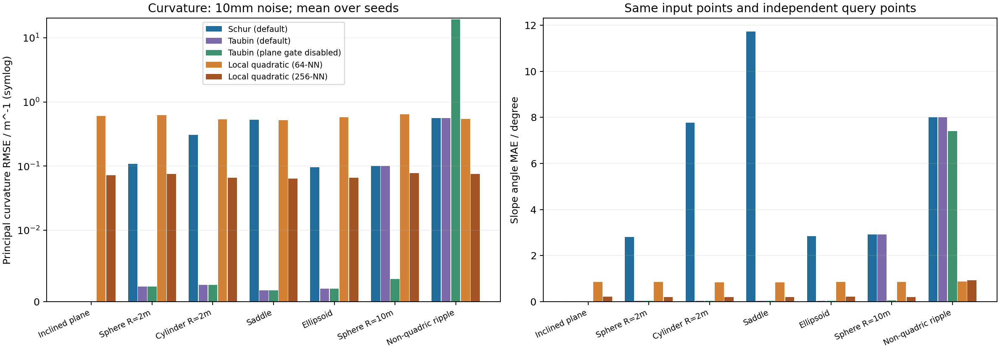
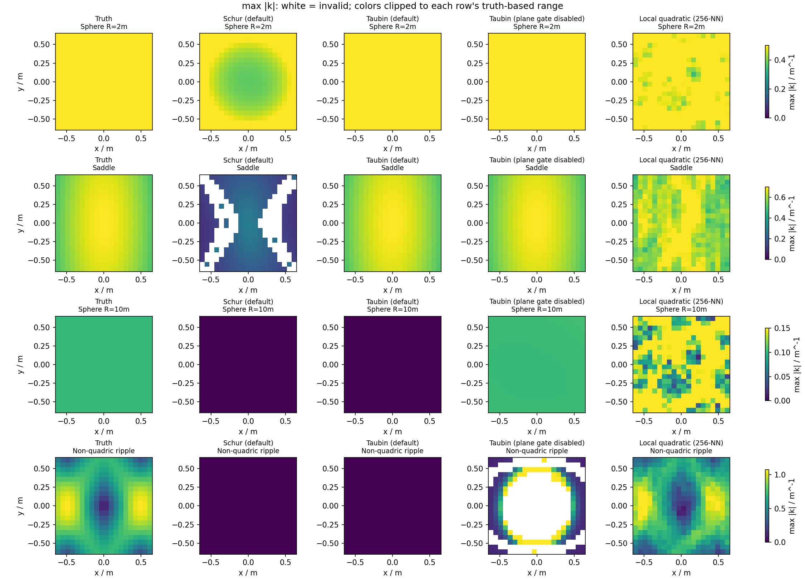
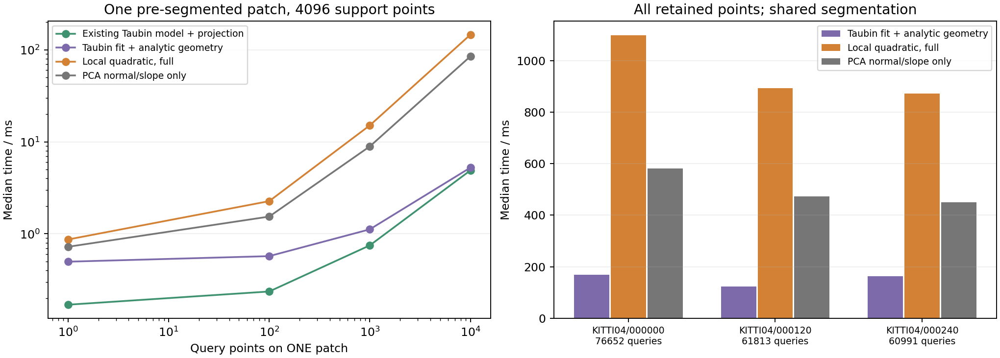
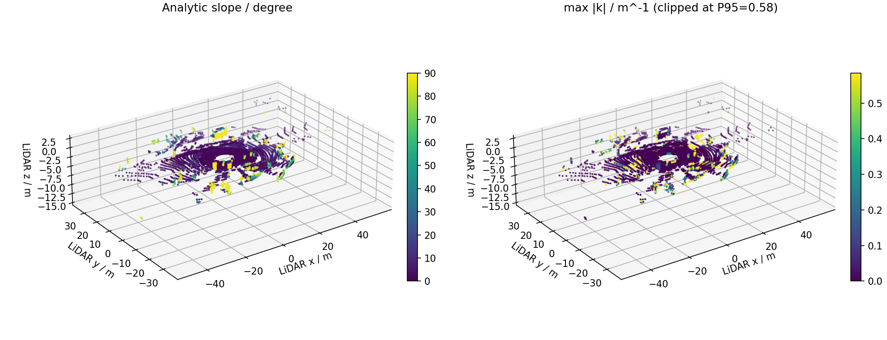

# 二次曲面解析法向、坡度和曲率：验证与速度比较

CPU：AMD Ryzen 9 7945HX with Radeon Graphics；Python 3.10.12 / NumPy 1.21.5，单线程BLAS。

主速度案例：4096个点构成一个已分割面片，1000个查询点。
Taubin预存模型+投影+解析几何 0.7492ms；Taubin从点云拟合后计算 1.1190ms；局部二次拟合64近邻 15.0792ms。

实测结论：解析求导成立，但默认Schur拟合受噪声影响明显。Taubin在符合二次曲面模型的场景更稳定；
缓弯面的平面分类、非二次起伏面的模型偏差仍需处理。当前整帧密集查询仍超过100ms，不能把局部查询速度当作整帧实时性能。

## 精度验证

七种场景，噪声[0, 0.002, 0.01, 0.03]米，5个随机种子，
每例4096个支持点、400个独立查询点。
噪声沿干净表面法向加入，查询位于面片内部。真值由显式图形的第一/第二基本形式独立计算。
法向误差不计朝向；曲率仅在评估时按真值法向统一正负号，真值不参与拟合。
误差为多个随机种子RMSE/MAE的平均；同时保留有效覆盖率，PCA不参与几何曲率误差排名。

以下为10mm噪声：

|场景|默认Schur曲率RMSE(m⁻¹)|Taubin曲率RMSE(m⁻¹)|关闭平面门限的Taubin|局部二次64近邻RMSE(m⁻¹)|局部二次256近邻RMSE(m⁻¹)|Taubin坡度MAE(°)|局部二次256近邻坡度MAE(°)|Schur有效比例|
|---|---:|---:|---:|---:|---:|---:|---:|---:|---:|
|Inclined plane|0.0000|0.0000|无有效值|0.6096|0.0726|0.0146|0.2098|100.0%|
|Sphere R=2m|0.1084|0.0021|0.0021|0.6230|0.0751|0.0406|0.1954|100.0%|
|Cylinder R=2m|0.3060|0.0024|0.0024|0.5402|0.0657|0.0412|0.2069|89.8%|
|Saddle|0.5262|0.0016|0.0016|0.5214|0.0642|0.0298|0.2081|66.6%|
|Ellipsoid|0.0968|0.0018|0.0018|0.5803|0.0663|0.0369|0.2107|100.0%|
|Sphere R=10m|0.1000|0.1000|0.0032|0.6435|0.0776|2.9169|0.2001|100.0%|
|Non-quadric ripple|0.5573|0.5573|19.2445|0.5482|0.0760|8.0123|0.9250|100.0%|

曲率误差图采用对称对数纵轴，保留零误差并显示数量级差异；无有效值表示拟合或投影失败。
默认平面门限可能把缓弯曲面归为平面；关闭门限是单独的消融对照，未修改原里程计默认配置。
非二次起伏面检验模型偏差，不能因为解析求导快就把整个复杂场景拟合成一个二次曲面。
局部二次方法比较64及256近邻、PCA坐标系和二阶多项式；大邻域降低噪声，同时扩大支持范围。
这是本地NumPy实现，不是CGAL或作者原程序。

关闭平面门限的Taubin在非二次起伏面仅40.5%查询点数值有效；表中其误差只在这些有效点上计算。

图中显示max(|k₁|,|k₂|)，同一行使用相同色标；色标按真值范围设置，超出值截断，白色表示无效。
10mm噪声，第一个种子。

## 速度

全部预热后交错随机顺序计时，使用同一支持点云和查询点；包含结果构建，不含结果销毁。
完整解析法包括点云矩统计、曲面拟合、4次Newton法向投影和解析法向/坡度/主曲率/平均曲率/高斯曲率。
已有模型一列不含拟合。局部二次一列包含建KD树、近邻搜索、PCA和局部多项式拟合及几何计算。
两者利用的支持范围不同：解析法假设已有单一面片，局部方法每个查询点使用64或256近邻。
PCA只输出法向、坡度和无量纲表面变化指标，输出能力更少。

|查询点数|Schur仅导数，不投影(ms)|Taubin已有模型+投影+几何(ms)|Schur拟合+几何(ms)|Taubin拟合+几何(ms)|局部二次64完整(ms)|局部二次256完整(ms)|64近邻复用KD树(ms)|PCA法向坡度(ms)|Taubin对64近邻加速比|
|---:|---:|---:|---:|---:|---:|---:|---:|---:|---:|
|1|0.1009|0.1698|0.4868|0.4981|0.8679|0.8958|0.2250|0.7231|1.74×|
|100|0.1306|0.2363|0.5628|0.5723|2.2659|5.8106|1.6218|1.5399|3.96×|
|1000|0.3526|0.7492|1.1048|1.1190|15.0792|57.6619|14.2700|8.9088|13.48×|
|10000|2.1181|4.8898|5.2211|5.2401|145.8276|532.2183|147.6103|84.7742|27.83×|

## KITTI真实点云：只验证计算与耗时

先按同一算法分割，两条方法都只使用该面片自己的支持点，不跨面片查找邻居。
查询该帧所有保留点；计时不含分割、读盘、关联和位姿优化。真实场景没有曲率真值，不作精度排名。

|帧|查询点数|面片|Schur单独拟合(ms)|Schur已有模型几何(ms)|Schur拟合+几何(ms)|Taubin已有模型几何(ms)|Taubin拟合+几何(ms)|局部二次64(ms)|PCA法向坡度(ms)|Schur数值有效点|Taubin数值有效点|
|---:|---:|---:|---:|---:|---:|---:|---:|---:|---:|---:|---:|
|0|76652|474|41.86|110.48|167.64|109.96|168.25|1098.45|581.59|98.22%|99.37%|
|120|61813|323|30.66|80.57|122.99|80.27|123.59|893.35|473.49|95.93%|97.63%|
|240|60991|489|40.89|105.95|162.21|105.79|162.64|872.62|450.73|97.91%|99.22%|

图为观测点按所属面片的解析量着色；曲率色标在95百分位截断，不能据此认定曲率准确。

## 证据与限制

- 闭式曲率、投影、系数缩放、刚体变换、法向有限差分和局部鞍面测试见 tests/test_curvature.py。
- 原始逐次耗时、全部种子误差、配置、输入和源码SHA256见 metrics.json；accuracy.csv / speed.csv可直接检查。
- 合成场景假设分割正确，不含离群点、遮挡、桌腿与地面混合等问题；不能据此声称解决了这些场景。
- 导数公式正确与拟合曲面可靠是两件事；当前里程计精度问题未因新增曲率计算而解决。

解析几何公式参考：[Goldman 2005](https://www.cgeo.uliege.be/CAO/Goldman_Curvature_formulas_implicit.pdf)。
局部多项式方法参考：[CGAL官方Jet fitting说明](https://doc.cgal.org/latest/Jet_fitting_3/index.html)。
