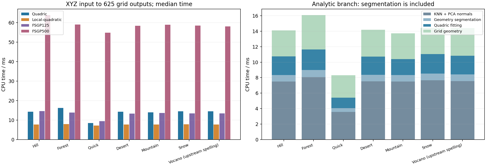
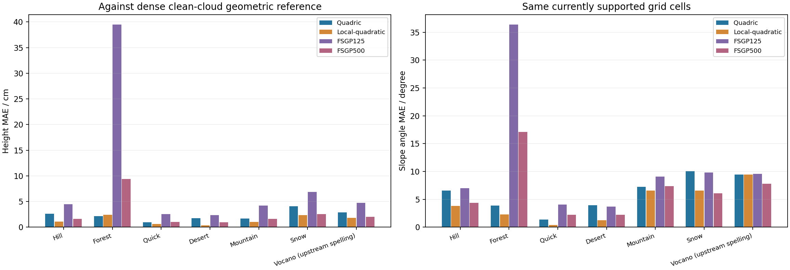
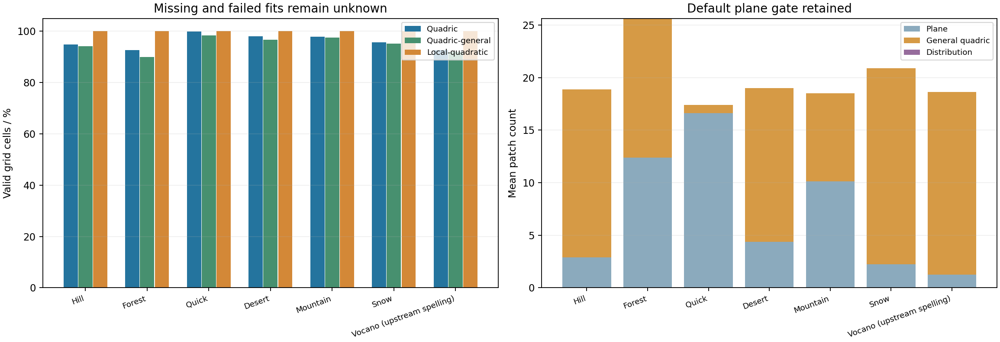
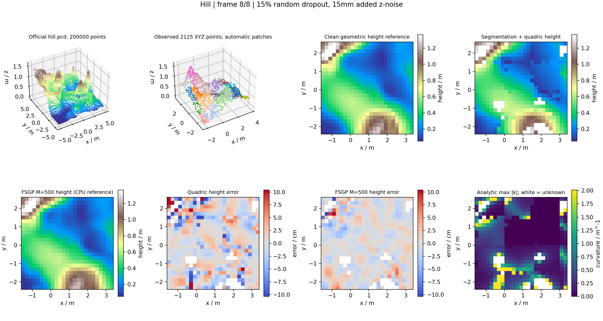
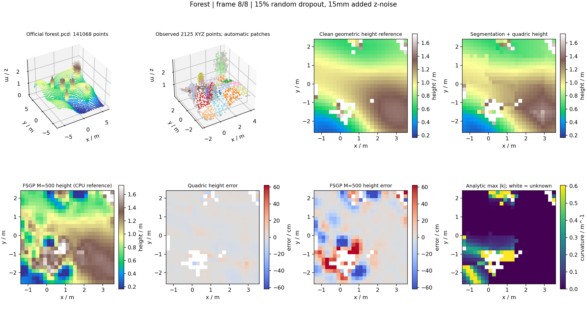
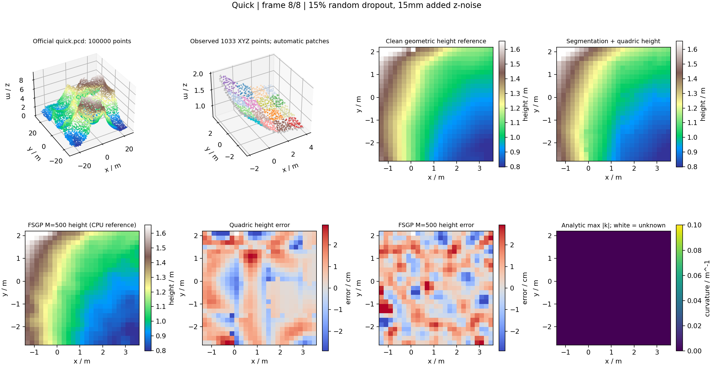
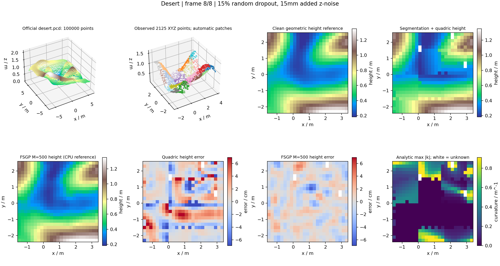
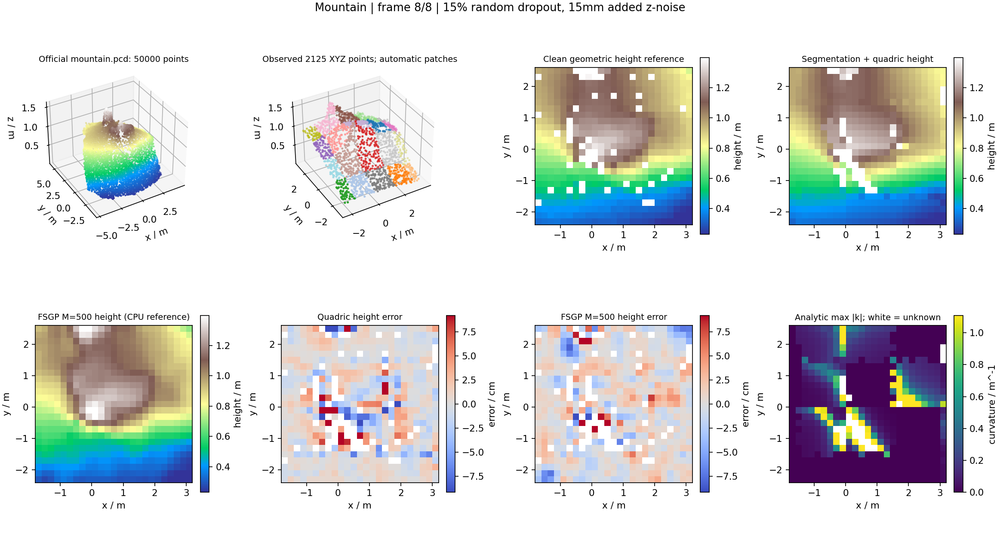
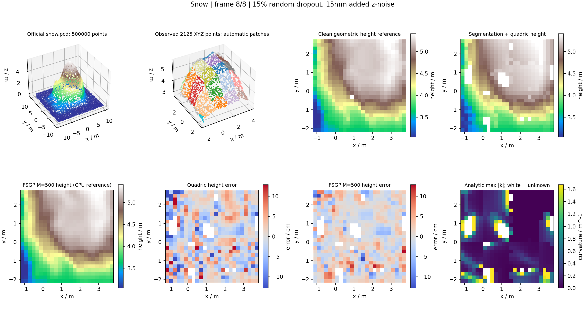
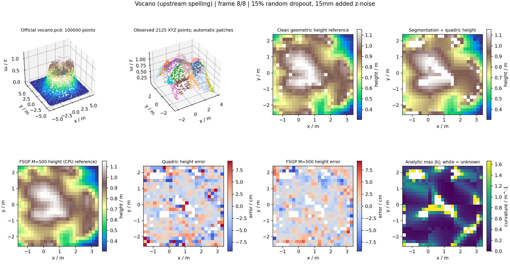

# 作者公开地形点云：从分割开始的完整拟合测试

已确认论文为高飞参与的 FSGP-BGK（IROS 2025）。本实验使用官方仓库原始点云，未用理想球面替代地形。

主要结果：计入法向和分割后，本地解析方案在七个场景都慢于局部高度二次拟合，与FSGP125 CPU参考接近。
它相对几何参考的曲率差异也普遍更大，先前理想面片上的速度与精度优势没有延续到这条完整地形流水线。

解析分支完整流程：输入XYZ → 裁剪局部窗口 → KNN/PCA法向 → 空间与法向约束的自动分割 → Taubin拟合 → 栅格高度/法向/坡度/主曲率。
FSGP原方法直接提取局部特征并做GP回归，不需要先做这种二次曲面面片分割。

## 数据范围与计时口径

上游固定提交：6e5976957734b90f367f8460a6eea6a0fc18c1cc。七份原始点云均检查Git blob SHA1、文件大小和SHA256。
仓库包含丘陵、森林以及quick、沙漠、山地、雪地、火山示例。这些示例不等于论文完整2500组评测；
公路、室内和废墟原始批测集与通行代价标签没有包含在该仓库发布中，本次没有伪造这些缺失实验。

每个场景8个移动窗口；5×5m地图、0.2m栅格，共625个查询位置。局部观测先以0.06m保留代表点，最多2500点，
然后随机丢弃15%、增加15mm高程噪声。后者是沿用的本地诊断噪声，不是论文已声明参数；随机丢点不是射线遮挡仿真。
单线程CPU，每种方法预热1次后交错重复7次计时；包含输入处理、法向、分割、拟合和地图计算，不含PCD读盘、参考生成与绘图。
FSGP125/500为本地CPU公式参考，另含不确定性与代价输出；没有运行作者GPU程序，也没有在此实验加入BGK时序融合。

局部二次对照使用64个3D近邻，直接拟合重力对齐的高度函数z=f(x,y)，不预分割；
它与前一轮任意切平面坐标下的局部多项式基线实现不同，本轮所有方法均固定625个地图查询。

|场景|原始点数|局部输入平均点数|原文件法向参考|
|---|---:|---:|---|
|hill|200000|2125|PCD provided normals|
|forest|141068|2125|dense clean-cloud PCA normals (estimated)|
|quick|100000|1042|PCD provided normals|
|desert|100000|2125|PCD provided normals|
|mountain|50000|2125|PCD provided normals|
|snow|500000|2125|PCD provided normals|
|vocano|100000|2125|PCD provided normals|

## 从XYZ开始的速度

所有方法读取完全相同的局部观测并查询同样625个栅格。统计是逐帧中位数再取中位数；各阶段不含参考计算。

|场景|分割+拟合+几何(ms)|局部二次拟合(ms)|FSGP125(ms)|FSGP500(ms)|KNN法向(ms)|区域分割(ms)|拟合(ms)|几何地图(ms)|
|---|---:|---:|---:|---:|---:|---:|---:|---:|
|hill|14.350|7.801|14.665|63.794|7.512|0.833|2.390|3.358|
|forest|16.242|7.957|13.901|58.990|8.057|0.937|2.631|4.437|
|quick|8.481|7.187|9.463|54.830|3.586|0.483|1.349|2.895|
|desert|14.311|7.764|13.400|58.388|7.521|0.839|2.355|3.457|
|mountain|13.968|7.777|13.627|58.840|7.499|0.842|2.055|3.335|
|snow|14.524|7.850|13.507|58.408|7.667|0.852|2.527|3.382|
|vocano|14.581|7.804|13.450|58.025|7.555|0.850|2.424|3.558|

## 效果与覆盖率

参照来自完整干净点云的局部几何：六个文件附带单位法向，森林文件没有法向，使用完整干净点云估计PCA法向。
高度由近邻切平面给出，几何曲率由干净法向变化局部拟合得到。因此这里是几何参考差异，不能称为论文代价真值误差。
主对照在参考与四种方法共同有效的当前栅格上评估，丢失/拟合失败位置保留未知；每种方法的完整覆盖率另列。
FSGP的无量纲PCA曲率指标没有与单位m⁻¹的主曲率直接比较。

|场景|方法|高度MAE(cm)|坡度MAE(°)|几何曲率参考RMSE(m⁻¹)|有效栅格比例|共同评估格子·帧|
|---|---|---:|---:|---:|---:|---:|
|hill|FSGP125|4.466|7.020|N/A|100.0%|4739|
|hill|FSGP500|1.598|4.342|N/A|100.0%|4739|
|hill|Quadric|2.618|6.569|1.324|94.8%|4739|
|hill|Local-quadratic|1.072|3.804|0.670|100.0%|4739|
|forest|FSGP125|39.465|36.368|N/A|99.8%|4521|
|forest|FSGP500|9.381|17.132|N/A|100.0%|4521|
|forest|Quadric|2.135|3.886|0.945|92.6%|4521|
|forest|Local-quadratic|2.416|2.280|0.487|100.0%|4521|
|quick|FSGP125|2.535|4.049|N/A|100.0%|4987|
|quick|FSGP500|1.002|2.253|N/A|100.0%|4987|
|quick|Quadric|0.985|1.375|2.062|99.9%|4987|
|quick|Local-quadratic|0.636|0.408|0.035|100.0%|4987|
|desert|FSGP125|2.369|3.713|N/A|100.0%|4899|
|desert|FSGP500|0.982|2.247|N/A|100.0%|4899|
|desert|Quadric|1.723|3.912|0.925|98.0%|4899|
|desert|Local-quadratic|0.363|1.229|0.072|100.0%|4899|
|mountain|FSGP125|4.198|9.074|N/A|100.0%|4581|
|mountain|FSGP500|1.629|7.371|N/A|100.0%|4581|
|mountain|Quadric|1.705|7.255|1.589|97.9%|4581|
|mountain|Local-quadratic|1.048|6.583|0.837|100.0%|4581|
|snow|FSGP125|6.878|9.801|N/A|100.0%|4774|
|snow|FSGP500|2.524|6.062|N/A|100.0%|4774|
|snow|Quadric|4.099|10.087|1.992|95.7%|4774|
|snow|Local-quadratic|2.356|6.584|1.139|100.0%|4774|
|vocano|FSGP125|4.737|9.564|N/A|100.0%|4489|
|vocano|FSGP500|2.010|7.799|N/A|100.0%|4489|
|vocano|Quadric|2.871|9.480|2.477|92.6%|4489|
|vocano|Local-quadratic|1.808|9.448|1.029|100.0%|4489|

默认平面阈值会让部分缓弯面输出零曲率。Quadric-general为关闭平面门限的单独敏感性对照，
其原始误差、失败比例和逐次耗时保留在CSV/JSON中；它采用自己的参考交集，不能与主表直接作精度排名。

## 完整原始PCD输入：不设点数上限

下面从原始PCD的全部XYZ在内存中开始，计时内先裁剪局部窗口；不做0.06m稀疏化、2500点上限、随机丢点或额外噪声。
局部二次方法和FSGP也包含各自所需的在线裁剪和建树。输入全图点数与实际局部点数分开列出。

|场景|输入全图点数|局部实际点数|完整解析分支(ms)|局部二次(ms)|FSGP125(ms)|
|---|---:|---:|---:|---:|---:|
|hill|200000|70974|326.887|40.375|306.047|
|forest|141068|40631|201.584|26.903|182.258|
|quick|100000|1219|12.752|10.249|14.458|
|desert|100000|24233|108.139|18.604|101.007|
|mountain|50000|29240|134.379|19.656|124.715|
|snow|500000|43287|215.459|40.539|205.500|
|vocano|100000|31916|155.598|23.313|146.246|

## 场景效果

每幅图先显示原始地图与带噪观测的自动分割，再显示相同窗口的地图结果。灰色点没有形成有效面片，白格为未知。
高度色标使用1–99百分位、误差色标使用98百分位、曲率色标使用95百分位；超出色标的数值截断，CSV/NPZ保留完整数值。

## 复查与来源

17项单元测试覆盖曲率闭式公式、有限差分、刚体变换、上下层分割、根选择与完整平面流水线。
每帧NPZ包含原始局部输入、源点索引、分割标签、参考与各方法预测，可重新计算误差；protocol.json记录全部参数与源码哈希。
本次是二次曲面方案在高飞团队公开地形上的独立测试，不能称为论文原版GPU性能复现或完整2500场景复现。

论文：https://arxiv.org/html/2503.04134v2 。官方仓库：https://github.com/ZJU-FAST-Lab/FSGP_BGK 。
