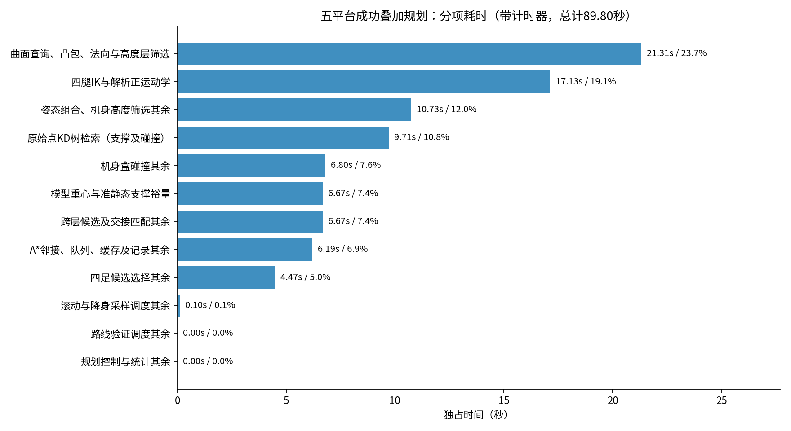

# 五平台规划耗时分布（2026-11-25）

复用原拟合数据，对最终成功的叠加图做一轮带计时器的重复实验。没有重复前两轮预算耗尽的尝试，也未修改规划器或原路线。
历史成功阶段为119.08 s；本次带计时器实测89.80 s。运行环境波动与计时器开销均可能影响绝对值，不能直接当作加速或减速倍数。

## 按处理阶段

| 阶段 | 时间 | 占规划时间 |
| --- | ---: | ---: |
| A*搜索及候选节点检查 | 84.534 s | 94.13% |
| 候选路线的滚动采样检查 | 5.267 s | 5.86% |
| 规划控制和记录 | 0.000 s | 0.00% |

## 按具体计算内容

下表为互不重复的独占时间：子调用已经从父项扣除。原始点KD树检索包含支撑、轮子和机身邻域查询，不能全部视作碰撞耗时。

| 计算项 | 独占时间 | 占规划时间 |
| --- | ---: | ---: |
| 曲面查询、凸包、法向与高度层筛选 | 21.312 s | 23.73% |
| 四腿IK与解析正运动学 | 17.133 s | 19.08% |
| 姿态组合、机身高度筛选其余 | 10.734 s | 11.95% |
| 原始点KD树检索（支撑及碰撞） | 9.713 s | 10.82% |
| 机身盒碰撞其余 | 6.798 s | 7.57% |
| 模型重心与准静态支撑裕量 | 6.671 s | 7.43% |
| 跨层候选及交接匹配其余 | 6.667 s | 7.42% |
| A*邻接、队列、缓存及记录其余 | 6.193 s | 6.90% |
| 四足候选选择其余 | 4.473 s | 4.98% |
| 滚动与降身采样调度其余 | 0.102 s | 0.11% |
| 路线验证调度其余 | 0.005 s | 0.01% |
| 规划控制与统计其余 | 0.000 s | 0.00% |

## 每次搜索与路线检查

| 调用顺序 | 内容 | 时间 |
| --- | --- | ---: |
| 1 | A*搜索及候选节点检查 | 81.970 s |
| 2 | 候选路线的滚动采样检查 | 3.215 s |
| 3 | A*搜索及候选节点检查 | 2.564 s |
| 4 | 候选路线的滚动采样检查 | 2.052 s |

## 准备阶段与验证

模型读入／原始点与曲面搜索树准备0.235 s；连续分层和边界连接5.947 s；机器人模型准备0.072 s。以上不计入规划百分比。
新评估31,816个姿态候选；A*累计展开59,404次；排除1条失败滚动边。返回136个路线节点、1302帧及2处跨层候选。

逐帧机身、四足、法向、关节和函数归属均与原结果一致（1e−12容差），节点序列、阶段和代价一致；原拟合文件、原结果和规划器源码SHA256不变。跨层动作仍未验证。

[完整计时数据及复现命令](profile.json) · [当前工作流程](../../workflow.md) · [规划页面](../../?scene=four-platforms)

