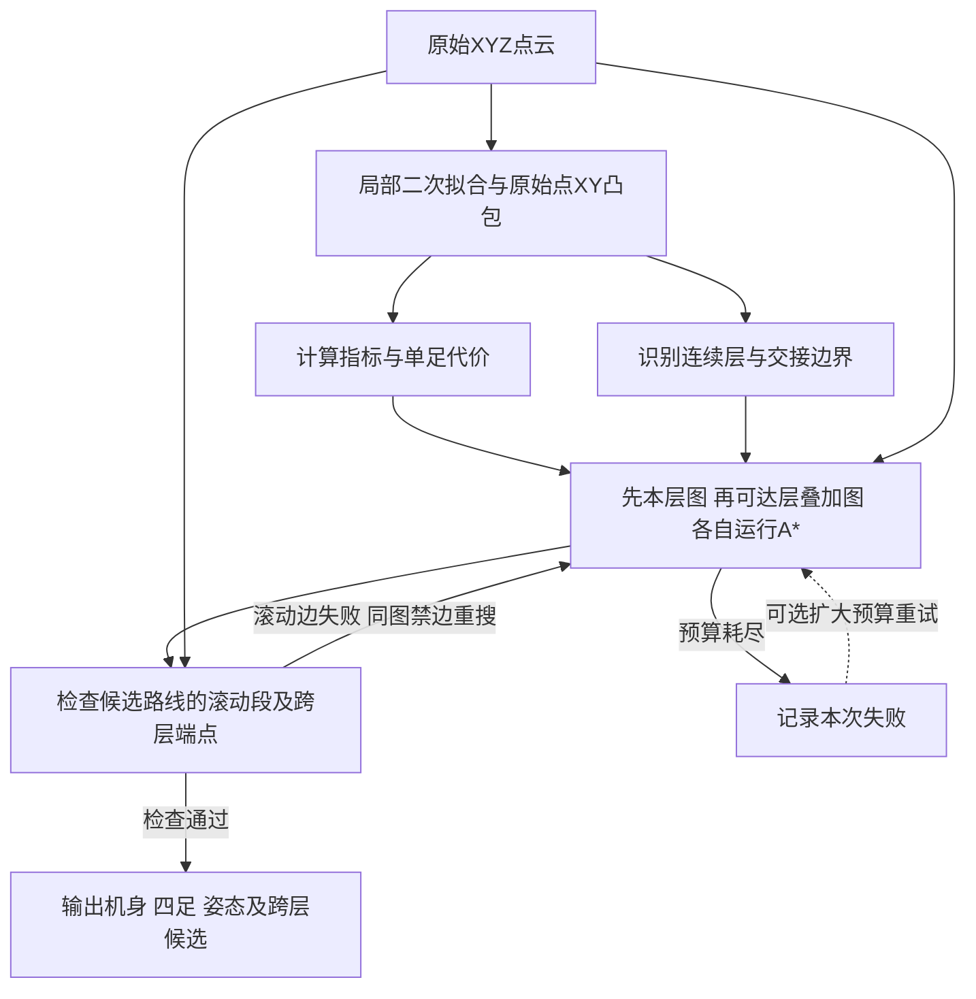

# 当前工作流程：从点云曲面到机器人路径

更新：2026-11-25（含分项计时补测）。当前使用**普通A*的分层规划**，复用已生成的自适应圆形二次曲面。加权A*、LPA*尚未实现或测试。

图中表示主要顺序；本层图与叠加图各自都执行候选路线检查和失败重搜。**当前输出是几何规划结果，跨层抬腿过程与动态执行尚未验证。**

## 1. 点云如何变成可查询的曲面

从原始XYZ选局部圆形邻域，按观测高度模式及局部切平面残差筛点，至少15点，半径最多15 cm，训练RMSE门限8 mm。拟合得到各自独立的二次函数：`z=f_i(x,y)`。每个函数的有效域是实际参与拟合点的XY凸包；保留系数、法向所需导数、协方差、指标和原始点。

规划时直接读取保存结果，**不会每搜索一个节点就重新拟合**。查询XY时只考虑凸包覆盖该点的函数，由公式求高度及法向`n=normalize(-∂f/∂x,-∂f/∂y,1)`，同一XY允许有不同高度的候选。相差小于1.2 cm的重复高度预测合并。

曲面用于四足落点、高度、法向、代价、分层和净空；原始点云用于支撑及碰撞核查。显示三角形和小缝补全不作为搜索节点或新增落足依据。当前规划固定使用`qcircle-adaptive`，主地形页的其他拟合设置作为独立对照。

## 2. 落足点怎样评分

地形页计算六项诊断指标，规划取其中五项。令每项归一化值为`clip(原值/尺度,0,1)`：

| 指标 | 归一化尺度 | 权重 |
| --- | ---: | ---: |
| 坡度 | 45° | 0.30 |
| 平滑性：法向变化 | 15° | 0.20 |
| 拟合RMSE | 2 cm | 0.15 |
| 拟合最大误差 | 2 cm | 0.10 |
| 预测不确定性σ | 1 cm | 0.10 |

`单足代价 = 上表五项加权和`，权重合计0.85，不重新缩放。一个落足点沿用所属函数的指标；机身地形代价`T`为四足代价的平均。上方占用比例仅作诊断，不进入此代价。RMSE和最大误差是训练残差，不代表独立测试精度。

节点代价还包括软IK、机身高度偏好和支撑裕量：

`C = T + 0.15×[IK软代价 + 0.25×((h−0.40)/0.10)²] + 0.05×max(0,(0.05−m)/0.05)`

其中`h`为机身中心相对支撑平面的高度（m），`m`为准静态支撑裕量（m）。靠近关节限位、IK残差较大、偏离40 cm高度或支撑裕量偏小，都会增加代价；下述硬检查失败则直接否决。

## 3. 怎样分层、连接曲面

先按相邻凸包间隙≤2.5 cm、共同XY查询位置的函数预测差≤2 cm建立连续关系，初始区域至少含3个函数；再检查真实交接边界，将边界样本均满足2 cm容差的区域合并。一层可包含许多独立函数和连续坡面，不按绝对高度切成固定几层。沿同一连续层移动按滚动处理。

不同层只在原拟合域的实际交接边界上比较：`Δz=abs(f_i(q)−f_j(q))`。**Δz严格小于40 cm，且水平域间隙≤2.5 cm**，才建立跨层连接。单纯在XY上重叠不允许任意切层。连续关系的2 cm容差与跨层的40 cm门限作用不同。

沿这些连接从起始层向外找到可达层，保存父子关系。40 cm是用户设定的规划门限，未标定为盲走模型的实际攀爬能力。

## 4. A*实际搜索什么

状态键为`(XY网格索引,航向,参考拟合函数编号)`，XY步长16 cm、航向8种。层编号由参考函数所属连续层得到；实际Z、四足和机身高度由节点检查计算。它搜索机身状态，每个状态同时求四个支撑点。

普通扩展包含8个方向的相邻位置及原地±45°转向。靠近跨层边界时，还在边界另一侧32／48／64 cm处生成连接候选；每个发生层变化的足点连接都要匹配实际交接边界，匹配容差8 cm。

搜索累计代价为`g`，启发项为到目标XY的直线距离，按`g+启发项`排序。边代价为：

`XY移动距离×(1+2×目标节点代价C) + 0.015×航向改变的45°档数`

当前不单独加入爬台能耗项。到达判据为XY距目标≤12.8 cm，若指定目标高度，参考曲面高度还需相差≤4 cm。

## 5. 每个候选节点如何求四足和机身

将模型的名义四足位置按候选航向旋转、平移。在每只足的名义点及XY各±3.5 cm形成的9个候选位置查询曲面；名义点可用时优先采用，否则按地形代价、偏移量和与参考面预测的高度差选择。未枚举四足所有组合，也没有对四只足分别跑A*。

用选中的四足拟合支撑平面，结合航向确定机身俯仰和横滚。机身中心Z等于该支撑平面在机身XY处的高度加`h`，依次评估`h=32、36、40、44、48、52 cm`，按IK及高度偏好选择可行姿态。

节点必须满足：

- 四足落在原始拟合凸包内；目标接触和IK实际接触附近都有原始点，三维距离≤3 cm。
- 解析IK求关节角并限制在关节范围内，轮心最大残差≤12 mm；软代价另外惩罚残差和接近限位。
- 上方通行初筛通过，机身与附近原始点无碰撞；轮心到原始点距离≥7.8 cm。
- 用模型关节姿态计算整机重心，其竖直投影距支撑多边形边缘至少1 cm，裕量在XY投影上计算。

**ZMP在本版用于准静态支撑检查**，采用重心在支撑平面上的竖直投影，没有做动态ZMP轨迹优化。当前配置的机身碰撞盒为75×23×14 cm，轮半径9 cm，机身安全余量2.5 cm；轮子采用球形包络接触近似。

## 6. 上方有曲面时如何处理

在同一XY查询上下层函数，取比当前曲面高出2 cm以上的最近上层，净空`g=f_上层−f_当前层`。**g≥41.5 cm记为1，否则记为0并否决该层落足候选。** 41.5 cm来自最低中心高度32 cm＋机身半高7 cm＋余量2.5 cm。没有拟合上层时记1，表示没有该项否决，仍需后续碰撞检查。

初筛通过后，继续按实际机身姿态检查顶部余量。例如净空42 cm时，40 cm中心姿态无法通过，32 cm中心姿态可行。降身和升身在四足支撑不变的位置按1 cm高度增量检查。

此前独立的[70 cm净空](http://127.0.0.1:42482/surface-planner/?scene=platform-underpass-070)和[42 cm净空](http://127.0.0.1:42482/surface-planner/?scene=platform-underpass-042)对照仍保留：前者保持40 cm中心高度，后者进入前降至32 cm、驶出后恢复40 cm；详细结果在报告中。

下方被否决时，上方曲面只有通过第3节的真实边界连接及节点检查，才可能作为跨层候选。不会因为下方为0就直接跳到上方。上方净空始终查询全部观测曲面，不能通过限制允许落足的层把顶板隐藏。

## 7. 两张规划图与路线验证

先只开放起始连续层，运行本层A*；如果存在其他可达层，再把其XY范围和代价加入，运行叠加图A*。叠加保留实际Z、原函数及层编号，不把上层高度改成零。两图用相同起终点和代价，各自最多返回一条路线；当前不枚举所有层组合和所有走法，也不规定平台必经点。

找到候选路线后，同层段按移动间隔≤2 cm、转角间隔≤7.5°采样，保持每只足原来的连续层，逐样本复查支撑、机身高度、IK、碰撞和准静态支撑裕量。某条滚动边失败，就记录并禁用该边，在同一图上从头重建A*队列重搜；姿态和查询缓存可复用。每张图最多尝试16轮。

跨层段只保存交接处两端有支撑的姿态，标记`requires_layer_transition=true`、`motion_validated=false`，网页画紫色虚线。**未生成逐腿摆动、lift/change顺序或动态跨越轨迹；旧的4 cm足点跳动自动抬腿规则在当前分层规划中关闭。** 普通A*扩大预算重试会新建规划器，没有复用此前耗尽预算时的搜索队列。

## 8. 五平台场景的实际结果与耗时

20×8 m平地，初始前方+X、左侧+Y，起点(-9.2,−2.4)、目标(9.2,−2.4)。第2、3、4台横跨完整8 m宽度，禁止侧绕；第5台左侧留1.2 m小路。当前只保留这一条全程查询。

| 平台 | 顶高／净空 | 全程规划实际结果 |
| --- | --- | --- |
| 1 | 80 cm／实心 | 绕行 |
| 2 | 80／70 cm | 保持机身中心40 cm正常下穿 |
| 3 | 52／42 cm | 机身中心降至32 cm下穿 |
| 4 | 30／20 cm | 经台面连接；上下台动作未验证 |
| 5 | 78／38 cm | 沿左侧小路绕行 |

| 阶段 | A*调用次数 | 节点展开次数 | 搜索与路线检查 |
| --- | ---: | ---: | ---: |
| 本层图，预算22,000 | 1 | 22,000 | 68.66 s，预算耗尽 |
| 首次叠加图，预算22,000 | 1 | 22,000 | 68.23 s，预算耗尽 |
| 叠加图扩大到每次66,000 | 2 | 29,674＋29,730 | 119.08 s，最终成功 |

**合计调用4次A*，搜索与检查约255.96 s。** 119.08 s仅为最后一行，包含一条滚动边失败后重新搜索的时间；该阶段新评估31,816个姿态候选，累计展开59,404次，重搜会重复展开已有节点。最终路线25.80 m、136个路线节点、1,302帧，含两处上下台连接候选。

“预算”是每次A*的最大节点展开数，达到上限还没找到路线就停止；它不是固定秒数，也不证明无路。另有初次读取／分层准备8.57 s、重试准备8.95 s。拟合及六指标、显示几何计算40.24 s独立统计，不在以上规划时间内；计时均不含浏览器。

2026-11-25对最终成功叠加阶段补测分项时间，路线与原节点、四足和关节逐帧一致。带计时器共89.80 s：首次A*及节点检查81.97 s、第一次路线检查3.21 s；禁边后复用缓存重搜2.56 s、第二次路线检查2.05 s。读模型／搜索树0.24 s、分层及边界图5.95 s、机器人模型0.07 s另计。未重复前两轮预算耗尽的尝试，原119.08 s与255.96 s仍保留为历史测量。

本次独占时间中，曲面查询／凸包／法向／高度层筛选23.73%，四腿IK／解析正运动学19.08%，姿态组合及高度筛选11.95%，原始点KD树检索10.82%，机身盒碰撞其余7.57%，重心与准静态支撑检查7.43%，跨层候选及匹配7.42%，A*邻接／队列／缓存／记录其余6.90%，四足候选选择其余4.98%。子调用已从父项扣除，避免重复加总；原始点检索同时服务支撑与碰撞。

这次补测表明，大部分时间用于首轮的新姿态评估。禁边后的全局重搜会重复展开节点，但已有姿态和查询缓存让重搜仅耗约2.56 s，不能按重复展开次数认定它与首次搜索同样昂贵。不同运行环境及计时器开销会改变绝对时间，本次89.80 s不能作为对原119.08 s的算法加速倍数。[完整分项报告](http://127.0.0.1:42482/surface-planner/profiling/four-platforms-20261125/report.md) · [耗时图](http://127.0.0.1:42482/surface-planner/profiling/four-platforms-20261125/breakdown.png)。

## 9. 当前验证范围

独立核查了原始凸包支撑、IK实际接触、轮心距离、机身碰撞和准静态支撑裕量。五平台还用构造场景的实体盒做27,342次机身体积核查，避免返回姿态进入台板内部；实体标签和盒子只用于独立核查／显示，不参与拟合或A*选路。第5台曾产生进入厚板内部的底面候选，已否决并调整场景；当前原始点碰撞方法仍不能保证识别任意实体内部。

原128项Python测试及浏览器检查记录保留；2026-11-25仅新增同约束下的分项计时重复实验，并核对原拟合、原路线与规划器源码哈希不变，未重跑整套场景。跨层抬腿、腿部全过程碰撞、完整圆柱轮接触和动态稳定性尚未验证，规划门限不能代替盲走能力实测。

## 10. 查看、代码和复现

[42482五平台规划](http://127.0.0.1:42482/surface-planner/?scene=four-platforms) · [拟合与指标](http://127.0.0.1:42482/?scene=four-platforms&profile=qcircle-adaptive&coverage=1) · [详细参数与逐场景结果](http://127.0.0.1:42482/surface-planner/report.md) · [核查记录](http://127.0.0.1:42482/surface-planner/preservation-audit.json)。勾选“透视上层”看下穿，紫色虚线表示跨层候选。

核心入口为`fsgp_bgk_repro/layer_projection_planner.py`；曲面查询和姿态检查复用`surface_astar.py`，模型IK／重心来自`surface_robot.py`，扩大预算入口为`retry_layer_projection.py`。完整复现命令见项目`step.md`第29节：先跑规划；叠加图预算耗尽时再扩大到66,000；随后运行核查、报告和发布模块。所有场景沿用42482端口。

[旧四平台实验](http://127.0.0.1:42482/surface-planner/history/before-five-platform-chain-20261124/?scene=four-platforms) · [此前错误延伸方向版本](http://127.0.0.1:42482/surface-planner/history/before-right-side-correction-20261124/?scene=platform-underpass-042) · [更早的规划查看器](http://127.0.0.1:42482/surface-planner/history/before-layer-projection-20261123/index.html)均保留独立入口。
