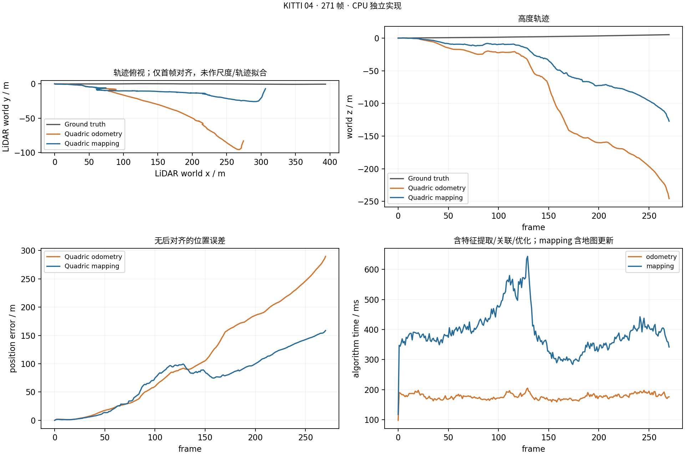
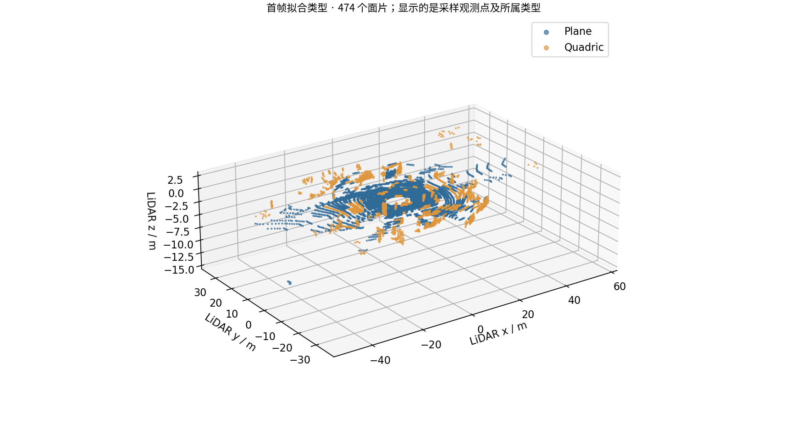
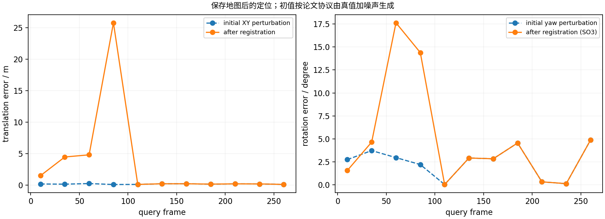

# Quadric LiDAR 论文方法独立复现

论文：[Quadric Representations for LiDAR Odometry, Mapping and Localization](https://arxiv.org/abs/2304.14190v1)。
没有找到作者公开的代码仓库；本目录是根据论文公式编写的 CPU 参考实现，不是作者代码。

实测 KITTI 04，共 271 帧；完整官方短序列约 393.65 m。
点云和真值来自 KITTI 官方公开存储；原始归档按 HTTP Range 选取该序列，不下载其余 84 GB 数据。

## 实测与论文对应序列

| 模块 | 本地平移误差 % ↓ | 论文序列04平移 % | 本地旋转误差 °/100m ↓ | 论文序列04旋转 | 本地中位 ms/帧 |
|---|---:|---:|---:|---:|---:|
| odometry | 52.813 | 1.66 | 20.518 | 1.22 | 176.0 |
| mapping | 35.481 | 0.87 | 9.953 | 0.51 | 381.5 |

上表是 KITTI 100–800 m 子段、每10帧起点的相对位姿指标；本序列仅足够生成100/200/300 m子段。
论文将这两个指标记为 ATE(%) / ARE(°/100m)，这里明确标为相对误差，避免与绝对轨迹 APE 混淆。
每个子段用未修改的官方 `calcSequenceErrors` 独立交叉验证；没有用刚体/尺度后对齐掩盖漂移。
**本地精度尚未对齐论文，不能称为已复现论文实验指标。**

## 实现范围

- spherical range image → patch segmentation → plane / quadric / distribution fitting。
- Taubin点到二次曲面残差、点到分布残差、式(7)加权面片关联、解析SE(3)雅可比和LM。
- scan-to-scan里程计、scan-to-submap建图、按式(8)/(9)更新矩统计；目标地图不保留历史原始点。
- 1.5 m空间哈希、最低MSE冲突保留规则、地图保存和重载后的scan-map定位。

## 与论文未指定细节/作者实现的差异

- 64-beam nominal HDL-64 ring projection, 2048 columns; extra 35-degree normal gate in range segmentation
- quadric fitting uses a Taubin generalized eigenproblem; sensor-specific noise model of ref [34] is not implemented
- PCA plane ratio, regularization, residual gates, sample budgets and LM stopping settings are explicit local choices
- patch association and optimization use deterministic point budgets rather than every source point
- default stability variant adds a 45-degree planar-normal association gate and Cauchy loss (scale 1); --literal disables both
- integer tuple spatial hashing instead of binary GeoHash; same 1.5m cell size and lowest-MSE collision rule
- no ROS, deskew/IMU fusion, loop closure, or official LOAM baseline; timings are Python/C++ reference on this CPU

默认版本在关联中增加近似平面法向一致性门限，并使用Cauchy损失以抑制错误匹配。
这些是明确列出的稳定性扩展，不属于已验证的作者原实现；`--literal`可关闭它们。
首次无这两项扩展的完整序列结果保存在 `../literal_initial/`，并保存对应源代码快照。

## 地图和定位

保存 1699 个面片，NPZ 584,838 bytes。
相对完整输入的XYZ float32载荷，文件尺寸比约 699.1 倍。
这个比值同时包含几何近似和NPZ压缩，不是内存峰值，也不是论文1508.9倍结果的复现。

定位查询 11 次，有匹配并接受优化步 3 次，平移误差低于初始扰动 3 次。
最终平移误差中位数 0.199 m；旋转误差中位数 2.927°。
定位初值按照论文由真值+XY±0.2m、yaw±5°生成；仅用于定位实验。
里程计和建图未读取真值。定位地图由估计轨迹建立，其漂移会影响定位结果；不把接近真值的初始先验当作定位成功。

## 检查和证据

`per_frame.csv`：实际面片数、选点数、优化步数、逐阶段耗时。
`*_camera.txt`：预测和真值的相机坐标轨迹，可直接用KITTI devkit评测。
`*_segment_errors.csv`：逐子段误差；`metrics.json`：汇总；`protocol.json`：参数、数据和代码哈希。
`quadric_map.npz`：origin、55项对称矩统计和点数，不含历史点云。
单元检查包括平面、球面、两类残差雅可比、矩统计变换/增量合并、已知SE(3)配准及地图保存重载。
