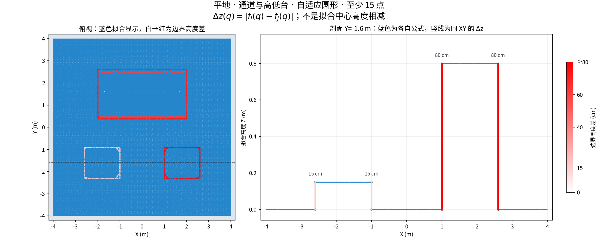

# 当前地形评价与分层投影规划结果

更新日期：**2026-11-25**（新增分项计时补测）。统一入口：**http://127.0.0.1:42482/**。地形页为 **18 场景×4 种基础设置×6 项诊断指标**，加森林门限对照，共 73 组；其他69组保留，五平台链替换原四平台场景的四组设置。

**当前流程：原始XYZ → 局部二次拟合与凸包 → 指标和落足价值 → 连续曲面分层 → 本层A* → 叠加可达层再跑A* → 路线检查／失败重搜 → 可视化**。完整流程、代价公式、节点检查顺序和验证范围见 [planning-workflow.md](planning-workflow.md)，[本轮实测与耗时](#layer-projection-planning)。

当前使用普通A*，复用已拟合函数求四足高度、法向和代价；搜索时不重新拟合。ZMP用于准静态支撑裕量检查，跨层仅验证连接两端。原五平台实验共调用4次A*，规划与路线检查累计255.96 s，其中最终叠加阶段119.08 s；这些历史测量保留。2026-11-25补测同一成功叠加阶段，带计时器实测89.80 s，逐帧路线一致：首次搜索81.97 s、复用缓存重搜2.56 s，两次路线检查合计5.27 s。不同运行环境和计时器开销影响绝对值，不作为算法加速比较。加权A*和LPA*尚未实现或测试。

单足只用五项代价：

`单足代价 = 0.30×坡度 + 0.20×平滑性 + 0.15×RMSE + 0.10×最大误差 + 0.10×不确定性`

权重合计 0.85，不重新缩放；body 地形代价是四足平均。上方占用只保留为诊断指标，上方通行 0/1 和碰撞检查继续保留。

- **同一连续层只滚动**：不再因足点目标高差>4 cm 触发抬腿，滚动失败也不自动改为摆腿。
- **分两张图规划**：先只开放起始层；再沿观测交接边界，把高差**严格小于 40 cm**的可达层叠加到同一 XY 搜索范围，重新运行 A*。保留原高度与层编号，重叠处不能随意切层。
- **跨层仅作为候选连接**：记录边界与两端姿态，没有生成跨层抬腿轨迹。40 cm 是本轮用户设定，与旧盲走台阶试验的 4 cm 分开。

[打开高低台对比](http://127.0.0.1:42482/surface-planner/?scene=flat-corridor-platforms) · [丘陵滚动](http://127.0.0.1:42482/surface-planner/?scene=hill) · [仅重算规划的命令](step.md#layer-projection-reproduce)。勾选“投影代价图（XY）”可查看叠加搜索图。

原五项权重、已有拟合函数、凸包与六项诊断指标保留；两个新场景另运行四设置与六指标。本轮核查见 [preservation-audit.json](fsgp_bgk_repro/outputs/visualization/surface-planner/preservation-audit.json)。本文第 8–11 节保留 2026-11-22 的旧规划阶段记录，当前规划以第 13 节为准；旧版独立查看器在 [历史目录](http://127.0.0.1:42482/surface-planner/history/before-layer-projection-20261123/index.html)。更早指标实验见 [result-history.md](result-history.md)。

<a id="11-当前首页八场景凸多边形显示与六项指标"></a>

<a id="11-当前首页九场景凸多边形显示与六项指标"></a>

## 1. 当前首页：十八场景、凸多边形显示与六项指标

首页提供丘陵、森林、平地、沙漠、山地、雪地、火山、高低组合多级台阶，以及“平地 · 通道与高低台”、“A* 初版 · 矮台、立墙与顶板”、恢复的大桌子，以及净空 40／42／60 cm 的三个独立低桌场景，以及封闭通道的降身／上桥对比场景、第二台向机器人初始右侧（−Y）延伸且净空 70／42 cm 的两版场景与五平台通行链；统一使用局部二次曲面。已移除组合曲面控件与当前组合网格计算，FSGP、突变 A/B/C、落足和机身评分不进入新首页。统一端口仍为 **http://127.0.0.1:42482/**。

用户已明确“对齐”指统一场景规则，不要求相邻函数公共边界严格无缝。四种基础拟合设置保留作对照，默认自适应适用于全部十八场景；森林额外提供取消中心偏移上限的实验选项。各设置的选点与质量门限按名称及配置区分，显示域、六项指标和色标共用。

### 1.1 当前显示规则

每个有效函数的有效显示域直接取其合格拟合原始点 XY 的精确凸包。拟合邻域依旧可以是圆或方，但显示外沿统一为凸多边形；取消旧版凸包 7.5 mm 扩张、显示高度带和近原始点支持删面。各有效凸包全部显示，不跨函数建组合网格。

网页所需的显示细分只用于近似画出二次函数；所有显示顶点的高度来自所属函数。指标直接在函数和原始点上计算，没有任何指标再读取显示顶点或三角形。凸包不能识别内部观测空洞，蓝色只说明模型在这个凸包域内被显示，不证明内部处处有原始点或可以通行。

所有当前场景均有默认勾选的“补齐小缝（<9 cm²）”显示选项：在原凸包域之外补全符合面积和边界高度条件的封闭小缝，蓝色包含这部分显示补全。取消该勾选即可查看严格原凸包覆盖。六项指标仍在原凸包域计算，不把补全面积当成新增观测或有效拟合函数。没有候选小缝时显示补全数量为零。

### 1.2 当前仅保留六项指标

| 指标 | 当前计算方式 |
| --- | --- |
| 上方占用 | 仅原始点；相对本函数高 10–60 cm 且 XY 在凸包内。5 cm 全局 XY 列按与凸包的精确交叠面积计权，返回占用面积比例。没有障碍观测不等于证明自由空间。 |
| 坡度 · 平均法向 | 在凸包内独立的 1 cm XY 网格中心，对二次函数求导并得到单位法向。先平均单位法向、再归一化，计算与 +Z 的夹角。 |
| 拟合 RMSE | 本次实际参与拟合点的竖直残差均方根。 |
| 不确定性 σ | phi(q)^T Sigma phi(q) 开方；在独立内部采样和凸包顶点上取预测均值标准差的最大采样值。 |
| 平滑性 · 法向变化 | 上述单位法向相对平均法向的夹角 RMS，以度表示，越小越平滑。不混入 RMSE，也不评价跨函数接缝。 |
| 拟合最大误差 | 同一批参与拟合原始点的最大绝对竖直残差。 |

平均法向坡度在对称起伏上可能相互抵消，应同时查看平滑性。训练残差不是独立测试精度，不确定性尚未标定为实际误差。独立内部采样按 XY 面积近似等权，极小凸包没有网格中心时使用凸包顶点平均位置。

统一白到红色标：占用 0–100%、坡度 0–45°、RMSE 0–20 mm、sigma 0–10 mm、法向变化 0–15°、最大训练残差 0–20 mm；超过红端不截断保存数值。页面“指标已知率”按有效函数计数，不是面积覆盖率。

### 1.3 默认自适应结果

| 场景 | 原始点 | 中心 | 有效／显示函数 | 当前完整计算 |
| --- | ---: | ---: | ---: | ---: |
| 丘陵 | 200,000 | 9,876 | 9,810 / 9,810 | 8.04 s |
| 森林 | 141,068 | 5,379 | 4,666 / 4,666 | 6.21 s |
| 平地 | 103,041 | 4,199 | 4,199 / 4,199 | 3.56 s |
| 沙漠 | 100,000 | 4,822 | 4,796 / 4,796 | 4.85 s |
| 山地 | 50,000 | 2,944 | 2,791 / 2,791 | 2.88 s |
| 雪地 | 500,000 | 22,767 | 20,391 / 20,391 | 23.42 s |
| 火山 | 100,000 | 5,857 | 5,747 / 5,747 | 5.70 s |
| 高低组合多级台阶 | 97,455 | 3,899 | 3,718 / 3,718 | 4.02 s |
| 平地 · 通道与高低台 | 156,743 | 8,527 | 5,793 / 5,793 | 9.64 s |
| A* 初版 · 矮台、立墙与顶板 | 45,776 | 2,565 | 1,961 / 1,961 | 2.68 s |
| 大桌子 | 82,283 | 3,740 | 3,734 / 3,734 | 5.80 s |
| 低桌 · 净空 40 cm | 80,043 | 3,338 | 3,332 / 3,332 | 4.90 s |
| 低桌 · 净空 42 cm | 80,523 | 3,451 | 3,443 / 3,443 | 5.11 s |
| 低桌 · 净空 60 cm | 80,683 | 3,402 | 3,396 / 3,396 | 5.16 s |
| 封闭通道 · 降身／上桥 | 189,025 | 27,130 | 7,346 / 7,346 | 20.95 s |
| 第二台右侧延伸 · 净空 70 cm | 168,401 | 9,300 | 6,688 / 6,688 | 11.29 s |
| 第二台右侧延伸 · 净空 42 cm | 167,897 | 9,202 | 6,587 / 6,587 | 11.32 s |
| 五平台全程通行链 | 454,219 | 18,748 | 18,547 / 18,547 | 40.24 s |

72 组“18 场景×4 设置”均计算六项指标，所有有效函数均有完整凸包显示。原八场景的固定设置复用并核对原有中心、系数、邻域、协方差和训练误差，自适应重新拟合；新增场景四种设置均从 XYZ 重新拟合。因此计时包含的拟合工作量不同，不能直接拿固定组与自适应组的总时间算速度倍数。本次 CPU／单线程 BLAS；单次完整计算包含读入或拟合、凸包、六项指标及显示几何，不含导出和浏览器。

已验证每个函数的原显示三角形 XY 面积和等于其凸包面积，没有跨函数三角形；独立复算法向指标及 sigma 与保存值一致。测试数以第 13 节最新核查为准；新增平地障碍场景前后，原八场景的 480 个数据文件哈希不变，更早的 677 个历史结果文件也核对未变。早期全场景补缝及边界高度图核对了基础 36 组与森林对照共 37 组的 **555 个数据文件不变**；此前删除占用代价只重算规划；前一轮保留61组、915个文件并增加两版下穿场景；本轮其他69组、1035个文件保持不变，五平台链替换原四平台的4组、60个文件，旧版独立归档。

- [当前首页](http://127.0.0.1:42482/)。
- [森林默认自适应](http://127.0.0.1:42482/?scene=forest&profile=qcircle-adaptive&coverage=1)。
- [完整计算说明](fsgp_bgk_repro/outputs/visualization/convex-assessment/report.md)。
- [统一拟合后处理与六指标](fsgp_bgk_repro/convex_surface_assessment.py)。
- [数值与凸包完整性核查](fsgp_bgk_repro/convex_assessment_report.py)。

原九场景浏览器记录保留：9 场景×4 设置×6 指标共 216 个视图核对数值和颜色；点选凸包边界、原始点开关、分享刷新、CSV、说明链接、手机布局、旧场景历史链接均通过，无页面错误或资源加载失败。新增场景本轮四设置×六指标的 24 个视图与规划播放器另行核查通过，见[规划浏览器记录](fsgp_bgk_repro/outputs/visualization/surface-planner/browser-audit.json)。新增低桌的 12 组和 72 个指标视图见第 10 节，原记录：[browser-audit.json](fsgp_bgk_repro/outputs/visualization/convex-assessment/browser-audit.json)。

## 2. 六项指标的公式、字段与单位

以中心 \((x_i,y_i,z_i)\) 为参考，\(u=x-x_i,\ v=y-y_i\)，每个局部函数分别为：

\[
f_i(u,v)=z_i+c_0+c_1u+c_2v+c_3u^2+c_4uv+c_5v^2.
\]

令 \(H_i\) 为本次实际拟合点 XY 的精确凸包。以下公式使用该函数自身的系数、协方差和原始点；不读取显示三角形。

| 页面名称 | 保存字段 | 页面单位 | 白到红色标 |
| --- | --- | --- | --- |
| 上方占用 | `clearance_cost` | % | 0–100% |
| 坡度 · 平均法向 | `slope_deg` | ° | 0–45° |
| 拟合 RMSE | `rmse_m` | mm | 0–20 mm |
| 不确定性 σ | `std_patch_m` | mm | 0–10 mm |
| 平滑性 · 法向变化 | `normal_spread_deg` | ° | 0–15° |
| 拟合最大误差 | `max_error_m` | mm | 0–20 mm |

内部长度以米保存，网页转换为 mm 或百分比。超过色标上限后颜色饱和为红色，保存值仍为实际数值。**色标上限不是拟合通过门限，也不是机器人能力门限。地形首页分别显示六项数值；新增 A* 规划页另按第 8 节的固定权重计算四足代价。**

### 2.1 上方占用

只检查原始点。点的 XY 必须在 \(H_i\) 内，且相对函数在该 XY 的预测高度满足 \(0.10\le z-f_i(x,y)\le0.60\) m。将这些点所在的 **5 cm 全局 XY 列**记为占用，同一列只计一次。设不同占用列的平面区域为 \(C_k\)：

\[
O_i=\frac{\sum_k\operatorname{area}(H_i\cap C_k)}{\operatorname{area}(H_i)}.
\]

列与凸包的交叠面积通过凸多边形和矩形精确裁剪计算。保存值为 0–1，网页乘以 100%。没有障碍观测时返回 0，不能由此证明自由空间。该指标也不负责识别当前函数是否为可行走地面。

闭区间端点仅允许 float32 量化级误差，防止 0.60 m 存为 0.6000000238 m 后漏检。原始点是唯一的障碍证据来源。

### 2.2 坡度：平均导数单位法向

在凸包内独立布置 **1 cm 局部 XY 网格中心**。极小凸包内没有格点时，使用凸包顶点的平均位置。对函数求导：

\[
f_x=c_1+2c_3u+c_4v,\qquad f_y=c_2+c_4u+2c_5v.
\]

每个评价位置的单位法向及归一化平均法向为：

\[
n(q)=\frac{(-f_x,-f_y,1)}{\sqrt{1+f_x^2+f_y^2}},\qquad
\bar n=\frac{\operatorname{mean}_q n(q)}{\|\operatorname{mean}_q n(q)\|}.
\]

坡度为 \(\theta_i=\arccos(\bar n_z)\cdot180/\pi\)。这是先平均单位法向，再求坡度。对称起伏的横向法向可能相互抵消，需同时查看平滑性。

### 2.3 拟合 RMSE

仅使用本次实际参与拟合的 \(N_i\) 个原始点：

\[
\operatorname{RMSE}_i=\sqrt{\frac{1}{N_i}\sum_{k=1}^{N_i}[f_i(x_k,y_k)-z_k]^2}.
\]

它是竖直训练残差，不是独立测试精度；不使用其他函数的点或显示顶点。

### 2.4 不确定性 σ

令 \(\phi(q)=(1,u,v,u^2,uv,v^2)^T\)，参数协方差为 \(\Sigma_i\)：

\[
\sigma_i(q)=\sqrt{\max(0,\phi(q)^T\Sigma_i\phi(q))}.
\]

在独立内部网格与精确凸包顶点上采样，取最大值作为 `std_patch_m`。这是预测均值标准差的采样最大值，不是连续域严格上界，也不是已标定的实际误差。

协方差来自拟合矩阵与残差噪声估计，噪声标准差下限为 3 mm。因此无噪声平面的训练残差接近零时，σ 仍可非零；点数、分布和矩阵条件也会影响它。

### 2.5 平滑性：法向夹角 RMS

使用与坡度相同的内部评价位置和单位法向：

\[
S_i=\sqrt{\operatorname{mean}_q\left(\left[\arccos(n(q)\cdot\bar n)\cdot180/\pi\right]^2\right)}.
\]

值越小，面片内部的法向变化越小。平面为 0，即使该平面本身倾斜；弯曲和起伏会使数值增加。当前平滑性不混入 RMSE，也不评价不同函数之间的接缝连续性。

### 2.6 拟合最大误差

\[
E_i^{\max}=\max_{k=1,\ldots,N_i}|f_i(x_k,y_k)-z_k|.
\]

使用与 RMSE 相同的实际拟合原始点，度量最大绝对竖直训练残差，不能等同于真实表面的最大重建误差。

### 2.7 统计与拟合通过门限

首页平均值按当前指标有限的有效函数**等权平均**，最大值取其中最大值；不是按地表面积加权，重叠面片也各自计数。“指标已知／有效函数”是有限指标函数数÷有效函数数，不是面积覆盖率。未知值不填成零。

四种设置全部使用合格邻域点，圆形至少 15 点，15 cm 方窗至少 15 点，20 cm 方窗至少 30 点。固定圆形与方窗使用相对参考高度 ±4 cm 门限，固定圆形另区分局部高度模式；自适应使用观测高度模式和局部切平面残差 ±4 cm 筛点。数值秩与中心预测偏移需合格，圆形训练 RMSE 上限为 8 mm，方窗为 20 mm。

森林的“自适应圆形 · 无中心偏移限制”是单独的门限对照：只关闭最后的中心预测偏移检查，保留选点高度规则、点数与秩检查，以及 RMSE≤8 mm。原四种基础设置仍执行中心偏移≤4 cm 检查。

计算依据：[当前六指标](fsgp_bgk_repro/convex_surface_assessment.py)、[拟合与协方差](fsgp_bgk_repro/terrain_assessment.py)、[前端字段、单位、色标和统计](fsgp_bgk_repro/visualization/metrics/viewer.js)。

<a id="12-平地新增通道与高低台2026-11-21"></a>

## 3. 平地新增通道与高低台（2026-11-21）

按用户要求在一个平地场景内增加通道、高台和矮台。保留包括原平地在内的八个已有场景，新增 `flat-corridor-platforms`，首页名称“平地 · 通道与高低台”，合计九场景。继续使用 **http://127.0.0.1:42482/**，仅局部二次曲面与现有六指标，不涉及路径规划。

### 3.1 构造与输入

| 部件 | 尺寸与位置 |
| --- | --- |
| 平地 | 8×8 m，XY=[−4,4]×[−4,4]，Z=0 |
| 通道 | 沿 X，长 4 m、净宽 2 m、净高 0.60 m；X=[−2,2]，内部 Y=[0.5,2.5]；两端敞开 |
| 顶板与侧墙 | 厚度均 0.12 m；顶板底面 Z=0.60 m、上表面 Z=0.72 m |
| 矮台 | 实心，1.6×1.4 m，高 0.15 m；XY=[−2.6,−1]×[−2.3,−0.9] |
| 高台 | 实心，1.6×1.4 m，高 0.80 m；XY=[1,2.6]×[−2.3,−0.9] |

以上为本次选定的构造尺寸。约 2.5 cm 间隔采样，去除重复 XYZ 后 **156,743 点**。通道下方保留地面和空腔；实心台体内部、平台底面和墙体接触区不生成隐藏地面。地面 94,021 点、顶板 29,692 点、侧墙 16,500 点、矮台 5,145 点、高台 11,385 点；部件交界去重后按第一个部件归属记数。

这是完整、无噪声的构造表面，不是 LiDAR 遮挡模拟。部件标签仅用于几何核查，拟合与指标只接收 XYZ，不传入已知表面高度、部件标签或层数。原始数据及尺寸说明位于 `outputs/visualization/flat-corridor-platforms/`，生成器为 [flat_obstacles_scene.py](fsgp_bgk_repro/flat_obstacles_scene.py)。

### 3.2 四种设置重新拟合与计时

| 设置 | 保存中心 | 主拟合实际求解次数 | 有效函数 | 显示函数 | 选点至拟合链路 | 完整计算 |
| --- | ---: | ---: | ---: | ---: | ---: | ---: |
| 自适应圆形 R=7–15 cm，≥15 点 | 8,527 | 17,019 | 5,793 | 5,793 | 4.824 s | 9.636 s |
| 固定圆形 R=7 cm，≥15 点 | 6,953 | 7,969 | 6,953 | 6,953 | 1.044 s | 5.485 s |
| 15×15 cm，≥15 点 | 9,805 | 9,799 | 8,419 | 8,419 | 0.199 s | 6.138 s |
| 20×20 cm，≥30 点 | 9,805 | 8,467 | 8,417 | 8,417 | 0.261 s | 8.111 s |

本次四组都从相同 XYZ 重新选中心、查邻域和求解，没有复用旧场景系数。实际主求解包含圆形的候选半径尝试和补中心候选，不等于最终中心数量；方窗每个足量邻域只求解一次。有效函数还需通过秩、中心高度偏移和 RMSE 门限。所有有效函数的显示域均取本邻域 XY 凸包，分别显示，不跨函数连接。

本机 CPU／单线程 BLAS 单次测量。“拟合链路”包括中心选择、邻域筛选、拟合与协方差；圆形另包含内部支持结构与有限补中心检查。“完整计算”另含输入读取、凸包、六项指标和显示细分，不含结果写盘与浏览器加载渲染。默认自适应的六项指标约 3.598 s，显示几何约 0.956 s。设置的中心选择及质量检查工作量不同，不能将时间差只归因于形状。

### 3.3 核查到的效果

在离边缘至少约 20 cm 的区域分别核查地面、顶板底面、顶板上表面和两个台面，四种设置都得到相应独立函数；没有将通道上下层拟合为同一面，也没有在实心平台内部生成地面函数。默认自适应选中通道内地面 371 个函数，平均上方占用 **98.35%**；顶板底面 371 个函数平均占用 **99.12%**；顶板上表面及高低台顶面均为 **0%**。这里统计的是函数等权平均，不是整个通道的面积覆盖率。

顶板底面也高占用，是因为其上 12 cm 还有顶板上表面的原始点；该指标只回答相对函数上方 10–60 cm 是否有点，不负责判断此函数是否为可行走地面。通道地面 Z=0 上的顶板位于 60 cm 闭区间端点，已加入 float32 量化级容差（约 0.12 微米），防止 0.60 m 存为 0.6000000238 m 后漏检。0.60001 m 仍不会当作区间内。

水平内部区域的坡度和训练残差为零，符合无噪声构造平面的预期；这不是独立测试精度。高台、矮台的顶面都平整，因此这六项局部指标不会仅凭台面高度就判断它能否爬上。垂直墙面不能用单值高度函数 z=f(x,y) 表达，可能没有蓝色拟合面；打开“原始点”查看墙体几何，橙色为未通过拟合的中心。蓝色曲面之间的细小间隙仍来自独立凸包范围，并未生成组合网格补齐。

70 项 Python 测试通过；9 场景×4 设置×6 指标共 **216 个浏览器视图**通过数值、颜色、完整凸包及现有交互核查，无页面错误或资源加载失败。原八场景四设置的 **480 个文件哈希未变**；更早的 677 个历史结果文件也核对未变。36 组完整凸包及独立指标复算通过。

- [新场景：蓝色拟合＋原始点](http://127.0.0.1:42482/?scene=flat-corridor-platforms&profile=qcircle-adaptive&coverage=1&points=1)。
- [新场景：白到红上方占用](http://127.0.0.1:42482/?scene=flat-corridor-platforms&profile=qcircle-adaptive&metric=clearance_cost&coverage=0&points=1)。
- [区域与耗时核查 JSON](fsgp_bgk_repro/outputs/visualization/convex-assessment/flat-obstacles-audit.json)。
- [36 组汇总](fsgp_bgk_repro/outputs/visualization/convex-assessment/report.md)。

### 3.4 新场景六项指标的 P95

下表直接取当前保存模型的有效函数统计，按页面单位转换。P95 是函数值的第 95 百分位，不是面积百分位。

| 指标 | 自适应圆形 | 固定 R7 圆形 | 15 cm 方窗 | 20 cm 方窗 |
| --- | ---: | ---: | ---: | ---: |
| 上方占用（%） | 100.000 | 100.000 | 100.000 | 100.000 |
| 坡度（°） | 0.000 | 0.000 | 9.393 | 5.638 |
| 拟合 RMSE（mm） | 0.000 | 0.000 | 8.006 | 7.432 |
| 不确定性 σ（mm） | 2.285 | 2.209 | 6.066 | 4.540 |
| 平滑性（°） | 0.000 | 0.000 | 11.163 | 9.703 |
| 拟合最大误差（mm） | 0.000 | 0.000 | 12.500 | 14.453 |

无噪声平面的训练残差可接近零；方窗在边缘混入侧面点后，法向变化和残差会增加。圆形与方窗的中心选择、高度模式筛选、邻域和 RMSE 门限均有差异，不能将此表单独解释为哪种邻域形状重建更准确。σ 仍受点分布、协方差与噪声下限影响。

### 3.5 查看与复现

勾选“拟合覆盖（蓝色）”查看实际显示的独立函数范围；取消勾选或选择评价指标，查看对应白到红数值。“原始点”用于叠加检查输入几何。指标图中的白色表示数值低，背景空白表示没有显示面片；两者含义不同。

[蓝色拟合截图](fsgp_bgk_repro/outputs/visualization/convex-assessment/flat-corridor-platforms-coverage.png) · [拟合与原始点叠加截图](fsgp_bgk_repro/outputs/visualization/convex-assessment/flat-corridor-platforms-raw-fit.png) · [通道端口上方占用截图](fsgp_bgk_repro/outputs/visualization/convex-assessment/flat-corridor-platforms-corridor-end.png)。

仅重跑新增场景的四种设置并发布到现有 42482 页面：

```bash
cd /home/jiang/snap/go2
export PYTHONNOUSERSITE=1 OPENBLAS_NUM_THREADS=1 OMP_NUM_THREADS=1 MKL_NUM_THREADS=1
/usr/bin/python3 -m fsgp_bgk_repro.flat_obstacles_scene
/usr/bin/python3 -m fsgp_bgk_repro.convex_surface_assessment --scenes flat-corridor-platforms
/usr/bin/python3 -m fsgp_bgk_repro.convex_assessment_report
/usr/bin/python3 -m fsgp_bgk_repro.publish_metric_viewer
```

命令同时收录于 [step.md 第 17 节](step.md#17-平地通道与高低台)。

## 4. 森林：取消中心预测偏移上限（2026-11-22）

### 4.1 修改范围与可视化

新增森林专用设置 `qcircle-adaptive-no-offset`，名称为“自适应圆形 · 无中心偏移限制”。`center_offset_check=False` 关闭拟合通过条件中的 `abs(c0)≤4 cm`；选点高度模式、局部切平面残差 ±4 cm、至少 15 点、满秩、训练 RMSE≤8 mm、候选半径和六项指标定义全部保留。原始 141,068 个 XYZ 点逐点一致，没有增加观测。

在 [42482 森林对照](http://127.0.0.1:42482/?scene=forest&profile=qcircle-adaptive-no-offset&coverage=1)切换“拟合设置”查看；点选曲面显示中心预测偏移。其他场景只有原四种基础设置，切出森林后自动回到可用设置。

### 4.2 从原始点完整重跑的结果

| 统计 | 原中心偏移≤4 cm | 取消中心偏移上限 |
| --- | ---: | ---: |
| 保存中心 | 5,379 | 5,447 |
| 主拟合实际求解次数 | 16,906 | 16,794 |
| 有效／显示函数 | 4,666 / 4,666 | 4,760 / 4,760 |
| 有效函数中中心偏移>4 cm | 0 | 91 |
| 最大中心预测偏移 | 3.95 cm | 156.26 cm |
| 同一批 5,000 个已观测点支持率 | 71.06% | 71.40% |
| 训练 RMSE P95 | 0.314 mm | 0.473 mm |
| 训练 RMSE 最大值 | 7.955 mm | 7.977 mm |
| 不确定性 σ P95 | 2.535 mm | 2.586 mm |
| 本轮重新运行的拟合链路 | 3.171 s | 3.358 s |

取消检查后有效函数增加 **94 个（2.01%）**，已观测点支持率只增加 **0.34 个百分点**，没有大幅消除空白。放宽接受条件会改变选中的半径和补中心位置，因此最终保存中心数也会变化。

支持率使用场景内固定种子 211 抽取的同一批 5,000 个原始点：XY 必须落在至少一个有效函数的精确凸包内，且其预测 Z 与该点差≤12 mm。它是同帧已观测点支持诊断，不是独立测试精度或地表面积覆盖率。本表固定了本轮抽样，和此前其他抽样的百分比应区分。

### 4.3 固定原邻域与系数，只移除最后的检查

另外对原有 5,379 个中心进行单项核查，固定中心、半径、邻域、六系数与协方差，不重新拟合。按原检查顺序归为中心偏移失败的 261 个中心中，只有 **23 个**同时通过点数、秩和 RMSE 检查。

因此只取消最后的中心偏移判定时，有效函数为 **4,666→4,689**。完整重跑的 4,760 还包含半径选择与有限补中心变化的结果，不能将原 261 个中心全部视为可以恢复。

### 4.4 大偏移的含义与验证

最大偏移示例为新函数 #5365：中心参考高度 **2.3788 m**，拟合中心高度 **0.8161 m**，相差 **1.5626 m**；该中心 XY 位于本函数显示凸包内，训练 RMSE 约 **0.097 mm**。这表明参考高度与拟合邻域支持的表面不一致；中心偏移不能直接解释为表面拟合误差，低训练残差也不能保证参考高度与当前表面相符。

本轮默认开关开启的控制重跑，逐项复现了保存的原中心、邻域、系数和训练残差。新版本六项指标均有限，所有有效凸包完整显示，没有跨函数三角形。73 项 Python 测试通过，森林新设置的六指标、场景切换、点选分享、原始点叠加和手机布局检查通过；原 36 组数据的 **540 个文件哈希不变**。本机单次 CPU／单线程 BLAS，取消上限版本完整计算约 **6.383 s**，不含写盘与浏览器。

基础九场景×四设置的 **216 个指标视图**也完成本轮浏览器回归；加上森林实验六视图，本轮合计 **222 个视图**核查通过。大型场景的回归按拟合设置分批释放浏览器资源。

- [原设置截图](fsgp_bgk_repro/outputs/visualization/convex-assessment/forest-center-offset/forest-original-coverage.png) · [取消上限截图](fsgp_bgk_repro/outputs/visualization/convex-assessment/forest-center-offset/forest-no-offset-coverage.png)。
- [实测报告](fsgp_bgk_repro/outputs/visualization/convex-assessment/forest-center-offset/report.md) · [统计与控制实验 JSON](fsgp_bgk_repro/outputs/visualization/convex-assessment/forest-center-offset/summary.json) · [浏览器核查](fsgp_bgk_repro/outputs/visualization/convex-assessment/forest-center-offset/browser-audit.json)。
- [实验脚本](fsgp_bgk_repro/forest_center_offset_ablation.py) · [新设置逐函数六指标 CSV](fsgp_bgk_repro/outputs/visualization/convex-assessment/qcircle-adaptive-no-offset/forest/per-model.csv)。

复现：设置 `PYTHONNOUSERSITE=1 OPENBLAS_NUM_THREADS=1 OMP_NUM_THREADS=1 MKL_NUM_THREADS=1` 后，依次用 `/usr/bin/python3 -m` 运行 `fsgp_bgk_repro.forest_center_offset_ablation` 和 `fsgp_bgk_repro.publish_metric_viewer`。仍使用 42482，详见 [step.md 第 18 节](step.md#18-森林取消中心预测偏移上限)。

<a id="hill-small-gaps"></a>

## 5. 丘陵：小于 9 cm² 的小缝显示补全（2026-11-22）

本节保留第一阶段丘陵实验记录。当前首页已经推广到全部九场景，并统一增加边界高度兼容检查，见[第 6 节](#all-small-gaps)。本节历史独立数据未覆盖；15 cm 方窗的当前补全数量为 651 处，原实验为 653 处。

### 5.1 按整个连通空档判断，只补小缝

遵循最终要求：**较大的空档保留，不继续拟合。** 不改变丘陵原始点密度，不为补洞增加中心或重求二次函数。

1. 对全部有效函数的原始 XY 凸多边形求几何并集，重叠部分只算一次。
2. 识别被并集包围的封闭空档，以**整个连通区域**的 XY 投影面积判断。连起来的空档按总面积计算，不拆成小三角形分别过门限。
3. 面积严格 **<9 cm²（0.0009 m²）** 才补全；等于或大于 9 cm²、与外侧相通的敞口全部保留。忽略 <1e−12 m² 的数值碎片。
4. 选定小缝后才生成显示三角形；每个三角形从附近已有有效函数中选一个，所有顶点 Z 由该函数解析计算，沿用其指标颜色。不是重新拟合，也没有恢复旧的中心 Delaunay 组合曲面。

只在 12 个最近有效中心中选择父函数，优先使顶点离中心的最远距离／该邻域半径最小，并限制不超过原半径外 4 cm；找不到合格函数时整块小缝不补。本次四种设置均完成选定小缝；自适应圆形实际最远外推约 1.62 cm，固定圆形约 1.68 cm。显示细分最大边长 4 cm，只控制画图密度，不参与 9 cm² 的面积判断。

### 5.2 四种设置的效果

| 拟合设置 | 原凸包 XY 并集 | 补后显示并集 | 补全小缝数 | 补全面积 | 保留 ≥9 cm² 封闭空档 |
| --- | ---: | ---: | ---: | ---: | ---: |
| 自适应圆形 | 96.475406 m² | 99.628957 m² | 12,398 | 3.153551 m² | 234 |
| 固定圆形 R7 cm | 90.791637 m² | 95.059946 m² | 12,148 | 4.268309 m² | 1,460 |
| 15×15 cm 方窗 | 97.967856 m² | 98.152024 m² | 653 | 0.184168 m² | 525 |
| 20×20 cm 方窗 | 99.685318 m² | 99.743503 m² | 284 | 0.058185 m² | 47 |

面积为 **XY 投影并集**，不是三维曲面面积、拟合点支持率或独立重建精度。表中不统计外侧敞口的数量。默认自适应仍为原始点 **200,000**、中心 **9,876**、主拟合实际求解 **12,269 次**、有效／显示函数 **9,810／9,810**；补全显示增加 **16,164 个三角形**，**新增拟合求解 0 次**。补缝数量不是新增函数数量。

### 5.3 如何看与如何验证

打开 [42482 丘陵补缝效果](http://127.0.0.1:42482/?scene=hill&profile=qcircle-adaptive&coverage=1&gaps=1)，勾选“拟合覆盖（蓝色）”，切换“补齐小缝（<9 cm²）”进行对照。也可直接打开 [不补小缝版本](http://127.0.0.1:42482/?scene=hill&profile=qcircle-adaptive&coverage=1&gaps=0)。当前其余场景也已同步该开关。

蓝色新增部分是已有函数对小缝的显示外推，不代表那里新增了点云。指标图仍采用六项原指标，补缝继承父函数颜色，不重新在补缝范围估计指标；原统计数值保持不变。白到红模式中的白色实体面仍表示指标低，蓝色覆盖模式中的背景空档才表示没有显示曲面。

原始 XYZ、中心、邻域、系数、协方差、六项指标和原凸包显示文件均未修改，原 36 组基础数据的 **540 个文件 SHA256 不变**。补缝几何单独保存。检查了每个完整空档面积门限、保留大空档面积逐项不变、新增并集面积等于选定小缝面积、三角形面积和一致、每个三角形属于一个原函数、顶点符合父函数。79 项 Python 测试通过；补缝四设置×六指标的 24 个浏览器视图、开关、分享链接、手机布局及森林兼容性通过。

本轮基础 216 个指标视图与森林对照 6 个视图也完成回归，合计 **246 个指标视图**通过。大型场景按场景与设置分批释放浏览器资源；这不改变网页自身的场景切换功能。

- [补前截图](fsgp_bgk_repro/outputs/visualization/convex-assessment/hill-small-gaps/hill-before.png) · [补后截图](fsgp_bgk_repro/outputs/visualization/convex-assessment/hill-small-gaps/hill-after.png) · [补后俯视](fsgp_bgk_repro/outputs/visualization/convex-assessment/hill-small-gaps/hill-top-after.png)。
- [详细报告](fsgp_bgk_repro/outputs/visualization/convex-assessment/hill-small-gaps/report.md) · [统计 JSON](fsgp_bgk_repro/outputs/visualization/convex-assessment/hill-small-gaps/summary.json) · [几何与数据核查](fsgp_bgk_repro/outputs/visualization/convex-assessment/hill-small-gaps/audit.json) · [浏览器核查](fsgp_bgk_repro/outputs/visualization/convex-assessment/hill-small-gaps/browser-audit.json)。
- [补缝代码](fsgp_bgk_repro/hill_small_gaps.py) · [多边形计算](fsgp_bgk_repro/polygon_topology.py) · [复现命令](step.md#hill-small-gaps-reproduce)。

<a id="all-small-gaps"></a>

## 6. 全场景同步小缝补偿（2026-11-22）

本节数值保留首批九场景、37 组记录；当前已同步至 14 场景、57 组，全部几何核查与新增低桌网页核查见[第 10 节](#low-table-underpass)及[自动报告](fsgp_bgk_repro/outputs/visualization/convex-assessment/small-gaps/report.md)。

该轮九场景的四种基础设置，以及森林“取消中心预测偏移上限”对照均完成补偿，共 **37 组**。当前新增规划测试场景四设置也已同步，总计 **41 组**，见[第 8 节](#surface-planner-v1)。首页仍使用同一个“补齐小缝（<9 cm²）”开关，默认勾选，切换场景或拟合设置即可看对应结果。

### 6.1 统一规则与边界高度条件

沿用第 5 节的整个连通空档面积规则、邻近 12 个有效中心和半径外最多 4 cm 的范围限制。**≥9 cm² 的大空档、外侧敞口均保留，不继续拟合。** 三角形仅在选定小缝后生成，用于显示，不参与面积门限判断。

为适用森林、台阶和通道的多高度表面，全部场景统一增加一项边界检查：对于落在相邻原凸包支持范围内的小缝顶点，候选父函数在该 XY 的预测高度，必须与至少一个支持函数相差 **≤4 cm**。这比较同一个位置的函数预测，不是限制整个缝隙的最高点与最低点差，因此连续陡坡仍可补齐。其他高度的曲面不否决同层的兼容支持。找不到满足范围或高度条件的函数时，整块连通小缝保留，不只补一半。

该检查是局部高度兼容检查，不保证接缝严格无缝。空洞来自**全部高度凸包的 XY 投影并集**；已被另一高度曲面覆盖的位置不算投影空洞，不额外给各层补面。新增蓝色表示模型显示外推，不代表新增实测点。

### 6.2 默认自适应圆形结果

| 场景 | 候选小缝 | 补全小缝 | 补全面积 | 保留不兼容小缝 | 保留 ≥9 cm² 大空档 |
| --- | ---: | ---: | ---: | ---: | ---: |
| 丘陵 | 12,398 | 12,398 | 3.153551 m² | 0 | 234 |
| 森林 | 2,622 | 2,613 | 1.238262 m² | 9 | 3,288 |
| 平地 | 4,884 | 4,884 | 1.335227 m² | 0 | 0 |
| 沙漠 | 4,304 | 4,304 | 1.929779 m² | 0 | 1,646 |
| 山地 | 1,844 | 1,843 | 0.758389 m² | 1 | 446 |
| 雪地 | 20,031 | 20,031 | 7.376647 m² | 0 | 3,413 |
| 火山 | 4,329 | 4,329 | 1.810570 m² | 0 | 1,025 |
| 高低组合多级台阶 | 3,242 | 3,242 | 0.878393 m² | 0 | 0 |
| 平地 · 通道与高低台 | 4,562 | 4,538 | 1.202847 m² | 24 | 0 |

面积为 XY 投影并集；大空档数量不包含外侧敞口。其余设置和森林对照的逐组数值见[全部 37 组 CSV](fsgp_bgk_repro/outputs/visualization/convex-assessment/small-gaps/summary.csv)。有些固定设置原本没有封闭小缝，补全为零；不意味着其实际拟合覆盖已经完整。

### 6.3 数据保留与验证

37 组原始点、中心、实际求解数量、有效／显示函数数量、邻域、六系数、协方差与六指标全部保留，**555 个原文件 SHA256 不变，新增拟合求解 0 次**。补缝顶点和父函数编号独立保存于 `convex-assessment/small-gaps/<profile>/<scene>/`，发布时核对原文件哈希，避免启用过期数据。原丘陵实验独立目录继续保留。

所有组均核查完整空档面积门限、大空档面积不变、新增并集面积与补缝三角形面积一致、一个三角形只属于一个原函数、顶点符合解析函数。84 项 Python 测试通过，覆盖不同高度台面不得补接、连续陡坡可补接、多高度同层支持，以及嵌套岛屿补全不误填内部大空档。

全部 **37 组×六指标＝222 个指标视图**通过浏览器核查：原模型哈希、原凸包显示、补缝几何、父函数颜色、统计数值、补偿开关、零补全设置、跨场景切换、分享链接及手机布局均通过。没有页面错误或文件加载失败。

查看 [42482 全场景入口](http://127.0.0.1:42482/?scene=forest&profile=qcircle-adaptive&coverage=1&gaps=1)，切换场景与拟合设置对比。蓝色覆盖模式下，已补小缝为蓝色；白红指标模式下，补缝沿用父函数颜色，原平均值、最大值和已知率保持不变。

- [全场景详细报告](fsgp_bgk_repro/outputs/visualization/convex-assessment/small-gaps/report.md) · [统计 JSON](fsgp_bgk_repro/outputs/visualization/convex-assessment/small-gaps/summary.json) · [几何与哈希核查](fsgp_bgk_repro/outputs/visualization/convex-assessment/small-gaps/audit.json) · [222 个浏览器视图核查](fsgp_bgk_repro/outputs/visualization/convex-assessment/small-gaps/browser-audit.json)。
- [统一生成脚本](fsgp_bgk_repro/small_gaps.py) · [复现命令](step.md#all-small-gaps-reproduce)。

<a id="boundary-heights"></a>

## 7. 邻层曲面的边界高度差图（2026-11-22）

### 7.1 显示效果与数值含义

高低台通道场景和高低组合多级台阶的四种拟合设置均生成，共八张诊断图。在 [42482 高低台图](http://127.0.0.1:42482/?scene=flat-corridor-platforms&profile=qcircle-adaptive&coverage=1&boundary=1)或[多级台阶图](http://127.0.0.1:42482/?scene=steps&profile=qcircle-adaptive&coverage=1&boundary=1)勾选“边界高度差”，将色线叠加到原蓝色拟合曲面。点击色线显示两侧原函数编号和边界高差；支持三维、俯视、侧视与分享链接。

色线白→红对应 **0–80 cm**，仅绘制 **≥2 cm** 的诊断差值，超过 80 cm 保持红色并保留原数值。边界平均、最大值和邻层区域对数量单独列在图下；页面上方仍是原六指标的有效函数统计。竖向短线是高度标尺，不是新生成的竖直曲面；诊断色线允许透过蓝色面显示。原曲面、六指标和小缝补偿不变。

默认自适应高低台场景有 **2,332 个边界样本、4 对相邻区域**。矮台与地面约 **15 cm**，高台与地面约 **80 cm**；另有通道顶板下／上表面边缘与地面的约 **60／72 cm** 差值。区域按拟合一致性自动识别，没有预设三层，也没有用部件标签划边界。

默认多级台阶有 **2,445 个边界样本、17 对区域**。中央十处相邻台阶的高差依次为 **8、18、12、30、10、22、25、10、40、25 cm**；整图最大 **100 cm** 来自最高台面侧边到外侧地面，不是中央最大一级台阶。上／下表面差、侧面落差和可行走台阶需要区分，不能直接把全图最大值当机器人抬腿高度。



[多级台阶图与剖面](fsgp_bgk_repro/outputs/visualization/convex-assessment/boundary-heights/steps.png)。俯视蓝色含默认小缝显示补全；剖面蓝线仅画原凸包域内的解析函数。

### 7.2 如何找边界，如何算高度差

1. 函数凸包 XY 间距≤**2.5 cm**，且在两中心 XY 与中点三个**共同查询位置**的预测差均≤**2 cm**，才连为同一局部一致区域。区域是图的连通分量，不是将函数融合成一个大公式；少于三个函数的分量不绘制诊断边界。
2. 对区域凸包并集提取外边界和≥9 cm² 的孔洞边界，每隔最多 **2 cm** 采样，沿外法向取 **2 cm** 探针。查询 **32 个最近拟合中心**，候选其他区域必须向边界外侧延伸，原拟合域 XY 间距≤**10 cm**。同样近（5 mm 内）的候选中，选预测高度最接近的一层。
3. 两块原拟合域可能有间隙，没有严格共同边线。查询位置 q 取源区域边界点与相邻拟合域最近点的 XY 中点，是从拟合域估计的边界。不是使用已知物体边线，单侧中点外推最多约 5 cm。找不到源支持函数或邻层时不绘制，不把未知算成零。
4. 在同一个 q 处，计算 **Δz(q)=|f_i(q)−f_j(q)|**。色线沿两侧解析函数画，竖向标尺连接同一 XY 的两预测高度。**不是用两个中心高度直接相减**，因此连续陡坡不会仅因中心高低不同而被判成台阶。

这是基于原局部拟合的工程诊断，不是严格的全局物体分割或接缝无缝保证。方窗边缘函数混点、倾斜或碎裂时，结果会随原拟合变化；两种方窗的高台最大边界差约 **78.7 cm**，没有人为校正为 80 cm。完整八设置统计见[报告](fsgp_bgk_repro/outputs/visualization/convex-assessment/boundary-heights/report.md)。

### 7.3 验证、文件与复现

88 项 Python 测试通过，新增测试覆盖平行面 80 cm、连续陡坡无跳变、连续坡上叠加 15 cm 后恢复 15 cm，以及几何最近点。对默认场景另用已知合成几何事后核对两平台和中央十处台阶，误差均<0.1 mm；这些已知值不参与构造图，不是独立观测精度。逐样本独立重算 q 处高差、检查边界间距及有效函数；线顶点和颜色符合解析函数与高差，原 **555 个文件哈希不变**，新增拟合求解 **0 次**。

八设置×六项原指标的 **48 个视图**检查通过，覆盖色线颜色、点选编号与高差、开关、分享、手机布局和场景适用范围；没有改动原六指标统计。

原九场景 37 设置的 **222 个指标视图**也通过本轮回归，共检查 **270 个视图状态**。大型场景逐组隔离测试浏览器资源；页面自身的跨场景切换另行检查通过。

- [三维高低台截图](fsgp_bgk_repro/outputs/visualization/convex-assessment/boundary-heights/flat-corridor-platforms-3d.png) · [多级台阶截图](fsgp_bgk_repro/outputs/visualization/convex-assessment/boundary-heights/steps-3d.png)。
- [几何与合成场景核查](fsgp_bgk_repro/outputs/visualization/convex-assessment/boundary-heights/audit.json) · [浏览器核查](fsgp_bgk_repro/outputs/visualization/convex-assessment/boundary-heights/browser-audit.json)。
- [高低台逐边界 CSV](fsgp_bgk_repro/outputs/visualization/convex-assessment/boundary-heights/qcircle-adaptive/flat-corridor-platforms/samples.csv) · [台阶逐边界 CSV](fsgp_bgk_repro/outputs/visualization/convex-assessment/boundary-heights/qcircle-adaptive/steps/samples.csv)。
- [计算代码](fsgp_bgk_repro/boundary_heights.py) · [绘图与核查代码](fsgp_bgk_repro/boundary_height_report.py) · [复现命令](step.md#boundary-heights-reproduce)。

<a id="surface-planner-v1"></a>

## 8. 拟合曲面上的 A* 初次记录（2026-11-22）

本节保留初次结果。当时只在摆腿时检查轮子包络，滚动过渡仍可能擦入台边；当前版本已补齐四轮检查、重新运行全部五个场景。以[新说明的自动测量表](surface-planning-v1.md#6-测试场景与结果)和[平地/桌子补充记录](#flat-table-planning)为当前可行性证据。

按本次新要求实现，统一在 **42482**：[丘陵路径与抬腿播放](http://127.0.0.1:42482/surface-planner/?scene=hill) · [矮台、立墙与顶板双路径](http://127.0.0.1:42482/surface-planner/?scene=surface-route-test)。首页增加入口，点击“播放”或“近看机器人”查看四轮、单腿阶段、支撑多边形与 ZMP。原六指标页保持独立。

[新的完整说明：surface-planning-v1.md](surface-planning-v1.md)写明选点、权重、软 IK、机身高度、A* 代价、分支父子树、抬腿和立面虚拟力公式、M20 实测及局限；[复现命令](step.md#surface-planner-v1-reproduce)。

### 8.1 如何规划

历史初版的 A* 使用 16 cm XY 网格、八个航向与所选支撑函数编号。四脚分别选原凸包内的拟合函数，接触点到原始点必须 ≤3 cm，当时有上方占用的函数排除；显示补缝不作为支撑。body 地形代价是四足代价均值，当时坡度／平滑性／RMSE／最大残差／sigma／占用权重分别为 0.30／0.20／0.15／0.10／0.10／0.15，归一化红端沿用六指标色标。**当前已删除最后的占用代价项，并改用独立的上方通行 0/1 判断，见本文开头。** 这些是手工权重，不是已标定成功概率。

M20 XML 两腿段各 25 cm，轮半径为 **9 cm**。解析 IK 加关节边界与残差软惩罚，最大轮心偏差允许 12 mm；机身高度在 32–52 cm 六档中选取，偏好 40 cm。四足支撑平面确定姿态，摆腿时改用三条支撑腿；考虑上方拟合面及原始点包围盒碰撞。整机质心由 MuJoCo 求出，**准静态 ZMP** 必须在三足／四足投影支撑多边形内，裕量 ≥1 cm。未实现动态 ZMP 跟踪。

单脚相邻目标高度变化 **>4 cm** 设置 flag。触发后以四足移身、三足单腿摆动、落地的阶段依次重新放置四足，实际摆动腿与高差 flag 分开记录。过渡失败的边从 A* 图中排除再搜索。正常过渡每 2 cm 及航向每 7.5° 采样检查；这不是连续碰撞证明。

多高度候选作为不同函数节点搜索，导出父节点树；初版每类最多一条路线，总计最多两类，不是所有拓扑路径的穷举。两个支撑函数在过渡中点相同 XY 的预测差用于能力门限，和整步脚目标高度变化分开。测试场景分支一机身经过矮台，分支二机身绕开台面中心域；部分脚仍可能踩到台缘，四脚允许混合高度支撑。

立墙从原始近竖直点拟合 `前向=f(横向,z)`，即面对 X 时的 `x=f(y,z)`。沿面向机身的法向给出最大 3.5 cm 排斥修正，保持原足点并重新检查 IK、机身和 ZMP，失败回退；没有加入第二套路径搜索或数值轨迹优化器。

### 8.2 M20 离线能力测试

本地 checkpoint `model_19999.pt`，保存 iteration 19,999，MuJoCo 3.8；0.35 m/s 直行、摩擦 1、三种初始微扰。共 **51 次**仿真：盲走模型在 0／2／4 cm 台阶均 3/3，通过 4.5 cm 为 2/3，5–25 cm 的已测各高度均 0/3。腿 PD 目标固定、轮速仍由 actor 给出的对照，0／2 cm 为 3/3，4 cm 为 0/3。

因此先用 **4 cm 保守门限**过滤同 XY 的函数跳差。不是 M20 实机最大能力，固定 PD 目标也不是物理锁腿；尚未用 actor 执行规划轨迹。丘陵沿连续坡跨步的目标高度变化可超过 4 cm，只要同 XY 函数跳差、IK 与支撑检查通过；不能将它当作已验证可跨同样高的竖直台阶。

### 8.3 结果与验证

| 路线 | A* 与全部过渡检查 | 路长 | 节点／检查帧 | 高差标记段 | 最大 IK 偏差 | 最小 ZMP 裕量 |
| --- | ---: | ---: | ---: | ---: | ---: | ---: |
| 丘陵 | 27.55 s | 10.87 m | 59 / 1,018 | 15 | 10.84 mm | 1.01 cm |
| 测试场景：经过矮台 | 两条合计 9.14 s | 5.69 m | 32 / 304 | 0 | <0.001 mm | 20.78 cm |
| 测试场景：绕开台面中心域 | 同上 | 5.69 m | 32 / 305 | 0 | <0.001 mm | 20.66 cm |

单次 CPU／单线程 BLAS，复用已有曲面；立面拟合与虚拟力另需丘陵 0.852 s、测试场景 0.568 s。测试场景修正 34 帧，丘陵没有近竖直立面，因此未作立面修正。当前是**离线初版，尚非实时规划器**。

三条路线共检查 **6,208 次支撑接触**，目标足点及实际 FK 轮心推回的接触点均在原凸包内、到原始点 ≤3 cm（最远 2.25 cm）。直接 MuJoCo XML FK 与导出轮心最大差约 6.87e−16 m；整机 COM、ZMP、关节范围、机身包围盒、六指标权重和能力门限逐帧核对通过。动态接触力、摩擦锥、整机连杆连续碰撞与策略跟踪尚未验证；演示时长不代表实机用时。

**98 项 Python 测试通过**；浏览器已核查三条路线、播放/暂停、时间条、近看、ZMP 与单腿显示、俯视、原始点、手机布局、首页链接，以及新增场景四设置×六指标 **24 个视图**。原九场景 37 组的 **555 个数据文件 SHA256 不变**。新增场景为 6×4 m、45,776 点，默认拟合中心 2,565、实际主求解 5,952 次、有效／显示函数 1,961、显示三角形 144,750；拟合及六指标计算 2.68 s，和规划时间分开。四种设置及小缝补偿均同步，当前共十场景、41 组。

- [丘陵独立核查](fsgp_bgk_repro/outputs/visualization/surface-planner/results/hill/audit.json) · [测试场景独立核查](fsgp_bgk_repro/outputs/visualization/surface-planner/results/surface-route-test/audit.json)。
- [51 次能力测试](fsgp_bgk_repro/outputs/visualization/surface-planner/capability/report.json) · [规划与计时 CSV](fsgp_bgk_repro/outputs/visualization/surface-planner/summary.csv) · [浏览器记录](fsgp_bgk_repro/outputs/visualization/surface-planner/browser-audit.json)。
- [丘陵近看截图](fsgp_bgk_repro/outputs/visualization/surface-planner/hill-route-0-close.png) · [立墙近看截图](fsgp_bgk_repro/outputs/visualization/surface-planner/surface-route-test-route-0-close.png)。

<a id="flat-table-planning"></a>

## 9. 平地、桌下、桌面与高低台规划（2026-11-22）

本节保存增加低桌之前的单次计时与测试规模。最新八场景十路线的重新计时见[自动表](surface-planning-v1.md#6-测试场景与结果)，低桌增补见第 10 节。

[平地](http://127.0.0.1:42482/surface-planner/?scene=flat) · [桌下穿行](http://127.0.0.1:42482/surface-planner/?scene=table&route=0) · [桌面行走](http://127.0.0.1:42482/surface-planner/?scene=table&route=1) · [高低台绕行](http://127.0.0.1:42482/surface-planner/?scene=flat-corridor-platforms)。在 42482 同页切换，点击“播放”或“近看机器人”。桌下时上层半透明；桌面时恢复不透明；默认叠加桌子原始点，便于查看桌腿。

沿用同一个 A*、四足代价、软 IK、准静态 ZMP、原凸包和原始点支持检查，没有更换规划算法。桌子使用历史 `assessment/table/points.bin` 的 **82,283 点**，不是历史 large-table 页默认 4 cm 采样的 32,683 点版本。桌面仍为 3×2 m、高 1.20 m、厚 10 cm，桌下净高 1.10 m。原始输入没有重采样或填充。

| 测试 | 路长 | 规划与过渡检查 | 检查帧 | 支撑足高度 | 最小 ZMP 裕量 |
| --- | ---: | ---: | ---: | ---: | ---: |
| 平地直行 | 6.47 m | 3.70 s | 353 | 0.00–0.00 m | 20.86 cm |
| 桌下穿行 | 4.48 m | 1.96 s | 241 | 0.00–0.00 m | 22.58 cm |
| 桌面行走（初始在桌面） | 1.60 m | 0.56 s | 87 | 1.20–1.20 m | 22.58 cm |
| 高低台地面绕行 | 7.89 m | 9.05 s | 427 | 0.00–0.00 m | 19.05 cm |

每项时间复用已拟合曲面，包含 A* 与采样过渡检查，不含拟合、读取/建索引、立面拟合与虚拟力或浏览器渲染；附加阶段逐场景列在[自动报告](surface-planning-v1.md#6-测试场景与结果)。桌下机身 Z 约 0.40 m，到拟合桌底的最小垂直距离约 **63 cm**；桌面路线机身 Z 约 1.60 m。

桌面路线明确指定“初始已在桌面”，并验证起终点支撑函数高度，不代表机器人从地面爬上桌。另从地面 (-2.24,0,0) 搜索到桌面 (0,0,1.2)，**没有找到路线**；搜索 16.74 s、展开 6,436 个状态，8,420 个候选连接被 4 cm 跳差门限拒绝，开放集耗尽。15 cm 与 80 cm 实心台也不在该门限内，因此新高低台路线从地面绕行，不穿台内部。

### 9.1 补齐轮子检查与分离桌腿约束

测试发现原滚动过渡只有机身检查：旧平台绕行曾使轮心距原始点仅 6.31 cm，低于 9 cm 轮半径对应的容差包络。现在每个姿态都要求四个轮心距原始点 **≥7.8 cm**（9 cm 半径，12 mm 软 IK 容差）。平台重新规划后最小约 **7.95 cm**，路长从旧 7.66 m 调整至 7.89 m。

滚动若因轮子或连续支撑不足而失败，尝试已有的单腿换足过程，再逐帧检查；不放行碰撞。高度 flag 仍仅按 >4 cm 判断，故旧 3 cm 矮台测试现在也可能有实际摆腿，其原因另存 `rolling_transition_infeasible`。轮子检查是离散点云上的球形包络，不是精确圆柱轮缘/连续碰撞证明。

立面拟合拒绝横向或竖直观测存在 >8 cm 间隙的切片，避免把两根桌腿凸包跨过空处画成整墙。桌下只保留真实桌腿点的显示，不把其间空隙视作墙面。六项地形指标及原拟合公式没有修改。

### 9.2 拟合、前端与验证

大桌子加入当前主页面，统一使用四设置、凸包裁剪和原六指标；自适应组本轮从同一 XYZ 求解，固定组按 `fit.source` 复用历史拟合，重算统一指标和显示域。默认自适应：82,283 原始点，3,740 中心，7,882 次主求解，3,734 有效/显示函数，279,660 个显示三角形，完整拟合及六指标约 5.80 s。四设置与小缝显示均同步，当前 **11 场景×4 设置，加森林门限对照，共 45 组**。

原 41 组的 **615 个点云、模型、指标和凸包文件 SHA256 不变**。当前 103 项 Python 测试通过，新增“目标高度不能由地面冒充”“桌面初始层”“不支持的初始高度”“机身已清空但轮子撞墙”“分离桌腿不能合为墙”回归。全部五个规划场景、七条有效路线及上桌负例均完成独立逐帧核查；浏览器覆盖七条路线、桌下透明/桌面不透明、播放/近看/手机布局、主页面的桌子与测试场景四设置×六指标，共 48 个指标视图。

[完整算法与自动记录](surface-planning-v1.md) · [逐项测评 CSV](fsgp_bgk_repro/outputs/visualization/surface-planner/case-summary.csv) · [逐路线数值 CSV](fsgp_bgk_repro/outputs/visualization/surface-planner/summary.csv) · [网页记录](fsgp_bgk_repro/outputs/visualization/surface-planner/browser-audit.json) · [桌下截图](fsgp_bgk_repro/outputs/visualization/surface-planner/table-route-0-close.png) · [桌面截图](fsgp_bgk_repro/outputs/visualization/surface-planner/table-route-1-close.png)。

当前仍是离线准静态规划，未让盲走 actor 跟踪本次轨迹；不把可视化播放称为物理执行成功。

<a id="low-table-underpass"></a>

## 10. 低桌下方通行：40／42／60 cm 净空（2026-11-22）

本节保留上轮低桌实验。当前所有重算规划均采用统一上方 0/1 与逐腿换层，见第 11 节；最新九场景数值见自动报告。

[42 cm 降身穿行](http://127.0.0.1:42482/surface-planner/?scene=table-low-042) · [60 cm 常高穿行](http://127.0.0.1:42482/surface-planner/?scene=table-low-060) · [40 cm 无法穿下，绕行](http://127.0.0.1:42482/surface-planner/?scene=table-low-040)。点击“播放”或“近看机器人”，桌面半透明。42 cm 的播放包含进入前降身、退出后升身，四轮保持地面支撑，没有抬腿标记。低桌默认关闭原始点叠加，深色线框为构造物外沿参考，蓝色仍为原拟合面，可手动开启原始点。

新增三个独立的 6×6 m 平地低桌场景：桌面 3×2 m、厚 10 cm、四腿宽 12 cm、点间距约 2.5 cm，只改变桌底净空。使用完整无噪声构造表面，不是 LiDAR 可见性仿真。标签仅供几何核查，拟合和规划输入为 XYZ；原大桌子与历史通道数据不改动。

### 10.1 原占用过滤为什么会阻止低桌通行

“上方占用”取支撑面上方 10–60 cm 的原始返回。即使顶板高 60 cm、足够放下机身，地面仍可能被记为占用，原先直接拒绝非零占用会误挡桌下支撑。该阶段只对三个低桌实验设置 `reject_overhead_occupancy=False`，当时占用仍以 0.15 权重进入单足代价，改由实际桌底高度和机身包围盒决定净空是否允许，其余五个规划场景保留原严格策略。**这是历史策略；当前九场景统一使用上方 0/1，单足代价已删除占用项。** 六项地形指标的计算没有改变。

同时保留原凸包内落足、原始点距离≤3 cm、IK≤12 mm、原始点轮心距离≥7.8 cm、ZMP 裕量≥1 cm。机身候选离地高度仍为 32／36／40／44／48／52 cm，偏离首选 40 cm 加惩罚；机身半高 7 cm，净空安全余量 2.5 cm，不为通过低桌而减小。

42 cm 下选中 32 cm 高度。降身在上一水平位置完成，每步高度变化≤1 cm，保持四足不动；再向桌下移动。退出后先水平移动，再在新位置升身。每个采样都重新求 IK 并检查机身、轮子和 ZMP。仍只有原来的 A* 搜索，没有新增路径优化器。

### 10.2 实测结果

| 桌底净空 | 结果 | 机身中心离地 | 最小桌底间隙 | 路长 | A* 与过渡检查 |
| --- | --- | ---: | ---: | ---: | ---: |
| 40 cm | 桌下中央不可达；另找到绕行路径 | 40 cm | 未进入桌下中央 | 6.29 m | 绕行 5.56 s；不可达搜索 8.94 s |
| 42 cm | 降身直线穿下 | 40→32→40 cm | 3.00 cm | 4.48 m | 11.21 s |
| 60 cm | 常高直线穿下 | 40 cm | 13.00 cm | 4.48 m | 10.36 s |

单次 CPU／单线程 BLAS；规划复用保存拟合，计时不含拟合、读入/索引、立面修正与网页渲染。40 cm 失败由当前模型和高度候选约束决定：32＋7＋2.5＝41.5 cm，大于 40 cm；**不是已经测出的 M20 实机极限**。

三个成功路线分别检查 338／259／241 帧，支撑足始终 Z=0。42 与 60 cm 路线各有 107 帧机身位于桌下中央，独立核查保证没有把绕行称为穿下。42 cm 最小 ZMP 裕量约 22.58 cm、轮心到原始点至少 9.00 cm，目标轮心的 IK 残差为数值舍入量。40 cm 到桌下中央的负例保持无解。

### 10.3 拟合、可视化与核查

主页面同步三个低桌的四种拟合设置和六指标，当前 14 场景、56 组基础设置，加森林对照共 57 组；小缝显示数据全部同步。新增三个自适应组分别 80,043／80,523／80,683 原始点，3,338／3,451／3,402 个中心，7,653／8,163／7,749 次实际主求解，3,332／3,443／3,396 有效且显示的函数。完整拟合、六指标和显示几何约 4.90／5.11／5.16 s；求解次数包含自适应候选，不等于有效函数数量。

106 项 Python 测试通过，包括低桌占用策略、净空拒绝、先降身再进入和退出后升身。原 45 组的 675 个点云／拟合／指标／凸包文件 SHA256 不变；56 组基础凸包完整性与指标复核、57 组小缝几何核查均通过。规划浏览器记录覆盖八场景、十条路线、两个负例和五场景四设置六指标的 120 个视图；新增低桌 12 组小缝开关及 72 指标视图另行核查。

仍是离线离散几何规划，没有让盲走策略跟踪这些路线，没有完成整机连杆连续碰撞与动态稳定性验证。蓝色面片为原拟合凸包，显示补缝不作为落足支持。

[算法与全场景自动表](surface-planning-v1.md) · [复现命令](step.md#low-table-reproduce) · [42 cm 逐帧核查](fsgp_bgk_repro/outputs/visualization/surface-planner/results/table-low-042/audit.json) · [40 cm 绕行及负例](fsgp_bgk_repro/outputs/visualization/surface-planner/results/table-low-040/result.json) · [新增小缝网页核查](fsgp_bgk_repro/outputs/visualization/convex-assessment/small-gaps/low-table-browser-audit.json) · [低桌外轮廓与净空显示核查](fsgp_bgk_repro/outputs/visualization/surface-planner/low-table-browser-audit.json)。

<!-- layer-choice:start -->

<a id="layer-choice-planning"></a>

## 11. 上方二值通行、向上选层与降身／上桥对比（2026-11-22）

[打开同一场景的两条路线](http://127.0.0.1:42482/surface-planner/?scene=layer-choice)。在“路径”中切换压低穿下／逐腿上桥；勾选“上方通行 0/1”查看搜索位置的绿点 1、红点 0。

### 如何做

1. **判断上方。** 在查询 XY 上，收集凸包覆盖此处的有效函数并按高度排序。相对当前支撑面，取最近的真正上层作顶界；当前脚已踩住的台阶属于支撑，不误当头顶。上层即使原始点较稀疏，仍用其有效拟合面约束净空。
2. **给出 0/1。** 当前最低机身中心候选为 32 cm，加机身半高 7 cm、安全余量 2.5 cm，所需最低净空 41.5 cm。局部净空不足则为 0，直接否决这个下方支撑候选；足够或没有更上层拟合面则为 1，继续检查原始点支持、IK、轮子和 ZMP。1 仅表示上层条件允许，不代表机器人已完整可通行。
3. **继续向上看。** 不因某一层为 0 就结束：继续枚举更高函数，记录父子高度关系。上层要有净空、原始支持且单次高度切换≤盲走保守门限 4 cm，才标为可切换候选；完整姿态及过渡仍需通过检查。超过能力的层不能靠一个 flag 跳上去。
4. **分别规划。** 同一对起终点，分别运行下层 A* 和必须经过上桥区域的上层 A*。下层路线限制地面支撑；上层路线必须真正踩上桥面再到终点，不能碰一下低台阶就算上桥。两条都可行时比较同一工程代价，选较小者；只有一条可行则只选它。
5. **逐腿换层。** 换层前先在同层完成朝向对齐；换层保持朝向，四足按左前→右前→左后→右后依次重新放置。每个单腿阶段只有对应的 change flag 为真，其他三足承担支撑并检查 ZMP。原先“脚目标高差>4 cm”的 lift flag 单独保留，二者含义不同。

### 测试场景

12×3 m 平地通道，两侧有高墙，桥板横跨全宽；桥底 42 cm、桥面 48 cm。侧方没有绕过桥板的地面路线。下方通道需要把机身中心降到 32 cm；上方从两端各 12 级台阶抵达桥面，每级高 4 cm、踏面长 32 cm。没有把已测的 4 cm 单级能力放大成直接爬 48 cm。全部曲面从同一原始 XYZ 拟合，不使用部件标签规划。

| 方案 | 路长 | A* 工程代价 | 规划及过渡检查 | 逐腿 change 动作 | 最小 ZMP 裕量 |
| --- | ---: | ---: | ---: | ---: | ---: |
| 方案一 · 压低身体穿桥下 | 10.63 m | 11.20 | 10.73 s | 0 | 20.86 cm |
| 方案二 · 逐腿上台阶走桥面 | 13.07 m | 21.43 | 25.94 s | 152 | 1.07 cm |

当前代价选择 **方案一 · 压低身体穿桥下**。单足代价仅含坡度、平滑性、RMSE、最大误差及不确定性，权重依次为 0.30／0.20／0.15／0.10／0.10，合计 0.85，不重新缩放；上方占用已删除，净空仍由上方 0/1 和碰撞检查判断。路径代价还综合距离、IK、高度、转向和换层足点数，没有秒的单位。上桥的额外换层代价为每只需切换的脚 0.08，与下层使用同一公式。计时为 CPU 单线程一次运行，复用曲面，不含拟合、索引读取、立面修正和网页；不等于机器人执行时长。

能力来源需要分清：4 cm 来自既有盲走模型的上台阶仿真测试（51 次总记录中的盲走部分）；32 cm 最低中心候选与 41.5 cm 净空来自当前 IK／机身几何设置。该盲走 actor 只有速度指令，未测出可控降身能力；下降暂共用保守高度门限，也尚未独立标定。网页两条轨迹均未由 actor 跟踪执行。

拟合统计单独计算：189,025 个原始点、27,130 个候选中心、42,391 次实际主求解、7,346 个有效且显示的函数。主求解包含自适应半径尝试，不等于函数数；拟合、指标与显示几何合计 20.95 s。

独立逐帧核查同时检查目标接触点及 FK 实际接触点的原凸包和原始点≤3 cm，检查 IK≤12 mm、轮心原始点距离≥7.8 cm、机身余量≥2.5 cm及两套接触点支撑多边形的 ZMP 裕量≥1 cm，另验证上层到达、侧绕禁止、四足 change 顺序及五项代价。当前 113 项 Python 测试通过。本轮只重算规划，原有 61 组共 915 个拟合数据文件不变；地形首页仍为 15 场景、61 组（含森林对照），六项诊断指标保留。含占用代价的旧规划保存在 surface-planner/history/before-no-occupancy-cost-20261122/。

[逐帧核查](http://127.0.0.1:42482/surface-planner/results/layer-choice/audit.json) · [局部高度关系与搜索树](http://127.0.0.1:42482/surface-planner/results/layer-choice/layer-tree.json) · [网页核查](http://127.0.0.1:42482/surface-planner/layer-choice-browser-audit.json) · [简明全流程](http://127.0.0.1:42482/surface-planner/workflow.md)。

<!-- layer-choice:end -->

## 12. 历史实验归档

<a id="8-圆形-r7-cm-拟合2026-11-21"></a>
<a id="9-四个稀疏地形的自适应圆形拟合2026-11-21"></a>
<a id="10-森林固定-r7-cm-覆盖诊断"></a>

[result-history.md](result-history.md)保留原第 1–10 节的旧指标和实验记录。旧圆形版本见[历史第 8 节](result-history.md#8-圆形-r7-cm-拟合2026-11-21)，早期自适应版本见[历史第 9 节](result-history.md#9-四个稀疏地形的自适应圆形拟合2026-11-21)，森林早期删面诊断见[历史第 10 节](result-history.md#10-森林固定-r7-cm-覆盖诊断)。

<!-- layer-projection:start -->

<a id="layer-projection-planning"></a>

## 13. 分层滚动与可跨层投影叠加（实验 2026-11-24；计时补测 2026-11-25）

当前顺序：**原始XYZ → 局部二次拟合与凸包 → 指标和落足价值 → 连续曲面分层 → 本层A* → 叠加可达层再跑A* → 路线检查／失败重搜 → 可视化**。

当前是普通A*，加权A*、LPA*尚未实现或测试。[完整工作流程、公式和检查顺序](http://127.0.0.1:42482/surface-planner/workflow.md)为当前方法说明。主体表格保留2026-11-24的实验；2026-11-25仅对成功叠加阶段补做分项计时，单独列在后面，不覆盖原路线和历史计时。

1. **曲面直接参与计算。** 当前规划读取已保存的`qcircle-adaptive`函数；在原拟合点XY凸包内求`z=f_i(x,y)`及导数法向，同一XY允许多层。搜索时不重新拟合，显示三角形和补缝不作为搜索节点或新增落足支撑。
2. **先评价四足。** 坡度／法向变化／RMSE／最大误差／σ分别按45°／15°／2 cm／2 cm／1 cm归一化，权重0.30／0.20／0.15／0.10／0.10，总和0.85。单足沿用所属函数指标，四足平均为机身地形代价，再加IK、高度偏好和支撑裕量惩罚。上方占用比例不进入代价；RMSE及最大误差是训练残差。
3. **连续分层和跨层连接分开。** 原凸包间隙≤2.5 cm、共同XY的预测差≤2 cm，结合实际边界复查形成连续层；连续坡保持同层滚动。在不同层的实际交接边界计算`abs(f_i(q)-f_j(q))`，高差严格<40 cm、水平间隙≤2.5 cm才建立跨层连接，重叠位置不能任意切层。40 cm是用户设置，未标定为盲走能力。
4. **A*搜索机身候选。** 状态为16 cm XY网格、8种航向和参考拟合函数编号；每个状态同时求四个支撑点。普通边包含相邻位置和转向，跨层边来自交接边界。按累计代价加到目标的XY直线距离排序；边代价为`距离×(1+2×目标节点代价)+0.015×转向45°档数`。
5. **每个节点检查四足和机身。** 从名义四足及XY各±3.5 cm的9个附近位置选曲面支撑；由四足支撑平面确定机身俯仰／横滚，测试中心离地32／36／40／44／48／52 cm。检查原凸包、原始点距离≤3 cm、IK轮心残差≤12 mm、关节限位、机身／轮子碰撞及准静态支撑裕量≥1 cm。机身碰撞盒75×23×14 cm、轮半径9 cm，轮接触为球形包络近似。
6. **上方净空为独立0/1检查。** 同一XY取高出当前曲面2 cm以上的最近上层；净空≥41.5 cm才保留该层候选，再按实际姿态检查顶部余量。无上层仅表示该项未否决，后续仍检查碰撞。净空42 cm时中心需要降至32 cm，不能保持40 cm。上方几何不随允许落足层过滤。
7. **本层和叠加图分别搜索。** 先只允许起始连续层；存在其他边界可达层时，将其XY和代价叠加再规划，保留真实Z、函数和层编号。每张图最多返回一条路线，未枚举所有层组合，也未规定平台必经点。
8. **检查路线并处理失败。** 滚动段按≤2 cm和≤7.5°采样，四足保持各自原连续层，复查支撑、IK、碰撞和准静态稳定性；失败边被禁用，再从头搜索，复用同一规划器内的姿态／查询缓存。扩大预算重试会新建规划器。跨层仅记录有支撑的两端及`motion_validated=false`，紫色虚线是连接候选，未生成逐腿抬腿或lift/change序列；旧4 cm跳变触发规则关闭。

ZMP采用整机重心在支撑平面上的竖直投影，裕量按XY支撑凸包计算；机身姿态来自四足支撑平面和高度选择，没有进行动态ZMP轨迹优化。跨层过程、腿部全过程碰撞及动态执行尚未验证。

## 实测结果

计时为本机单次 CPU 运行，复用拟合数据。下表的 A* 与滚动检查不含读取数据、分层及边界构图，也不含网页渲染。叠加规划可以选择继续走原层；增加第二层不会强迫路径登上它。

| 场景／规划图 | 状态 | A* 与滚动检查 | 路长 | 代价 | 跨层候选 |
| --- | --- | ---: | ---: | ---: | ---: |
| 丘陵／本层（hill） | 找到路径 | 19.59 s | 9.84 m | 11.86 | 0 |
| 丘陵／叠加层（hill） | 找到路径 | 14.96 s | 9.84 m | 11.86 | 0 |
| A* 初版 · 矮台、立墙与顶板／本层（layered） | 找到路径 | 7.87 s | 5.76 m | 6.02 | 0 |
| A* 初版 · 矮台、立墙与顶板／叠加层（layered） | 找到路径 | 9.34 s | 4.82 m | 5.05 | 2 |
| 平地／本层（flat） | 找到路径 | 5.33 s | 6.47 m | 6.71 | 0 |
| 大桌子／本层（table-under） | 找到路径 | 2.62 s | 4.48 m | 4.64 | 0 |
| 大桌子／叠加层（table-under） | 找到路径 | 1.54 s | 4.48 m | 4.64 | 0 |
| 大桌子／本层（table-top） | 找到路径 | 0.43 s | 1.60 m | 1.66 | 0 |
| 大桌子／叠加层（table-top） | 找到路径 | 0.41 s | 1.60 m | 1.66 | 0 |
| 大桌子／本层（ground-to-table） | 未找到路径 | 0.02 s | — | — | — |
| 大桌子／叠加层（ground-to-table） | 未找到路径 | 0.00 s | — | — | — |
| 平地 · 通道与高低台／本层（platforms-bypass） | 找到路径 | 11.28 s | 7.66 m | 8.04 | 0 |
| 平地 · 通道与高低台／叠加层（platforms-bypass） | 找到路径 | 15.79 s | 7.29 m | 7.59 | 2 |
| 低桌 · 净空 0.40 m／本层（low-table-under-rejected） | 未找到路径 | 0.04 s | — | — | — |
| 低桌 · 净空 0.40 m／本层（low-table-bypass） | 找到路径 | 7.43 s | 6.29 m | 6.60 | 0 |
| 低桌 · 净空 0.42 m／本层（low-table-under） | 找到路径 | 3.87 s | 4.48 m | 4.81 | 0 |
| 低桌 · 净空 0.60 m／本层（low-table-under） | 找到路径 | 2.44 s | 4.48 m | 4.64 | 0 |
| 封闭通道 · 降身或逐级上桥／本层（bridge） | 找到路径 | 11.16 s | 10.63 m | 11.20 | 0 |
| 封闭通道 · 降身或逐级上桥／叠加层（bridge） | 找到路径 | 18.70 s | 10.63 m | 11.20 | 0 |
| 高低台 · 第二台下方净空 0.70 m · 向机器人右侧延伸／本层（extended-platform-under） | 找到路径 | 11.81 s | 7.38 m | 7.72 | 0 |
| 高低台 · 第二台下方净空 0.70 m · 向机器人右侧延伸／叠加层（extended-platform-under） | 找到路径 | 15.24 s | 6.41 m | 6.63 | 2 |
| 高低台 · 第二台下方净空 0.42 m · 向机器人右侧延伸／本层（extended-platform-under） | 找到路径 | 16.39 s | 7.38 m | 7.84 | 0 |
| 高低台 · 第二台下方净空 0.42 m · 向机器人右侧延伸／叠加层（extended-platform-under） | 找到路径 | 15.13 s | 6.41 m | 6.74 | 2 |
| 五平台通行链 · 绕行、下穿、降身、上台、小路／本层（all-platforms） | 未找到路径 | 68.66 s | — | — | — |
| 五平台通行链 · 绕行、下穿、降身、上台、小路／叠加层（all-platforms） | 找到路径 | 119.08 s | 25.80 m | 26.95 | 2 |

## 第二个平台改为空心并延伸：下方通行对照（2026-11-24）

原场景第一台仍为实心 15 cm 矮台，原第二台为实心 80 cm 高台。第二台改为 10 cm 厚的顶板和四角 12 cm 支腿，恢复下方原始地面点。初始航向为 0：前方 +X，右侧 −Y。**前后 X 保持 [1, 2.6] m，右侧 Y 从 −2.3 延伸到 −4 m**，左边沿仍为 Y=−0.9 m。两版分别为顶高 80／52 cm、下方净空 70／42 cm。标签只核查几何，拟合和规划输入仍是 XYZ。此前沿 +X 延伸的错误方向版本已归档。

起点 (-3.2, -1.6)，目标 (3.2, -1.6)，均在地面；目标现在位于第二台前方出口外，可以核查驶入、从下方通过、驶出及恢复机身高度。沿用本层／叠加两次 A*，没有指定路径必须如何绕过第一台，也没有把顶板删掉或把占用强制改成可通行。

| 净空／规划图 | 平台下核查帧 | 最低机身中心离地 | 最小机身顶部余量 | 降身帧 | 路长 | 搜索与滚动检查 |
| --- | ---: | ---: | ---: | ---: | ---: | ---: |
| 70 cm／本层 | 44 | 40 cm | 23.0 cm | 0 | 7.38 m | 11.81 s |
| 70 cm／叠加 | 44 | 40 cm | 23.0 cm | 0 | 6.41 m | 15.24 s |
| 42 cm／本层 | 44 | 32 cm | 3.0 cm | 9 | 7.38 m | 16.39 s |
| 42 cm／叠加 | 44 | 32 cm | 3.0 cm | 9 | 6.41 m | 15.13 s |

42 cm 版本在进入顶板前降低机身，平台下中心离地 32 cm，机身半高 7 cm，因此顶部还剩 3 cm，大于当前 2.5 cm 几何余量；在同一平台下支撑姿态强制保持 40 cm 的对照被否决。70 cm 版本平台下保持 40 cm 中心高度，该对照可行。两者都检查了真实顶板、四腿观测支撑、IK、轮子与机身碰撞、准静态 ZMP；这是模型几何与采样轨迹检查，没有执行盲走策略或机器人实测。若叠加路线经过第一矮台，其跨层段仍只是未验证动作的连接候选；本层路线为连续滚动和降身。

[70 cm 下方通行](http://127.0.0.1:42482/surface-planner/?scene=platform-underpass-070) · [42 cm 降身通行](http://127.0.0.1:42482/surface-planner/?scene=platform-underpass-042)。顶板拟合面默认蓝色不透明，勾选“透视上层”才变为 18% 透明以查看下方，外沿保留；此前自动 6% 透明导致顶板几乎不可见，属于显示问题。

### 上方通行 0/1 如何计算

查询 XY 时，只取原始拟合凸包覆盖该 XY 的二次函数，计算各自真实 Z 并合并相差小于 1.2 cm 的重复预测。对当前高度，选高差>2 cm 的最近上层；净空 g=f_上层(x,y)−f_当前(x,y)。**g≥41.5 cm 为 1，否则为 0**。无上层时本项记 1，表示没有拟合上层否决，并不证明全空间无障碍。

41.5 cm=最低机身中心 32 cm+机身半高 7 cm+余量 2.5 cm，是当前几何配置。42 cm 和 70 cm 都通过初筛，40 cm 被否决。0/1 不代表可以按正常高度通过：节点还要选机身高度，要求机身顶面加 2.5 cm 不超过最近顶板，并检查整个机身、轮子和原始点碰撞、IK、ZMP。因此 42 cm 净空必须降到中心 32 cm；40 cm 中心姿态被否决。网页绿点=1、红点=0，显示的是查询点的净空初筛；它与六项诊断指标中的上方占用比例分开。

[错误方向版本独立留档](http://127.0.0.1:42482/surface-planner/history/before-right-side-correction-20261124/?scene=platform-underpass-042)。


## 五平台通行链：仅保留全程规划

20×8 m 平地，初始朝向 +X，左侧 +Y。2、3、4 台均覆盖 Y=[−4,4] m 的完整宽度，不能侧绕；第 1 台可从左侧绕行，第 5 台左侧留 1.2 m 小路。第 4 台顶高改为 30 cm、净空 20 cm：下方否决，但台面高差小于 40 cm，可建立跨层候选。第 5 台顶高 78 cm、净空 38 cm，上下均不通过，只能尝试小路。其板内间距40 cm也被41.5 cm净空规则否决，避免把台板底面当作落足面并站进板内；这一设置不代表算法已能对任意厚实体做体积碰撞。

只运行 (-9.2,−2.4) → (9.2,−2.4) 这一条全程查询，分别在本层、可跨层叠加图运行 A*；删除本页原来的四个局部测试与三个否决目标。没有添加必经点，也没有强制指定五个平台的走法。仍从 XYZ 拟合、按原凸包查询，沿用五项代价、IK、碰撞和准静态支撑检查。

| 平台 | 顶高 | 净空 | 横跨全宽 | 下方 0/1 | 从地面直接上台 | 本次全程实际结果 |
| --- | ---: | ---: | --- | --- | --- | --- |
| 1 | 80 cm | 实心 | 否 | 无地面支撑 | 超过门限 | 绕行 |
| 2 | 80 cm | 70 cm | 是 | 1 | 超过门限 | 正常下穿 |
| 3 | 52 cm | 42 cm | 是 | 1 | 超过门限 | 降身下穿 |
| 4 | 30 cm | 20 cm | 是 | 0 | 可作为候选 | 跨层上台候选（动作未验证） |
| 5 | 78 cm | 38 cm | 否 | 0 | 超过门限 | 沿小路绕行 |

| 全程地图／尝试 | A*调用次数 | 累计节点展开 | 每次展开预算 | 搜索与检查 | 实际结果 |
| --- | ---: | ---: | ---: | ---: | --- |
| 本层图 | 1 | 22,000 | 22,000 | 68.66 s | 预算耗尽 |
| 叠加图／前次尝试1 | 1 | 22,000 | 22,000 | 68.23 s | 预算耗尽 |
| 叠加图／扩大预算重试 | 2 | 59,404 | 66,000 | 119.08 s | 找到路线 |

本场景合计调用 **4 次A***，搜索与路线检查共 **255.96 s**；读取、分层和重试准备另约 **17.53 s**。预算指每次A*允许的最大节点展开次数，耗尽表示该次提前停止，不证明无路。拟合、结果导出、独立核查和浏览器不计入以上规划时间。

叠加搜索首次22,000节点预算耗尽，耗时68.23 s；只扩大该图预算重跑，未改A*、代价或约束。首次失败完整保存在previous_attempts中，未包含在上表最后一次搜索计时内。

复现时在首次规划失败后、核查前运行 `python -m fsgp_bgk_repro.retry_layer_projection --scene four-platforms --map all-platforms-overlay --budget 66000`。详见step.md第29节；该命令只重试此图，不增加局部查询。

all-platforms-overlay 的最终阶段包含 2 次A*、合计 59,404 次节点展开：滚动检查不合格的边被排除后再搜索。最后一次单独展开29,730次，表中给的是两次累计数。该历史119秒记录没有分项计时；2026-11-25的独立计时补测见下方记录。

40 cm 为用户设定的跨层规划门限，未标定为盲走能力。跨层结果若存在，仍只是边界两端姿态可行的连接候选，未验证抬腿动作或动态执行。

[42482 五平台全程结果](http://127.0.0.1:42482/surface-planner/?scene=four-platforms)。默认显示蓝色拟合面，勾选“透视上层”查看下方。[原四平台实验独立留档](http://127.0.0.1:42482/surface-planner/history/before-five-platform-chain-20261124/?scene=four-platforms)，不再作为本页局部选项。


## 分项计时补测（2026-11-25）

复用同一场景、曲面、状态、约束和66,000次展开预算，单独重复最终成功叠加阶段。原路线与拟合数据保持不变。带计时器实测 **89.80 s**，原历史阶段为119.08 s；运行环境和计时器开销影响绝对值，不能直接作为算法加速倍数。

下表为互不重复的独占时间，子调用已从父项扣除。原始点检索涉及支撑及碰撞，不能全归为碰撞；A*其余项包括邻接、缓存和记录，不能等同于堆操作。

| 计算内容 | 时间 | 占本轮规划 |
| --- | ---: | ---: |
| 曲面查询、凸包、法向与高度层筛选 | 21.312 s | 23.73% |
| 四腿IK与解析正运动学 | 17.133 s | 19.08% |
| 姿态组合、机身高度筛选其余 | 10.734 s | 11.95% |
| 原始点KD树检索（支撑及碰撞） | 9.713 s | 10.82% |
| 机身盒碰撞其余 | 6.798 s | 7.57% |
| 模型重心与准静态支撑裕量 | 6.671 s | 7.43% |
| 跨层候选及交接匹配其余 | 6.667 s | 7.42% |
| A*邻接、队列、缓存及记录其余 | 6.193 s | 6.90% |
| 四足候选选择其余 | 4.473 s | 4.98% |
| 滚动与降身采样调度其余 | 0.102 s | 0.11% |
| 路线验证调度其余 | 0.005 s | 0.01% |
| 规划控制与统计其余 | 0.000 s | 0.00% |

| 调用顺序 | 内容 | 时间 |
| --- | --- | ---: |
| 1 | A*搜索与节点检查 | 81.970 s |
| 2 | 路线采样检查 | 3.215 s |
| 3 | A*搜索与节点检查 | 2.564 s |
| 4 | 路线采样检查 | 2.052 s |

本轮结果与原136个路线节点、1,302帧的几何、关节、阶段及代价一致。首次搜索承担大部分新姿态求解；第二次从头重建A*队列，但复用姿态和曲面查询缓存，仅耗约2.56 s。不能根据29,730次重复展开就认为再次支付了首轮的IK和碰撞开销。曲面函数是预先拟合的，本轮曲面查询不包含重新拟合。

[分项报告与口径](http://127.0.0.1:42482/surface-planner/profiling/four-platforms-20261125/report.md) · [耗时图](http://127.0.0.1:42482/surface-planner/profiling/four-platforms-20261125/breakdown.png) · [JSON与函数调用次数](http://127.0.0.1:42482/surface-planner/profiling/four-platforms-20261125/profile.json)。


本轮 12 个规划场景，25 张规划图，21 条成功路线，4 张图未找到路径；每张图可能因检查失败或预算耗尽而重试A*，不将图数等同于A*调用次数。独立核对 31,384 次支撑接触；128 项 Python 测试通过。其他 69 组、1035 个拟合及指标文件保持不变；五平台链替换原四平台场景的四组设置，旧数据独立归档。首页仍为 18 场景、73 组。

## 查看与复现

[高低台对比](http://127.0.0.1:42482/surface-planner/?scene=flat-corridor-platforms) · [丘陵滚动](http://127.0.0.1:42482/surface-planner/?scene=hill)。路径选项可切换本层／叠加层；“投影代价图（XY）”显示搜索位置的投影代价，白低红高，紫色虚线表示跨层候选。三维图保留原曲面高度。

依次运行 `python -m fsgp_bgk_repro.layer_projection_planner`、`surface_planner_audit`、`surface_planner_report`、`publish_metric_viewer`（后三者同模块前缀）。本机使用系统 `/usr/bin/python3` 及单线程 BLAS。命令详见项目 `step.md` 第 27 节。

[逐场景数据](http://127.0.0.1:42482/surface-planner/summary.json) · [CSV](http://127.0.0.1:42482/surface-planner/summary.csv) · [最终核查](http://127.0.0.1:42482/surface-planner/preservation-audit.json) · [上一版独立查看器](http://127.0.0.1:42482/surface-planner/history/before-layer-projection-20261123/index.html)。

<!-- layer-projection:end -->
