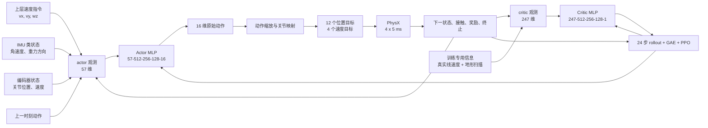

# M20 强化学习训练：输入、输出、数据流与 PPO 算法

本文解释本次 `Rough-Deeprobotics-M20-v0` 训练实际运行的内容。数字以已保存的正式运行配置
`params/env.yaml`、`params/agent.yaml` 和 `model_4999.pt` 为准，而不是只按默认配置推测。

本模型的本质是一个**速度条件低层控制器**：上层给出期望前后速度 `vx`、横向速度 `vy`
和偏航角速度 `wz`，策略根据机身姿态、关节状态和上一动作，每 20 ms 输出 12 个腿关节
位置目标及 4 个轮子速度目标。它不是路径规划器，也不直接输入相机、激光雷达、目标点或地图。

## 1. 系统整体结构



这张图可以这样理解：actor 是最终部署在机器人上的控制策略；critic 只在训练时帮助判断某个
状态“未来大概还能获得多少奖励”。训练完成后只需要 actor，不需要地形高度扫描，也不需要 critic。

## 2. 时间尺度与张量形状

| 项目 | 本次设置 | 含义 |
| --- | ---: | --- |
| PhysX 时间步 `sim.dt` | `0.005 s` | 物理仿真频率 200 Hz。 |
| 控制降频 `decimation` | `4` | 一个策略动作保持 4 个物理步。 |
| 策略周期 `step_dt` | `0.020 s` | actor 以 50 Hz 运行。 |
| 单回合长度 | `20 s` | 最长 1000 个策略步。 |
| 并行环境数 | `2048` | GPU 同时模拟 2048 台 M20。 |
| 每轮采样长度 | `24` 步/环境 | 每轮 PPO 收集 49,152 条转移。 |
| 每轮仿真时间 | `0.48 s`/环境 | `24 × 0.02 s`。 |

在正式训练中，一个控制步的主要张量形状是：

```text
actor_obs       [2048, 57]
critic_obs      [2048, 247]
action          [2048, 16]
reward / done   [2048]

24 步 rollout 后：
actor_obs       [24, 2048, 57]
critic_obs      [24, 2048, 247]
action          [24, 2048, 16]
reward / done   [24, 2048]
```

## 3. Actor 的 57 维输入

actor 的 57 个数按下面的顺序直接拼接，然后送进 MLP。没有图像编码器、RNN 或 Transformer，
也没有额外的手工状态机。

| 总下标 | 内容 | 维度 | 训练缩放 | 训练观测噪声 | 物理含义 |
| --- | --- | ---: | ---: | --- | --- |
| `0:3` | `base_ang_vel_b` | 3 | `0.25` | 均匀 `[-0.2, 0.2]` | 机身坐标系下的滚转、俯仰、偏航角速度。 |
| `3:6` | `projected_gravity_b` | 3 | `1.0` | 均匀 `[-0.05, 0.05]` | 世界重力方向投影到机身坐标系，用来表达倾斜姿态。 |
| `6:9` | command `(vx, vy, wz)` | 3 | `1.0` | 无 | 希望机器人跟踪的前后、横向和转向速度。 |
| `9:25` | `joint_pos_rel_without_wheel` | 16 | `1.0` | 均匀 `[-0.01, 0.01]` | 相对默认姿态的关节位置；其中 4 个轮子位置被强制写成 0。 |
| `25:41` | `joint_vel_rel` | 16 | `0.05` | 均匀 `[-1.5, 1.5]` | 12 个腿关节和 4 个轮子的速度。 |
| `41:57` | `last_action` | 16 | `1.0` | 无 | 上一个 20 ms 周期网络给出的原始动作。 |

表中的切片使用 Python 规则，例如 `0:3` 表示第 0、1、2 个数。观测组开启
`enable_corruption=True`，所以噪声只在训练策略观测时加入；critic 观测没有这些噪声。
训练配置未启用经验归一化 `empirical_normalization`，输入预处理主要就是上表中的缩放和噪声。

### 3.1 16 个关节的位置与速度顺序

关节顺序固定为：

```text
fl_hipx, fl_hipy, fl_knee,
fr_hipx, fr_hipy, fr_knee,
hl_hipx, hl_hipy, hl_knee,
hr_hipx, hr_hipy, hr_knee,
fl_wheel, fr_wheel, hl_wheel, hr_wheel
```

`fl/fr/hl/hr` 分别表示前左、前右、后左、后右。关节位置特征先计算：

```text
q_rel = q_measured - q_default
```

然后将 `fl_wheel` 到 `hr_wheel` 对应的四个位置设为 0。轮子可以连续旋转，其绝对转角会不断
累加，直接输入会变成无界且没有稳定的物理含义；轮子速度仍然完整输入，因此策略知道轮子转得多快。

### 3.2 Actor 明确看不到什么

actor 不直接获得：

- 机身真实线速度；
- 187 点地形高度扫描；
- 相机、深度图、激光雷达或地图；
- 世界坐标位置和目标点；
- 接触力本身。

因此它不能“看见前面第几级台阶”。它只能根据 IMU、关节和历史动作形成的反馈，在接触地形后作出
反应。训练时添加观测噪声，是为了降低模型对理想仿真传感器的依赖。

### 3.3 为什么速度指令必须作为输入

相同的机器人状态下，上层可能希望它前进、后退、横移、原地转向或停止。如果网络只看到当前状态，
无法区分这些目标。将 `(vx, vy, wz)` 作为输入后，一个 checkpoint 就能表示一整族动作：

```text
(0.0, 0.0, 0.0)  -> 保持静止
(0.8, 0.0, 0.0)  -> 向前约 0.8 m/s
(-0.5, 0.0, 0.0) -> 后退
(0.0, 0.4, 0.0)  -> 横移
(0.0, 0.0, 1.0)  -> 原地左转约 1 rad/s
```

部署时同样需要上层持续给速度指令。遥控器、导航器或规划器负责产生指令，actor 负责把指令变成
50 Hz 的关节控制目标。若部署端不传指令或一直传零，模型的合理行为就是尽量站住。

## 4. Critic 的 247 维输入

本训练采用 asymmetric actor-critic。critic 比 actor 多看真实机身线速度和地形扫描，而且不加
观测噪声。其拼接顺序为：

| 总下标 | 内容 | 维度 | 缩放 | 是否在部署 actor 中使用 |
| --- | --- | ---: | ---: | --- |
| `0:3` | 机身线速度 `base_lin_vel_b` | 3 | `1.0` | 否 |
| `3:6` | 机身角速度 `base_ang_vel_b` | 3 | `1.0` | actor 有对应量，但 actor 缩放为 0.25 |
| `6:9` | 投影重力 | 3 | `1.0` | 是 |
| `9:12` | 速度指令 | 3 | `1.0` | 是 |
| `12:28` | 16 个关节位置特征 | 16 | `1.0` | 是，轮子位置同样为 0 |
| `28:44` | 16 个关节速度 | 16 | `1.0` | 是，但 actor 缩放为 0.05 |
| `44:60` | 上一动作 | 16 | `1.0` | 是 |
| `60:247` | 地形高度扫描 | 187 | `1.0`，裁剪到 `[-1,1]` | 否 |

高度扫描网格覆盖机身附近 `1.6 m × 1.0 m`，分辨率 `0.1 m`，因此为
`17 × 11 = 187` 个采样点。critic 输出一个标量价值：

```text
V(s_t) = 从当前状态开始，未来折扣累计奖励的估计值
```

这种设计让价值估计在训练时更准确，同时保持最终策略的传感器要求较低。critic 的额外信息不会被
直接拼回 actor 输入，部署也不需要复现 247 维观测。

## 5. Actor 网络和 16 维输出

### 5.1 网络结构

actor 是前馈 ELU MLP：

```text
57 -> Linear(512) -> ELU
   -> Linear(256) -> ELU
   -> Linear(128) -> ELU
   -> Linear(16)  -> 动作均值 mu
```

训练时策略是 16 维高斯分布。网络给出均值 `mu`，另有 16 个可学习的、与状态无关的
`log_std` 参数：

```text
a_t ~ Normal(mu(o_t), sigma)
sigma = exp(log_std)
```

初始标准差为 `1.0`，随机采样用于探索；第 4999 轮日志中的平均动作标准差约为 `0.39`。
评测和部署使用确定性的动作均值，避免每次控制都随机抖动。

critic 也是 ELU MLP，但输入输出为：

```text
247 -> 512 -> 256 -> 128 -> 1
```

### 5.2 16 维原始动作怎样映射到关节

原始动作顺序与动作配置的顺序一致：前 12 维控制腿，后 4 维控制轮子。

| 动作下标 | 执行对象 | 控制模式 | 目标计算 |
| --- | --- | --- | --- |
| `0:12` | 四条腿的 hip-x、hip-y、knee | 关节位置目标 | `q_target = q_default + scale × action` |
| `12:16` | 四个轮子 | 关节速度目标 | `qd_target = 5.0 × action` rad/s |

腿部的 `scale` 并不完全相同：

- 4 个 hip-x：`0.125 rad`；
- 4 个 hip-y 和 4 个 knee：`0.25 rad`。

例如某个 hip-y 动作是 `0.6`，该关节目标会在默认姿态基础上偏移
`0.6 × 0.25 = 0.15 rad`。若轮子动作是 `-0.8`，速度目标是 `-4 rad/s`。

默认站姿为：机身高度 `0.58 m`，hip-x 为 `0`，前腿 hip-y 为 `-0.3 rad`、后腿为
`+0.3 rad`，前膝为 `+0.6 rad`、后膝为 `-0.6 rad`，轮子速度为 0。

原始动作在 runner 和 action term 中均允许裁剪到 `[-100, 100]`。这只是极宽的安全边界，正常
策略输出主要由高斯策略、动作平滑惩罚及训练数据约束在更小范围内。

### 5.3 执行器层

动作目标不是直接当作电机力矩。Isaac Sim 中的执行器根据目标产生力矩：

- 腿：延迟 PD，刚度 `80`、阻尼 `2`、力矩上限 `76.4 Nm`；
- 轮：速度驱动，刚度 `0`、阻尼 `0.6`、力矩上限 `21.6 Nm`；
- 执行器随机延迟为 0 或 1 个物理步，即 0 或 5 ms。

随后 PhysX 连续运行 4 个 5 ms 物理步，得到 20 ms 后的新状态。

## 6. 一个控制步的数据流

对第 `t` 个控制周期，流程是：

1. **读取状态**：从仿真获取机身角速度、姿态投影、16 个关节位置、16 个关节速度、接触和
   上一动作；命令管理器提供当前 `(vx, vy, wz)`。
2. **构造观测**：为 actor 拼出 `[2048,57]`，训练时加入配置噪声；另为 critic 拼出
   `[2048,247]` 的无噪声特权观测。
3. **策略推理**：actor 计算 `mu` 和 `sigma`。训练时采样 `a_t`，评测时使用 `mu`。
4. **动作映射**：把 `[2048,16]` 拆成 12 个腿位置目标和 4 个轮速目标。
5. **物理执行**：同一目标保持 4 个 PhysX 步，总计 20 ms。
6. **计算反馈**：根据新状态计算奖励 `r_t`、终止标志 `done_t` 和下一观测。
7. **保存转移**：存入 `(obs_t, critic_obs_t, action_t, reward_t, done_t,
   log_prob_t, value_t)`。
8. **局部重置**：翻倒、越界或到达 20 s 的环境单独重置，其他环境继续运行。

物理仿真和奖励函数无需可微。PPO 不会穿过 PhysX 反向传播，而是利用采样动作的概率变化来更新策略。

## 7. 训练场景

### 7.1 地形组成

地形生成器有 10 个难度行、20 个类型列，每块地形为 `8 m × 8 m`。2048 个并行环境被分配到
不同类型和难度：

| 地形 | 比例 | 正式配置 |
| --- | ---: | --- |
| 金字塔楼梯 | 20% | 台阶高 `0.05–0.23 m`，宽 `0.30 m`。 |
| 反向金字塔楼梯 | 20% | 台阶高 `0.05–0.23 m`，宽 `0.30 m`。 |
| 随机方格台阶 | 20% | 高 `0.025–0.20 m`，格宽 `0.45 m`。 |
| 随机粗糙高度场 | 20% | 高度扰动 `0.01–0.16 m`，步进 `0.01 m`。 |
| 金字塔坡面 | 10% | 坡度 `0–0.4`。 |
| 反向金字塔坡面 | 10% | 坡度 `0–0.4`。 |

所以训练不是只在平地上进行。某段回放视频看起来像平地，只能说明那次评测选中了较平的环境或
视频导出没有正确画出地形，不能反推训练场景只有平地。

### 7.2 地形课程

地形 curriculum 开启，速度 command curriculum 关闭。每个回合结束时：

```text
若离出生点距离 > 8 / 2 = 4 m：地形难度上升
若距离 < ||command_xy|| × 20 s × 0.5：地形难度下降
若已经满足上升条件，则不会同时下降
```

这使能走得更远的环境逐渐进入更难地形，表现差的环境回到简单地形。正式训练结束时平均
`terrain level = 4.0068`；这表示课程等级的平均值，不等于“能稳定通过 4 级台阶”。

### 7.3 速度指令分布

命令每 10 秒重采样：

| 命令 | 范围 |
| --- | --- |
| 前后速度 `vx` | `[-2, 2] m/s` |
| 横向速度 `vy` | `[-1, 1] m/s` |
| 偏航角速度 `wz` | `[-2, 2] rad/s` |

样本中还固定保留：20% 零速度、2% 纯前后、2% 纯横向、20% 纯转向。配置启用了 heading 模式，
命令生成器会结合目标朝向形成传给策略的偏航角速度；actor 最终收到的仍是三个当前速度目标。

这也解释了某些视频“前面慢、后面突然快”：前 10 秒可能抽到了零或小速度，10 秒后命令重新采样。
这不是网络随时间自动把油门越踩越大。

### 7.4 域随机化与重置

为了减少策略只记住单一理想仿真的风险，训练还随机化：

- 静、动摩擦系数：`0.35–1.5`；
- 恢复系数：`0–0.7`；
- 刚体质量、机身质心及外力/外力矩；
- 初始水平位置：出生点附近 `±1 m`；
- 初始 roll/pitch：`±0.3 rad`，yaw：`±3.14 rad`；
- 初始线速度：各轴 `±0.2 m/s`；roll/pitch 角速度：`±0.05 rad/s`；
- 每 10–15 秒给机身一个水平速度扰动，范围约 `±0.5 m/s`。

终止条件包括 20 秒超时、离开地形边界和严重姿态错误。M20 配置禁用了普通
`illegal_contact` 直接终止，但不希望的非轮子接触仍会受到奖励惩罚。

## 8. 奖励函数

每个控制步的总奖励为所有启用项的加权和，并按 `step_dt = 0.02 s` 积分：

```text
r_t = 0.02 × sum_i(weight_i × term_i)
```

### 8.1 速度跟踪主奖励

设命令为 `c = (vx_cmd, vy_cmd, wz_cmd)`，实际机身坐标速度为 `v` 和 `wz`。两项核心奖励为：

```text
r_xy  = 5 × exp(-||(vx_cmd, vy_cmd) - (vx, vy)||² / 0.5)
r_yaw = 3 × exp(-(wz_cmd - wz)² / 0.5)
```

误差为 0 时，它们在乘 `dt` 前最多分别贡献 5 和 3。指数核让小误差获得高奖励，误差越大，奖励
平滑衰减。它优化的是“实际速度接近指定速度”，而不是无条件跑得越快越好。

### 8.2 正式运行中启用的奖励项

| 类别 | 项目 | 权重 | 作用或触发条件 |
| --- | --- | ---: | --- |
| 跟踪 | 平面线速度跟踪 | `+5` | 跟踪 `vx, vy`。 |
| 跟踪 | 偏航角速度跟踪 | `+3` | 跟踪 `wz`。 |
| 转向步态 | 轮腿腾空时间 | `+50` | `|wz_cmd| > 0.1` 时，根据落地前腾空时间与 `0.2 s` 阈值计分。该函数可能产生负值。 |
| 转向步态 | 对角组接触状态 | `+2` | 近似原地转向时，鼓励一组对角轮着地、另一组抬起。 |
| 转向步态 | 5 秒接触占空比对称 | `+15` | 近似原地转向时，鼓励两组接近 50% 占空比。 |
| 稳定 | 垂直线速度平方 | `-2` | 减少机身上下弹跳。 |
| 稳定 | roll/pitch 角速度平方 | `-0.02` | 减少摇晃。 |
| 稳定 | 非水平姿态 | `-50` | 惩罚投影重力的 x/y 分量。 |
| 稳定 | 严重错误姿态 | `-1000` | 倒置或倾斜过大时强惩罚。 |
| 腿部 | 腿关节力矩平方 | `-2.5e-5` | 减少腿部控制代价。 |
| 腿部 | hip-x 偏离默认姿态 | `-3` | 抑制无必要的横摆腿。 |
| 腿部 | hip-y 偏离默认姿态 | `-1.5` | 约束构型；转向、横移或高地形时放宽。 |
| 腿部 | knee 偏离默认姿态 | `-0.75` | 约束构型；转向、横移或高地形时放宽。 |
| 腿部 | 对角关节镜像误差 | `-0.03` | 促进对角腿动作协调。 |
| 平滑 | 一阶动作变化 | `-0.01` | 惩罚 `||a_t-a_(t-1)||²`。 |
| 平滑 | 二阶动作变化 | `-0.025` | 惩罚 `||a_t-2a_(t-1)+a_(t-2)||²`。 |
| 接触 | 非轮子部位接触 | `-1` | 减少机身和腿撞地。 |
| 接触 | 轮子接触力超过 100 N | `-1.5e-4` | 惩罚超出阈值的接触冲击。 |
| 接触 | 原地转向时轮子滑动 | `-2` | 仅小线速度、大转向命令时启用。 |
| 静止 | 零命令时偏离默认姿态 | `-1` | 帮助零命令时站稳。 |
| 加速度 | 腿关节加速度平方 | `-2e-7` | 抑制高频腿动作。 |
| 加速度 | 轮关节加速度平方 | `-1e-7` | 抑制轮速突变。 |

当地形高度超过 `0.06 m` 时，hip-y 和 knee 姿态惩罚缩小到原来的 10%；在纯转向或横移场景也会
放宽。这给策略留下抬腿跨越障碍的空间。`base_height`、`upward` 和普通 `feet_height` 等项权重
为 0，正式配置加载时已被移除。因此模型没有一个直接写成“爬得越高奖励越多”的目标；楼梯能力来自
粗糙地形课程、速度跟踪、稳定与接触奖励的组合。

## 9. PPO 如何训练这个控制器

PPO 是 on-policy 强化学习：每轮先用当前策略收集新轨迹，再用这批轨迹更新，更新后重新采样。

### 9.1 收集 24 步 rollout

对 2048 个环境各运行 24 个控制步：

```text
2048 × 24 = 49,152 条转移/iteration
```

每条转移保存 actor 观测、critic 观测、采样动作、奖励、终止、旧策略对数概率和 critic 价值。
这里的动作是在旧策略 `pi_old` 下采出的，因此后续能比较更新前后的动作概率。

### 9.2 用 GAE 计算优势

rollout 结束后，critic 对最后状态做 bootstrap。对每一步先计算 TD 残差：

```text
delta_t = r_t + gamma × (1-done_t) × V(s_(t+1)) - V(s_t)
```

再从后向前计算广义优势估计 GAE：

```text
A_t = delta_t + gamma × lambda × (1-done_t) × A_(t+1)
return_target_t = A_t + V(s_t)
```

本次 `gamma=0.99`、`lambda=0.95`。`A_t > 0` 表示这个动作的结果比 critic 原先预期更好，PPO
会提高它的概率；`A_t < 0` 则降低概率。

### 9.3 PPO 裁剪目标

对同一条已采样动作，计算新旧策略概率比：

```text
ratio_t = exp(log pi_new(a_t|o_t) - log pi_old(a_t|o_t))
```

策略目标为：

```text
L_clip = mean(min(
    ratio_t × A_t,
    clip(ratio_t, 1-epsilon, 1+epsilon) × A_t
))
```

其中 `epsilon=0.2`。裁剪限制一次更新把动作概率改得过猛，降低训练突然崩溃的风险。

总优化还包含：

- critic 价值损失，系数 `1.0`，并启用 clipped value loss；
- 策略熵奖励，系数 `0.003`，用于保留探索；
- 梯度范数裁剪 `1.0`；
- 初始学习率 `1e-3`，根据 KL 距离自适应调整，目标 KL 为 `0.01`。

### 9.4 一轮实际做多少次更新

49,152 条转移被分为 4 个 minibatch，每批约 12,288 条；整批数据重复训练 5 个 epoch：

```text
4 minibatch × 5 epoch = 20 次 minibatch 优化/iteration
```

完成后丢弃这批 rollout，用更新后的 actor 再采 24 步。这正是 on-policy 的含义。

## 10. 从重置到训练结束的完整过程

1. 创建 2048 个 M20 子环境，分配不同类型和等级的地形。
2. 随机化摩擦、质量、质心、初始姿态和速度。
3. 为每个环境采样速度/朝向命令。
4. actor 用 57 维观测产生动作，执行器和 PhysX 推进一步。
5. 奖励管理器根据速度误差、稳定、动作、接触和步态计算奖励。
6. 某个环境翻倒、越界或运行满 20 秒时，只重置该环境。
7. 采满 24 步后，critic 计算价值，GAE 计算优势。
8. PPO 用 5 epoch、4 minibatch 更新 actor 与 critic。
9. 地形课程根据每个回合行进距离调整难度。
10. 重复到第 4999 轮并保存最终 checkpoint。

## 11. 本次正式训练的规模与结果

| 项目 | 结果 |
| --- | --- |
| 正式任务 | `Rough-Deeprobotics-M20-v0` |
| 随机种子 | `42` |
| 并行环境 | `2048` |
| PPO iteration | `5000`，最后一个为 `4999/5000` |
| 总环境转移 | `245,760,000` |
| 正式训练耗时 | `03:00:39` |
| 最终吞吐 | 约 `21,207 steps/s` |
| 最终平均奖励 | `60.38` |
| 最终平均回合长度 | `996.39 / 1000` 步 |
| 最终平均动作标准差 | `0.39` |
| 最终平均地形等级 | `4.0068` |
| 最终 XY 速度误差指标 | `0.9029` |
| 最终 yaw 速度误差指标 | `0.3826` |
| 最终超时结束占比 | `0.9828` |
| 最终错误姿态结束占比 | `0.0161` |
| 最终越界结束占比 | `0.0011` |
| 最终 checkpoint | `model_4999.pt` |

这些是最后一个训练 iteration 的在线统计，不是独立测试集的通过率。平均回合长度接近 1000、超时
占比约 98.3%，说明大部分当轮环境能活到回合结束；它不能单独证明每一种楼梯都稳定通过。

按每 500 iteration 保留的主要 checkpoint 为：

```text
model_0.pt
model_500.pt
model_1000.pt
model_1500.pt
model_2000.pt
model_2500.pt
model_3000.pt
model_3500.pt
model_4000.pt
model_4500.pt
model_4999.pt
```

## 12. 怎样理解视频和上楼梯能力

训练见过楼梯，不等于任意楼梯都有 100% 通过率。严谨评测需要固定：

- 楼梯方向：正向、反向、上楼、下楼；
- 台阶高度和宽度；
- 指令速度，尤其不能让零命令占据大部分视频；
- checkpoint 和随机种子；
- 多次重复的通过率、翻倒率、速度误差、接触冲击和滑动。

对比视频还要保证真正加载了不同 checkpoint。`model_0.pt` 已经完成第一次 rollout 和更新，并非
完全随机初始化；`model_4999.pt` 是完整训练结果。视频里后半段突然加速通常来自 10 秒命令重采样，
而不是策略在一个回合内继续学习。评测模式不会更新网络权重。

## 13. 部署时的数据接口

部署循环可以抽象为：

```python
while robot_is_enabled:
    command = get_velocity_command()          # [vx, vy, wz]
    imu = read_imu()                          # body angular velocity + gravity direction
    q, qd = read_joint_encoders()             # 16 positions + 16 velocities

    actor_obs = build_57d_observation(
        imu=imu,
        command=command,
        joint_pos=q,
        joint_vel=qd,
        previous_action=last_action,
    )

    action = actor(actor_obs)                  # deterministic mean, 16 values
    leg_position_targets = q_default + action[:12] * leg_scales
    wheel_velocity_targets = action[12:16] * 5.0
    send_targets(leg_position_targets, wheel_velocity_targets)

    last_action = action
    wait_until_next_20_ms_cycle()
```

真正上实机还必须保持关节顺序、符号、默认姿态、单位、缩放、50 Hz 周期和动作历史与训练完全一致，
并在电机层增加限位、急停和通信超时保护。critic 的 247 维观测不进入这条部署数据流。

## 14. 对应代码和保存文件

下面的源码路径相对于 DeepRobotics `rl_training` 仓库根目录。本地完整源码位于
`/home/jiang/m20-repro/src/rl_training/`；GitHub 复现分支用固定的 `upstream/rl_training`
submodule 指向同一上游版本。

- M20 环境覆盖、动作、奖励、命令与随机化：
  `source/rl_training/rl_training/tasks/manager_based/locomotion/velocity/config/wheeled/deeprobotics_m20/rough_env_cfg.py`
- 通用场景、观测、奖励、终止和控制周期：
  `source/rl_training/rl_training/tasks/manager_based/locomotion/velocity/velocity_env_cfg.py`
- 轮子位置清零观测：
  `source/rl_training/rl_training/tasks/manager_based/locomotion/velocity/mdp/observations.py`
- 自定义奖励实现：
  `source/rl_training/rl_training/tasks/manager_based/locomotion/velocity/mdp/rewards.py`
- 地形课程实现：
  `source/rl_training/rl_training/tasks/manager_based/locomotion/velocity/mdp/curriculums.py`
- PPO 超参数：
  `source/rl_training/rl_training/tasks/manager_based/locomotion/velocity/config/wheeled/deeprobotics_m20/agents/rsl_rl_ppo_cfg.py`
- 训练入口：`scripts/reinforcement_learning/rsl_rl/train.py`
- 正式运行参数：`results/complete-run/2026-09-28_08-58-15/params/`
- 正式训练日志：`results/complete-run/2026-09-28_08-58-15/training.console.log`
- 复现命令：`docs/SETUP_AND_RUN.md`
- 交付与文件位置：`docs/FINAL_DELIVERY.md`

阅读源码时应先看保存的 `params/env.yaml` 和 `params/agent.yaml`。Python 文件包含很多通用默认值和
权重为 0 的候选项，而 YAML 是正式运行解析后的最终配置，最能说明 checkpoint 实际使用了什么。
