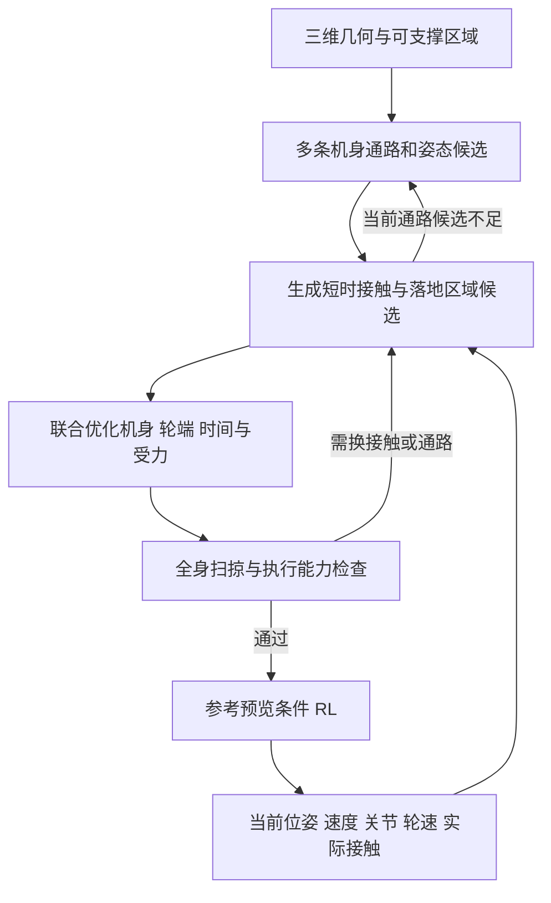

# 四轮足三维通行：机身与轮端耦合、滚动/抬腿转换及实验方案

更新：2026-10-21。本文承接[主报告](three_d_planning_methods_and_validation.md)，集中回答“接下来做什么、怎样判断有效”。**本文中的 E0–E7 均为待执行实验；本轮新增的是文献核对、方案分析和实验定义，没有新增完整机器人运行结果。** 已完成的简化验证仍以主报告第 9 节和[实验目录](validation_20261021/README.md)为准。

## 1. 当前判断和最值得先做的事

推荐保留“优化式上层 + RL 下层”，但把上层任务明确成：**在三维空间中，联合决定机身怎样运动、各轮在哪里持续支撑、哪条腿何时离地及何时落地，并使这一段运动能被当前控制器执行。** 输出可以呈现为机身与四个轮心的五条轨迹，内部还必须考虑姿态、关节、轮速、接触力和时间。

下一项最有信息量的实验是：**目标四轮足模型上的“滚动接近—单腿跨越—恢复滚动”闭环实验**，逐步加入低顶棚和侧向障碍。它先回答局部动作是否真的可执行，再回答长距离路线选择。继续增加点足搜索案例，无法替代这个环节。

现有证据的边界如下：

| 已有工作 | 实际支持什么 | 尚不能支持什么 |
|---|---|---|
| 38 个几何场景的机身搜索 | 加入支撑筛选会改变机身路线 | 完整机器人能执行这些路线 |
| PhysX 碰撞交叉检查 | 端点安全仍可能摆轮碰撞；膝碰撞不能忽略 | 机器人受力、关节控制、落地与滚动稳定 |
| 1175 条路径边审计 | 原有逐节点模型遗漏了接触连续性与部分滚动限制 | 已经求出完整滚动/抬腿时序 |
| 四点足接触图 | 在限定准静态动作集合中能连接一条平地路线 | 真实轮足的效率、摆腿避障和 RL 跟踪能力 |

工程可行性有分层依据：已知地图、低速、一次一条腿离地，是值得先实现的范围；移动支撑上的摆腿、狭窄空间姿态变化、精确落足同时发生时，风险明显增加。任意三维环境、任意速度和任意步态的统一通行，目前没有依据承诺。

## 2. 四个落足点和 body 能否互相确定

### 2.1 能互相约束，通常不能互相唯一确定

先讨论四个轮心在世界坐标中固定的简化支撑情况。第 i 条腿满足：

\[
c_i^W=p_B^W+R_B^W f_i(q_i),\qquad i=1,\ldots,4.
\]

这里 `f_i(q_i)` 包括髋部安装位置和腿正运动学，`T_B=(p_B,R_B)` 是机身位姿。给定四个 `c_i`，方程里仍有机身和腿关节两个未知部分。因此，腿弯曲一些可以使机身下降，腿伸展一些可以使机身上升，也可能允许机身平移、俯仰或横滚。

| 已知量 | 还可以变化什么 | 结论 |
|---|---|---|
| 四个轮心的世界位置 | 机身位姿、各腿关节构型 | 通常对应一组机身可行位姿，不是唯一 body |
| 机身位姿 | 各腿关节、轮端位置、接触选择 | 每条腿仍有工作空间，四足不唯一 |
| 机身位姿 + 四个轮心位置 | 各腿的 IK 解、轮转角及可能的轮轴姿态 | 可能无解，也可能有不同膝朝向；不能默认唯一 |
| 机身位姿 + 全部腿关节角 | 四个轮心由正运动学得到 | 在给定机器人模型下确定；轮旋转等其他状态需另给 |
| 全部腿关节角 + 足够的非共线轮心世界对应位置 | 机身刚体变换 | 几何一致、无退化时可确定；这比“只固定四个落足点”多了很强的条件 |

自由度计数也能解释：常见每腿 3 个关节，机身 6 个自由度，一共 18 个构型自由度；四个轮心位置最多给出 12 个独立标量等式。在非奇异、暂不考虑额外轮轴/接触约束的理想模型中，局部仍可能剩余 6 个自由度。**这只是运动学计数，不是说真实机器人可以任意移动 6 个方向**：关节限位、碰撞、摩擦、力矩和稳定性会进一步压缩可行范围，极端构型甚至只剩很小区域或无解。轮自转自由度未计入上述 18 个变量。

四个接触点也不会自动确定唯一接触力。负载分配、摩擦和执行器限制仍需处理；“质心投影在支撑范围内”只是一类准静态筛选，不是高速运动的充分条件。

### 2.2 对你的规划思路意味着什么

“固定四足后优化 body”可以成为一个局部子问题，例如在不换脚时寻找能钻过横梁的最低可行姿态；“固定 body 后优化四足”也可以成为子问题，例如在当前姿态附近选择下一块支撑面。**两者交替求解是可行算法结构，但不能把其中一步的结果永久固定。**

建议比较三种具体实现：

1. **顺序求解**：先固定 body，再求足端。最简单，适合作为基线；失败时容易不知道应当改哪一层。
2. **交替修正**：固定接触选择优化 body，再固定或限制 body 变化优化轮端/时序，最后联合检查。实现负担较小，但可能局部震荡或困在同一走廊；需要信赖域、多初值和回退。
3. **局部联合优化**：在短时域内同时优化 `T_B、q、接触位置、时间`，用正运动学等式把轮端关联起来。耦合更直接，但非凸性更强，仍需要好的路径和接触初值。

不必把五条曲线全部设成彼此独立的自由变量。以 `T_B(t),q(t)` 为主变量，轮心轨迹由正运动学导出，也是在联合规划机身与四轮端。显式增加轮心变量有时便于约束和求解，但应增加一致性等式。

### 2.3 “固定落足点”在轮足上要说清楚

足式支撑常近似为足端在世界中不动。轮式支撑不同：轮心沿地面运动，接触位置也不断更新；纯滚动要求的是**当前接触处的轮上材料点相对地面瞬时速度为零**，不是轮心速度为零，也不是轮子永远压在同一个地面点上。

一般轮几何还涉及轮轴方向、倾角、半径和地形法向。仅给出四个地面接触点，还需要这些条件才能恢复相应轮心；不能据此唯一恢复 body。

因此，滚动阶段应该规划**支撑轨迹和可滚动面片**；离地阶段规划**摆轮轨迹和下一次落地区域**。若研究保持某一接触位置的阶段，才适合使用固定支撑点近似；即使锁住轮自转，轮倾角改变也可能改变接触几何，仍需检查。

## 3. 滚动和抬腿怎样进入规划

### 3.1 不必把整台机器人分成“滚动模式”和“走路模式”

每条腿最基本的接触状态是 `κ_i∈{接地,离地}`。接地时的轮速可以为零，也可以非零；在同一种无滑动接触模型下，“保持”与“滚动”通常是连续速度选择。如果硬件存在制动器或其他离散机构，再增加相应状态。

整机可以处于“四轮滚动”“一轮摆动、三轮滚动”“一轮摆动、三轮保持”等组合。**先停车再抬腿是有用的初始方案和对照，不是必须遵守的运动规律。** 有些场景提前抬轮可以提高效率或避开即将到来的狭窄姿态，并非只能等到滚动失败后才抬腿。

支撑和动作历史也重要。同一个 body 位姿，若速度、腿伸展程度、剩余支撑区域不同，后续可行动作就可能不同。局部搜索/优化的初始状态至少应包括：

\[
x=(T_B,v_B,q,\dot q,\omega,\kappa,\mathcal P_{1:4}),
\]

其中 `P_i` 是当前或候选接触面，`ω` 是轮速。远距离粗搜索可以简化状态；进入即将执行的局部窗口后，应恢复速度、接触和关节一致性。

### 3.2 一次跨越是有持续时间的运动

以左前轮跨过障碍为例，程序需要生成并检查下列过程：

1. 根据当前速度、障碍和可落区域，决定开始准备的位置；必要时提前减速或改变机身姿态。
2. 将左前轮的负载转移给其余支撑，检查其余三轮的摩擦、力矩、腿工作空间和沿途支撑面。
3. 左前轮离地，整条腿沿无碰撞轨迹摆动；机身和其他三轮可以继续运动。
4. 落地前降低法向接近速度；若随后继续滚动，协调轮速和接触处速度，避免突发切向滑动。
5. 接触传感/估计确认落地，逐渐恢复承载，再接续后续动作。

这里的顺序是接触物理过程的说明，不要求实现成五个固定时长的硬状态。离地、落地时刻和各段时长可以由优化器调整，执行时再依据接触事件修正。

不能只依赖计时器：“计划到时间了”不代表真正落到了支撑面。也不能在失配时任意冻结整条参考：机器人可能仍有速度、正处于单腿摆动，冻结命令可能使其失稳。要在训练和规划中覆盖保持支撑、减速、提前/重新落地等有限恢复动作，并记录无法恢复的情况。

### 3.3 动作是否可行由哪些条件决定

| 约束 | 对切换的具体影响 |
|---|---|
| 未来支撑连续性 | 三个接地轮在摆腿期间不能滚出可承载区域，不能只检查摆腿起终点 |
| 轮地滚动和转向能力 | 非转向轮不能任意实现平面横移/偏航；须考虑腿运动、轮轴变化或受控滑动模型 |
| 三维全身扫掠 | 轮心绕开障碍仍可能膝部撞横杆；机身降低又可能使腿的摆动空间变小 |
| 关节速度、力矩和轮驱动能力 | 几何上跨得到，不代表给定时间内跨得到，也不代表其余腿承载足够 |
| 接触/冲击 | 空中接触力为零；接地力非拉力且受摩擦限制；触地需要冲击或低速近似 |
| 执行误差 | 上层几何余隙必须容纳本控制器在该姿态、速度和转换中的实际偏差 |

机身和关节位置在切换中连续；触地可以产生速度变化。不能为了“平滑”强制所有冲击时刻的速度完全连续，也不能让轮速和控制命令发生超出执行器能力的跳变。

低台阶未必都需要抬腿，滚轮爬越有时可行。但其可行性取决于轮径、台阶形状、负载、摩擦和力矩，不能用一个通用的台阶高度阈值代替模型。第一版可明确排除轮缘顶住台阶棱边的多接触爬越，随后单独增加这类动作；排除后不能宣称已覆盖所有轮式越障。

## 4. 具体方案及可以替换的路线

### 4.1 首选：多条机身候选 + 少量接触序列 + 局部联合优化

**全局层**提供几条不同通路、可用机身姿态范围和可支撑面片。body 路径是引导，允许接触失败后改变路线。**局部层**从当前实际状态出发，比较继续滚动、调整姿态/速度、抬某一条腿等候选；每个候选都优化机身、轮端、关节和时长。**执行层**只执行一小段已验证参考，再根据实际状态更新。

为控制第一版规模，可从“全接地”及“一条腿离地”开始，在局部窗口内允许最多两次有序单腿抬落事件；候选包括不同腿顺序、落地区域及绕障方向。这个动作集合是工程起点，不具备动态对角步态、跳跃和任意接触序列的完备性。若任务必须使用这些动作，搜索失败应标为“超出当前动作集合”。

对每个候选序列，求解连续子问题：

\[
\min_{T_B,q,v,\omega,f,\tau,\Delta t,\,c^{td}}\;
J_{progress}+J_{time}+J_{effort}+J_{smooth}+J_{guide}+J_{risk}.
\]

约束为运动学一致性、全身碰撞、支撑区域、滚动/离地约束、动力学及执行器限制。`c^td` 表示落地目标，轮心与实际接触几何仍须换算；选择质心近似时并非所有完整动力学变量都直接进入求解，须补做关节力矩核查。先解决可行性，再在可行候选中比较效率；避免用有限碰撞罚分兑换更快进度。

切换次数可以作为小的效率代价，但不是越少越好。必要的提前换脚不能被惩罚掉；真正需要抑制的是无进展的重复抬落和接触抖动。平地持续滚动是否自然出现，应由实验检查，而非手工把平地标签映射到某种技能。



一个局部优化未收敛不能证明空间不可通行。日志须区分：明确违反约束、局部优化失败、达到计算预算、当前候选耗尽。可更换初值或机身通路；不能把这些情况统一标为“物理无解”。

### 4.2 其他路线何时值得尝试

| 路线 | 具体做法 | 何时更合适／主要代价 |
|---|---|---|
| 固定步序 + 联合优化 | 给定周期或单腿顺序，优化 body、落点和相位时长 | 最重要的简单对照；若足以解决目标场景，就不必夸大自动接触搜索的必要性 |
| body/轮端交替优化 | 在可调整的走廊内交替求解，失败则换初值和通路 | 易实现，可作为首版连续求解器；必须检查最终整体一致性 |
| 短时离散选择 + 非线性优化 | 枚举或分支搜索少量腿序/面片；每个分支解连续轨迹 | 首选折中；组合数、初值和重规划尾延迟是风险 |
| 接触隐式轨迹优化 / MPC | 将接触形成、消失和力学模型纳入连续优化，减少预先指定步序 | 值得作为另一主线。已有四足实时实机先例，不能说只能离线；轮接触、复杂三维碰撞和长时域仍需具体验证 |
| 参数化动作库 + 搜索 | 离线生成滚动转姿、单腿跨越、重落地等动作族，在线匹配并局部优化 | 在线代价易控制；需记录动作的起始速度/姿态/支撑范围，不能只存动画；覆盖范围有限 |
| 采样 MPC / 物理或学习模型 rollout | 在局部候选参考上模拟执行，按进度、碰撞和稳定性选动作 | 可减少手写可行性评分；受仿真吞吐、模型误差和接触不连续影响，学习模型预测安全不等于保证安全 |

这些方案不必一次全部实现。优先比较简单固定步序、有限接触候选和局部联合优化；若主要瓶颈是候选缺失，再考虑接触隐式或动作库。如果瓶颈是 RL 无法执行已有可行参考，应先改控制接口。

## 5. RL 下层需要跟踪什么

建议先训练**统一的参考条件策略**，把滚动与单腿摆动放在同一动作空间中。输入含本体状态历史、实际接触、轮速、未来短窗口 body 位姿/速度参考、轮端参考或落地区域、各腿接触标记和剩余时间，以及局部障碍信息。轮端量和姿态误差使用定义一致的坐标系，参考带时间戳。

对常见 12 个腿关节 + 4 个驱动轮，动作可以是腿关节目标增量和四轮速度目标；最终按实际硬件确认。机身平衡、轮驱动、摆腿和落地须共同训练，不能给普通四足策略临时接上四个轮速命令。

接口比较应包含：

| 接口 | 测什么 |
|---|---|
| 速度 + 机身高度/姿态 | 强而简单的对照；检验额外足端参考是否必要 |
| 上述命令 + 下一落地区域 + 接触顺序 | 检验精确落足是否足够，摆轮能否自行处理 |
| 短时 body/轮端轨迹 + 接触相位 | 检验需要侧向绕障或精确时序时的收益 |
| 轨迹/区域 + 允许偏差 + 接触事件修正 | 检验能否兼顾避障与平衡恢复，而非逐点死追 |

轨迹容差由全身几何、可达性和接触约束决定，不能随意增大。脚踩桩时强调接触位置；钻低顶棚时强调顶部和膝部净空；宽地面可放宽无必要的逐点跟踪。

训练参考先从有物理依据的短动作开始，混入实际扰动后的状态。再比较“优化生成参考”与“结构化采样参考 + 可行性筛选”的数据效率；不预设所有参考都必须由昂贵优化器生成。GeCCo 提示采样接触目标也值得作为训练方案对照，但不能直接外推到任意机身、轮速和摆轮曲线同时跟踪。

课程建议为：全接地滚动与转姿 → 固定支撑单腿抬落 → 其他轮移动时摆腿 → 落地区域缩小与三维障碍 → 连续转换和恢复。每阶段保留前一阶段样本，避免只会抬腿后丢失滚动能力。训练时可给 critic 真值信息；部署 actor 不应依赖真实摩擦、真值接触力等不可获取量，需逐项标明。

统一策略可能难训练，双策略或专家混合可作为备选，但必须训练交接状态及恢复过程，比较相同总训练预算。不能把两个独立稳定策略直接切换，就认为切换本身稳定。

## 6. 下一项实验怎样实际进行

### 6.1 E0：先建立可信的完整轮足测试对象

当前尚未确定目标机器人的 URDF/USD、执行器限制和可用参考跟踪策略。Isaac Sim 已可用于先前的几何检查，这不等于已有完整轮足仿真环境。现成普通四足模型也不能直接代表四轮足。

需要固定的最小配置包括：各连杆几何/质量/惯量、轮径与轮宽、轮轴和关节轴、关节限位、转矩—转速限制、控制接口和增益、摩擦/接触参数、仿真步长、控制周期及状态估计接口。若先用公开轮足模型，实验结论只对那个模型有效；切换到目标硬件后重做标定。

E0 包含以下检查：静止承载和机身升降；固定轮心的可行机身姿态采样与 IK；不同姿态下滚动、加减速和转向；单腿抬落时剩余腿承载；轮速符号、半径、传动比与位移是否一致。必须通过执行器驱动和物理积分运行，不能每帧设置 body/关节状态来“跟踪”轨迹。

**特别增加一组验证你新问题的实验：** 固定同一组四轮心位置，扫描 body 高度、俯仰和横向位移，对每个候选求 IK 并检查碰撞/关节限制，画出可行区域；再固定若干 body 姿态，画各腿可达落地区域。该图将直观看出“一对多”关系。它首先是运动学实验，通过后再用承载和动力学检查缩小范围，不能把 IK 可行图直接叫稳定工作空间。

E0 应产出模型版本、标定记录、工作空间切片、平地滑移与接触噪声基线，以及下文判据需要的数值容差。若转向靠异常侧滑、静止关节力矩已超限，先修模型，不进入算法排名。

### 6.2 E1：最小但完整的滚动—抬腿—滚动闭环

**假设 H1：** 对相同落地区域和起终状态，联合调整机身、轮端、时间，比“固定 body 后让腿追上”能扩大实际可执行范围；允许其他轮移动的转换可以提高效率，但也可能增加滑移和落地失败。

**场景构造：** 先让障碍只占一条前腿的通行带，使另外三轮保有连续地面。之后在同一障碍上加入可调顶棚，再加入要求侧向绕摆的腿部障碍。顶棚/侧障碍改变时，不悄悄移动落地区域来照顾某个方法。完整横向台阶、稀疏桩列放到后续连续转换实验。

**参考范围：** 定义 `L` 为选定的腿长尺度、`r` 为轮半径。可用 `v/√(gL)∈{0,0.05,0.10,0.20}` 筛查初始速度，用 `障碍高度/r∈{0.5,1,1.5,2}` 筛查几何；顶棚净空可先试 `0.02L、0.05L、0.10L`，并加入宽松无顶棚组。这些是仿真探索起点，**不代表目标机器人都可通过，也不是最终通过阈值**。净空要按对应姿态的完整机器人最高外廓计算；结合 E0 的工作空间删去明显超模型范围的组合，同时单列超范围失败。

不必把所有参数做全因子乘积。先单因素找边界，再专门测试低顶棚、较高进入速度、狭窄落区相互叠加的情况；固定测试集后再比较方法。

**比较三种动作生成方式：** 固定 body 参考后求摆腿；减速到近停、转移负载后抬腿；机身与支撑轮在摆腿期间共同运动的联合优化。三者使用相同机器人、碰撞模型、落地区域、执行器限制和同一个已训练跟踪策略。低层尚未就绪时，可用 WBC/MPC 作诊断执行器，但必须标注为“规划可执行性检查”，不能据此宣称 RL 系统已完成。

**一次 trial 的过程：**

1. 从共同定义的初始状态分布初始化模型，记录真实初始速度、机身姿态及四轮支撑；需要稳态滚动时先运行相同的接近阶段。
2. 在相同地图下为各方法生成参考，记录优化状态和全部耗时。规划失败/超时也保留 trial。
3. 通过真实控制接口执行参考。最初固定参考检查模型误差，再增加在线重规划作为单独比较；不要混用两种设置。
4. 在每个物理步记录接触、碰撞、状态与驱动量，在控制步记录参考、策略动作和时间戳；保存离地、触地、失配及重规划事件。
5. 目标不是“轮子碰到目标”就结束。必须完成落地承载并进入规定的后续稳定滚动段；停在障碍前、跳过难段、仿真中途重置都不算成功。
6. 采用相同外部扰动日程进行配对重复，输出失败原因和成功边界；状态相关噪声应记录实际注入值，不能只靠相同随机种子声称完全一致。

先做少量调试 trial 冻结日志和判据，再正式采样。最值得看的结果图是：**初始速度 × 顶棚净空下的成功率/滑移/腿碰撞热图**，以及固定四轮位置时不同 body 可行范围的变化。它们能直接显示耦合价值和代价。

**E1 的判断方式：** 如果联合方案只在几何回放里成功，物理执行频繁失败，尚未支持 H1。如果停车方案已达到相近成功率，而移动支撑方案只增加风险，就先保留停车方案；将移动支撑作为效率扩展。如果两者都被膝部障碍卡住，应先检查全身路径和构型分支，而不是增加 RL 训练次数。

## 7. 后续实验矩阵：每组到底验证什么

### 7.1 核心对照版本

以下沿用主报告的 B0–B3 编号。所有上层对照尽量冻结同一个 RL 策略，并保证其训练参考分布覆盖各方法；如果某方法输出了策略从未见过的命令，需单列为接口分布失配。

| 版本 | 唯一关键区别 | 要回答的问题 |
|---|---|---|
| B0 | body 路径生成后固定，再规划轮端和时序 | 不允许 body 根据接触修正会损失多少可执行路线？ |
| B1 | body 规划加入逐姿态支撑筛选，但不在搜索中保存转换状态 | 静态支撑可行是否足以预测完整路线可执行？ |
| B2 | 保留接触转换状态，局部联合优化；固定、已调参的几何余隙 | 几何和物理耦合本身解决多少问题？ |
| B3 | B2 加入当前控制器的执行误差/失败预测，反作用于速度、姿态、落点和通路 | 学习执行能力是否提供超过固定余隙的收益？ |

另设三种强对照：**固定步序但优化时长/落点的联合优化、基于腿工作空间余量的自动抬腿启发式、每次先减速再抬腿的保守策略**。它们可以复用 B2 的连续优化器。只打败 B0/B1 这类故意缺少约束的版本，不足以说明方法优于现有思路。

用同地图、同底层、同硬件和相近在线预算比较，同时报告各方法离线训练成本。若原论文代码不可用，称为“按该思想实现的对照”，不能写成完整复现或把本文结果直接归给原论文。

### 7.2 从局部动作到完整系统

| 实验 | 假设与主要变化量 | 控制条件/对照 | 主要指标与否定信号 |
|---|---|---|---|
| E0：模型与几何耦合 | 同四轮位置对应多个 body；轮模型与驱动一致 | 固定机器人及接触参数 | IK 可行区域、实际承载、平地滑移；模型有异常就暂停算法结论 |
| E1：单次转换 | body/轮端/时间联合调整扩大执行范围 | 三种动作方式，同一 RL；另做 WBC 诊断 | 转换成功率、落地误差、滑移、碰撞、耗时；仅播放成功不算 |
| E2：连续转换与滚动选择 | 局部最便宜动作可能使下一步无路；短时接触前瞻能改善 | 固定步序、工作空间启发式、单事件贪心、两事件前瞻；均用同联合优化器 | 全任务成功率、死锁/回退、距离归一化抬腿数和完成时间；只少抬腿但更易卡住不算改善 |
| E3：机身与接触的双向修正 | 单一路径/逐点支撑会错过需要提前侧移、俯仰或换落区的解 | B0/B1/B2；另比交替优化与联合优化 | 端到端成功、错误接受路径比例、路线长度及计算尾延迟；只靠更多候选/更大预算获益需说明 |
| E4：RL 参考接口与转换 | body、落区、摆轮预览和事件修正各有不同价值 | 第 5 节四接口；相同总训练交互预算；冻结上层和场景 | 机身/落地误差、摆腿碰撞、转换失败、样本效率；接口越大反而不稳定时缩减冗余目标 |
| E5：执行能力反馈 | 误差随姿态、速度和接触转换改变，常数余隙不足 | B2/B3；固定余隙扫参、姿态/速度查表、匹配完成时间的降速基线 | 成功—时间—能耗关系、误接受率、校准；仅整体变慢或更保守不能证明模型必要 |
| E6：完整三维与地图误差 | 规划收益在混合场景、未见组合、地图误差下仍存在 | 同算法用真值地图/重建地图；同地图比较方法 | 到达、身体/腿碰撞、未知空间违规、恢复、地图更新延迟；真值成功而重建失败应定位感知误差 |
| E7：在线运行与失配恢复 | 算得出还必须来得及；触地延迟、地图变化后能接续 | 正常/延迟/算力限额；有无事件修正；有无上一可执行参考保留 | p95/p99 耗时、截止期遗漏、参考过期、失配恢复率；离线快不代表闭环实时 |

E2–E7 不必等待一条路线全部成熟后才开始设计；但只有完成 E0/E1 的真实驱动闭环后，长路线成功率才有解释价值。实验编号代表验证问题，不代表已经启动的后台任务。

### 7.3 场景不要只分成“楼梯、桌下、梅花桩”

按约束组合生成场景，并保留宽松对照：

| 场景族 | 改变的几何/物理因素 | 主要逼出的能力 |
|---|---|---|
| 连续平地、斜坡和弯道 | 坡度、曲率、摩擦、速度 | 高效滚动、转向、低滑移；检查是否无必要抬腿 |
| 局部凸起、台阶和连续阶梯 | 轮径相对高度、踏面深度、斜向进入 | 预见性抬腿、移动支撑和连续落地 |
| 低顶棚及变截面通道 | 高度、宽度、转弯、姿态恢复距离 | 同一接触下的 body 调姿及提前选择支撑 |
| 稀疏面片/桩/窄梁 | 面片尺寸、间距、错位、高差 | 落地精度、接触顺序、后续可达性 |
| 顶棚下的台阶或缺口 | 跨越幅度与可抬身空间同时变化 | 检验 body 与足端是否真正双向修正 |
| 膝部横杆、侧壁与桌腿 | 端点不受阻，但中间腿段受阻 | 摆腿的三维绕障与 IK 分支选择 |
| 多条通路/不同层支撑 | 短通路难执行、长通路宽松 | 执行风险是否能改变路线，而非只改速度 |
| 遮挡、薄障碍和不可承载表面 | 未知几何、观测误差、接触权限 | 观测—规划反馈；几何可踩与允许接触的区别 |

同一地形家族内划分几何实例，另外保留“训练见过各组件、测试才出现组合”的集合。按体长、腿长、轮径和最小可行姿态范围报告尺寸，同时给出实际米制尺寸。

应有明确不可通过的负例，例如模型允许动作下缺乏任何支撑，或物体开口小于全机器人可达外廓。若不可行性只是某个求解器超时，标签应是未知；可以用离线多初值、人工构造的可行示例或更高预算参考解帮助标注，但后者找到不了也不能自动证明不存在解。

## 8. 指标、分母和通过标准

### 8.1 任务与转换是否完成

令 `N` 为所有正式 trial，`P` 为首次规划阶段在预算内返回并通过验证的参考数，`A` 为实际开始执行的 trial 数，`G` 为完整到达目标且满足任务约束的 trial 数。分别报告 `P/N、A/N、G/N、G/A`；在所有接受规划都开始执行时才有 `A=P`，这时可以同时报告 `G/P`。在线重规划次数另记，不并入 trial 分母。

成功要求事先定义的时限内到达目标区域，满足终端速度/姿态和保持时间要求，且无跌倒、禁止部位接触、越出可支撑面等违规。终端保持时间、碰撞数值容差和跌倒判据随模型在 E0 标定后冻结。撤销、超时和执行中止均不得从总成功率分母删除。

转换单独统计“已计划事件数、实际尝试数、完成数”和失败阶段。完成一次抬落需满足离地、按许可轨迹通过、在允许区域触地并恢复承载。日志区分起飞失败、摆腿碰撞、漏落地、落错面、滑移失稳、提前触碰及后续无法接续。

### 8.2 具体计算哪些连续量

| 指标 | 定义/统计方式 | 容易误用的地方 |
|---|---|---|
| 全身净空 | 对 body、传感器、每个腿段、膝及摆轮，统计全程最小距离和低分位距离；指定轮地接触单独处理 | 只看轮心距离会漏膝碰撞；仅采几个规划节点会漏扫掠碰撞 |
| 非预期接触 | 每 trial 是否发生、接触部位、持续时间、冲量；用物理接触日志及独立几何查询核查 | 不能用规划器自己的代价为零替代真实碰撞判定 |
| 机身跟踪 | 位置 RMSE/p95/最大值；旋转误差 `acos(clip((tr(R_refᵀR)-1)/2,-1,1))`，单位明确 | 不能直接相减欧拉角；时间重定标后需同时报告原时间表偏差 |
| 轮端/落地误差 | 摆动段轮心误差；触地时在目标面局部坐标中的位置误差；真实接触足迹距面片边界的最小有符号距离 | 桩顶安全不能只用四轮平均误差；轮心目标和接触目标不可混算 |
| 接触时序 | 实际离地/触地时刻减去参考时刻，报告偏差、p95 绝对误差、漏事件率 | 同时保存原计划和事件修正后的计划，防止重写时间掩盖延误 |
| 滑移 | 接地承载时，轮上接触材料点相对地面的切向速度：`v_slip=(I−nnᵀ)v_contact_rel`；报告载荷加权均值、p95、积分滑移距离 | 轮心沿地面运动是正常滚动；低速下不要用会发散的滑移比作为唯一指标 |
| 承载与驱动 | 法向力、摩擦利用率、关节/轮电机力矩峰值、饱和时间占比、落地冲量 | 静态支撑裕度不足以判动态稳定；真实摩擦未知时标明用估计值还是仿真真值 |
| 效率 | 完成时间、路径长度、停顿时间、各腿抬落次数/米、纯滚动时间比例及混合支撑时间比例 | 滚动比例高不一定好；必须联合成功率、滑移和耗能判断 |
| 能量代理 | `E⁺=∫Σ_j max(τ_j q̇_j,0)dt`，含轮电机；`COT⁺=E⁺/(mgD)`，`D` 为预先定义的任务起终点距离 | 正机械功不是实际耗电；再生、驱动损耗需电机模型；`D=0` 的局部实验直接报功而非 COT |
| 切换抖动 | 对同一腿记录短时间反复离地/触地、无进展重复抬落；将触地反弹与计划事件分开 | 不应把必要的快速接触变化都叫抖动；阈值按传感器及动作时间标定 |

滑移载荷门限、接触判定迟滞、最短持续时间，应从 E0 的接触噪声和控制周期确定，并报告敏感性；不能用很强滤波隐藏真实滑移/碰撞。接触力峰值受仿真步长和接触模型影响，必须同时报步长和冲量，至少对代表性落地做步长敏感性检查。

成功 trial 的时间、能耗与误差单列，失败 trial 的终止时间、已行距离及失败原因也单列。只报告成功样本会把“困难任务全失败”的算法伪装得很省能。

### 8.3 规划计算与执行能力预测

计算时间报告 p50、p95、p99、最大值、超时率和“超过本控制周期截止期”的比例，并说明 CPU/GPU、线程、候选数、优化迭代预算、碰撞模型与地图大小。首次全局规划、每次局部重规划、地图更新及感知到动作的总延迟分开统计。少量样本不适合精确估计 p99，需同时报告样本数和原始分布。

下一条参考要从**预测的实际交接状态**衔接，不能从已经过时的测量状态起步。超时策略可以继续上一段仍可执行参考，或进入已经验证的减速/恢复动作；没有有效后续参考时应记为系统失效，不能靠不计时暂停仿真。

执行能力模型重点报告：

- **误接受率**：被模型允许执行但实际失败的动作数 / 被允许执行的动作数。
- **覆盖率**：被允许执行的候选数 / 全部被评估候选数。全部拒绝可能误接受率低，但没有通行价值。
- 成功概率的 Brier 分数/可靠性图；类别不平衡时补充 PR 曲线。
- 预测的身体/腿段误差分位数与实际超出频率，按速度、姿态、转换类型分组。

这些统计必须在独立局部动作集上标定，并在闭环产生的新状态分布上复测。策略、控制增益或机器人模型改变后，旧的能力模型不应自动视为仍有效。

### 8.4 通过标准如何确定

不预先编造“成功率 95% 就证明方案有效”一类通用门槛。实验开始前冻结两类标准：

1. **物理/任务标准**：目标容差、禁止接触、可支撑区域、驱动限额、时间上限。由任务和模型决定，不能看到测试结果后放宽。
2. **方法比较标准**：主要看端到端成功率在配对场景上的差值及置信区间，同时检查碰撞/滑移是否恶化、完成时间是否大幅增加。若预先约定可接受的时间代价，也要在测试前写入配置。

净空初值可按“地图几何误差 + 状态估计误差 + 姿态误差传播到连杆表面的误差 + 控制跟踪误差”设计保守预算，再用独立数据校准。不同误差不能未经证明按独立高斯合成；统计分位数也不是绝对安全界限。

## 9. 数据、统计和复现实验需要保存什么

按**几何实例**划分训练、验证和测试；同一个场景只换随机种子不等于未见几何。执行能力模型的训练集还应与最终任务测试分开。策略选择、余隙和门限都在验证集调整，正式测试时冻结。

初筛可沿用每个关键场景族 20 个几何实例、每例 5 个扰动日程的建议；它只是定位问题的起点，不是统计功效保证。方法使用配对场景，按几何实例聚类 bootstrap 成功率差和时间差的置信区间，避免把同场景的 5 次重复当成 5 个独立地形。学习策略若只训练一个种子，结论限于该策略实例；资源允许时用至少 3 个独立训练种子检查结果是否依赖偶然训练。

至少保存以下字段：

```text
run_id, method_id, scene_id, geometry_split, disturbance_schedule_id
robot_model_hash, controller_hash, map_hash, config_hash
physics_dt, control_dt, planner_deadline, hardware, software_versions
initial_state, goal_region, task_timeout, success_tolerances
planner_status, first_plan_time, replan_times, deadline_misses
executed, reached_goal, terminal_reason, failure_stage
reference_timestamps, measured_state, commanded_action, measured_torque
planned_contact_events, actual_contact_events, target_patch_ids
body_link_wheel_clearance, slip, contact_force_impulse, actuator_saturation
tracking_errors, completion_time, path_length, energy_proxy
```

`planner_status` 区分 `accepted / constraint_violation / solver_failure / timeout / candidates_exhausted`。`terminal_reason` 至少区分到达、跌倒、禁止碰撞、错落/漏落、失去支撑、无法接续、任务超时。独立验证器的版本也要保存；其碰撞检查不得仅重新读取规划器的“安全”标签。

每一组实验应交付逐 trial 表、汇总脚本和图，至少包括成功率及区间、失败原因、时间尾部分布、滑移/净空，以及一组成功和一组失败的同步轨迹。视频用于解释失败，不能替代量化数据。完整机器人试验尚未运行，因此本文不填任何虚构结果数字。

## 10. 创新性：哪些已有，哪些值得争取

### 10.1 本轮新增核对的直接相关工作

以下为论文作者报告，不是本地复现。核对日期 2026-10-21；仅摘要支持的结论明确限制在摘要范围内。

| 工作 | 核对范围与证据 | 对创新判断的影响 |
|---|---|---|
| Bjelonic et al., **Whole-Body MPC and Online Gait Sequence Generation for Wheeled-Legged Robots**, IROS 2021。[作者全文](https://www.markobjelonic.com/publications/files/2021_iros_bjelonic.pdf) | 核对建模与步序章节：全身运动学 + 单刚体动力学；按腿工作空间利用程度生成非周期接触时序，有轮足实机 | 联合 body/轮端、在线抬腿和边走边滚均已有先例；该步序是生成/适配机制，不能误写成任意离散序列都在连续 MPC 内联合求最优 |
| Atanassov et al., **GeCCo — a Generalist Contact-Conditioned Policy for Loco-Manipulation Skills on Legged Robots**，2025 首版、2026-09 v2，标注 IROS 2026 接收。[全文](https://arxiv.org/html/2509.17582v2) | 接触区域条件的通用四足策略；正文明确摆动时长尚不可控，动作是 12 个腿关节目标 | “一个 RL 跟踪不同接触计划”已有直接先例；轮驱动、受限机身姿态及受约束摆轮时序仍需新增验证 |
| Kim et al., **Contact-Implicit Model Predictive Control: Controlling Diverse Quadruped Motions Without Pre-Planned Contact Modes or Trajectories**，IJRR 2025，2024 在线。[作者稿](https://arxiv.org/abs/2312.08961) | 摘要核对：无预先接触序列的实时 MPC，HOUND 实机包含 trot 与前腿抬起；论文也承认需代价引导运动 | 不能把“必须先枚举接触”当作唯一方法，也不能把接触隐式一概排除为离线方法；不据此推断已解决轮足三维受限空间 |
| Sun et al., **ATRos: Learning Energy-Efficient Agile Locomotion for Wheeled-legged Robots**，2025 预印本，页面标注投往 IROS 轮足 workshop。[论文](https://arxiv.org/abs/2510.09980) | 摘要核对：未指定固定步态的 RL 混合轮腿运动，报告平地、楼梯及草地实机 | 自动滚动/抬腿本身不是新能力；其论文身份不应写成 IROS 正会录用 |
| Zhao et al., **Unleashing the Agility of Wheeled-Legged Robots for High-Dynamic Reflexive Obstacle Evasion / AWARE**，RA-L 2026。[论文](https://arxiv.org/abs/2604.23761) | 摘要核对：分层 RL、多专家和轮/腿/混合避障行为，M20 实机 | 应与学习式自适应动作比较能力边界；不能声称优化式上层是实现混合避障的必要条件 |
| Yu et al., **Discovery of skill switching criteria for learning agile quadruped locomotion**，2025 预印本。[论文](https://arxiv.org/abs/2502.06676) | 摘要核对：学习多技能权重及切换条件，包含四足实机转换 | 双策略拼接不是已经解决的工程细节，交接需要单独学习和验证 |
| Palanivelu et al., **SABER: Learning Attention-based Semantic Affordance for Legged Locomotion**，2026 预印本。[论文](https://arxiv.org/abs/2609.21572) | 摘要核对：融合几何与接触权限，报告 B2 实机和摆腿禁止区域避让 | 可把“几何可到但不允许碰”的区域纳入后续场景；不能仅凭换成三维地图声称全身避障创新 |

此前的 Buchanan、RBPRM、LSTP、DTC、Taouil 等仍是关键对照，详见[主报告第 3 节](three_d_planning_methods_and_validation.md)。其中 LSTP 是长短时域规划架构对照，Taouil 是控制器能力进入规划的直接先例。

### 10.2 三个可探索的研究问题

| 方向 | 可形成贡献的具体问题 | 可行性与主要风险 | 必须提供的证据 |
|---|---|---|---|
| A：三维约束下的轮足接触转换 | 不只看下一落点，而是同时评估摆腿期间其他轮的支撑轨迹、全身净空及后续可接续性，并改变 body/接触选择 | 最适合作为首条实现路线；有限动作集可控，但与 LSTP/轮足 MPC 接近，需要明确新增机制 | E1–E3：胜过固定步序及工作空间启发式，在相近预算下扩大真实执行范围；不能只证明漏约束的基线更差 |
| B：带容差和事件修正的联合参考接口 | 在受限空间中同时满足 body 外廓与精确落区，让策略在安全范围内调整摆动、轮速和时序 | 对齐上层与下层很有价值；可能变成大规模奖励调参，且 DTC/GeCCo 已覆盖部分思想 | E4：逐项消融 body/摆轮/时序/容差，展示成功—误差—训练成本的差别；只换输入维度不够 |
| C：控制器条件化的转换可执行性 | 根据速度、姿态、接触和净空，预测转换期间误差/失败，并改变路线、落区或抬腿时机 | 研究价值较集中，但依赖稳定控制器及足够数据；“学习能力模型”概念已有先例 | E5–E7：超过常数余隙、速度查表和匹配耗时基线；校准、覆盖率和未见组合表现都要成立 |

**目前最合理的排序是：先用 A 建立完整、可解释的实验对象，再判断 B 或 C 哪一个实际解决了主要瓶颈。** A 若只是把现有模块拼接起来，工程价值可以有，但算法创新可能偏弱；B/C 也不能仅凭标题成立。论文贡献应对应一个具体失效机制及可重复的改善，不用“3D + 优化 + RL + 自动切换”的组合代替。

### 10.3 哪些结果会改变推荐

- 固定步序联合优化已经覆盖目标范围：收缩接触搜索，研究精确三维轨迹或控制接口。
- 联合优化与交替修正效果相近：优先用更简单、尾延迟更低的求解方式。
- 局部动作可靠而长路线反复进入死路：增加接触前瞻、多通路或动作库连接，不继续堆底层奖励。
- 几何参考可行但两个控制器都执行失败：先核对动力学、执行器和参考时长，不能直接归因于 RL。
- WBC 可执行而 RL 失败：检查参考分布、观测、动作接口和切换训练；WBC 成功也不等于所有参考都有保证。
- 学习误差模型不优于调好的固定/分段余隙：保留简单模型，暂不把学习可执行性作为创新主张。
- 真值地图上成功、加入遮挡后失败：转向观测与地图不确定性，而不是继续声称规划已解决真实环境通行。

## 11. 最小交付闭环与推进依据

第一份值得期待的新结果是 **E0 的机器人标定 + E1 的局部转换数据**：模型和控制器版本明确、真实执行器驱动、包含失败样本、有净空/滑移/落地/时间记录。它可以先限制低速单腿转换，不必一开始追求所有步态。

第二份结果是**同一系统连续通过混合约束路线**：从滚动进入必须抬腿的区域，再回到滚动，途中需要改变机身姿态；用固定步序和保守停车作为对照。只有这一步才开始支持“统一通行”，仍需未见组合和扰动验证。

第三份结果才是**具体创新模块的增量证据**：冻结基础系统，在相同条件下比较有无该模块，报告成功率、时间、滑移、碰撞和计算代价。尚未完成第一份结果时，不应预先把第三份结果的收益写进结论。
