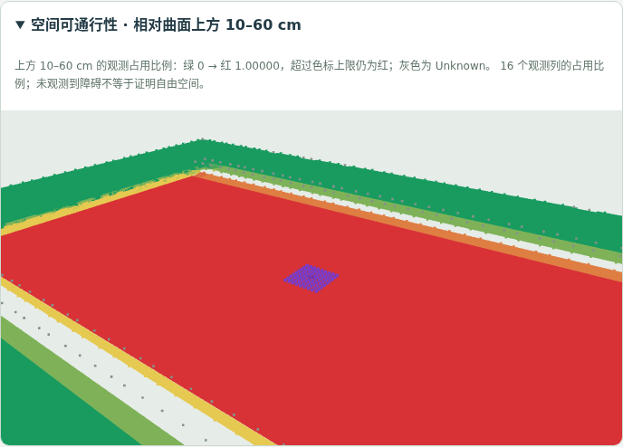
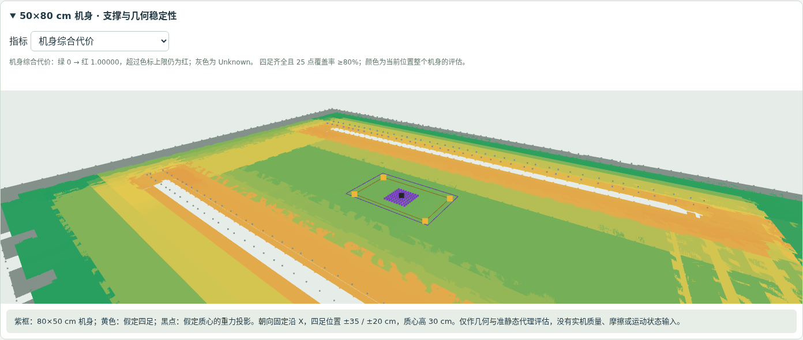
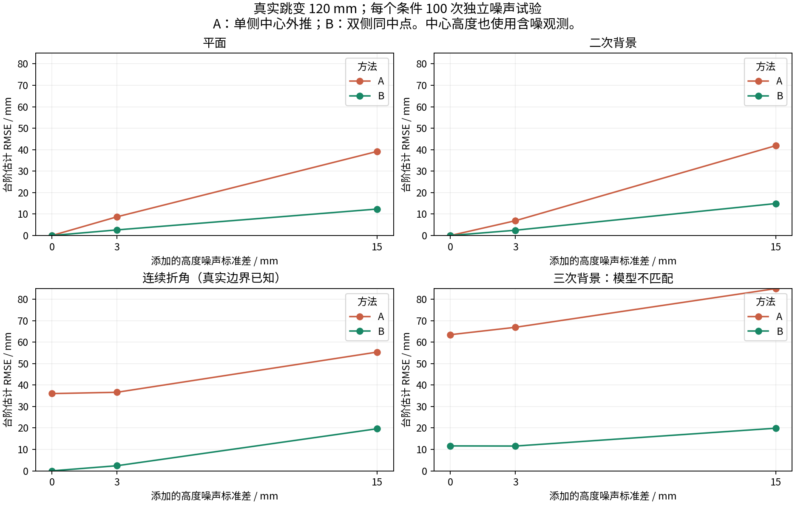
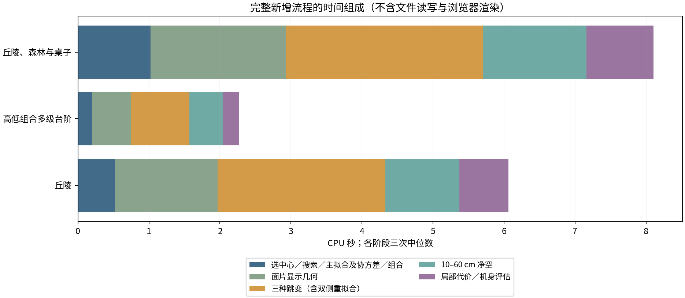

# 局部二次曲面拟合实验

当前版本：2026-11-24。[简明完整流程](planning-workflow.md)说明点云、曲面、指标与两次 A*；[第 27 节](#layer-projection-reproduce)复现分层投影规划。圆形拟合及早期方窗、FSGP 记录继续保留。

当前地形页为 **18 场景、73 组设置、六项诊断指标**。当前规划改为同层滚动、本层 A* 与可跨层叠加图的第二次 A*；交接高差严格小于 40 cm。当前命令见[第 27 节](#layer-projection-reproduce)，最新结果见 [result.md](result.md)。旧逐腿规划与计数保留为历史阶段。

规划单足代价已删除上方占用，只保留坡度／平滑性／RMSE／最大误差／不确定性，权重为 0.30／0.20／0.15／0.10／0.10，合计 0.85。地形页六项诊断指标仍保留；删除占用项的上一阶段记录见[第 26 节](#no-occupancy-cost-reproduce)。

**阅读顺序：**了解当前流程先看 `planning-workflow.md`，复现当前版本看第 27 节，详细参数与逐项结果看 `surface-planning-v1.md`。下面第 1–15 节记录早期方窗、组合面及旧指标；第 16–26 节记录后续历史迭代。各节“当前／本次”及场景数、测试数均按其所属阶段理解，组合面不属于当前方法。

历史初稿：2026-11-17。下文按阶段保留已实现方法、计算口径和实测结果。

## 1. 做了什么，在哪里看

本次已实现严格 **20×20 cm 局部拟合**、独立拟合面与组合面分窗显示、误差与参数协方差、曲面上方 **10–60 cm 障碍证据**、A/B/C 三种跳变指标、落足代价以及 **50×80 cm 机身范围的几何综合评估**。17 个已有场景均生成了结果，包括没有足够支持、结果为 Unknown 的场景。

这是局部二次函数的工程实验，与 FSGP 论文的 GP 方法分开。当前机身评估是有假设的几何／准静态代理指标，没有输入实机质量分布、摩擦、关节可达性或运动状态，因此不能据此宣称实机动力学稳定或保证通过。

- 统一首页：<http://127.0.0.1:42482/>，简洁单图切换指标，统一白→红；白色实体面表示已拟合且指标低。勾选“拟合覆盖（蓝色）”查看有效曲面、未拟合中心与有效但未成面中心；点击曲面查看实际局部网格和数值。森林／桌子缺面归因见 [实验记录](experiment-results.md)，[指标与计算方法](result.md) 单独保留。
- 新工作台：<http://127.0.0.1:42482/assessment/details.html?scene=steps>。
- 丘陵：<http://127.0.0.1:42482/assessment/details.html?scene=hill>。
- 平地与斜坡：<http://127.0.0.1:42482/assessment/details.html?scene=flat_ramp>。
- 通道： [0.4 m](http://127.0.0.1:42482/assessment/details.html?scene=corridor-040)、[0.6 m](http://127.0.0.1:42482/assessment/details.html?scene=corridor-060)、[0.8 m](http://127.0.0.1:42482/assessment/details.html?scene=corridor-080)。三个都是仅含通道与地面的独立小场景。

原详细工作台保留 8 个可分别收起／展开的窗口：原始点云、独立拟合面、组合面、误差与不确定性、净空、跳变、落足、机身。相机同步。点击曲面或点云可选择附近的拟合中心，也能输入编号；紫色点表示实际拟合点。未知指标显示灰色，不填成零代价。

通道顶板和桌面会遮住下方地面。查看下方地面时，点击“选中央低表面”，勾选“曲面仅显示当前高度 ±10 cm”，再点击“放大当前位置”。这个开关仅裁剪显示，不删减用于净空或机身计算的点。

误差窗口默认将**当前场景有效函数的最大值映射为红色**，也可切换固定物理色标；全零数据使用固定参考门限。其他指标按明确物理门限或 0–1 代价着色。低值绿、高值红，不使用亮度光照改变误差颜色。显著性 S 的颜色表示数值，不表示危险度。

## 2. 局部面到底是什么

### 2.1 输入、选点与有效性

所有计算只使用 XYZ，不使用已知部件标签、真实台阶高度或预设表面数量。不设“地面／桌底／桌面三层”。每个中心独立选择自身高度附近的点；这是本地工程流程，不能称作论文的分割算法。

| 项目 | 当前设置 | 含义 |
|---|---:|---|
| 拟合中心 | 0.10 m 三维体素各取一个原始点 | 不把全部原始点都当中心 |
| 实际 XY 拟合域 | 20×20 cm | 中心左右各 10 cm，不是仅缩小显示面片 |
| 相对高度门限 | ±4 cm | 相对中心 Z，筛选发生在求解之前 |
| 最少点数 | 30 | 使用域内全部合格点，**不再封顶取最近 30 点** |
| 函数参数 | 6 个 | 常数、一阶和二阶项 |
| 数值正则 | 归一化 Gram 矩阵 trace/6 的 1e−10 倍 | 微小岭回归 |
| 满秩检查 | 最小／最大特征值比 >1e−10 | 退化、近共线点不能提供可靠二维曲面 |
| 中心预测位移 | ≤4 cm | 避免中心高度被拟合明显拉离 |
| 训练 RMSE | ≤2 cm | 质量检查，不是独立测试精度 |

索引树采用缩放后 XYZ 的无穷范数查询，得到精确的方形 XY 范围与高度带交集。点不足、秩不足、残差超限等情况保留缺失；不向其他高度表面借点凑数。

**点云密度变化必须单独说明：**历史平地等 8 cm 网格在 20 cm 方域内通常不足 30 点。因此平地、斜坡、平地与斜坡、两类台阶、桌子和三个通道，使用原来的解析几何显式重新生成 2.5 cm 间距点云；没有把原扫描插值成“实测点”。丘陵、森林、沙漠、山地、雪地、火山、quick 和拼接大场景使用原有 XYZ 文件，未为本次实验加密。各场景 `data.json` 中记录了来源。

历史 30 近邻结果仍保存在首页原查看器与 `outputs/visualization/scene-fits/`，它使用 0.12 m 中心体素、0.75 m 搜索半径和最多 24×24 cm 的显示域；与本次严格 20 cm 新流程分别保存。数值与运行量不能混用。

### 2.2 二次函数与显示组合

以中心为局部原点，u=x−x_seed，v=y−y_seed：

\[
f(u,v)=z_{seed}+c_0+c_1u+c_2v+c_3u^2+c_4uv+c_5v^2,
\quad \phi=[1,u,v,u^2,uv,v^2]^T.
\]

独立面片：在每个有效函数的 20 cm 方域内采样 5×5 个点，顶点高度确实来自该二次函数；仅保留顶点都在原拟合点 XY 凸包和 ±4 cm 预测高度带内的三角片。它是函数的离散渲染近似，实际显示面积可能小于 0.04 m²，也可能为零。不同中心的面片可重叠，不能累加为场景覆盖面积。

组合面：沿用原有一致性组网。中心间三维距离 ≤35 cm，双向模型预测差 ≤2 cm，中心法向夹角 ≤15°；保留至少 30 个有效中心的连通组件，再做 XY Delaunay、三边与重心预测一致性检查。**最终组合网格是拟合中心之间的分片线性三角网，不是把所有独立二次面连续焊成一张光滑函数。**仍保留局部二次系数用于导数与评估。

“有效函数”“实际显示面片”“参加组合的函数”“组合三角形”是不同数量。没有三角片，不一定没有拟合函数；没有参加组合，也不一定拟合失败。

## 3. 误差、协方差和不确定性如何计算

对本次选中的 n 个点，残差 e_j=f(x_j,y_j)−z_j：

\[
RMSE=\sqrt{\frac1n\sum_j e_j^2},\qquad E_{max}=\max_j |e_j|.
\]

两者都是**训练残差**。另设独立解析坐标测试，用于后面的受控实验，不把训练误差称为泛化精度。

为减小条件数，将 XY 按支撑点均方根半径 s 归一化。设归一化设计矩阵为 A，G=AᵀA，M=(G+λI)⁻¹，D=diag(1,1/s,1/s,1/s²,1/s²,1/s²)。使用有限岭回归的参数协方差：

\[
\hat\sigma_\epsilon^2=\max\left(\frac{\sum e_j^2}{n-6},(0.003\,m)^2\right),
\qquad\Sigma_\theta=\hat\sigma_\epsilon^2 D M G M^T D^T.
\]

残差方差用自由度 n−6，参考 [NIST 最小二乘说明](https://www.itl.nist.gov/div898/handbook/pmd/section4/pmd431.htm)。极小岭回归仍使用这一近似自由度。3 mm 是本实验设置的噪声下限，避免解析平面因为残差为零而给出零不确定性；它不是传感器标定结果。

任意位置的**拟合均值高度方差**：

\[
\sigma_z^2(x,y)=\phi(x,y)^T\Sigma_\theta\phi(x,y).
\]

页面可查看完整 6×6 协方差、中心 σ、实际显示域内采样点的最大 σ。将误差和不确定性相加时，使用相同的米单位：

\[
E=E_{max}+2\max_{\text{显示域内采样点}}\sigma_z.
\]

这不是直接把“残差的米”与“方差的平方米”相加。该协方差以固定 XY、独立同方差高度噪声和局部二次模型近似成立为条件；未包含 XY 测量误差、点间相关、边界位置不确定性或模型偏差，也未加上新观测自身的噪声方差。**2σ 没有经过传感器或场景覆盖率标定，不能直接称 95% 置信保证。**

## 4. 三种跳变方案

### 4.1 怎样选双侧候选

从有效拟合中心出发，在 ±X、±Y 四个方向，目标偏移 24 cm。每个目标附近查询最多 16 个中心，查询半径 10.5 cm，剔除中心间距不足 14 cm 的候选，再按 XY 距离及预测高度差选择一个；双向产生的重复对去重。

对 i、j 两中心，比较位置 p=(XY_i+XY_j)/2，方向 d=XY_j−XY_i。**p 是候选中点，没有先精确定位真实地形边界。**完整场景中的倾角转折、过悬多层、候选错配或三次以上背景都可能造成非零指标。

### 4.2 A：单侧二阶预测残差

\[
r_{i\to j}=\left|\hat z_j-\left(\hat z_i+\nabla f_i^T d+\frac12d^TH_id\right)\right|,
\qquad A_{ij}=\max(r_{i\to j},r_{j\to i}).
\]

对二次函数，二阶 Taylor 预测就是直接代入已有多项式。实现取两个单侧预测的较大值，目标高度是对方中心的拟合高度。它避免重新拟合，比较距离却较远；噪声和连续折角会使它比双侧方案更敏感。

### 4.3 B：双侧在同一位置外推

以过 p、法向为 d 的直线切开原拟合点集。左侧只用投影严格为负的点，右侧只用严格为正的点，边界上的点不共享。各自重新进行二次拟合，每侧仍要求至少 30 点和同样质量检查。

\[
B_{ij}=|f_{right}(p)-f_{left}(p)|.
\]

比较在相同 XY 的高度，因此避免直接把连续坡面上相隔一段距离的自然高差当成台阶。理想无噪声、恰可由二次函数表达的背景叠加在两侧时，在同一点相消。这个性质不代表对任意复杂曲面或错误候选都完全不变。

### 4.4 C：双侧跳变加协方差不确定性

每一对候选的两侧使用不重叠原始点 ID；在独立高度噪声假设下：

\[
\sigma_\Delta^2=\phi_l(p)^T\Sigma_l\phi_l(p)+\phi_r(p)^T\Sigma_r\phi_r(p),
\qquad C_{ij}=B_{ij}+2\sigma_\Delta.
\]

另外导出：

\[
S_{ij}=\frac{B_{ij}}{\sqrt{\sigma_\Delta^2+10^{-12}\,m^2}}.
\]

S 是模型标准差尺度上的比值，不能把 S 当作台阶大小、危险程度或经校准的显著性检验。高不确定性会降低 S，却会提高 C；用于几何代价的是 C。真实点若存在相关误差，还需要两侧交叉协方差项。

每个拟合中心分别取所有参与候选对的最大 A、B、σΔ、S、C。**这些列的最大值可能来自不同候选对**；C 是先对每对计算 B+2σΔ，再取最大，并非“最大 B + 2×最大 σΔ”。逐对 CSV 保留了各对数值。候选对不足或任一侧不支持，B/C 为 Unknown，不设为零。已知方向数量只统计成功的候选，不宣称四周都已观测完整；多个中心反向选中时数量可以超过四。

## 5. 上方 10–60 cm 的空间占用

对每个有效地面函数，在 20 cm XY 方域中分别检查：原始点，以及**实际拟合三角片使用的顶点采样**。每个样本都用自身 XY 处的地面预测值计算相对高度：

\[
\Delta h=z_{sample}-f_{ground}(x_{sample},y_{sample}).
\]

若 0.10≤Δh≤0.60 m，记为障碍证据；端点包含，浮点容差为 1e−7 m。用 5 cm 列把 20 cm 域分成 4×4=16 列，原始点与拟合面证据做并集：

\[
O=\frac{\text{存在障碍证据的列数}}{16}\in[0,1].
\]

O 越大，观测到的上方占用越多。CSV 同时保留原始命中数和拟合面顶点命中数；它们不是独立障碍数量，不对重叠面片的点数直接累加打分。

这里的“曲面检查”是三角面顶点采样证据，没有求解连续二次曲面／机身实体的精确碰撞，也没有射线可见性与遮挡建模。稀疏样本可能漏掉薄障碍；O=0 只表示没有观测到该检查带内的障碍，不能证明自由空间。0.8 m 顶板在这项指定检查带以外，不据此推断任意高度机器人都可通过。

## 6. 坡度、粗糙度与落足综合指标

二次函数可以直接求导：

\[
\nabla f=(c_1+2c_3u+c_4v,\ c_2+c_4u+2c_5v),\qquad
H=\begin{bmatrix}2c_3&c_4\\c_4&2c_5\end{bmatrix}.
\]

Hessian 的系数不是一般曲面的主曲率；本次没有将其直接冒充曲率。中心坡度 α=atan(√(c₁²+c₂²))。粗糙／弯曲代理用训练 RMSE 和 20 cm 域四角相对中心的最大法向夹角 Δn；角点梯度是模型外推，角点可能在显示凸包外。

令 clip(t)=min(1,max(0,t))：

\[
P=clip(\alpha/45^\circ),\quad
R=\max\{clip(RMSE/0.01m),clip(\Delta n/15^\circ)\},
\]
\[
J=clip(C/0.12m),\quad U=clip(E/0.02m),\quad
F=0.25P+0.20R+0.25J+0.20O+0.10U.
\]

中心坡度 ≥45° 时 F=1，表示本实验判为不宜落足。其他必要指标未知时保留 Unknown。R 包含平滑弯曲本身的影响，不能等同于纯测量噪声或严格表面粗糙度。

45°、1 cm、15°、12 cm 及上述权重都是本次工程设定；没有声称来自 FSGP 论文或已经完成 Go2 实机标定。综合代价主要用于观察各项变化，没有给出可靠的实机通过分数阈值。

## 7. 50×80 cm 机身下方如何汇总

机身长边固定沿 X，为 80 cm；短边沿 Y，为 50 cm，当前不搜索不同朝向。对每个有效中心，建立：

- 机身内含边界的 5×5 网格，共 25 个查询位置。
- 4 个假定足点，偏移为 (±35 cm,±20 cm)。这是支撑点布局假设，不是实机运动学求解结果。

每个位置从有效中心中查询最多 16 个附近候选，限定在该模型的 20 cm 方域及 ±4 cm 预测高度带内，按 XY 距离和相对于当前切平面预期高度的差选支持表面，以尽量保持同一高度分支；不指定“地面”标签。当前查询没有逐次检查原始点 XY 凸包，因此边缘可能有小范围外推，多层表面附近也可能错配。

25 点覆盖率 ≥80%，且四足均找到支持，才继续汇总。四足拟合平面 z=a+gₓu+gᵧv，得到平面坡度 α_b、共面 RMSE r_b 和最大垂直残差。窗口中的净空、保守跳变、粗糙度、误差取 **25 点与四足所引用模型中的已知最大值**。它是有限采样的最坏观测值，不是整个连续矩形上的严格最大值；部分候选方向缺失仍可能被其他已知值覆盖，不能将它称为全域完整观测。

假定质心在该支撑平面中心沿法向高 0.30 m，则其重力投影的 XY 偏移：

\[
q_x=-0.30g_x/\sqrt{1+g_x^2+g_y^2},\qquad
q_y=-0.30g_y/\sqrt{1+g_x^2+g_y^2}.
\]

矩形四足支撑多边形下的投影裕量：

\[
m=\min(0.35-|q_x|,\ 0.20-|q_y|)\quad(m).
\]

它衡量假定重力投影到最近支撑边的距离；平地假设下为 20 cm。支撑多边形只是静态平衡分析的一部分，接触法向和摩擦约束仍然必要，参见 [Robotic Systems 的接触与平衡章节](https://motion.cs.illinois.edu/RoboticSystems/AdvancedTopicsInPlanning.html)。本次没有求完整接触力平衡。

机身代价：

\[
D=clip(r_b/0.02m),\quad M=clip((0.10m-m)/0.10m),
\]
\[
B_{body}=0.20clip(\alpha_b/45^\circ)+0.15D+0.25J_{max}
+0.20O_{max}+0.10R_{max}+0.05U_{max}+0.05M.
\]

平面坡度 ≥45°、投影裕量 ≤0，或四足相对平面的最大垂直残差 >15 cm 时，代价置为 1；缺少四足、覆盖不足或必要指标不可得时保持 Unknown。质心高度可以在配置中调整，权重在评分函数中显式列出；当前没有把这些假设当作实机参数。

这里未检查足底力／摩擦锥、整机质心随姿态和腿位变化、完整关节可达性、动态冲击、侧倾惯性、连续机身碰撞或步态稳定性。低代价表示在这些假设下几何更有利，不表示已验证机器人一定稳定。

## 8. 实际效果

### 8.1 17 个场景

下表是新 20 cm 流程。求解列只统计**主窗口**求解；三种方法的双侧重拟合另列在每个场景 JSON 中。有效率的分母是中心数，不是原始点数。机身“已知”不是“安全”。各场景时间为首轮单次，另有三个代表场景的三次重复中位数。

| 场景 | 原始点 | 中心 | 主求解 | 有效函数 | 有实际显示面片的函数 | 机身代价已知 | 单次总耗时 ms |
|---|---:|---:|---:|---:|---:|---:|---:|
| 独立通道 · 净空 0.40 m | 78,103 | 4,889 | 4,305 | 4,285 | 4,285 | 3,884 | 1873.6 |
| 独立通道 · 净空 0.60 m | 83,383 | 5,221 | 4,317 | 4,285 | 4,285 | 3,884 | 1877.2 |
| 独立通道 · 净空 0.80 m | 88,663 | 5,553 | 4,329 | 4,285 | 4,285 | 3,884 | 1901.0 |
| 丘陵、森林与桌子 | 439,501 | 55,364 | 18,906 | 18,385 | 17,013 | 13,250 | 8135.3 |
| 大桌子 | 82,283 | 5,183 | 5,131 | 5,011 | 5,011 | 4,527 | 2161.3 |
| 丘陵 | 200,000 | 13,860 | 13,791 | 13,789 | 12,448 | 12,589 | 6201.8 |
| 森林 | 141,068 | 24,500 | 4,505 | 3,958 | 3,930 | 318 | 1438.9 |
| 平地 | 103,041 | 6,561 | 6,557 | 6,557 | 6,557 | 5,913 | 2773.7 |
| 斜坡 | 103,041 | 8,246 | 8,242 | 8,242 | 8,242 | 7,462 | 3480.3 |
| 高低组合多级台阶 | 97,455 | 6,097 | 5,401 | 5,379 | 5,379 | 4,855 | 2308.5 |
| 原单级台阶（历史） | 103,041 | 6,669 | 6,663 | 6,663 | 6,663 | 6,019 | 2748.2 |
| 平地与斜坡组合 | 103,041 | 6,885 | 6,881 | 6,881 | 6,881 | 6,229 | 2844.1 |
| Quick 地形 | 100,000 | 99,942 | 0 | 0 | 0 | 0 | 337.9 |
| 沙漠 | 100,000 | 18,285 | 844 | 844 | 844 | 0 | 344.7 |
| 山地 | 50,000 | 7,533 | 5,192 | 5,191 | 5,191 | 3,925 | 1852.5 |
| 雪地 | 500,000 | 61,454 | 35,924 | 35,924 | 35,838 | 28,529 | 14474.0 |
| 火山 | 100,000 | 14,637 | 9,967 | 9,967 | 9,967 | 7,488 | 3669.3 |

丘陵有 13,860 个中心，13,791 次主求解，13,789 个有效函数：69 个点不足，2 个求解后未通过检查。其中 12,448 个函数真正显示出三角片，1,341 个有效函数因显示采样／裁剪没有三角片；452 个有效函数未参加最终组合。这两类可重叠，不能相加当作互斥“失败数”。显示洞、求解失败和组合失败要分别看。

quick 在 20 cm 和至少 30 点这一约束下，99,942 个中心没有一个能实际求解；沙漠只有 844 个有效函数，尚无机身已知代价。这说明当前固定窗口与密度假设对这些输入不适用；没有通过补点隐藏问题。拼接大场景也保留大量 Unknown，因此不能将局部有结果理解为整个大场景都完成了稳定性判断。

### 8.2 通道中央地面的可重复对照

| 顶板净空 | 上方 10–60 cm 观测占用 O | 机身窗口最大占用 | 中央机身代价 | 假设下的投影裕量 |
|---|---:|---:|---:|---:|
| 0.4 m | 1.00 | 1.00 | 0.21624 | 20.0 cm |
| 0.6 m | 1.00 | 1.00 | 0.21624 | 20.0 cm |
| 0.8 m | 0.00 | 0.00 | 0.01624 | 20.0 cm |

0.4 m 和 0.6 m 的顶板在指定检查带内，中央地面净空窗口为红色；0.8 m 顶板在检查带外，该项为绿色。三个场景中央地面支撑都平，投影裕量相同；它们的净空代价不同。这正好区分“脚下平整”和“机身上方被占用”。综合代价采用加权求和，障碍项不是一票置 1 的碰撞判定。

中央平地的机身代价约 0.01624，即使无几何误差也不严格为零：3 mm 噪声下限带来了预测不确定性和保守跳变项。大桌子中央地面的 10–60 cm 占用为零，是由于本场景桌板高于该检查带；并不表示桌板不存在。





### 8.3 三种跳变的受控实验

设置两个 16×16 cm 支撑点集，中心在 x=±12 cm，每侧 9×9 点，真实边界固定在 x=0；真实跳变为 0 或 12 cm。背景包含平面、斜坡、二次面、连续折角和三次面。加 0、3、15 mm 独立高度高斯噪声，每个条件 100 次，共 30 条件、3,000 次。

真实函数用于生成观测并作事后评价，算法只收到 XYZ；拟合中心高度也取含噪声的实际观测点，没有用真实高度来限制邻点。该受控布局的候选中点恰好落在真实边界，完整场景不提供这项有利条件。另在每侧独立随机 XY 坐标上评价有效模型对无噪声真实函数的均值高度误差；它与训练残差、对新含噪观测的预测误差分开。

下面只列真实跳变 120 mm 的代表结果；A/B 的 RMSE 是相对真实跳变的估计误差，C 是保守代价量，不能将其均值直接称作估计精度。

| 背景 | 噪声 σ mm | A 跳变 RMSE mm | B 跳变 RMSE mm | C 平均值 mm | 双侧 2σ 诊断覆盖率 |
|---|---:|---:|---:|---:|---:|
| 平面 | 3 | 8.719 | 2.619 | 126.077 | 98% |
| 二次面 | 0 | 0.000 | 0.000 | 125.403 | 100% |
| 二次面 | 3 | 6.908 | 2.466 | 125.790 | 97% |
| 二次面 | 15 | 41.876 | 14.898 | 152.955 | 90% |
| 连续折角 | 0 | 36.000 | 0.000 | 125.403 | 100% |
| 三次面（不匹配） | 0 | 63.456 | 11.616 | 137.019 | 0% |

无噪声且符合二次模型时，A/B 能以数值精度恢复 120 mm 台阶；0 mm 台阶也得到接近零的 A/B。C 由于噪声下限会额外增加约 5.4 mm，不应期待它与真值完全相等。

二次背景加 3 mm 噪声时，B 的跳变 RMSE 约 2.47 mm，优于 A 的 6.91 mm；该条件独立 XY 的拟合均值高度 RMSE 约 0.61 mm。连续折角在已知正确边界处高度连续，B 不把这一坡度转折当成台阶；A 有 36 mm 误差。**完整场景不提供真实边界**，不能把这个理想条件的结果直接当作完整场景的检测准确率。

三次背景反例更重要：无噪声时 B 仍有约 11.62 mm 模型偏差，双侧 2σ 诊断覆盖率为 0%。这表明只加参数协方差不能吸收模型不匹配偏差。本实验没有宣称“对任意连续地形严格不变”或“2σ 已经覆盖所有误差来源”。

覆盖率这里定义为 |B−J_true|≤2σΔ 的经验比例，使用非负跳变幅度，分母为双侧支持已知的试验数（CSV 的 bilateral_known），每条件至多 100 次；不是通用 95% 校准结论。C 的保守上调与 A/B 点估计也不能放在同一精度名义下排名。



完整 [CSV](fsgp_bgk_repro/outputs/visualization/assessment/controlled-noise.csv) 和 [JSON](fsgp_bgk_repro/outputs/visualization/assessment/controlled-noise.json) 保留全部 30 个条件与独立坐标误差。

## 9. 速度，算到了哪一步

本节保留首轮三个代表场景的重复计时；最新的全部 17 场景、逐图计时见第 11 节。重复运行存在小幅波动。

环境：AMD Ryzen 9 7945HX，系统 Python 3.10、NumPy 1.21、SciPy 1.8；CPU 计算，BLAS 单线程。下面是三个代表场景各运行 3 次的中位数，输入 XYZ 已在内存。

| 阶段 / ms | 丘陵 | 高低组合台阶 | 拼接大场景 |
|---|---:|---:|---:|
| 选中心 | 58.5 | 22.3 | 130.0 |
| 建树与严格方域查询 | 172.2 | 70.0 | 507.4 |
| 主窗口拟合 + 参数协方差 | 211.4 | 72.8 | 273.8 |
| 一致性组合 | 79.9 | 34.3 | 111.5 |
| 全部局部面片显示几何 | 1443.3 | 552.3 | 1907.8 |
| A/B/C（含双侧重拟合） | 2365.0 | 820.6 | 2768.8 |
| 上方净空 | 1038.1 | 465.6 | 1460.6 |
| 局部代价 | 2.4 | 1.1 | 8.9 |
| 50×80 cm 机身评估 | 690.3 | 231.9 | 937.1 |
| 完整新增流程 | 6067.4 | 2273.5 | 8104.4 |

各阶段独立取中位数，阶段中位数相加不一定恰好等于总时间中位数。单次网页场景卡与此处三次中位数口径不同。

以丘陵为例：13,791 次主窗口求解以外，B/C 共同使用了 37,396 个候选对，触发 74,792 个侧窗口，其中 **74,785 次实际侧求解**；37,389 对双侧都通过检查。侧求解包含重复支撑集，目前没有缓存同一个侧点集的重复拟合。不能把整套算法说成“只拟合了 13,791 次”。

结果表明主窗口二次拟合和协方差仍较快，丘陵约 211 ms；完整流程约 **6.07 s**，明显更贵的部分是双侧评估、全部显示面片与净空查询。当前代码是离线预计算工作台，不是已经满足实时帧率的在线机器人模块。网页加载已保存结果的时间也不等于算法运行时间。

总时间包括选中心、树与查询、拟合、协方差、组合、显示几何、三种跳变、净空和机身评估；不包括点云生成、文件读写、网络传输和浏览器渲染。历史几百毫秒的 30 近邻拟合＋组合，配置、中心数、点云密度和计算范围均不同，不能直接拿来声称本算法更快／更慢多少倍。



原始重复数据：[repeat-timing.json](fsgp_bgk_repro/outputs/visualization/assessment/repeat-timing.json)。

## 10. 验证证据、文件和复现命令

本次检查包括：

- 6 项新增解析单元测试：真实二次函数恢复、独立设计矩阵协方差、相同二次背景不变性／台阶恢复、缺失侧为 Unknown、严格方域与高度带、相对斜面的净空，以及坡度硬门限和假定平地机身裕量。
- 与已有邻点／几何测试合计 13 项单元测试通过。
- 17 场景数值审计：原始点、中心、求解、有效模型、显示三角片、组合引用、邻点窗口、残差与协方差独立复算、CSV 行数、机身支持覆盖，以及额外双侧实际求解数。
- 新工作台浏览器检查：17 场景，8 个窗口，A/B/C 与误差选择、折叠、局部面、按高度剖切、机身标记、下载、首页场景同步、手机无横向溢出；无页面错误或资源失败。
- 原查看器的 17 场景回归通过；17 个历史拟合 NPZ 的 SHA256 与此前审计一致。42482 常驻用户服务运行中。

数值审计对每场景抽查最多约 200 个求解模型（不是每个模型都做独立矩阵复算）；计数、二进制尺寸、索引与 CSV 行数按全量检查。当前最大绝对训练残差复算差约 4.2e−17 m，协方差元素最大复算差约 2.2e−11。这些检查验证实现一致性，不替代真实 LiDAR 精度或实机通行验证。

证据文件：[数值审计](fsgp_bgk_repro/outputs/visualization/assessment/numerical-audit.json)、[新工作台浏览器审计](fsgp_bgk_repro/outputs/visualization/assessment/browser-audit.json)、[原查看器浏览器审计](fsgp_bgk_repro/outputs/visualization/scene-fits/browser-audit.json)。

实现入口：

| 文件 | 职责 |
|---|---|
| [terrain_assessment.py](fsgp_bgk_repro/terrain_assessment.py) | 严格窗口拟合、协方差、三种跳变、净空与局部／机身代价 |
| [assessment_export.py](fsgp_bgk_repro/assessment_export.py) | 17 场景新结果导出，来源记录与首轮阶段计时 |
| [validate_assessment.py](fsgp_bgk_repro/validate_assessment.py) | 数值审计、受控噪声实验与重复阶段计时 |
| [新工作台页面](fsgp_bgk_repro/visualization/assessment/index.html) | 8 个可折叠窗口与使用说明 |
| [viewer.js](fsgp_bgk_repro/visualization/assessment/viewer.js) | 实际几何渲染、绿红色标、选择模型与机身显示 |

每个新场景的输出在 `fsgp_bgk_repro/outputs/visualization/assessment/<scene>/`：

- `data.json`：参数、来源、各项统计、实际求解数量和阶段耗时。
- `per-model.csv`：全部中心，每个二次函数的误差、方差、跳变、净空与机身指标；未知留空。
- `jump-pairs.csv`：每个候选对的 A、B、σΔ、C；真实边界未知。
- `result.npz`：模型、完整 6×6 协方差、实际邻点 CSR 索引、原始中心索引、最终三角网和四足支持引用。
- 页面 `.bin`：原始点、模型、协方差、独立面片、组合网、实际邻点与四足支持数据。

```bash
cd /home/jiang/snap/go2

# 重算并发布全部 17 个场景；保留历史 scene-fits 结果。
PYTHONNOUSERSITE=1 OPENBLAS_NUM_THREADS=1 OMP_NUM_THREADS=1 MKL_NUM_THREADS=1 \
  /usr/bin/python3 -m fsgp_bgk_repro.assessment_export

# 数值审计、每条件 100 次噪声试验、三个代表场景各 3 次重复计时。
PYTHONNOUSERSITE=1 OPENBLAS_NUM_THREADS=1 OMP_NUM_THREADS=1 MKL_NUM_THREADS=1 \
  /usr/bin/python3 -m fsgp_bgk_repro.validate_assessment \
  --repeats 100 --timing-scenes hill steps combined --timing-repeats 3

# 解析单元测试；浏览器检查需要已安装的本机 Chrome 与 Playwright。
PYTHONNOUSERSITE=1 OPENBLAS_NUM_THREADS=1 \
  /usr/bin/python3 -m unittest fsgp_bgk_repro.tests.test_terrain_assessment -v
node fsgp_bgk_repro/tests/terrain_assessment_browser.cjs

# 由保存的数值证据重新整理本文。
PYTHONNOUSERSITE=1 OPENBLAS_NUM_THREADS=1 MPLCONFIGDIR=/tmp/fsgp-bgk-matplotlib \
  /usr/bin/python3 -m fsgp_bgk_repro.assessment_figures
PYTHONNOUSERSITE=1 OPENBLAS_NUM_THREADS=1 \
  /usr/bin/python3 -m fsgp_bgk_repro.write_assessment_report

# 启动／查看既有同端口服务；无需再起一个端口。
systemctl --user start go2-pointcloud-viewer.service
systemctl --user status go2-pointcloud-viewer.service
```

若没有常驻服务，可在确保 42482 没有被既有服务占用时直接执行 `/usr/bin/python3 fsgp_bgk_repro/serve_visualization.py`。监听仍为 `127.0.0.1:42482`。

当前已完成上述本地计算与展示；尚未做的是真实传感器不确定性标定、完整机器人运动学／接触力／动力学验证和实时在线优化。这些边界不影响查看已生成的几何指标，但限制其在机器人控制中的直接使用。


## 11. 新增：17 场景、逐图计时记录

最新的逐场景 3 次计算、每图依赖阶段、浏览器逐窗口测量，见 [同端口耗时页面](http://127.0.0.1:42482/assessment/timing/) 与 [完整计时说明](fsgp_bgk_repro/outputs/visualization/assessment/timing/report.md)。算法和浏览器计时分别记录，不相加为独立每图的算法工作量。

下表为整幅场景点云的算法总耗时，单位秒。包括全部评估与显示几何，不含点云准备、文件导出和浏览器绘制。quick 等无有效拟合的快速返回不代表有效评估完成。

| 场景 | 3 次中位数 s | 最短–最长 s |
|---|---:|---:|
| 独立通道 · 净空 0.40 m | 1.867 | 1.867–1.879 |
| 独立通道 · 净空 0.60 m | 1.882 | 1.881–1.904 |
| 独立通道 · 净空 0.80 m | 1.910 | 1.907–1.918 |
| 丘陵、森林与桌子 | 8.263 | 8.233–8.309 |
| 大桌子 | 2.155 | 2.149–2.156 |
| 丘陵 | 6.122 | 6.100–6.142 |
| 森林 | 1.465 | 1.464–1.473 |
| 平地 | 2.743 | 2.736–2.746 |
| 斜坡 | 3.545 | 3.531–3.562 |
| 高低组合多级台阶 | 2.305 | 2.299–2.315 |
| 原单级台阶（历史） | 2.793 | 2.766–2.799 |
| 平地与斜坡组合 | 2.874 | 2.867–2.877 |
| Quick 地形 | 0.340 | 0.339–0.342 |
| 沙漠 | 0.353 | 0.353–0.354 |
| 山地 | 1.913 | 1.908–1.914 |
| 雪地 | 14.863 | 14.833–14.871 |
| 火山 | 3.744 | 3.725–3.755 |

逐窗口出图数据明确记录实际 WebGL 设备；本次无头 Chrome 的 SwiftShader 是软件渲染，不能当作桌面硬件 GPU 性能。原始逐次记录与依赖计算口径均保存在上述链接中。


## 12. 新增：与 FSGP 的配对效果测评

已在 9 个现有场景、3 种密度／噪声条件、3 个传感器种子上完成 81 组配对输入。比较当前 Q20 与 CPU 公式参考 FSGP（M=125/500），并保留同 M 点的旧 K20 和通道理想地面控制。独立评价高度、法向、覆盖率、原生危险排序，以及一组 8 帧 BGK 时序测试。

结果与完整限制见 [同端口交互对比](http://127.0.0.1:42482/fsgp-q20/) 和 [测评报告](fsgp_bgk_repro/outputs/visualization/fsgp-q20/report.md)。原生代价值域不同，没有比较代价 MAE，也未声称超过作者 GPU 或论文基准。

主要结果：密集低噪声丘陵的共同支持 RMSE 为 Q20 1.69 mm、FSGP-500 22.52 mm；稀疏高噪声丘陵的覆盖率分别为 21.6% 和 100%。稀疏原单级台阶的危险排序 AUROC 为 0.748 和 0.975，这一组 FSGP 更好。密集低噪声条件的共同几何中位耗时分别约 179 / 266 ms；含各自评分约 2363 / 266 ms，任务工作量不同。当前二次方案的局部几何优势并不等同整个评分链路更快或全部场景更好。


## 13. 新增：15×15 cm／至少 15 点设置（2026-11-18）

统一首页增加“拟合设置”：原 20×20 cm／至少 30 点，与新 15×15 cm／至少 15 点。两组使用相同原始 XYZ 和相同中心；窗口内全部合格点参与。高度门限仍为 ±4 cm，机器人窗口仍为 80×50 cm。

森林有效函数 3,958→11,845，实际独立面函数 3,930→11,736；新增有效中心 8,493，原先有效但新设置失效 606。
森林面片 σ 中位数 1.21→1.82 mm；B 最大外推差 1.62→7.93 m。B 是函数在候选位置的外推差，不能把此极值当作真实测得的台阶高度；覆盖增加没有证明外推更稳定或精度更高。

完整 17 场景表、阶段耗时和逐组指标见 [设置对照](http://127.0.0.1:42482/assessment/profile-comparison/)；[直接打开森林 15 cm 版本](http://127.0.0.1:42482/?scene=forest&profile=q15-n15&metric=jump_b_m&coverage=1&mesh=0)。有效比例按中心计算，不是面积；残差为训练残差；本次计时每组各一次。默认 20 cm 模型与网格已复算核对，并保留原文件。

对应实现：`assessment_profiles.py`；汇总 `assessment/profile-comparison/summary.json`；新二进制结果 `assessment/profiles/q15-n15/<scene>/`。净空列数、法向角点和机身支持查询跟随所选局部尺寸，默认参数下结果保持一致。浏览器核查 2 设置×17 场景×11 指标。

## 14. 圆形 R=7 cm 拟合（2026-11-21）

本节仅保留圆形局部二次拟合；路径规划、相关仿真与两个新增规划场景已按用户要求删除。原有 17 场景、三个独立通道和一个拼接大场景继续保留，统一入口为 **http://127.0.0.1:42482/**。

圆形邻域半径 7 cm，至少 15 个合格点全部参与，参考高度带 ±4 cm；使用 11.5 cm 六角中心排布，允许少量相邻原始点复用。高度模式从局部观测推断，不预设全场层数。只在有观测而缺少有效函数的位置有限补片，新增数量最多为初始中心数的 5%。

每个有效中心有独立六参数二次函数、协方差和训练残差；RMSE 上限 8 mm。有效范围同时受圆域、局部凸包与附近兼容原始点限制。每个函数独立裁切和建面，不跨函数生成连接网格，也不把未知区域补零。显示网格用于渲染，并按原方窗指标口径为上方占用提供顶点采样证据，不进行完整三角面碰撞检测。

圆形现补齐与 20 cm、15 cm 方窗相同的 11 项指标：突变 A/B/C、坡度、粗糙度、最大训练残差、RMSE、预测标准差、上方占用、落足与机身评价。粗糙度改用相同的 RMSE 与边界法向变化归一化，误差不确定性项统一用 2 cm 参考尺度；圆形占用按裁切列面积加权，机身查询使用真实圆域与原始点支持。两种方窗重新计算并核对历史数值，不覆盖原文件；没有恢复已删除的规划与新增场景。

完整计算口径、原始点支持条件及数量定义见 [result.md 第 8 节](result.md#8-圆形-r7-cm-拟合2026-11-21)。圆形代码为 `fsgp_bgk_repro/circular_surfaces.py`，复算与对照脚本为 `compare_circle_square.py`；数据位于 `assessment/profiles/qcircle-r07/<scene>/`。[三组指标对照](http://127.0.0.1:42482/assessment/circle-square-comparison/)保存 17 场景×3 设置的指标统计与单次阶段计时。选择指标自动切换白到红，勾选蓝色覆盖可继续看实际拟合范围。

- [多级台阶](http://127.0.0.1:42482/?scene=steps&profile=qcircle-r07&coverage=1)。
- [丘陵](http://127.0.0.1:42482/?scene=hill&profile=qcircle-r07&coverage=1)。
- [森林](http://127.0.0.1:42482/?scene=forest&profile=qcircle-r07&coverage=1)。
- [原有大桌子](http://127.0.0.1:42482/?scene=table&profile=qcircle-r07&coverage=1)。


## 15. 四个稀疏场景自适应拟合（2026-11-21）

新增沙漠、山地、雪地、火山专用的“自适应圆形”设置，其他设置继续保留。按原始点密度选择六角中心间距，每个中心在 7–15 cm 候选半径中尝试，优先满足覆盖与 24 点，质量不合格时保留较小的合格函数，至少 15 点全部参与、训练 RMSE≤8 mm。改用切平面残差筛点，并在原始点自身 XY 比较预测高度；依然受圆域、凸包和附近兼容观测限制，显示不跨函数补洞。

固定种子 5000 个原始观测点支持率：沙漠 0.64%→99.96%，山地 10.46%→95.00%，雪地 60.66%→94.50%，火山 14.76%→99.06%。这不是独立测试精度或地表面积覆盖率；实际拟合次数、显示函数、训练残差和分项耗时单列。所有 11 项指标均已计算。

统一入口 **http://127.0.0.1:42482/**；[直接看沙漠](http://127.0.0.1:42482/?scene=desert&profile=qcircle-adaptive&coverage=1)。勾选蓝色覆盖或选择白到红指标，点选可见函数实际半径。完整方法和结果见 [result.md 第 9 节](result.md#9-四个稀疏地形的自适应圆形拟合2026-11-21) 与 [对照报告](fsgp_bgk_repro/outputs/visualization/assessment/adaptive-circle/report.md)。

生成命令（保持 42482 服务运行，生成后刷新）：

```bash
cd /home/jiang/snap/go2
export PYTHONNOUSERSITE=1 OPENBLAS_NUM_THREADS=1 OMP_NUM_THREADS=1 MKL_NUM_THREADS=1
/usr/bin/python3 -m fsgp_bgk_repro.adaptive_circular_surfaces
/usr/bin/python3 -m fsgp_bgk_repro.adaptive_circle_report
/usr/bin/python3 -m fsgp_bgk_repro.publish_metric_viewer
```


## 16. 当前首页收敛为八场景与六指标

以 [result.md 第 11 节](result.md#11-当前首页八场景凸多边形显示与六项指标)为准。首页仅八场景，局部二次拟合后直接以合格点的精确 XY 凸包作为显示域，不再做组合网格或按观测支持删除显示三角形。所有指标独立于显示网格：上方占用、平均导数法向坡度、训练 RMSE、预测均值不确定性、法向变化 RMS 平滑性、最大训练残差。默认自适应扩展至八场景，保留固定圆形和两种方窗对照，统一色标和坐标单位。

新数据位于 `outputs/visualization/convex-assessment/`；原数据及历史独立链接保留。用户已确认“对齐”指统一场景规则，相邻函数不额外施加无缝约束。

```bash
cd /home/jiang/snap/go2
export PYTHONNOUSERSITE=1 OPENBLAS_NUM_THREADS=1 OMP_NUM_THREADS=1 MKL_NUM_THREADS=1
/usr/bin/python3 -m fsgp_bgk_repro.convex_surface_assessment
/usr/bin/python3 -m fsgp_bgk_repro.convex_assessment_report
/usr/bin/python3 -m fsgp_bgk_repro.publish_metric_viewer
```

继续使用 http://127.0.0.1:42482/ ，用户服务 `go2-pointcloud-viewer.service` 无需更换端口。

## 17. 平地通道与高低台

原八场景保留，新增“平地 · 通道与高低台”，共九场景、四种设置、六项指标。8×8 m 平地上放置长 4 m、净宽 2 m、净高 0.60 m 的敞口通道，以及高 0.15 m／0.80 m 的两个实心平台，台面各 1.6×1.4 m。约 2.5 cm 间距构造完整表面，去重后 156,743 点；未模拟 LiDAR 遮挡或噪声。拟合只用 XYZ。

```bash
cd /home/jiang/snap/go2
export PYTHONNOUSERSITE=1 OPENBLAS_NUM_THREADS=1 OMP_NUM_THREADS=1 MKL_NUM_THREADS=1
/usr/bin/python3 -m fsgp_bgk_repro.flat_obstacles_scene
/usr/bin/python3 -m fsgp_bgk_repro.convex_surface_assessment --scenes flat-corridor-platforms
/usr/bin/python3 -m fsgp_bgk_repro.convex_assessment_report
/usr/bin/python3 -m fsgp_bgk_repro.publish_metric_viewer
```

第二条命令仅重跑新场景的四种设置，自动更新九场景目录；不重算原八场景。查看 [42482 新场景](http://127.0.0.1:42482/?scene=flat-corridor-platforms&profile=qcircle-adaptive&coverage=1&points=1)。默认自适应拟合链路 4.824 s，含六指标及显示几何的完整计算 9.636 s，5,793 个有效函数全部显示。其余三组完整计算约 5.485／6.138／8.111 s；均为本机单次 CPU 结果，排除写盘与浏览器。方法、验证和局限见 [result.md 第 12 节](result.md#12-平地新增通道与高低台2026-11-21)。

## 18. 森林取消中心预测偏移上限

2026-11-22 新增森林专用的“自适应圆形 · 无中心偏移限制”。只关闭 `abs(c0)≤4 cm` 的拟合通过检查，保留邻域高度筛选、至少 15 点、秩检查、RMSE≤8 mm、凸包显示和现有六项指标。原四种设置与 36 组数据保留。

```bash
cd /home/jiang/snap/go2
export PYTHONNOUSERSITE=1 OPENBLAS_NUM_THREADS=1 OMP_NUM_THREADS=1 MKL_NUM_THREADS=1
/usr/bin/python3 -m fsgp_bgk_repro.forest_center_offset_ablation
/usr/bin/python3 -m fsgp_bgk_repro.convex_assessment_report
/usr/bin/python3 -m fsgp_bgk_repro.publish_metric_viewer
```

实验脚本包含完整自适应重跑与固定原邻域／系数的单项核查。完整重跑有效函数 4,666→4,760，同一批原始点支持率 71.06%→71.40%；固定原系数时仅恢复 23 个函数。取消上限后 91 个有效函数偏移>4 cm，最大 1.5626 m，详细含义和计时见 [result.md 第 4 节](result.md#4-森林取消中心预测偏移上限2026-11-22)。

[42482 取消上限版本](http://127.0.0.1:42482/?scene=forest&profile=qcircle-adaptive-no-offset&coverage=1) · [原版本](http://127.0.0.1:42482/?scene=forest&profile=qcircle-adaptive&coverage=1)。该选项只在森林可用；切换其他场景时回到可用设置。

<a id="hill-small-gaps-reproduce"></a>

## 19. 丘陵：只补小于9 cm²的小缝

本节为丘陵第一阶段记录；当前全场景同步与边界高度规则见[第 20 节](#all-small-gaps-reproduce)。原独立结果继续保留。

2026-11-22，按最终要求保留大空档，不继续拟合。对丘陵四设置已有有效函数的精确 XY 凸包求并集，只补被包围、整个连通区域面积严格小于 9 cm² 的小缝；≥9 cm² 和外侧敞口保持原样。不删减原始点，不新增拟合中心或函数。

```bash
cd /home/jiang/snap/go2
export PYTHONNOUSERSITE=1 OPENBLAS_NUM_THREADS=1 OMP_NUM_THREADS=1 MKL_NUM_THREADS=1
/usr/bin/python3 -m fsgp_bgk_repro.hill_small_gaps
/usr/bin/python3 -m fsgp_bgk_repro.publish_metric_viewer
```

前提是当前丘陵四设置的 `convex-assessment/` 数据已存在。本机使用系统 GEOS C 库计算多边形并集、连通空洞面积和约束三角化，通过 ctypes 调用，不依赖 Shapely；GEOS 需提供 `GEOSConstrainedDelaunayTriangulation_r`。

补缝三角形每个归属一个邻近原函数，顶点 Z 由原二次函数求值。三角形只用于显示已经选好的小缝，面积门限先按整个连通空档判断；六项指标在原凸包域计算，补缝仅继承父函数颜色。显示补全与原文件分开保存到 `convex-assessment/hill-small-gaps/`，发布时核对原文件哈希，若不匹配则不启用该显示选项。

默认自适应补全 12,398 处、3.153551 m²，显示 XY 并集由 96.475406 增至 99.628957 m²；234 处较大的封闭空档和外侧敞口保留，实际拟合函数仍为 9,810 个。其余设置的结果与验证见 [result.md 第 5 节](result.md#hill-small-gaps)。

查看 [42482 补缝效果](http://127.0.0.1:42482/?scene=hill&profile=qcircle-adaptive&coverage=1&gaps=1)，切换“补齐小缝（<9 cm²）”直接对照。大空档仍显示背景；补上的蓝色不表示新增实测点云。

<a id="all-small-gaps-reproduce"></a>

## 20. 全场景同步小缝补偿

全部九场景、四种基础设置及森林取消中心偏移上限对照，共 37 组，统一使用严格 <9 cm² 的封闭连通空档门限。大空档和外侧敞口保留，不继续拟合。范围约束和新增边界高度兼容检查同时使用：在原凸包支持的缝隙顶点，父函数与至少一个支持函数的预测高度差≤4 cm；无法满足时整块小缝保留。

```bash
cd /home/jiang/snap/go2
export PYTHONNOUSERSITE=1 OPENBLAS_NUM_THREADS=1 OMP_NUM_THREADS=1 MKL_NUM_THREADS=1
/usr/bin/python3 -m fsgp_bgk_repro.small_gaps
/usr/bin/python3 -m fsgp_bgk_repro.publish_metric_viewer
```

前提为当前 37 组拟合数据已经存在；使用系统 GEOS C 库，不重新拟合。当前结果单独存放于 `convex-assessment/small-gaps/<profile>/<scene>/`，原丘陵 `hill-small-gaps/` 历史结果保留。首页优先使用当前全场景补偿数据，发布时验证原文件哈希。

打开 [42482](http://127.0.0.1:42482/?scene=forest&profile=qcircle-adaptive&coverage=1&gaps=1)，所有当前场景均可切换“补齐小缝（<9 cm²）”。原始点、拟合系数与六指标不变；没有候选小缝的设置显示零补全。统计和局限见 [result.md 第 6 节](result.md#all-small-gaps)。

<a id="boundary-heights-reproduce"></a>

## 21. 邻层曲面的边界高度差图

为高低台通道场景和多级台阶的四种设置生成边界高差色线，共八组。局部一致函数先组成连通区域，按区域外侧相邻关系找边界，再在同一 XY 查询两个原函数，计算 `abs(f_i(q)-f_j(q))`；不使用两个中心高度直接相减。无人工分层、无部件标签、无新拟合。

```bash
cd /home/jiang/snap/go2
export PYTHONNOUSERSITE=1 OPENBLAS_NUM_THREADS=1 OMP_NUM_THREADS=1 MKL_NUM_THREADS=1
export MPLCONFIGDIR=/tmp/go2-boundary-matplotlib
/usr/bin/python3 -m fsgp_bgk_repro.boundary_heights --profiles qcircle-adaptive qcircle-r07 q15-n15 q20-n30
/usr/bin/python3 -m fsgp_bgk_repro.boundary_height_report
/usr/bin/python3 -m fsgp_bgk_repro.publish_metric_viewer
```

查看 [42482 高低台边界图](http://127.0.0.1:42482/?scene=flat-corridor-platforms&profile=qcircle-adaptive&coverage=1&boundary=1) 或[多级台阶边界图](http://127.0.0.1:42482/?scene=steps&profile=qcircle-adaptive&coverage=1&boundary=1)。新增“边界高度差”开关默认关闭，`boundary=1` 链接开启；白→红为 0–80 cm，低于 2 cm 不绘制，超过 80 cm 保留原值。点选色线查看两函数编号与边界差。

原六指标和全场景小缝补偿保留，边界统计独立显示。默认矮台约 15 cm、高台约 80 cm；台阶侧边到外侧地面可达 100 cm，不能当作中央单级台阶高度。计算规则、核查与局限见 [result.md 第 7 节](result.md#boundary-heights)。数据、CSV、俯视和解析剖面图位于 `convex-assessment/boundary-heights/`。

<a id="surface-planner-v1-reproduce"></a>

## 22. 拟合曲面 A* 初版、M20 台阶能力与播放

这是本次重新实现的初版，未恢复以前删除的规划方案。详细方法见 [surface-planning-v1.md](surface-planning-v1.md)，实际结果见 [result.md 第 8 节](result.md#surface-planner-v1)。原拟合和六指标保留，规划单独输出。

```bash
cd /home/jiang/snap/go2
export PYTHONNOUSERSITE=1 OPENBLAS_NUM_THREADS=1 OMP_NUM_THREADS=1 MKL_NUM_THREADS=1
# 首次生成新的小场景，原丘陵拟合直接复用。
/usr/bin/python3 -m fsgp_bgk_repro.surface_route_scene
/usr/bin/python3 -m fsgp_bgk_repro.convex_surface_assessment --scenes surface-route-test
# 依次执行，避免同时写能力记录；已完成的同 checkpoint/高度/种子/模式自动跳过。
/usr/bin/python3 -m fsgp_bgk_repro.m20_step_capability
/usr/bin/python3 -m fsgp_bgk_repro.m20_step_capability --heights .045 .05 .055
/usr/bin/python3 -m fsgp_bgk_repro.m20_step_capability --heights 0 .02 .04 --modes fixed_legs
# 从能力报告读取保守门限，规划丘陵和新增场景，独立核查后生成说明。
/usr/bin/python3 -m fsgp_bgk_repro.surface_astar
/usr/bin/python3 -m fsgp_bgk_repro.surface_planner_audit
/usr/bin/python3 -m fsgp_bgk_repro.surface_planner_report
# 如重建全部场景的小缝显示数据，仍与规划支持域分开。
/usr/bin/python3 -m fsgp_bgk_repro.small_gaps
/usr/bin/python3 -m fsgp_bgk_repro.convex_assessment_report
/usr/bin/python3 -m fsgp_bgk_repro.publish_metric_viewer
systemctl --user start go2-pointcloud-viewer.service
```

依赖本地 `/home/jiang/m20-repro/` 中的 M20 XML、meshes 和 `model_19999.pt`，具体路径及 SHA256 写在 JSON。能力测试为 MuJoCo 3.8 的确定性 CPU rollout；`PYTHONNOUSERSITE=1` 先隔离 NumPy 环境，工具中的 `_mujoco()` 再按需载入已有 MuJoCo 包，不需要安装其他依赖。

[打开丘陵](http://127.0.0.1:42482/surface-planner/?scene=hill)，点击“播放”或“近看机器人”；绿色为支撑足，红色为空中腿，紫色点为准静态 ZMP。时间条可逐帧查看，文字中“高差 flag”和“摆动腿”分别显示。[测试场景](http://127.0.0.1:42482/surface-planner/?scene=surface-route-test)可以切换机身经过矮台或绕开台面中心域的两条路线。原首页仍为全部拟合场景入口，所有端口均沿用 **42482**。

当前能力记录 51 次，采用 4 cm 保守跳差门限；丘陵 A* 与过渡检查约 27.55 s，测试场景两条路线合计约 9.14 s。它是离线离散规划，尚未进行盲走策略跟踪、动态 ZMP 或整机连杆连续碰撞验证，不能把网页播放当作物理执行成功。

验证命令：

```bash
PYTHONNOUSERSITE=1 OPENBLAS_NUM_THREADS=1 OMP_NUM_THREADS=1 /usr/bin/python3 -m unittest discover -s fsgp_bgk_repro/tests -p 'test_*.py'
node fsgp_bgk_repro/tests/surface_planner_browser.cjs
```

本次 98 项 Python 测试通过。逐帧核查位于 `surface-planner/results/<scene>/audit.json`；网页检查记录 `surface-planner/browser-audit.json`，包括新增场景四设置×六指标的 24 个视图。原九场景 37 组的 555 个数据文件 SHA256 不变，新增场景四设置与小缝补偿已同步，合计 41 组。

<a id="flat-table-reproduce"></a>

## 23. 平地、桌下、桌面和平台绕行复现

```bash
cd /home/jiang/snap/go2
export PYTHONNOUSERSITE=1 OPENBLAS_NUM_THREADS=1 OMP_NUM_THREADS=1 MKL_NUM_THREADS=1
# 复用保存的桌子 XYZ，四设置统一凸包与六指标；只更新桌子的小缝数据。
/usr/bin/python3 -m fsgp_bgk_repro.convex_surface_assessment --scenes table
/usr/bin/python3 -m fsgp_bgk_repro.small_gaps --scenes table
/usr/bin/python3 -m fsgp_bgk_repro.convex_assessment_report
# 三个场景合计四条成功路线，加一项地面上桌的未通过测试。
/usr/bin/python3 -m fsgp_bgk_repro.surface_astar --scenes flat table flat-corridor-platforms
/usr/bin/python3 -m fsgp_bgk_repro.surface_planner_audit --scenes flat table flat-corridor-platforms
/usr/bin/python3 -m fsgp_bgk_repro.surface_planner_report
/usr/bin/python3 -m fsgp_bgk_repro.publish_metric_viewer
```

全量回归可省略 `--scenes`，规划与审计将覆盖丘陵、矮台立墙、平地、大桌子、高低台全部五场景。统一打开 [42482 平地](http://127.0.0.1:42482/surface-planner/?scene=flat) 或[桌下](http://127.0.0.1:42482/surface-planner/?scene=table&route=0)／[桌面](http://127.0.0.1:42482/surface-planner/?scene=table&route=1)。桌面路线初始已在桌面，另一个从地面到桌面的测试未通过；没有把二者混用。

新增起终点支撑高度检查、全部四轮包络检查，以及滚动不可行时的逐腿换足。实际摆腿与 >4 cm 高差 flag 分开保存。立面切片存在 >8 cm 观测间隙时拒绝，避免把分离桌腿画成墙。桌下自动半透明显示上层，不更改几何/点云或规划输入。

使用现有 `assessment/table/points.bin` 的 82,283 点，与历史 large-table 默认 32,683 点版本分开。当前原 615 个数据文件不变，主页面 11 场景、45 组设置（含森林对照）。103 项 Python 测试通过；[最新数值与逐帧核查](result.md#flat-table-planning)。

<a id="low-table-reproduce"></a>

## 24. 低桌 40／42／60 cm：下方通行与降身

```bash
cd /home/jiang/snap/go2
export PYTHONNOUSERSITE=1 OPENBLAS_NUM_THREADS=1 OMP_NUM_THREADS=1 MKL_NUM_THREADS=1
/usr/bin/python3 -m fsgp_bgk_repro.low_table_scene
/usr/bin/python3 -m fsgp_bgk_repro.convex_surface_assessment --scenes table-low-040 table-low-042 table-low-060
/usr/bin/python3 -m fsgp_bgk_repro.small_gaps --scenes table-low-040 table-low-042 table-low-060
/usr/bin/python3 -m fsgp_bgk_repro.convex_assessment_report
/usr/bin/python3 -m fsgp_bgk_repro.surface_astar --scenes table-low-040 table-low-042 table-low-060
/usr/bin/python3 -m fsgp_bgk_repro.surface_planner_audit --scenes table-low-040 table-low-042 table-low-060
/usr/bin/python3 -m fsgp_bgk_repro.surface_planner_report
/usr/bin/python3 -m fsgp_bgk_repro.publish_metric_viewer
# 服务沿用 go2-pointcloud-viewer.service，始终 42482。
node fsgp_bgk_repro/tests/surface_planner_browser.cjs
node fsgp_bgk_repro/tests/small_gaps_browser.cjs table-low-040 table-low-042 table-low-060
```

42 cm 时先降机身中心到 32 cm 再进入，最小桌底间隙约 3 cm；60 cm 保持中心高 40 cm；40 cm 到桌下中央无解，另一项从桌外到桌外测试找到侧向绕行。三个场景使用占用作代价、实际净空作可行性约束，其余五场景保留严格占用过滤；没有修改六指标或降低 IK/ZMP/包围盒余量。规划仍为 A*，未知原始支撑仍禁止。

全量 `surface_astar` 与 `surface_planner_audit` 省略 `--scenes` 时现覆盖八个规划场景。主地形页 14 场景、57 组设置（含森林对照），106 项 Python 测试通过；原 675 个数据文件哈希不变。[42 cm 播放](http://127.0.0.1:42482/surface-planner/?scene=table-low-042) · [完整记录](result.md#low-table-underpass)。本次是几何验证，未测定实机最低穿行高度。

<a id="layer-choice-reproduce"></a>

## 25. 上方 0/1 与降身／上桥两方案

```bash
cd /home/jiang/snap/go2
export PYTHONNOUSERSITE=1 OPENBLAS_NUM_THREADS=1 OMP_NUM_THREADS=1 MKL_NUM_THREADS=1
/usr/bin/python3 -m fsgp_bgk_repro.layer_choice_scene
/usr/bin/python3 -m fsgp_bgk_repro.convex_surface_assessment --scenes layer-choice
/usr/bin/python3 -m fsgp_bgk_repro.small_gaps --scenes layer-choice
/usr/bin/python3 -m fsgp_bgk_repro.convex_assessment_report
# 不带 --scenes 为全部九个规划场景；只看新场景可加 --scenes layer-choice。
/usr/bin/python3 -m fsgp_bgk_repro.surface_astar
/usr/bin/python3 -m fsgp_bgk_repro.surface_planner_audit
/usr/bin/python3 -m fsgp_bgk_repro.surface_planner_report
/usr/bin/python3 -m fsgp_bgk_repro.layer_choice_report
/usr/bin/python3 -m fsgp_bgk_repro.publish_metric_viewer
node fsgp_bgk_repro/tests/layer_choice_browser.cjs
```

[42482 两条路线](http://127.0.0.1:42482/surface-planner/?scene=layer-choice)。桥底 42 cm、桥面 48 cm，两侧封闭；上桥走两端每级 4 cm 的台阶，下穿需把机身中心降至 32 cm。同一起终点分别规划，并比较相同工程代价。0/1 在查询 XY 处计算；为 0 就否决下方支撑候选，再继续看上层，不预设三层。上层还需满足原始支撑、4 cm 能力和 IK/ZMP/过渡检查。换层前同层对齐朝向，逐腿 change 顺序为左前、右前、左后、右后。

爬升门限来自既有盲走上台阶测试；最低降身高度来自当前 IK/几何候选，现有 actor 没有高度指令，未声称已经完成盲走降身标定或轨迹执行。此前八场景规划输出保留在 `surface-planner/history/before-binary-overhead-20261122/`。全部原 855 个拟合数据文件保持不变。

<a id="no-occupancy-cost-reproduce"></a>

## 26. 单足代价删除占用项，仅重算规划

复用现有曲面、原始点、六项指标及盲走能力记录，无需重新拟合：

```bash
cd /home/jiang/snap/go2
export PYTHONNOUSERSITE=1 OPENBLAS_NUM_THREADS=1 OMP_NUM_THREADS=1 MKL_NUM_THREADS=1
/usr/bin/python3 -m fsgp_bgk_repro.surface_astar
/usr/bin/python3 -m fsgp_bgk_repro.surface_planner_audit
/usr/bin/python3 -m fsgp_bgk_repro.surface_planner_report
/usr/bin/python3 -m fsgp_bgk_repro.layer_choice_report
/usr/bin/python3 -m fsgp_bgk_repro.publish_metric_viewer
```

五项权重不重新缩放；上方通行 0/1、IK、ZMP、原始点支撑及机身／轮子碰撞门限保持原设置。含占用代价的旧规划结果独立保存在 `surface-planner/history/before-no-occupancy-cost-20261122/`。

本轮九场景十二路线及两个负例完成独立核查，113 项 Python 测试通过；原 61 组的 915 个拟合数据文件不变。新代价与单次耗时以 [result.md](result.md) 和自动报告为准。


<a id="layer-projection-reproduce"></a>

## 27. 分层滚动与交接高差<40 cm 的投影重规划（2026-11-23）

复用现有拟合和五项代价，不重新拟合点云。同层只滚动；先搜索本层，再将交接高差<40 cm 的可达层投影叠加后搜索。保留原 Z 和层编号，不生成跨层摆腿轨迹。

```bash
cd /home/jiang/snap/go2
export PYTHONNOUSERSITE=1 OPENBLAS_NUM_THREADS=1 OMP_NUM_THREADS=1 MKL_NUM_THREADS=1
/usr/bin/python3 -m fsgp_bgk_repro.layer_projection_planner
/usr/bin/python3 -m fsgp_bgk_repro.surface_planner_audit
/usr/bin/python3 -m fsgp_bgk_repro.surface_planner_report
/usr/bin/python3 -m fsgp_bgk_repro.publish_metric_viewer
```

只跑一个场景可在前两项后加 `--scenes flat-corridor-platforms`；自动全场景报告需要各场景已完成。旧命令 `surface_astar` 入口也已转向当前实现。上一版独立保存在 `surface-planner/history/before-layer-projection-20261123/`。


<a id="platform-underpass-reproduce"></a>

## 28. 第二台空心延伸与降身对照（2026-11-24）

原场景不覆盖，新增 `platform-underpass-070` 和 `platform-underpass-042`：净空分别 70／42 cm，顶面 80／52 cm，初始前方为 +X、右侧为 −Y；第二台前后 X=[1,2.6] m 不变，右侧延伸到 Y=−4 m，另一边沿 Y=−0.9 m。四角支腿间保留真实地面点；第一台仍为 15 cm 实心台。起点 (-3.2,-1.6)、目标 (3.2,-1.6)，目标位于平台前方出口外，核查从下方驶入、驶出与恢复机身高度。

```bash
cd /home/jiang/snap/go2
export PYTHONNOUSERSITE=1 OPENBLAS_NUM_THREADS=1 OMP_NUM_THREADS=1 MKL_NUM_THREADS=1
/usr/bin/python3 -m fsgp_bgk_repro.platform_underpass_scene
/usr/bin/python3 -m fsgp_bgk_repro.convex_surface_assessment --scenes platform-underpass-070 platform-underpass-042
/usr/bin/python3 -m fsgp_bgk_repro.convex_assessment_report
/usr/bin/python3 -m fsgp_bgk_repro.small_gaps --scenes platform-underpass-070 platform-underpass-042
/usr/bin/python3 -m fsgp_bgk_repro.layer_projection_planner --scenes platform-underpass-070 platform-underpass-042
/usr/bin/python3 -m fsgp_bgk_repro.surface_planner_audit --scenes platform-underpass-070 platform-underpass-042
/usr/bin/python3 -m fsgp_bgk_repro.surface_planner_report
/usr/bin/python3 -m fsgp_bgk_repro.publish_metric_viewer
node fsgp_bgk_repro/tests/layer_projection_browser.cjs
```

四种设置均从 XYZ 拟合并计算六指标；规划复用默认自适应曲面，仍分别搜索本层／叠加图，没有新增规划算法。核查平台下实际支撑、IK、ZMP、机身与轮子碰撞，42 cm 版本另检查顶板开始覆盖机身前已降低，整段机身顶部保留至少 2.5 cm 余量。平台下中心实际为 32 cm，顶部余量 3 cm；70 cm 版本中心保持 40 cm。几何候选高度不当作盲走策略实测能力。

[70 cm 版](http://127.0.0.1:42482/surface-planner/?scene=platform-underpass-070) · [42 cm 版](http://127.0.0.1:42482/surface-planner/?scene=platform-underpass-042)。顶板默认蓝色不透明；勾选“透视上层”查看实际降身，外沿保留。原九场景本轮前的结果在 `surface-planner/history/before-platform-underpass-20261124/`，原场景链接继续有效。


## 29. 五平台通行链（2026-11-24）

20×8 m 平地，平台沿初始前方+X排列。第1台实心80 cm、可从左侧绕行；第2台顶高80／净空70 cm；第3台52／42 cm；第4台30／20 cm；第5台78／38 cm。2、3、4覆盖完整8 m宽度，不能侧绕；5左侧留1.2 m小路。40 cm为当前跨层门限，41.5 cm为最低净空规则，两者均为规划设置。

```bash
cd /home/jiang/snap/go2
export PYTHONNOUSERSITE=1 OPENBLAS_NUM_THREADS=1 OMP_NUM_THREADS=1 MKL_NUM_THREADS=1
/usr/bin/python3 -m fsgp_bgk_repro.four_platforms_scene
/usr/bin/python3 -m fsgp_bgk_repro.convex_surface_assessment --scenes four-platforms
/usr/bin/python3 -m fsgp_bgk_repro.convex_assessment_report
/usr/bin/python3 -m fsgp_bgk_repro.small_gaps --scenes four-platforms
/usr/bin/python3 -m fsgp_bgk_repro.layer_projection_planner --scenes four-platforms
/usr/bin/python3 -m fsgp_bgk_repro.retry_layer_projection --scene four-platforms --map all-platforms-overlay --budget 66000
/usr/bin/python3 -m fsgp_bgk_repro.surface_planner_audit --scenes four-platforms
/usr/bin/python3 -m fsgp_bgk_repro.surface_planner_report
/usr/bin/python3 -m fsgp_bgk_repro.publish_metric_viewer
```

[42482五平台全程结果](http://127.0.0.1:42482/surface-planner/?scene=four-platforms)。仅保留起点(-9.2,−2.4)到终点(9.2,−2.4)的全程查询，本层／叠加图分别运行；当前页不再提供原局部测试或否决目标，不指定必经点。场景标签只用于几何核查与显示，拟合和规划使用XYZ、原凸包及原五项代价。旧四平台场景、拟合和路线放在[历史页面](http://127.0.0.1:42482/surface-planner/history/before-five-platform-chain-20261124/?scene=four-platforms)。具体路线、失败状态和计时以[结果](surface-planning-v1.md)为准；跨层动作尚未验证。
