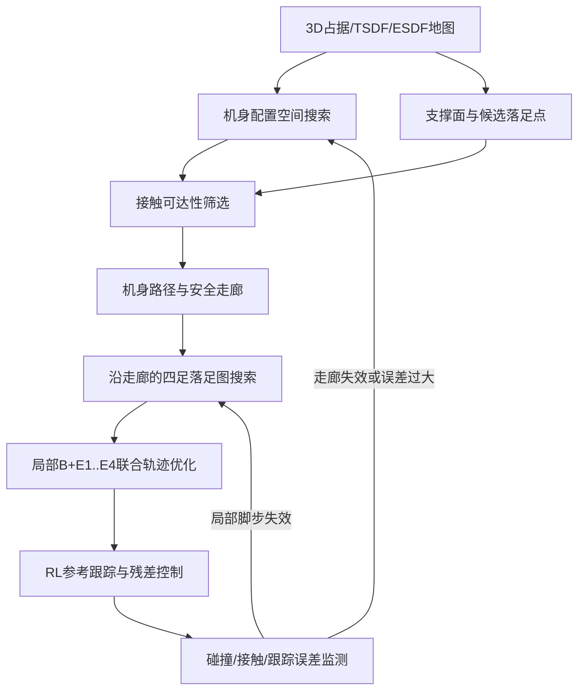

# 四轮足机器人：三维机身走廊、接触可达性与四足轨迹规划

> 2026-10-21 更新：本文件保留为早期讨论稿。当前方案、文献核对和实际实验请看 [三维规划方法调研与验证](three_d_planning_methods_and_validation.md)。早期稿中逐节点支撑、五条位置轨迹和走廊安全性的条件不充分；新报告补充了接触转换、关节构型及执行能力的约束，并收紧了创新性判断。

## 先给结论

你提出的“先用 body 探索三维空间可行性，再规划四个落足点”比“先选接触模式和关键机身姿态”更接近实际问题。桌下通过、窄通道、台阶侧向通过、梅花桩等任务，首先受机身扫掠体积、离地高度、俯仰/横滚和转向空间限制；如果机身轨迹没有在三维空间里规划出来，四个脚的落点优化没有可靠的参考。

但**纯 body-first 仍然不够**：几何上能通过的机身位姿，可能没有腿可达的支撑组合，也可能无法连续转换到下一个支撑状态。具体稳定条件取决于准静态或动态模型。因此建议采用下面的闭环结构：

> **三维机身可行走廊搜索** → **接触可达性/支撑性筛选** → **沿机身走廊搜索四足落足序列** → **局部五条轨迹联合优化** → **RL 跟踪与在线安全修正**。

这里的“接触模式”不是人工逐段指定，而是图搜索中的离散变量。第一版可以固定为若干安全模式，后续再允许规划器自动切换。

## 为什么必须先规划机身的三维空间

设机身状态为

\[
  x_B=[p_x,p_y,p_z,\phi,\theta,\psi,v_B],
\]

其中位置、姿态和必要的速度构成机身配置。对每个候选状态，应该检查机身、轮子、腿部上段以及传感器外壳在地图中的扫掠体积。ESDF 可以给出机身与障碍物的距离，状态有效条件可写成

\[
  d_{ESDF}(T_B(x_B)\mathcal B) > d_{safe}(v_B,e_{track},\sigma_{map}),
\]

其中 \(\mathcal B\) 是机器人碰撞模型，\(e_{track}\) 是跟踪误差上界，\(\sigma_{map}\) 是地图不确定性。

这个检查直接决定以下情况：

- 桌下：机身高度、俯仰角和顶部扫掠体积是否有连续通道；
- 窄门或狭窄岩缝：机身宽度、轮子外廓和转向半径是否能通过；
- 台阶：机身是否能升高，前后轴是否能处在不同高度；
- 梅花桩：机身是否能在跨步时保持足够的横向空间和支撑裕度。

因此，输出不能只是一个目标位姿或一个模式标签，而应是一个**三维机身轨迹和安全走廊**：

\[
  \mathcal C_B=\{\mathcal C_0,\ldots,\mathcal C_N\},
\]

每个 \(\mathcal C_k\) 是包含允许机身位置和姿态的安全区域。局部控制器可在走廊内有一定偏差，而不必精确跟踪一条过于脆弱的中心线。

## 纯 body-first 为什么会失败

下面的流程不能直接采用：

1. 只按机身与障碍物距离搜索一条自由空间路径；
2. 再把四个脚投影到附近地面；
3. 如果某个脚够不到，就局部修补。

它会产生三类问题：

1. **接触不可达**：机身经过某个位置，但某条腿的工作空间够不到可支撑表面；
2. **支撑断裂**：单个脚都“能到”，但抬脚顺序导致剩余支撑不足，或者质心投影越过支撑多边形；
3. **摆腿碰撞**：脚的终点安全，但从旧落足点到新落足点的摆动轨迹撞到台阶、桌腿或障碍物。

所以 body-first 应该改成**带接触可达性约束的 body-first**。每个机身状态不只存一个 ESDF 距离，还存一个支撑可行性标签：

\[
  R_{sup}(x_B)=\{(f_1,\ldots,f_4,m):
  \text{腿可达、脚接触面有效、支撑稳定、摆腿可行}\}.
\]

如果 \(R_{sup}(x_B)=\varnothing\)，这个机身状态即使在几何上无碰撞，也必须从机身图中删除。

## 推荐架构：支持感知的三维机身走廊规划

### 1. 地图：3D 几何层加支撑层

建议使用以下组合，而不是把 3D 高斯直接当规划器：

1. **3D 占据或 TSDF**：表达桌面、桌板下表面、立柱、台阶立面和悬空障碍；
2. **ESDF**：快速计算机身、轮子、腿和摆腿轨迹到障碍物的距离；
3. **支撑面层**：表面法向、粗糙度、坡度、摩擦估计、可承载性和高度变化；
4. **未知空间层**：区分“确认空闲”和“未观测”，桌下等遮挡区域不能默认安全；
5. **可选视觉重建层**：3D Gaussian Splatting 可用于稠密视觉重建和主动观测，但规划接口仍应转换成占据、ESDF 和支撑层。

2.5D 高程图适合开阔地面和普通台阶，但无法正确表达桌下、悬空板、洞口和同一 \((x,y)\) 上多个高度的结构。因此本课题的主地图应是 3D 体素/TSDF/ESDF，2.5D 只能作为支撑面查询的加速缓存。

### 2. 机身配置空间搜索

全局搜索不必一开始就在完整动力学状态上做优化。可以用离散图、A*、Lazy-PRM 或 RRT* 在低维机身状态上搜索：

\[
  s_B=(x,y,z,\psi,h,\phi,\theta),
\]

其中 \(h,\phi,\theta\) 只在需要时开放。对于普通平地可固定 \(h,\phi,\theta\)；遇到桌下、台阶或斜坡再扩展到 3D 姿态。

每条边需要检查：

- 机身、轮子和腿部上段的连续扫掠碰撞；
- 机身高度、俯仰和横滚变化率；
- 转向半径、轮子滚动方向和最大曲率；
- 走廊宽度是否大于定位误差、RL 跟踪误差和安全裕度之和；
- 相邻状态是否存在至少一个可延续的支撑集合。

代价可写成

\[
J_B= w_lL+w_cC_{clear}+w_uC_{unknown}+w_pC_{posture}
       +w_rC_{reach}+w_sC_{stability},
\]

其中 \(C_{reach}\) 和 \(C_{stability}\) 不允许仅靠加权项掩盖硬约束：如果没有可达接触或支撑中断，应直接判无效。

搜索完成后，对离散机身节点进行平滑，生成中心线和凸安全走廊。走廊可以用 ESDF 膨胀、凸多面体分解或局部球/盒子序列表示。后续五轨迹优化只允许在走廊内运动。

### 3. 接触可达性不是最后才检查

对每个机身节点和每种候选支撑集合，建立四足接触候选：

\[
  G_k=\{(i, f_i, q_i): f_i\in\text{support surface},
  q_i\in\text{leg workspace},\;collision\text{-}free\}.
\]

接着建立节点间的接触转移边。边的有效条件包括：

- 只抬起允许抬起的腿后，剩余接触仍满足支撑多边形或动态稳定条件；
- 新脚点在腿长、关节限位、足端姿态和摩擦约束内；
- 摆腿曲线不碰撞；
- 机身在该步期间不离开三维走廊；
- 对轮式滚动段，轮子接触与腿部支撑的混合约束可满足。

这一步可以使用腿工作空间查表、接触可达性图或 Contact Dynamic Roadmap 思路。它比在每个时刻直接优化所有关节更快，也能把不可能的机身路径提前删除。

### 4. 沿机身走廊搜索四个落足点

全局层输出应是：

\[
  \{\mathcal C_B,\; (f_1^j,f_2^j,f_3^j,f_4^j,m_j)_{j=1}^M\}.
\]

其中 \(\mathcal C_B\) 是机身安全走廊，\(f_i^j\) 是第 \(j\) 步每条腿的落足点，\(m_j\) 是由搜索器自动决定的接触集合。它不是把四个脚分别规划四条独立路径，而是把“机身节点 + 当前接触集合 + 四足落点”作为一个图节点。

对每个腿，终点落足点要同时满足：

- 支撑面法向和粗糙度满足要求；
- 足端位置在机身对应的工作空间内；
- 对台阶和梅花桩，允许不同腿处于不同高度；
- 对桌下，脚点高度变化不能迫使机身撞上方障碍；
- 摆腿中间轨迹满足 ESDF 和最低离地高度约束。

这样，机身路径负责“机器人整体能不能穿过去”，落足图负责“每一步怎么支撑和换脚”。两者通过接触可达性图双向耦合。

### 5. 局部五条轨迹联合优化

全局层不宜直接优化几十米长的连续动力学轨迹。对当前滚动窗口 \([t,t+H]\)，再联合优化五个对象：

\[
  \Xi=\{X_B(\tau),E_1(\tau),E_2(\tau),E_3(\tau),E_4(\tau)\}.
\]

轮足机器人还应包含关节、轮速、接触力或接触模式等变量。目标函数至少包括：

\[
\begin{aligned}
J=&J_{track}+J_{corridor}+J_{collision}+J_{contact}
 +J_{smooth}+J_{energy}\\
 &+J_{terrain}+J_{wheel/leg}+J_{uncertainty}.
\end{aligned}
\]

硬约束包括机身走廊、障碍物距离、关节和轮腿运动学、足端接触、摩擦、支撑稳定和摆腿无碰撞。优化器可以采用 direct collocation、SQP/iLQR、MPPI 或采样加局部优化。重要的是，初始化来自全局机身走廊和落足图；局部优化负责修正耦合，不负责从零发现整条路线。

## 三种方案的取舍

### 方案 A：纯机身轨迹，再投影四足

实现简单，最适合先验证桌下空间碰撞和地图表达。但对于台阶、梅花桩和连续换脚，失败率会高，因为机身路径可能没有接触支撑。它可以作为基线，不能作为最终方法。

### 方案 B：支持感知的机身走廊 + 落足图 + 局部五轨迹优化

这是早期建议主线。机身先在三维空间搜索，每个机身节点通过接触可达性筛选，再结合落足搜索与局部优化。后续调研表明，还需要保存支撑构型、验证相邻接触转换，并允许局部失败改变机身路线。覆盖全部目标场景的能力与论文创新性尚需验证，不能仅凭架构成立就断言。

### 方案 C：全局直接联合优化机身、四足、接触模式和动力学

表达力最强，但非凸性和接触序列组合爆炸严重。它适合后期在局部窗口做 refinement，不适合作为第一版的全局规划器。若一开始直接做全局五轨迹+模式联合优化，很容易在桌下、台阶等场景中陷入不可行初值或局部最优。

## RL 在系统中的位置

RL 不应该替代三维全局规划。它的输入可包括：

- 机身参考位姿、速度和剩余走廊；
- 四个足端参考轨迹和接触标志；
- 3D 局部占据/ESDF 或压缩后的障碍距离；
- 支撑裕度、足端误差、轮地接触状态和估计速度。

奖励应同时惩罚机身/足端跟踪误差、碰撞距离、滑移、接触冲击、能耗和走廊越界。建议先训练固定模式和较宽走廊，再逐步加入模式切换、地图噪声、延迟和执行器误差。在线运行时保留一个安全层：当 RL 输出使 ESDF 距离、足端可达性或支撑裕度低于阈值时，投影回可行控制集或触发局部重规划。

## 创新性判断

“body 先规划、脚后规划”本身不是全新思想。多足机器人已有 body action planner、接触可达性图和 whole-body planning；Buchanan 等人的工作明确先生成机身位姿轨迹，再计算落足和摆腿，同时检查接触可达性。Mastalli 等人则展示了机身运动和落足联合搜索在复杂地形上的必要性。因此只把顺序改成 body-first，创新性只能算低到中等。

比较有价值的创新点是把以下内容组合到轮足机器人和 RL 执行闭环中：

1. **轮腿混合接触下的支持感知三维机身走廊**：同时考虑轮子滚动、腿部支撑、机身扫掠体积和悬空障碍；
2. **把控制跟踪误差转化为走廊收缩量**：走廊安全裕度随速度、姿态、延迟和 RL 误差自适应变化；
3. **机身路径与接触可达性双向反馈**：机身搜索阶段就剔除未来无法支撑的状态，局部落足失败时回退到机身图重新搜索；
4. **不确定 3D 地图下的主动观测**：只有当桌下或障碍后方的未知区域影响走廊可行性时，才改变视角或减速观测；
5. **全局走廊、足步图和局部五轨迹的分层验证**：分别量化几何可行、接触可行、动力学可执行和 RL 跟踪成功率。

## 建议的验证顺序

1. **几何基线**：静态 3D 占据图和 ESDF，验证机身扫掠体积能否通过桌下、窄门和悬空障碍；暂不加入 RL。
2. **接触可达性**：固定机身走廊，加入腿工作空间、落足支撑和摆腿碰撞，统计每个机身节点的可行支撑比例。
3. **落足图**：在台阶、随机高低块和梅花桩上比较“独立脚投影”和“机身走廊上的接触图搜索”的成功率、步数和最小支撑裕度。
4. **局部五轨迹优化**：比较仅跟踪机身、机身加落足点、五轨迹联合优化三种方法，记录碰撞、滑移、足端误差和求解时间。
5. **RL 跟踪**：加入摩擦、质量、延迟、地图噪声和执行器扰动，比较无走廊安全层、固定走廊安全层、自适应误差走廊。
6. **闭环重规划**：遮挡桌下部分地图或人为移动障碍，验证未知区域处理、局部失败回退和重新生成机身走廊的能力。

核心指标应包括：机身路径成功率、四足接触序列成功率、全身碰撞率、最小 ESDF 距离、最小支撑裕度、足端跟踪误差、机身姿态误差、规划时间和重规划次数。只报告最终是否走通不足以证明方法有效。

## 相关工作

- Buchanan et al., *Perceptive Whole-Body Planning for Multilegged Robots in Confined Spaces*, Journal of Field Robotics, 2021：三维地图中生成机身位姿、落足和摆腿轨迹，并检查接触可达性。<https://onlinelibrary.wiley.com/doi/10.1002/rob.21974>
- Mastalli et al., *Motion Planning for Quadrupedal Locomotion: Coupled Planning, Terrain Mapping and Whole-Body Control*, 2020：联合考虑机身运动、步时和落足，说明复杂地形中完全解耦会丢失可行性。<https://arxiv.org/abs/2003.05481>
- Short and Bandyopadhyay, *Legged Motion Planning in Complex Three-Dimensional Environments*, 2017：Contact Dynamic Roadmap，将腿工作空间和接触可达性用于复杂三维环境规划。<https://doi.org/10.1109/LRA.2017.2728200>
- Jenelten, Grandia, Farshidian, Hutter, *TAMOLS: Terrain-Aware Motion Optimization for Legged Systems*, 2022：高程地形上的机身与落足优化。<https://arxiv.org/abs/2206.14049>
- Jenelten, He, Farshidian, Hutter, *DTC: Deep Tracking Control*, Science Robotics 2024：优化规划与 RL 精确落足跟踪，不是任意五条轨迹同时精确跟踪。<https://arxiv.org/abs/2309.15462>
- Miki et al., *Learning to walk in confined spaces using 3D representation*, 2024：三维感知与姿态可调的分层行走控制。<https://arxiv.org/abs/2403.00187>
- Jelavic, Qu, Farshidian, Hutter, *LSTP: Long Short-Term Motion Planning for Legged and Legged-Wheeled Systems*, T-RO 2023：长时域接触/全身构型搜索与短时域非线性优化。<https://www.research-collection.ethz.ch/entities/publication/bd78885c-32e9-4889-867c-15550e3224b9>

## 最终建议

你的主线可以确定为：**三维机身配置空间走廊规划 + 接触可达性筛选 + 沿走廊的四足落足图 + 局部五轨迹联合优化 + RL 跟踪**。

第一版不要追求任意接触模式和完整动力学全局最优，而应先实现固定几种安全支撑模式、自动生成机身三维走廊，并证明这条走廊经过接触可达性筛选后能在仿真中覆盖桌下、台阶、起伏地面和梅花桩。之后再加入自动模式切换和轮腿混合接触。这样既保留了你提出的 body-first 核心，也避免纯 body-first 生成不可支撑轨迹的问题。
