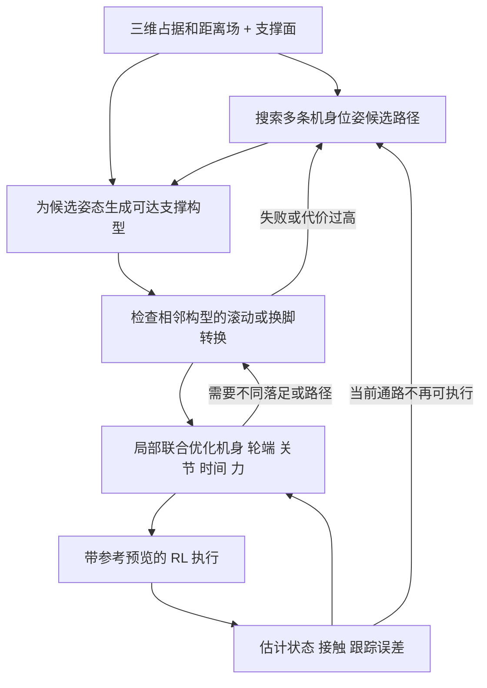
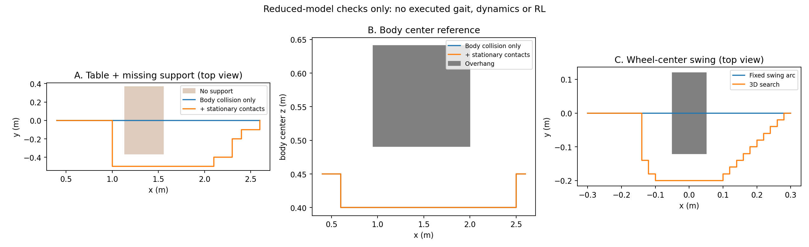
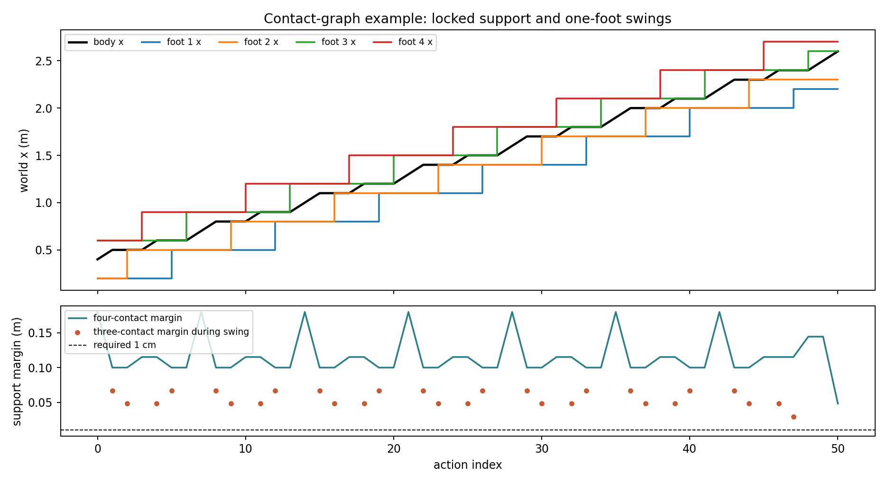

# 三维环境中的轮足规划与 RL 执行：方法调研、方案修正及实际验证

> **2026-10-22 执行进度：** 最新已完成与未完成工作见 [PROGRESS.md](PROGRESS.md)。已新增 E0/E1 的部分物理仿真诊断；下文保留 2026-10-21 的研究记录，不作为最新完成状态。

更新：2026-10-21。本文替代此前的 `three_d_body_corridor_contact_planning.md` 作为当前建议。研究对象是四轮足机器人；楼梯、桌下、梅花桩是代表性约束，并非三个独立任务或限定应用范围。

**本轮新增：[机身与四轮端关系、滚动/抬腿转换及完整实验方案](rolling_stepping_experiment_protocol.md)。** 其中解释了“固定四个落足点是否确定 body”，并定义了 E0–E7 的实验、对照、指标及创新性判据。新定义的完整机器人实验尚未执行。

## 1. 我的判断

**大方向可行，但需要把“body 先找一条路，再让四个轮端追上去”改成“由 body 引导搜索，接触和全身运动不断修正这条路”。** 下层 RL 可以提高执行鲁棒性，但不能补救上层遗漏的支撑面、膝部碰撞或滚动约束。

本次查阅了四足、轮足、多足、接触规划、轨迹优化、学习控制，以及无人机三维避障相关方法。最接近你的想法的已有工作是 **Buchanan 的受限空间全身规划、RBPRM、LSTP、轮足 whole-body MPC 和 DTC**。它们分别说明关键环节有实现依据，也说明“3D 地图 + body/四足规划 + RL”这个框架本身不足以作为创新点。

我实际做了四类简化检查：38 个场景的配对路径搜索、Isaac Sim/PhysX 碰撞交叉检查、已有路径的逐边运动学审计，以及四点足接触图搜索。结果支持下面三点：

1. 机身避障路径可能没有支撑，支撑条件必须进入路径选择。
2. 轮端起终点安全，不代表摆轮轨迹安全；机身和轮端都安全，也不代表膝部安全。
3. 逐个姿态可行，不代表它们之间存在可执行的换脚过程。

**这些结果尚未证明完整系统能通过楼梯、梅花桩或桌下。** 当前实验没有载入目标轮足机器人的关节模型，没有训练 RL，也没有进行机器人闭环行走。它们是架构假设的反例与筛选实验；完整成功率需要后文定义的执行实验。

如果选一个兼顾研究价值和实现风险的方向，我推荐：

> **三维机身引导的接触转换搜索 + 局部全身轨迹优化 + 参考条件化 RL；研究重点放在“规划结果是否能被当前控制器执行”，以及该判断怎样反过来改变机身、接触和摆轮路径。**

这里的“转换”很具体：从当前机身姿态和四轮支撑状态，滚动或抬起某条腿，到达下一组姿态和接触位置。程序搜索这些动作，人只给目标位置、机器人模型及允许的动作范围。

## 2. 先纠正旧方案的几个问题

| 旧说法或容易产生的理解 | 更准确的表述 |
|---|---|
| 优化五个点就能确定动作 | 机身需要位置与姿态；四个轮端需要轨迹、轮轴方向和接触状态；内部还必须恢复关节构型、时间及必要的力学变量。 |
| 四个落足点固定，body 就固定；反之也一样 | 通常都不成立。给定轮端位置仍可通过腿关节改变 body；给定 body 后各腿仍有工作空间。两者互相约束，详见第 5.4 节。 |
| 每个 body 点存在一组落足即可 | 必须验证前后落足之间的连接；支撑不能瞬移，摆动不能穿过障碍。 |
| 只知道 body 位姿即可检查全身 | 腿和膝的位置依赖关节构型。同一个 body/轮端位置可能对应不同膝朝向。 |
| 先生成一个安全走廊，之后都在里面修 | 狭窄走廊可能排除唯一可行接触序列。必须允许换候选路径、扩大局部搜索或回退。 |
| 三点支撑是所有情况的稳定条件 | 它只适用于选定的准静态步态近似；动态步态需要力、动量及接触时序判断。 |
| 支撑轮的位置始终固定 | 纯滚动时，轮心和地面接触位置随运动变化；无滑动约束施加于当前接触处的轮上材料点。 |
| 整机必须先从滚动切到走路才能抬腿 | 一条腿可离地，其他轮继续滚动支撑；接地轮保持与滚动通常是连续速度选择。 |
| RL 后接一个投影层就有安全保证 | 对黑箱策略，控制输出和未来碰撞的关系未必准确可知。监测、限速、重规划可以实现，形式化保证需要额外模型与假设。 |

旧文献表也有错误，应以本报告为准：DTC 的题名是 **DTC: Deep Tracking Control**；TAMOLS 作者为 **Fabian Jenelten、Ruben Grandia、Farbod Farshidian、Marco Hutter**；arXiv:2403.00187 是 **Learning to walk in confined spaces using 3D representation**；LSTP 的全称是 **Long Short-Term Motion Planning for Legged and Legged-Wheeled Systems**。

## 3. 哪些已有方法真正有用

下表中的“已验证”是论文作者报告的结果，不代表本次已经复现。全文可访问的工作用于核对算法与边界；仅摘要核对的条目会注明。年份按正式出版信息优先，预印本单列。

### 3.1 最值得读的规划工作

| 工作与来源 | 方法及已有证据 | 对本课题的价值与限制 |
|---|---|---|
| Buchanan et al., **Perceptive whole-body planning for multilegged robots in confined spaces**, JFR 2021。[论文](https://onlinelibrary.wiley.com/doi/10.1002/rob.21974) | 先采样机身位姿路径，平滑后选择落足、优化姿态与摆动；包含真实 ANYmal 受限空间实验。 | 和你的 body-first 想法非常接近。使用地面/顶棚多高程表达，依赖静态稳定近似；不能等同于任意三维结构、任意动态轮足运动。 |
| Geisert et al., **Contact Planning for the ANYmal Quadruped Robot using an Acyclic Reachability-Based Planner**, 2019。[论文](https://arxiv.org/abs/1904.08238) | 用简化机身和肢体可达体寻找根部路径，再生成接触与全身构型；ANYmal 仿真验证。 | 可借鉴“机身路径如何关联接触”，但粗可达性只是放松条件，不能直接证明狭窄空间全身可行。 |
| Mastalli et al., **Motion Planning for Quadrupedal Locomotion: Coupled Planning, Terrain Mapping and Whole-Body Control**, 2020。[论文](https://arxiv.org/abs/2003.05481) | 将机身运动、步时和落足耦合优化，地形用代价图表达。 | 说明完全分开规划会丢失可行解；并非已经解决完整 SE(3) 机身与任意悬空障碍。 |
| Jelavic, Farshidian, Hutter, **Combined Sampling and Optimization Based Planning for Legged-Wheeled Robots**, ICRA 2021。[论文](https://arxiv.org/abs/2104.04247) | 采样阶段给出全身构型与接触时序，优化阶段细化；实验平台包括轮腿式挖掘机 HEAP。 | 适合研究非凸障碍下的初值生成。不要把该文的平台误写成四轮足 ANYmal。 |
| Jelavic, Qu, Farshidian, Hutter, **LSTP: Long Short-Term Motion Planning for Legged and Legged-Wheeled Systems**, T-RO 2023。[作者接收稿](https://www.research-collection.ethz.ch/bitstream/20.500.11850/625515/1/LSTP_accepted_version.pdf) | 长时域采样得到稳定全身关键构型与接触时序，短时域优化满足更完整的模型；覆盖多种腿式和轮腿平台。 | **最重要的架构对照。** “全局搜索 + 局部非线性优化”“自动选择接触顺序”都已有直接先例。 |
| Jenelten et al., **TAMOLS: Terrain-Aware Motion Optimization for Legged Systems**, T-RO 2022。[论文](https://arxiv.org/abs/2206.14049) | 在高程地形上联合规划机身与落足，利用模型简化和分阶段优化提高效率；有复杂地形实机实验。 | 可借鉴局部优化，但地图及碰撞模型不能直接覆盖桌板下表面、侧向摆腿和膝碰撞。 |
| Bjelonic et al., **Whole-Body MPC and Online Gait Sequence Generation for Wheeled-Legged Robots**, IROS 2021。[论文](https://arxiv.org/abs/2010.06322) | 机身与轮端联合预测，处理移动接触及在线步态生成；实机轮足验证。 | 轮足接触、滚动和机身耦合的关键来源。换成普通四足的固定支撑点模型会漏约束。 |
| Gaertner et al., **Collision-Free MPC for Legged Robots in Static and Dynamic Scenes**, ICRA 2021。[论文](https://arxiv.org/abs/2103.13987) | 用 ESDF 与机器人几何近似在 MPC 中避障；包含实机狭窄空间和仿真实验。 | 有助于接入三维障碍代价。论文的钻低障碍展示含仿真，摆足避障仍列为后续问题；软障碍代价不等于严格安全证明。 |
| Asselmeier, Zhao, Vela, **QuadPiPS**, arXiv v3，2026-05，页面标注在审。[论文](https://arxiv.org/abs/2501.00112v3) | 支撑区域分割、离散搜索与非线性轨迹优化，输出全身参考，再用 MPC/WBC 执行；仿真及 Go2 实机。 | 接触区域图的重要近期对照。用户定义的步态仍是其搜索假设之一，不能写成自动发现任意步态。 |
| Li et al., **Stable Trajectory Planning for Quadruped Robots Using Terrain Features at Feet End**, RA-L 2026。[作者 PDF](https://labsun.org/pub/RAL2026_stable.pdf) | 用足端附近地形特征构造机身路径代价，SVGP 地形回归配合 CMA-ES；仿真及实机。 | “机身规划时考虑四足地形”也已有直接研究。该 Gaussian process 高程模型不是 3D Gaussian Splatting，也不是完整悬空结构地图。 |

关于第一篇，还需特别注意：作者明确讨论了分层处理造成的约束不一致——后续稳定性调整可能改变机身姿态，重新引入碰撞。因此，不能照搬“先 body 后 feet”的顺序，就假定最终全身轨迹自动安全。最终姿态变化后必须重新检查碰撞。[原文](https://onlinelibrary.wiley.com/doi/10.1002/rob.21974)

### 3.2 RL 接口及“控制器能否执行”的已有工作

| 工作与来源 | 已有证据 | 不能直接外推的地方 |
|---|---|---|
| Jenelten, He, Farshidian, Hutter, **DTC: Deep Tracking Control**, Science Robotics 2024。[全文](https://arxiv.org/html/2309.15462v2) | 优化器生成参考，RL 学习精确落足并提高鲁棒性；包含稀疏支撑地形。 | 不是把完整机身位姿和四条任意摆动曲线都输入 actor 逐点跟踪。不能直接拿来宣称“五轨迹跟踪已解决”。 |
| Miki et al., **Learning to walk in confined spaces using 3D representation**, ICRA 2024。[全文](https://arxiv.org/html/2403.00187v1) | 三维感知与分层控制结合，姿态可调，包含受限空间实机验证。 | 下层的六维命令包括平面速度、偏航角速度、横滚、俯仰和高度；不是任意 SE(3) 时间轨迹，也不指定每个轮端落点。 |
| Miao et al., **PALo: Learning Posture-Aware Locomotion for Quadruped Robots**, 2025 预印本。[论文](https://arxiv.org/abs/2503.04462) | 同时跟踪速度及机身高度、俯仰、横滚，报告仿真到实机迁移。 | 是姿态控制基础，不能替代精确落足、摆轮和轮轴约束。此处核对了摘要。 |
| Jeong et al., **HiPAN**, 2026，作者页面标注 RA-L 接收。[论文](https://arxiv.org/abs/2604.26504) | 高层从深度图输出导航与姿态命令，低层姿态自适应行走；仿真及实机。 | 属于学习式高层，与你要求的优化式高层不同，但必须作为三维受限空间导航的能力对照。 |
| Taouil et al., **Quadrupedal Footstep Planning using Learned Motion Models of a Black-Box Controller**, IROS 2023，arXiv v2 2025。[论文](https://arxiv.org/abs/2307.12292) | 学习速度命令到质心与足步运动的映射，并嵌入 A*。 | **“规划器考虑底层能力”本身已有先例。** 需要证明新增的姿态、接触转换或全身避障建模带来独立收益。 |
| Eisman et al., **Racing a Wheeled Quadruped: Active Load Transfer Mitigation via MPC**, AVEC 2026。[论文](https://arxiv.org/abs/2606.26313) | 轮足机器人上层 MPC 主动调节横滚，底层 RL 驱动 16 个执行器，有实机赛车实验。 | 说明轮足“优化上层 + RL 下层”也非新框架；任务不同于稀疏支撑和三维狭窄通行。 |
| Tao et al., **Learning-based path planning and tracking for the walking–jumping quadrupedal robot**, RAS，2026-10-09 在线预发表。[出版页](https://www.sciencedirect.com/science/article/pii/S0921889026004719) | 摘要及公开引言说明用实测跟踪能力约束跳跃路径，衔接 RL 行走/跳跃。 | 近期直接相关对照；本次未获取完整正文，不据此推断全部实现细节。 |

DTC 特别值得借鉴的是“规划提供可解释的落足目标，策略负责有扰动的执行”。其 actor 使用落足目标、相位/剩余时间等信息，完整机身参考姿态并非直接 actor 输入。对你而言，需要新增并验证**姿态与落足同时跟踪、侧向绕障摆轮、滚动/抬轮转换**这一接口；这项工作本身不小。[DTC](https://arxiv.org/html/2309.15462v2)

### 3.3 扩大视野后，哪些方法可以借，哪些不能直接照搬

| 方法 | 可借鉴部分 | 本课题中的边界 |
|---|---|---|
| **Walking Posture Adaptation for Legged Robot Navigation in Confined Spaces**, 2019。[论文](https://arxiv.org/abs/1901.10863) | 用可变形外廓调整机身高度与宽度。 | 对狭窄通行有启发，但外廓可行不证明每条腿能通过。 |
| **Rolling in the Deep**, 2019/2020。[论文](https://arxiv.org/abs/1909.07193) | 轮端与机身规划、轮足运动学约束。 | 可作为顺序规划基线，不能忽略滚动接触。 |
| **Optimization-Based Quadrupedal Hybrid Wheeled-Legged Locomotion**, 2021。[论文](https://arxiv.org/abs/2107.07507) | 混合轮腿优化、接触力与摩擦限制。 | 动作可行性和地图碰撞仍是不同层面的约束。 |
| **SafeSteps**, 2023。[论文](https://arxiv.org/abs/2307.12664) | 用运动学、腿碰撞等因素筛选落足动作。 | 可以借候选动作筛选思想；不是你的整套优化上层。 |
| **Motion Planning around Obstacles with Convex Optimization / GCS**。[论文](https://arxiv.org/abs/2205.04422) | 用凸区域图处理绕障路线和连续曲线。 | 支撑、关节、机身旋转、滚动约束不会因使用 GCS 自动变凸；适合作为路径拓扑工具。 |
| **Fast Path Planning Through Large Collections of Safe Boxes**。[论文](https://arxiv.org/abs/2305.01072) | 大量安全区域中的路线选择及连续优化。 | “位置在安全盒里”不能推出转动后的机身与腿安全。 |
| **RC-ESDF: Robot-centric ESDF…**, Gao 团队，2023。[论文](https://arxiv.org/abs/2306.16046) | 将机器人形状的距离表达用于碰撞查询。 | 对刚体外廓有价值；腿不断变形，不能直接用一个固定全身场。可研究分连杆表达。 |
| **GS-Planner**, Gao 团队，2024。[论文](https://arxiv.org/abs/2405.10142) | 高斯场景表示、规划与主动重建结合。 | 该文面向飞行器探索/重建，不提供轮足支撑、接触力或换脚可行性。 |
| **Splat-Nav**, 2024。[论文](https://arxiv.org/abs/2403.02751) | 从 Gaussian Splatting 场景构建避障空间并规划。 | 可以借鉴几何避障，不能从视觉高斯密度直接推断承载、摩擦和落足可靠性。 |

因此，我不会为了创新而强行采用高斯。当前更有用的变化是**把支撑与实际执行能力放进搜索**。地图只有在表示精度、未知空间处理或计算效率成为瓶颈后，才值得单独作为研究重点。

### 3.4 本轮补查：接触跟踪和动作转换不能当作空白领域

[GeCCo](https://arxiv.org/html/2509.17582v2) 已研究通用接触条件四足 RL；[ATRos](https://arxiv.org/abs/2510.09980) 与 [AWARE](https://arxiv.org/abs/2604.23761) 分别报告混合轮腿运动和轮足动态避障；[Contact-Implicit MPC](https://arxiv.org/abs/2312.08961) 提供无需预先给定接触序列的实时四足方法。因此，不应将“自动滚动/抬腿”“优化器接 RL”或“自动选择接触”单独声称为创新。

它们也不能直接证明本课题已解决：轮足的指定机身姿态、精确落区、全腿三维避障与转换时序同时受约束，仍需独立验证。论文版本、核对范围、具体能力边界和强对照已写入[实验方案第 10 节](rolling_stepping_experiment_protocol.md)。

## 4. 推荐方案 A：body 引导，但保留接触状态的搜索

### 4.1 具体流程是什么

程序最初可以只用机身粗路径引导采样，但进入精细搜索后，不能把节点仅存成一个 body 点。建议保存：

\[
 s=(T_B,\mathcal P_1,\ldots,\mathcal P_4,\sigma,q_{seed}),
 \qquad T_B\in SE(3).
\]

这里 `T_B` 是机身六自由度位姿；`P_i` 是第 i 个轮端对应的支撑面片或空中目标区域；`σ` 记录各腿接地/离地及动作阶段；`q_seed` 保存一组关节构型，避免在两个膝朝向之间无故跳变。接地时保持或滚动通常通过连续轮速表达，不必另设两个离散接触模式。上式只是远距离粗搜索表示；进入局部可执行性判断后，还需保留机身/关节速度、轮速及实际接触。不是每个变量都必须均匀离散，更不必枚举全部组合。

实现上，开放地面用较少姿态候选，接近低顶棚、坡面或窄门时增加高度和姿态采样。同一个机身位姿保留若干不同支撑构型。如果只保留第一组可行落足，下一步可能被错误堵死。保留有限个候选是计算量折中，会失去完整性，不能宣称一定找到所有存在的路径。

**“外层选择”不需要人工逐段选。** 例如当前为四轮接地，程序可以比较继续滚动、减速并降低机身、抬左前轮到候选支撑面等边。人工定义动作模型和搜索范围；环境中具体用哪条边，由代价和约束决定。

### 4.2 从便宜到昂贵检查什么

| 检查层 | 实际检查 | 判定意义 |
|---|---|---|
| 粗机身 | 包含传感器外壳的机身碰撞；目标是否落入已观测区域 | 排除明显碰撞；不证明腿安全 |
| 支撑候选 | 支撑面边缘裕度、腿工作空间、轮轴朝向可达性 | 工作空间近似可能有假阳性；有限采样也可能漏解 |
| 全身姿态 | IK、关节限位、自碰撞、膝与腿段到环境的距离 | 得到单个可行构型 |
| 力学 | 准静态用力/力矩平衡与摩擦约束；需要快速运动时升级动量/动力学 | 支撑多边形只能作为粗筛 |
| 转换边 | 连续机身运动、支撑轮约束、摆轮及腿段轨迹、换脚时序 | 验证两个构型是否真的能连接 |
| 当前控制器 | 在状态、速度、姿态和动作类型条件下是否可稳定执行 | 需要数据校准，不能只看规划器数学可行性 |

转换边昂贵，可先按粗代价搜索，选出候选路线后再检查关键边，并缓存结果。这就是“延迟检查”的用途。失败后应换接触、换姿态或换路线。

但要区分 **“证实碰撞/越界”与“某次优化没收敛”**。后者不能永久宣判整段空间不可通行，应尝试不同初值或调整候选。否则前端会被优化器的局部失败误导。

### 4.3 为什么比“固定 body 后四足”更合适

在低顶棚下面出现一块缺失地面时，单独优化 body 会倾向于下蹲直行。接触检查可能发现下蹲后前腿无法跨到下一块支撑面。此时应允许 body 横移或改变俯仰，甚至选择桌腿另一侧；不能只调整原轨迹附近几厘米的落足。

同样，在梅花桩上，同一机身位姿可能有两组支撑：第一组当前稳定却无法继续换脚，第二组能连接下一块桩。需要保留的是**支撑状态之间的连续路线**，不是每个 body 点附一个“可行”布尔值。

这些原则有 RBPRM/LSTP 的方法依据。把它们用于你的系统是可行架构选择，尚不是新的算法贡献。

### 4.4 滚动与抬腿要联合考虑，不能只检查下一落点

例如左前腿离地时，其他三轮可以继续滚动。规划需要同时验证它们在整个摆腿期间的支撑轨迹、受力和腿工作空间，且允许机身改变高度、姿态与速度。摆动轮需要无碰撞的整腿运动和下一落地区域，接地轮需要连续可滚动区域；只检查四个离散落点不够。

第一版可比较三种方案：固定步序但优化落点/时长；先减速再单腿抬落；在有限接触候选间搜索，并局部联合优化机身、轮端和时间。后者不是唯一选择，接触隐式优化、交替修正和参数化动作库也值得按实际瓶颈选择。

触地必须结合实际接触反馈：提前卸载、无碰撞摆动、落地速度/轮速协调、确认接触、恢复承载都属于同一段运动。停车抬腿是有用的对照，不应被当作所有场景的固定流程。详细模型和实验见[补充方案第 3–7 节](rolling_stepping_experiment_protocol.md)。

## 5. 到底优化什么：五条输出，更多内部变量

### 5.1 全局与局部输出不同

全局阶段优先输出带姿态的空间引导路径、候选接触面及粗动作顺序。不要太早锁定精确时间：同一条路径能否执行，常取决于降速、停顿或更改摆动时长。

局部优化输出：

\[
 y^{ref}(t)=\{T_B^{ref}(t),c_1^{ref}(t),\ldots,c_4^{ref}(t),
             \sigma(t),\omega_1^{ref}(t),\ldots,\omega_4^{ref}(t)\}.
\]

`c_i` 建议定义为轮心。轮心不是地面接触点；真实轮的接触几何与轮轴方向、轮半径和表面法向有关。简单平面、固定轮轴的近似可以用轮心相对接触点偏移；一般情况下必须通过轮的几何/运动学模型求接触。RL 同时接收未来短窗口的参考及允许偏差。

内部优化变量至少包括机身位姿/速度、腿关节、轮转角或轮速、接触力和各段时长。可以把轮心作为独立变量并用正运动学等式关联，也可以由关节构型直接算出。它们不是五条互不相关的自由曲线。

机身世界高度 `z` 与相对支撑高度 `h` 不应同时作为没有关系的自由变量；若使用 `h`，必须定义相对于哪一层支撑面，并通过等式关联。

### 5.2 优化目标建议

我建议按优先级处理：**先得到满足约束的可执行轨迹，再优化进度、平滑和能耗**。不要把“不能碰撞”和“尽量快”都用任意权重混在一起，然后假设高权重就代表安全。

一个可实现的局部目标是：

\[
 J=w_gJ_{goal}+w_bJ_{body\ guide}+w_sJ_{smooth}
   +w_tT+w_fJ_{force}+w_aJ_{actuation}+w_rJ_{execution\ risk}.
\]

各项分别代表终端进度、偏离全局引导、速度/加速度变化、动作时间、接触力变化、执行器负担和执行失败风险。不同量纲先归一化。`J_actuation` 可先用力矩/功率代理，若未采用准确电机模型就不要称为真实电能最优。

**落足应优化到区域，而非一开始固定到点。** 对一块可承载表面，去掉边缘不确定带和轮接触尺寸后得到可落区域 `P_i_safe`；优化器在其中选位置。稀疏桩顶需要较严的落足误差，宽地面不应强迫每次踩同一个毫无必要的点。

### 5.3 约束不能漏掉什么

1. **运动学一致性**：轮心/轮轴由 `T_B,q` 计算，关节位置和速度在限制内，考虑自碰撞。
2. **全身几何**：对机身、传感器、腿段、膝、轮分别计算距离。可以用胶囊/球/凸体近似；支撑轮的指定接触允许接触，其余部位不得穿透。
3. **支撑面约束**：接触位于可承载区域；摆动轮的接触力为零；接触力非拉力，并满足估计摩擦范围。
4. **动力学一致性**：按需求使用质心动量模型或完整浮动基动力学。只做 IK 加支撑多边形不等于动态可执行。
5. **滚动约束**：固定轮轴平面情形，侧向速度为零、沿滚动方向速度与轮速相配；一般情况使用包含轮旋转的接触 Jacobian，约束瞬时接触材料点速度。不能把滚动轮中心固定。
6. **时间与转换**：摆动时间足够、关节速度可达、落地速度受限，必要时建模触地冲击或用受控低速触地近似。

完整动力学形式可写为：

\[
 M(Q)\dot v+h(Q,v)=S^T\tau+\sum_iJ_i(Q)^Tf_i,
 \quad f_{n,i}\ge0,\quad \|f_{t,i}\|\le\mu_i f_{n,i}.
\]

其中 `Q` 包括浮动机身和关节。早期可用质心动力学加全身 IK/碰撞筛选降低计算量，但此时必须另行核对关节力矩和执行结果，不能把近似模型结果称为全身动力学保证。

轨迹只在离散时刻无碰撞还不够：应加密检查或用连续碰撞检测。若用距离场梯度优化，还需处理地图分辨率、插值误差和快速姿态变化导致的扫掠。

### 5.4 四个轮端与 body 是双向约束，不是唯一对应

轮心的运动学关系为 `c_i = p_B + R_B f_i(q_i)`。固定四个轮心后，腿关节仍可配合机身升降、平移或转姿；固定机身后，各轮端仍可在对应工作空间内选择。因此，支撑点不能直接“算出唯一 body”，body 也不能直接“算出唯一四足”。如果 body 与关节角都给定，轮心才由正运动学确定；如果 body 与四轮心都给定，则还要解 IK，可能无解或有多个构型分支。

这正是联合优化的自由度来源：在同一支撑下寻找更好的 body，或改变支撑来允许更好的 body。可先交替修正，再与短时联合优化比较；不能从“一对多”推出一定需要一次求完整全局非线性问题。E0 将用固定四轮位置的 body 可行域切片验证此关系，并进一步检查承载条件。[详细解释及实验](rolling_stepping_experiment_protocol.md)

## 6. 地图怎么选

**推荐可查询的真实三维几何地图，外加支撑面属性。** 点云是观测数据；为了高频优化，通常还需要建立距离查询结构。三维高斯是可选表示，不是必要条件。

| 层 | 用途 | 具体注意事项 |
|---|---|---|
| 三维占据/TSDF | 记录几何和已观测区域 | 桌板上下表面、侧壁、台阶立面必须保留；TSDF 截断距离不能直接当全空间避障距离。 |
| 三维 ESDF 或等价距离查询 | 机身/连杆碰撞距离和局部梯度 | 使用完整三维查询，不要不知不觉只调用导航用的二维切片。 |
| 支撑面片 | 轮接触与落足区域 | 保存法向、边缘、粗糙度、可承载先验及不确定性；视觉几何不能直接测出摩擦和承载能力。 |
| 未知空间 | 遮挡区域决策 | 未观测不能默认空闲；可减速观测、换视角或选已知通路。 |

单层高程图无法完整表达同一 `(x,y)` 的地面、桌板和桌上空间。地面/顶棚双层图确实可解决一部分桌下问题，已有论文采用；因此不应说“只要桌下就绝对必须稠密体素”。但你要求更一般的悬空结构和腿部绕障，完整三维地图更合适。

可以从 [nvblox 官方实现](https://github.com/nvidia-isaac/nvblox) 的 TSDF/ESDF 基础设施开始，也可以先从仿真真值几何构建距离查询，先分离规划问题与重建误差。这里没有验证 nvblox 与当前机器人传感器的完整集成。

分辨率应由最小碰撞间隙与地图误差决定。例如目标余隙只有约 2 cm，用 5 cm 体素却声称有厘米级安全保证不合理。可尝试粗全局地图加细局部地图，但需测显存、查询耗时和薄障碍漏检。

## 7. 下层 RL 怎样训练才对应这个上层

### 7.1 不要只训练速度跟踪，然后期望它精确踩桩

建议策略输入包含本体状态历史，以及机身参考姿态/速度、未来轮端目标、接触状态和相位/剩余时间。三维局部信息可以先压缩成腿/机身附近的距离查询或局部体素；关键是策略看得到影响当前动作的障碍。

输出可以采用腿关节目标增量与轮速目标；若已有可靠力矩控制和电机模型，也可选力矩动作。两种动作接口需要各自训练，不能假定一个普通四足策略加四个轮速输出就能直接工作。

参考数据应来自运动学/动力学可行的短动作优化，并混入实际扰动后的恢复状态。任意随机组合机身和四足曲线会大量生成物理不可行命令，导致策略在互相矛盾的奖励间折中。

### 7.2 更实际的跟踪对象：参考轨迹加允许偏差

我不建议最初强制“五条曲线每个时刻都完全重合”。建议：

- 桩顶触地位置和禁止碰撞区域采用严格误差要求。
- 桌下对机身顶部、姿态和膝部余隙敏感；机身速度可以降低。
- 宽阔区域放宽轮端路径和机身高度误差，给平衡恢复留余地。
- 摆动轨迹提供中心参考和无碰撞带；侧向绕行时不能只给一个抬脚高度。

这仍然是上层规划 body 与四端，只是参考带有容许范围。**容许范围不能随意扩大**：放宽后仍需有碰撞、接触与可达性检查。

奖励分为机身/落足跟踪、接触一致性、非预期碰撞、侧滑、关节限位和动作平滑。不能通过奖励权重宣称硬约束保证；应额外统计真实失败并拒绝高风险参考。

### 7.3 最有研究价值的反馈信号

在相同初始状态和参考动作下，随机化质量、摩擦、延迟、估计偏差及扰动，记录动作能否完成，以及 body、轮端和膝的最大偏差。由此估计：

\[
 \widehat P_{succ}(s,\text{reference segment},\text{local map}),
 \qquad \widehat e_{body},\widehat e_{wheel},\widehat e_{link}.
\]

最初可以用查表或小回归模型，无须一上来训练庞大神经网络。它应预测一段动作的执行情况，而非只给静态姿态打分。

将结果用于：降低速度、延长摆动、选择不同落足、扩大与障碍间距，或改换路径。几何检查仍独立保留。模型信心不足的区域调用更昂贵验证或更保守动作。

需要注意两点：第一，统计分位数不是绝对误差上界，部署分布变化后可能失效；第二，位置和姿态误差都影响外廓，不能只把机身位置误差加到所有距离上。应在各碰撞体表面估计实际扫掠误差，或者用运动学传播误差。

## 8. 三个可尝试的方向，如何判断创新性

以下是研究选择，不是三个场景各做一套控制器。三者都应面向同一类三维混合约束任务。

| 方向 | 核心做法 | 实现判断 | 创新性判断 |
|---|---|---|---|
| **A：控制器能力参与的接触转换规划，首选** | 上述 body 引导搜索 + 全身局部优化；用实际 RL 执行结果修正转换边的可行性与余隙 | 中等偏高难度。可先做低速、锁轮/滚动/单腿摆动，再扩展；需要可靠机器人模型和跟踪策略 | 有研究空间，但“考虑控制器能力”已有先例。贡献必须落到三维全身约束、轮腿转换及可验证收益。 |
| **B：机身姿态与精确落足的联合 RL 接口** | 上层优化参考及容许带，RL 同时控制姿态、落足和绕障摆轮；研究哪些参考必须严格、哪些可以放松 | 中等偏高难度。比同时研发复杂全局规划更聚焦，适合已有优化器但跟踪器薄弱的情况 | 仅增加奖励项较弱；若证明固定五轨迹在狭窄空间有系统性冲突，而自适应容许带改善执行，则更有价值。 |
| **C：多候选空间通路 + 接触验证 + 局部优化** | 借 GCS/安全区域图或采样规划处理路线拓扑，逐条验证全身与接触，失败回退 | 高难度。位置走廊容易做，姿态/接触可行走廊难，区域构建本身可能昂贵 | 若只有“用了 GCS/ESDF”较弱；要有新的可行域构建、验证加速或明确适用条件下的性质。 |

**我会选 A，保留 B 的接口设计作为必要工程基础。** 不建议把地图、全局搜索、接触优化、RL 和安全证明都同时列成论文创新；难以区分到底哪个贡献有效。

可以将 A 的研究问题收敛为：

> 在局部狭窄三维环境中，使用由实际跟踪策略得到的、分动作和分构型的执行误差预测，能否在相近规划耗时下，降低几何可行轨迹的执行失败，同时保持窄通道和小支撑面的可通行性？

对照必须包括：纯几何/动力学规划、统一固定膨胀量、按速度调整的简单裕度，以及学习模型。若固定裕度或简单查表效果相同，应承认复杂模型没有必要。也要对照 LSTP、Buchanan、DTC、黑箱控制器运动模型等最近邻思想，不能只打败弱化的“body 点避障”。

“首次统一解决任意桌下、楼梯和梅花桩”目前没有证据支持。更稳妥的贡献表述是清楚界定机器人的动作范围和地图条件，并证明某一类**耦合约束**下，方法提高成功率或降低计算代价。

## 9. 本次实际验证：做了什么、结果是什么

所有程序与结果在 [validation_20261021](validation_20261021/README.md)。数值程序是本次编写的简化实验，未复现上表任何论文的完整系统。

### 9.1 body-only 与带支撑筛选的机身搜索

模型：机身为 `0.50 × 0.28 × 0.16 m` 的固定朝向盒体，轮近似半径 `0.06 m` 的球，髋点偏置为纵向 `±0.20 m`、横向 `±0.18 m`，腿可达距离简化为 `[0.18,0.48] m`。搜索只改变 `x,y,z`，没有联合规划机身姿态。

每条腿在髋下方附近的 9 个候选位置中选取一个支撑；检查缺口边缘裕度和机身中心投影位于四接触凸包内。这个有限候选、四轮同时支撑的简化模型既可能漏掉实际可行动作，也可能接受实际关节不可达动作，不能称为实际机器人可行性的充要判据。

固定随机种子 `20261021`。平地和单台阶各 1 个固定场景；顶棚、缺口、顶棚加缺口各 12 个参数扰动场景，共 **38 个场景、76 次搜索**。缺口尺寸和顶棚高度的具体值保存在 JSON 中。台阶仅一个 15 cm 高台阶，不等同于连续楼梯。

| 场景 | 数量 | body-only 找到无机身碰撞路径 | 这些路径又通过逐节点支撑筛选 | 加入支撑筛选后找到并通过筛选的路径 |
|---|---:|---:|---:|---:|
| 平地 | 1 | 1 | 1 | 1 |
| 低顶棚 | 12 | 12 | 12 | 12 |
| 地面缺口 | 12 | 12 | 0 | 12 |
| 低顶棚 + 地面缺口 | 12 | 12 | 0 | 12 |
| 单台阶 | 1 | 1 | 1 | 1 |

两种方法返回的路径都通过固定朝向盒体的扫掠碰撞检查。缺口场景中，body-only 选择短直线，支撑筛选后的路径侧向绕开缺口；叠加顶棚时还会降低机身高度。这说明将支撑条件放进搜索能改变路径选择。

**不能把最后一列称为机器人行走成功率。** 加入筛选的算法本来就要求其节点通过相同筛选；真正有信息的是它仍能在这些场景中找到替代通路，以及 body-only 的盲点。尚未检查节点间接触连续性、完整关节构型和执行动力学。此实验也没有梅花桩实走。

本机 Python 实现中，带筛选的顶棚加缺口搜索中位耗时约 **156 ms**；这是小规模三维平移网格结果，不能外推完整六维、全关节或实时闭环性能。计时在每种方法前清空场景查询缓存，仍不是优化后的算法基准。

### 9.2 摆轮轨迹：端点安全而中间碰撞

轮心从 `(-0.30,0,0.06)` 到 `(0.30,0,0.06) m`，中间障碍高 `0.30 m`。固定抛物线抬升 `0.18 m`，轮心到障碍表面的距离减轮半径，最小值为 **-0.110 m**，表示穿入几何；两个端点均安全。

用三维网格搜索绕行后，加密采样的最小间距约 **0.0128 m**。节点间距为 2 cm，利用精确距离函数的 1-Lipschitz 性和节点大于 1 cm 的余隙，可对这个特定球体/盒体模型的边给出不碰撞判断；这不等于真实地图、圆柱轮和整条腿的保证。

搜索额外要求：除起落点的竖直升降段外，轮心至少高于地面 `0.12 m`，即轮底离地至少 `0.06 m`，避免把沿地面滚动绕障误记为摆动。仍未施加腿工作空间、关节构型和机身支撑约束，因此它只证明球体摆动绕障的几何可行，不能直接作为真实摆腿动作。

### 9.3 其他实际算出的反例

| 检查 | 结果 | 排除的错误假设 |
|---|---|---|
| 膝碰撞 | 两段各 0.27 m 的腿，在给定髋和轮端下有一组 IK 构型，机身和轮端不碰，但膝与小障碍重叠 | 五个位置不够确定全身碰撞；这个反例不表示所有 IK 分支都不可行 |
| 机身旋转 | 长 0.60 m、宽 0.30 m 的机身在 0.40 m 宽通道内，偏航 0° 能放入，30° 横向投影约 0.560 m，放不入 | 仅给机身中心位置安全走廊不够 |
| 接触力 | 4 种坡度 × 3 种摩擦系数共 12 组静力 LP；例如 20°、μ=0.3 虽有几何支撑，但力平衡/摩擦不可行 | 支撑凸包不等于摩擦可行；此组对照与 `tan(坡度) ≤ μ` 的解析条件一致 |
| 滚动 | 固定机身偏航、固定腿相对位置，轮沿 x 滚动而请求 0.2 m/s 的 y 向速度，侧滑残差为 0.2 m/s | 任意三维平移曲线不能直接交给滚动轮执行 |
| 接触连通性 | 构造的抽象图每层都有状态，但没有起点到终点连通路 | 点态“存在一组落足”不足以证明整段存在动作序列；这是逻辑反例，不是物理机器人实验 |

### 9.4 Isaac Sim / PhysX 独立交叉检查

使用已安装的 **Isaac Sim 6.0.1**，在 RTX 5090 主机上创建静态障碍，运行 PhysX overlap 查询。未加载机器人，也未运行 RL。

| 项目 | PhysX 实际结果 |
|---|---|
| 固定抛物线轮心路径 | 301 个采样点，111 个球体碰撞 |
| 三维搜索路径加密采样，加入中段离地约束 | 616 个采样点，0 个球体碰撞 |
| 窄通道中机身偏航 0° / 30° | 前者不碰撞，后者碰撞 |
| 膝反例的机身 / 轮端 / 膝 | 不碰撞 / 不碰撞 / 碰撞 |

PhysX 结果与几何计算一致，记录见 [isaac_results.json](validation_20261021/isaac_results.json)，场景见 [diagnostic_scene.usda](validation_20261021/diagnostic_scene.usda)。这些是碰撞检测结果，**不是 Isaac Sim 中机器人成功走过场景的视频或成功率**。

### 9.5 后续补做：路径边和接触连续性

针对上述 38 条带节点支撑筛选的路径，又运行了 [逐边审计程序](validation_20261021/transition_checks.py)。它重新计算原算法在每个机身节点贪心选出的四个轮心，并测试两种具体动作：固定偏航、未转向轮沿 x 纯滚动；或四个接触点保持世界坐标不动，机身在该边内改变腿长/姿态。后者只检查简化腿长、四点支撑几何和机身碰撞。

| 场景 | 路径边数 | 贪心参考中四个轮心都变的边数 | 固定轮向 x 滚动兼容边数 | 当前四接触保持不动、仅跨过这一边的可行数 |
|---|---:|---:|---:|---:|
| 平地 | 22 | 22 | 22 | 22 |
| 低顶棚 | 308 | 264 | 308 | 308 |
| 缺口 | 394 | 370 | 224 | 394 |
| 低顶棚 + 缺口 | 426 | 370 | 257 | 426 |
| 单台阶 | 25 | 20 | 23 | 24 |

缺口相关路径共 **339 段**不适合这个固定轮向纯滚动动作，因为贪心轮心参考含侧向或高度变化。这不证明它们不可执行：可转向、摆腿或原支撑点下改变机身位置都可能有效。逐边原接触固定也不证明整条路线可执行，因为下一边若重新选择四个接触点，就需要一条实际换足过程；台阶还有一段连逐边固定支撑条件也未通过。完整原始结果见 [transition_results.json](validation_20261021/transition_results.json)。

为验证“换足序列”这一层确实可建图搜索，另做了 [四点足接触图程序](validation_20261021/contact_graph_demo.py)。状态包含机身沿 x 的离散位置和四个世界坐标落足点；动作仅为：四足锁定时机身前进 10 cm，或机身不动、抬起一条腿并换到 35 cm 内另一支撑点，其他三足保留至少 1 cm 的准静态支撑裕度。腿长简化为 `[0.18,0.48] m`；目标是从 x=0.4 m 到 2.6 m。

| 地面 | 搜索结论 | 可检验含义 |
|---|---|---|
| 连续平地 | 找到路径：22 次机身前进，28 次单腿换足；对返回轨迹逐状态、逐动作回放检查 | 该简化动作集合可以给出一条接触连续、逐步支撑的完整路线。 |
| 横贯通道缺口 x=(1.15,1.65) m | 在该有限图中穷尽 2138 个状态，最远机身到 x=1.0 m，没有路径 | 在固定两条落足线、最大摆足 35 cm 的设定下，必须换路线或改变动作能力；并非所有真实机器人都过不了。 |

此图使用点足和固定高度，**没有**轮子滚动、真实腿关节 IK、摆腿整段碰撞、接触力、RL 或实物仿真。尤其平地“找到路径”只说明一种模型内接触序列可行，不能被引用为机器人运动成功率。逐动作列表及程序参数见 [contact_graph_results.json](validation_20261021/contact_graph_results.json)。

### 9.6 这些实验到底算不算“有效果”

**对错误假设的检验有价值，对完整方案的效果尚无证据。** 38 场景实验表明支撑信息会改变机身路线，但带支撑筛选的方法用相同条件评估自己，不能把 12/12 的节点筛选通过率当作独立性能提升。PhysX 证明几何碰撞反例不是数值距离函数写错；它仍没有驱动机器人。逐边审计发现了动作模型缺口；接触图只证实一个准静态点足动作集合可以拼成平地路径。

平地 2.2 m 的玩具图用了 28 次单腿换足，表明该动作集合用于真实轮足机器人会很低效；实际系统应把持续滚动作为重要候选，并提前比较抬轮/换足对效率和后续可行性的影响，而不是等滚动失败才反应。横贯通道、宽 0.5 m 的缺口超过模型规定的 0.35 m 最大单步，本来就难以通过；搜索失败用于检查约束一致性，不能作为先进算法性能证明。

**研究判断：** 路线值得继续验证，尚不能宣称已经解决三维狭窄、楼梯和稀疏支撑的统一通行。创新性主要取决于是否能用实际控制器的执行能力改变接触和机身选择，并在相同任务、相同策略及相近计算预算下，比固定安全裕度和现有分层规划有可重复的收益。当前没有目标轮足模型、相应 RL 策略和端到端测试，故这项贡献还只是明确的研究假设。

## 10. 怎样进一步判定“有效”，而不只看演示

这里给的是能够证伪方案的实验定义。当前尚未执行本节完整机器人实验。

### 10.1 要比较的版本

| 版本 | 保留什么 | 用于回答的问题 |
|---|---|---|
| B0：固定 body 路径后规划落足 | 同地图、同局部优化器、同底层策略 | body 和接触是否必须互相反馈？ |
| B1：body 搜索加逐节点支撑 | 允许改 body 路线，但不保留转换历史 | 节点筛选是否仍会误判接触连续性？ |
| B2：接触转换搜索 + 全身优化 | 完整几何/接触验证，固定余隙 | 本体规划解决多少问题？ |
| B3：B2 + 控制器条件化误差/失败预测 | 同样求解预算及策略 | 研究模块是否有独立收益？ |
| 额外控制基线 | 同一参考用 WBC/MPC 执行；或同一 RL 用速度/姿态命令 | RL 的作用、精确参考的作用分别是什么？ |

若无法拿到论文原始代码，应明确称为“按其思想实现的基线”，不能直接用论文名代替未经核对的复现。

只比较 B0/B1 还不够。应增加**固定步序但联合优化 body/落点/时长、按腿工作空间余量触发抬腿、先减速再抬腿**三种强对照，复用相同连续求解器。B3 另与固定余隙扫参、姿态/速度查表及匹配完成时间的降速方案比较，排除“只是更慢、更保守”的解释。

### 10.2 场景必须把约束混起来

除了独立的楼梯、低顶棚和稀疏桩，还应测试：低顶棚下有台阶；窄通道出口紧接缺口；桩之间有腿部高度的横杆；上楼后必须俯身转弯；侧向有障碍但轮端落点可用；同一机身位置存在不同层的支撑面。

这类混合场景最能检验是不是只把三种技能拼在一起。尺寸按机器人腿长、体长和最小蹲姿归一化，并同时包含可行和不可行任务；不要让算法为了“成功”接受本来就不能通过的轨迹。

### 10.3 数据怎么记

每个方法至少记录：规划找到解的比例、找到解后执行成功比例、端到端成功率、非预期 body/腿/轮碰撞、落足边缘距离、侧滑、姿态和落足误差、求解时间中位数及尾部、超时、回退次数。

不可把规划失败样本从成功率分母里删掉，也不可把成功停在入口当作完成任务。成功应定义为在时限内到达目标，且无跌倒、无指定禁止部位接触、无踩出可承载区域。

先在真值地图上判断规划与控制是否匹配，再用同一测试集注入深度噪声、定位误差、遮挡和重建延迟。这样能分清失败来自规划、控制还是地图。连续碰撞或高频接触日志应覆盖整段轨迹，不能只检查几个截图。

统计上可以先做每种组合 20 个几何实例、每例 5 个扰动日程；这是建议的筛选规模，非功效保证。按几何实例划分训练/验证/测试，冻结底层策略后比较上层；统计时按几何实例聚类，不能把同场景的重复试验当成独立地形。对于学习的执行可行性模型，重点报告**预测能执行但实际失败的比例**、接受覆盖率及校准误差，而不只是分类准确率。

滑移应由轮上接触材料点的相对切向速度计算，不能把正常轮心移动记成滑移。落地误差、摆腿碰撞、接触时间偏差、驱动饱和、正机械功代理及计算尾延迟的定义，已集中写入[实验方案第 8 节](rolling_stepping_experiment_protocol.md)。

### 10.4 什么结果会让我否定或调整推荐

- B2 仍频繁出现局部优化失败：先查全局候选是否缺少姿态和接触信息，不急着加 RL。
- 理想 WBC/MPC 能执行而 RL 失败：说明参考分布/接口未训练好，不应把问题归给地图。
- B3 只因大幅降速取得改善：需在匹配速度/时间预算下比较，否则没有证明新模型价值。
- 固定余隙与学习余隙效果相同：采用更简单的方法，或另找研究问题。
- 换几何组合就失效：说明还没有得到通用三维通行能力。

### 10.5 下一步的具体实验和推进条件

**下一项应当是完整轮足模型上的局部闭环转换，先完成 E0/E1。** 当前尚缺目标模型与参考跟踪策略；继续扩充点足图不能替代这两个条件。以下全部为待执行实验：

| 实验 | 验证问题 | 首要输出 |
|---|---|---|
| E0：模型、接触和工作空间 | 固定四轮时 body 能怎样变化？轮驱动和承载是否可信？ | 模型/参数版本、body 可行域切片、平地滑移与接触标定 |
| E1：滚动—单腿跨越—滚动 | body、支撑轮和摆腿共同运动是否可执行？ | 随进入速度、顶棚净空变化的成功率、滑移、落地误差及腿碰撞 |
| E2：连续接触转换 | 当前动作是否会堵死下一步？ | 固定步序/启发式/前瞻搜索对照，死锁和效率统计 |
| E3：机身与接触双向修正 | 是否需要改姿态或改通路，而非仅改落点？ | B0/B1/B2 及交替/联合优化的配对结果 |
| E4：RL 接口 | 落区、机身、摆轮预览、相位与容差各有何作用？ | 相同训练预算下的接口消融和转换成功率 |
| E5：执行能力反馈 | B3 是否优于固定裕度和简单降速？ | 成功—时间—能耗关系、误接受率、覆盖率和校准 |
| E6：混合场景与地图误差 | 同一系统能否应对未见组合、遮挡和定位误差？ | 真值/重建地图对照、失败部位及原因 |
| E7：在线运行与恢复 | 是否能在截止期内重规划并处理实际触地失配？ | p95/p99 耗时、超时率、参考过期和恢复成功率 |

E1 从只影响一条前腿的障碍开始，再叠加低顶棚和侧向绕摆障碍。比较固定 body、停车抬腿、移动支撑联合优化，使用同一个 RL；策略尚未训练时可用 WBC 作诊断，但结果只算规划执行检查。必须通过执行器驱动和物理积分完成全过程，不能以设置状态播放轨迹代替。

若局部闭环可靠，再扩展到连续台阶、低顶棚与缺口叠加等路线；若失败，按几何、受力/驱动、控制跟踪、接触时序或地图误差定位。完整参数建议、逐 trial 流程、指标分母、统计方式及创新性反例见[完整实验方案](rolling_stepping_experiment_protocol.md)。

## 11. 可以复用的代码和本次交付物

| 资源 | 能直接帮助什么 | 核对边界 |
|---|---|---|
| [HPP-RBPRM](https://github.com/humanoid-path-planner/hpp-rbprm) | 接触可达性及构型搜索基础设施 | 仍需机器人模型和轮接触扩展，不是完整轮足导航程序 |
| [OCS2](https://github.com/leggedrobotics/ocs2) | 最优控制/MPC 基础设施 | 自行建立碰撞、轮足模型和接口；本次未部署该库 |
| [nvblox](https://github.com/nvidia-isaac/nvblox) | 三维 TSDF/ESDF | 尚需接触面与未知空间决策 |
| [Feetend-Planner](https://github.com/lab-sun/Feetend-Planner) | RA-L 2026 足端地形影响机身规划的作者代码入口 | 本次核对作者论文给出的地址，未安装和复现 |
| [轮足赛车 MPC 作者代码](https://github.com/meisman-ucb/go2w-roll-control-mpc) | 上层 MPC 和自行车模型闭环示例 | README 明确是上层及简化模型仿真，不是完整底层 RL 训练包 |

本次没有确认可直接安装并复现完整 LSTP/DTC 系统的官方开源包。网上存在 DTC 非官方实现，但部分使用启发式落足代替论文优化器，不能据此声称复现原文。代码是否存在和完整性应分别核对。

本地文件：

- [滚动/抬腿转换与后续实验方案](rolling_stepping_experiment_protocol.md)
- [本次数值实验代码](validation_20261021/run_checks.py)
- [逐场景数据与路径](validation_20261021/results.json)
- [Isaac Sim 碰撞检查代码](validation_20261021/isaac_collision_checks.py)
- [PhysX 检查结果](validation_20261021/isaac_results.json)
- [运行说明与验证边界](validation_20261021/README.md)

**最终判断：该方向值得做，最有依据的起点是 body 引导、接触转换参与、全身局部优化和 RL 执行之间的闭环。工程上先证明一个受限但完整的动作集合；论文上聚焦规划与执行之间可量化的失配。仅改为 3D 地图、把五条轨迹一起优化，或把 WBC 换成 RL，都不足以自动构成强创新。**
